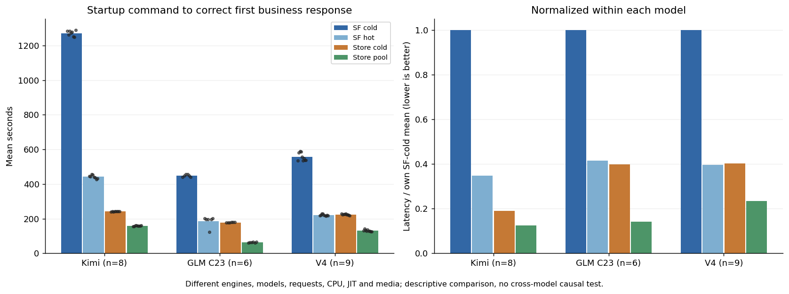

# SLLM 三模型实验对比

[阅读完整报告](REPORT.md) · [V4机制与状态契约](V4-MIGRATION.md) · [CPU复算](REPRODUCTION.md)

Kimi原40：38合格/2失败；GLM原40：35成功/5失败；DeepSeek-V4-Pro原40：38合格/2失败，B10已结束。

5组PNG/SVG/PDF及生命周期观测、启动时间分解两组表、原120行台账、独立版本/样本口径、准备与释放成本、缺测和原失败均保留。没有在整理阶段新增模型运行。

图用Kimi原8完整块、GLM C23原6完整块、V4同源B2–B10的9完整块。V4冻结正式分析仍另保留pair-specific n10/n9，不以本图重定义。配置不同，不作跨模型因果优劣结论。
