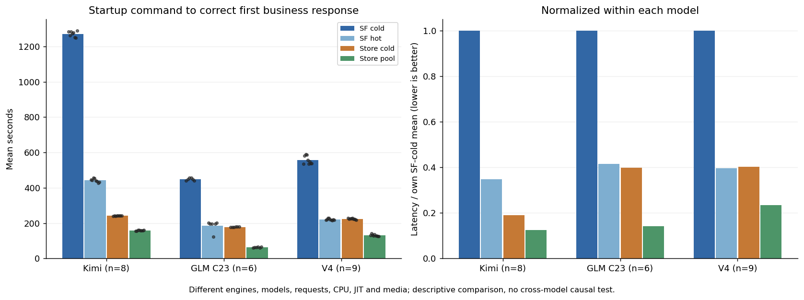
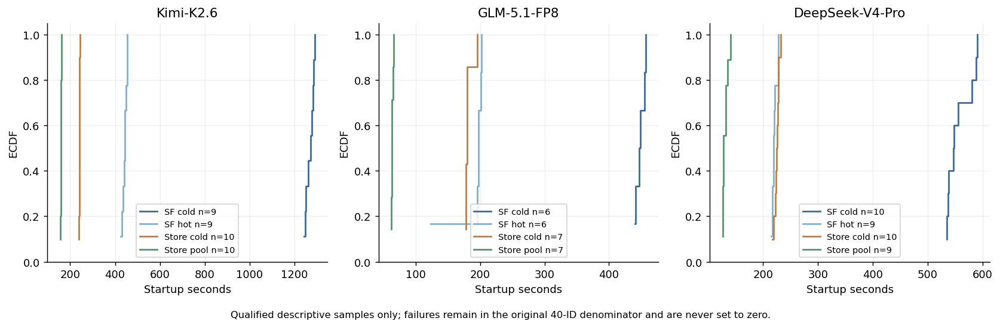
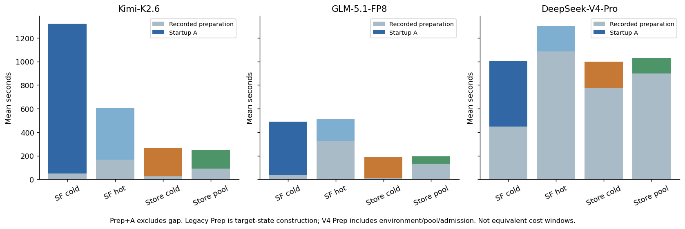
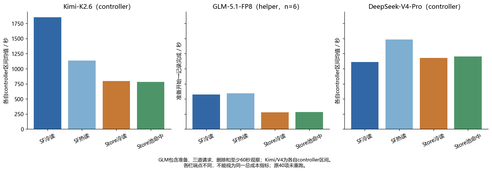
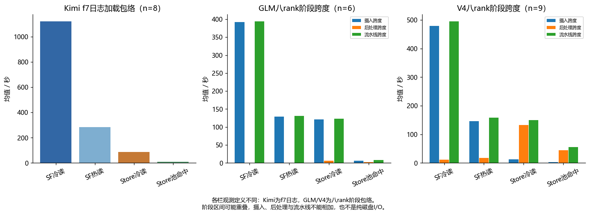
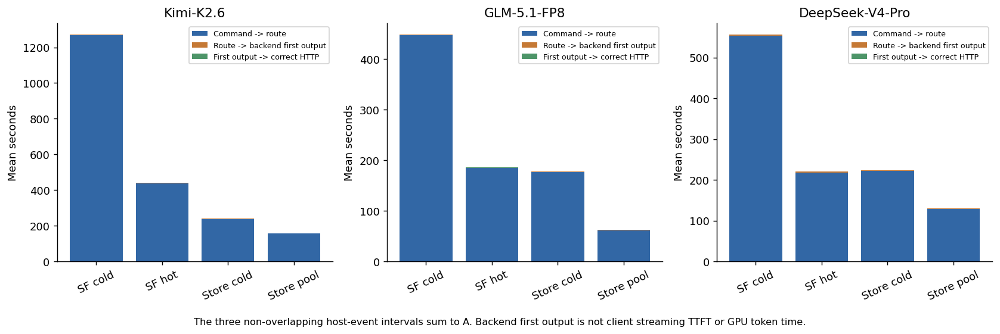
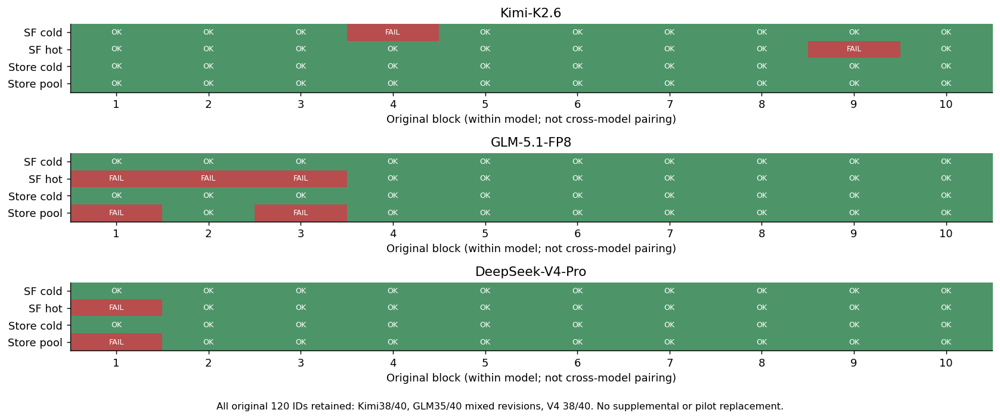

# SLLM × Kimi-K2.6 / GLM-5.1-FP8 / DeepSeek-V4-Pro 三模型对比

2026-11-08。参照[指定的 Kimi/GLM 整合版 V2](https://github.com/BoyJiang2/serverlessllm/blob/1213421633a6e63fa6afdfc960207560c7d3acf1/kimi/evidence/final-report-20261107-v2/REPORT.md)的组织方式，补入已完成 B10 的 V4 正式结果。本次整理仅做 CPU 复核、统计与绘图，没有新启动模型、转换 Store 或重跑 Kimi/GLM。

**GLM历史CPU补充**：新增读取既有监控与日志，补回资源采样、26条helper记录区间和一次历史转换容器成本；没有新增GPU运行，原40项35成功/5失败不变。数据来自已核验GLM提交[447765a](https://github.com/BoyJiang2/serverlessllm/commit/447765a98d1ed7edcd4075243c1b70e5ffd70032)及[服务器同步核验](https://github.com/BoyJiang2/serverlessllm/blob/5c9a7dba18a9d6da70a6dc61065f30b3fd418acc/glm/evidence/cost-sources/historical-supplement-sync.json)，副本与边界见[GLM历史CPU补充](inputs/glm-cpu/historical-supplement.md)。

**三个模型在各自配置下都观察到 Store 启动等待减少；计入准备、复位及释放后，收益明显收窄。不同模型、量化、引擎、CPU、JIT、介质和计时边界，不能用绝对秒数给模型或实现排名。**

## 交付与样本导航

| 项目 | Kimi-K2.6 | GLM-5.1-FP8 | DeepSeek-V4-Pro |
|---|---|---|---|
| 原始计划 / 合格 / 原失败 | 40 / 38 / 2 | 40 / 35 / 5，混合历史协议 | 40 / 38 / 2 |
| 比较图的完整块 | B1/2/3/5/6/7/8/10，n=8 | C23 B5–B10，n=6 | B2–B10，n=9，同一源 88cc71e |
| 全部有效描述样本，按四条件顺序 | 9 / 9 / 10 / 10 | C23：6 / 6 / 7 / 7 | 10 / 9 / 10 / 9 |
| 功能 / 生命周期证据 | 所有者接受既有 L1；原 NOT_L1、30 秒失败不改 | 沿用历史验收，非本轮重新运行 | 原生参考、完整 Store、八 rank 恢复、两轮 HTTP 服务及正常释放已通过 |
| 原失败 / 补跑 | b04 SF 冷准入、b09 SF 热身份错误保留；额外补跑 1 次和历史 5 次另列 | 原 5 失败不被后续协议覆盖 | Pool01 同引擎失败；SFhot01 缓存准入失败，均无替换 |

V4 的 n=9 是三模型展示用的**完整块描述性子集**，不是重订正式主分析。冻结的 V4 正式分析仍按各比较实际匹配块取 n=10 或 n=9，见后文。Kimi/GLM 主集和统计完全沿用原报告，三个模型的同名 B10 也不构成跨模型配对。原始 120 行见 [all-original120.csv](all-original120.csv)；Kimi 的额外 6 行在[原台账](inputs/legacy/all-runs-ledger.csv)单列，不进入这 120 行。

## 图 1：四条件启动至首个正确业务响应

柱为上述完整块的算术均值，点为原始观测。右图只在模型内部除以自己的 SF 冷读均值。图形形式参照原报告；指标包括服务启动和业务响应，不是论文 checkpoint-only loading。

| 条件 | Kimi n=8，秒 | GLM C23 n=6，秒 | V4 完整块 n=9，秒 |
|---|---:|---:|---:|
| SF 冷读 | 1271.466 | 448.496 | 556.222 |
| SF 热读 | 441.607 | 185.754 | 220.451 |
| Store 冷读 | 241.266 | 178.399 | 223.752 |
| Store 池命中 | 158.611 | 63.012 | 130.614 |

下面是同一展示集的**算术均值之比**；不是 V4 正式几何配对效应，也不进行新跨模型显著性检验。

| 模型 | SF 冷 / Store 冷 | SF 冷 / Store 池 | Store 冷 / Store 池 |
|---|---:|---:|---:|
| Kimi-K2.6 | 5.270× | 8.016× | 1.521× |
| GLM-5.1-FP8 | 2.514× | 7.118× | 2.831× |
| DeepSeek-V4-Pro | 2.486× | 4.259× | 1.713× |

V4 的 SF 冷读约 556 秒，Store 冷读约 224 秒，池命中约 131 秒；但其 SF 是冻结的 NFS 路径，Store 是本地 XFS。这是**加载器、缓存及介质路径的整体差异**，不能把约 2.49× 或 4.26× 全归因于 SLLM 代码。Store 池命中指 CPU 权重驻留，GPU 引擎仍为本次新建，不是暖 GPU 服务。

## 图 2：全部当前有效描述样本

Kimi 38、GLM C23 26、V4 38 个合格观测进入各自 ECDF；原失败仍留在原始 40 分母。未将失败延迟设为 0，也不以失败退出历时填入成功完成时间。

## 计时口径与准备成本

| 字段 | Kimi / GLM | V4 |
|---|---|---|
| A | HTTP /register 调用前 → 首题 17+25 完整响应解析/context 退出的 received_ns，早于金标断言 | startup_command_ns → 自然 EOS 的 2+2 正确业务响应 received_ns；原响应先保存再校验 |
| 首输出事件 | backend 第一次非空输出；不是客户端流式 TTFT | 同 backend 事件；不以完整 HTTP 响应代替 |
| 路由 | ready 实例真正发布，不是仅 Controller 注册成功 | 相同定义，严格校验 engine ready → 发布 → 首输出 → generation complete → 收到响应 |
| Prep | 目标缓存构造/准入；GLM 部分包含前一池卸载；公用环境和池初始化在外 | 从本次准备 origin 到 startup_command，包含环境、服务/池准备、注册准备及缓存准入 |
| Gap | 准备完成 → 注册命令，实测单列 | preparation_complete_ns 与 startup_command_ns 是同一边界，差为 0；不表示无开销 |
| controller elapsed | Kimi 原控制器实测范围 | origin → 正常退出、release_roles、journal release 后 candidate 落盘前；不含随后独立 review，不是总研究账单 |

三者 A 具有相近业务含义，但起点、文本、tokenizer 和终点实现并非逐字节相同。V4 输入为 30/43 token，业务自然 EOS 输出 `4`、IDs `[22,1]`，随后 fixed32 严格匹配同配置原生 gold；Kimi/GLM 为算术、cat 翻译、天空 fixed32，后者采用原报告新标准。不能把数值口径近似对齐写成同请求同实验。

| 模型 | 条件 | Prep 均值/秒 | A 均值/秒 | Prep+A/秒 | controller 均值/秒 |
|---|---|---:|---:|---:|---:|
| Kimi-K2.6 | SF 冷读 | 49.398 | 1271.466 | 1320.864 | 1851.676 |
| Kimi-K2.6 | SF 热读 | 167.311 | 441.607 | 608.918 | 1138.029 |
| Kimi-K2.6 | Store 冷读 | 26.410 | 241.266 | 267.676 | 796.615 |
| Kimi-K2.6 | Store 池命中 | 91.486 | 158.611 | 250.097 | 781.075 |
| GLM-5.1-FP8 | SF 冷读 | 39.818 | 448.496 | 488.315 | 缺测 |
| GLM-5.1-FP8 | SF 热读 | 323.430 | 185.754 | 509.184 | 缺测 |
| GLM-5.1-FP8 | Store 冷读 | 11.864 | 178.399 | 190.263 | 缺测 |
| GLM-5.1-FP8 | Store 池命中 | 132.754 | 63.012 | 195.766 | 缺测 |
| DeepSeek-V4-Pro | SF 冷读 | 446.443 | 556.222 | 1002.666 | 1112.746 |
| DeepSeek-V4-Pro | SF 热读 | 1084.352 | 220.451 | 1304.803 | 1483.558 |
| DeepSeek-V4-Pro | Store 冷读 | 776.518 | 223.752 | 1000.270 | 1177.261 |
| DeepSeek-V4-Pro | Store 池命中 | 898.217 | 130.614 | 1028.831 | 1203.268 |

图 3 相加的是不重叠的 Prep 和 A，排除 Gap；**不同模型的 Prep 语义不同，不能将上表相减称为纯磁盘/池加热成本**。V4 B2–B10 的池命中虽使 A 较 Store 冷减少约 93.14 秒，Prep+A 却增加约 28.56 秒；当前逐条件强制复位下，controller 均值也由约 1177 秒增至 1203 秒。没有测量持续保留池的 N>1 摊销，不能据此推回本次数。

SF 热读控制额外用 mlock 持有 864738865152 字节（约 805.35 GiB）OS 文件页；9 次 acquisition 为 215.01–784.34 秒，中位数 444.53 秒，已包含在 Prep。这是实验驻留控制，不是 Store 的 CUDA pinned pool。锁前已证 Store 1513 输入全冷，不代表 SF 的 64 权重在锁前也从统一全冷起点开始；初始 SF 驻留及前序影响未记录，不推断其准备时间变化的原因。

## 图 4：生命周期观测范围（端点不同）

Kimi 和 V4 的完整控制器均值按各自原边界展示，不强行对齐。GLM原选定小文件没有同定义完整controller数值；本次补回的是不同边界的helper区间，图4现以独立标签绘制该helper区间，不能改称同定义controller；对应数值见下表。原报告 Kimi 转换 controller 678.128942504 秒包含退出和释放；V4 原转换尝试因 1080 秒上限失败，后续独立 CPU 完整校验 197.160720331 秒通过。两者都不是统一定义的纯转换 I/O，V4 原失败没有被追认为成功。GLM本次补回历史rawexport容器启动至退出505.467441929秒，派发至八rank最后预热结束403.180093388秒。两者重叠，包含加载、导出、后处理、预热和退出；不是纯save或统一转换I/O，不能相加。容器身份及八rank事件SHA均经核验；纯保存分量仍缺测，不设为0。环境构建、历史失败、迁移人工时间不混成在线延迟。

### GLM：已恢复的helper生命周期区间（不是controller总时长）

| 条件 | C23描述n | 准备开始→记录完成均值/秒 | 完整B5–B10 n=6同区间/秒 |
|---|---:|---:|---:|
| SF冷读 | 6 | 575.095693 | 575.095693 |
| SF热读 | 6 | 594.722176 | 594.722176 |
| Store冷读 | 7 | 279.157305 | 276.402988 |
| Store池命中 | 7 | 281.920955 | 281.715133 |

每条严格计算 `(complete_ns-preparation_begin_ns)/1e9`，包括条件准备、三道请求、删除与至少60秒观察；不包含此前公共环境/池初始化，不保证包含记录完成后的落盘、进程退出及父控制器清理。描述26项与主配对24项分列；不混用7次与6次均值。逐项端点与SHA见[补充JSON](inputs/glm-cpu/historical-supplement.json)和[窗口摘要](inputs/glm-cpu/historical-monitor.json)。
共享worker/head supervisor各覆盖整批26项，实测区间分别为11204.882661/11217.540113秒；两者重叠，不相加或按ID均摊。

## 图 5：权重加载与后处理的可观测边界

Kimi f7 日志范围为 getloader 之前至 loadmodel / 可选 LoRA、drafter、aux 之后，缺 rank/PID，不能称 TP8 最大跨度或纯 ingestion。V4 的阶段 span 为八 rank 最早 begin 至最晚 end；分组恢复中 H2D 与逐专家层后处理交错，因此 ingestion、quantization 和 pipeline 的包络可能相互重叠，**不得求和或相减伪造纯固定开销**。GLM没有同定义f7包络；图5现单列已核验的八rank阶段跨度，明确标注n=6，不与Kimi f7视为同一指标。

V4 正式全集 Store 冷 ingestion 均值约 12.19 秒，后处理 span 约 133.01 秒；池命中约 2.97 秒与 44.99 秒。这些是主机函数观测包络，不能将差异解释为已证实的纯 PCIe/量化加速。池命中计时窗口内新增 native disk loads 为 0；预取和全部准备 I/O 并非 0。

### GLM既有八rank phase补充（不是f7包络）

下表使用C23完整B5–B10，各条件n=6；均为八rank最早begin至最晚end跨度的算术均值，单位秒。不相加，不作为纯I/O或独立因果贡献；图5使用明确标注的八rank阶段跨度，不补造同定义f7。

| 条件 | ingestion跨度 | quantization跨度 | 含分配weights pipeline跨度 |
|---|---:|---:|---:|
| SF冷读 | 391.670848 | 0.582500 | 393.624687 |
| SF热读 | 129.215433 | 0.275165 | 131.216366 |
| Store冷读 | 121.473016 | 6.475432 | 123.572061 |
| Store池命中 | 5.825793 | 2.055968 | 7.889165 |

26条原始阶段跨度及起止窗口保存在[event-intervals.csv](inputs/glm-cpu/event-intervals.csv)，主表选B5–B10；旧复算已核对每条八rank覆盖与起止时间，此处只做CPU求均值。

## 图 6：可相加的启动事件分解

命令至 route、route 至 backend 首输出、首输出至正确 HTTP 三段逐条非负、相加严格等于 A。大段不包含嵌套 phase 的重复累计。最后一段不是纯 decode，首输出事件不是 GPU 第一次 sampling。所有小段原数组保存在 [comparison.json](derived/comparison.json)，无需靠图估读。

Kimi fixed32 的整个 HTTP 均值约 3.61–3.69 秒；GLM 无独立持久化 begin/end，保留缺测。V4 本批未将固定长度请求的独立 HTTP 时长导出为跨模型比较指标；不从总历时倒推，不把 token 一致当吞吐性能。

## 图 7：原 120 个编号和失败

绿色只表示各自原协议下合格，不构成统一可靠性因果比较。GLM 图保留全 40 的混合 v6/v7/v8/C19/C21/C23 等来源，主推断只取 C23；Kimi runtime v8/v9 差别保留。V4 原始两失败如下：

| 编号 | 原终态和原因 | 处理 |
|---|---|---|
| v4n40_store_pool_hit_01 | 业务/fixed32 正确且退出正常，但 keep_alive=0 导致两请求间重建引擎，同引擎契约不通过 | 原编号仍失败；后续 3600 秒 keep_alive 修订及独立 pilot 不替换该行 |
| v4n40_safetensors_disk_hot_01 | 启动前 SF 全热缓存准入失败，199638095/211117887 页驻留；未加载模型 | 原失败和精确容器清理/82 秒观察保留；清理不是正常生命周期 PASS |

40 个 V4 编号均终结，38 次合格、2 次原失败，没有补跑或新增 B11。B10 的四条件均通过业务/fixed32、同引擎、正常退出及 head/worker 最终至少 60 秒释放。所有开发、转换、native-reference 和 pilot 失败单独保留，不把“正式 2 失败”说成整项研究只失败两次。

## V4 冻结正式统计：保留原规则

此表使用正式全集，**与图 1 的 V4 9 块均值不同**。

| 条件 | 合格/原分母 | A 均值/秒 | 中位数/秒 | 探索性 P90/秒 |
|---|---:|---:|---:|---:|
| SF 冷读 | 10/10 | 555.247 | 546.952 | 587.715 |
| SF 热读 | 9/10 | 220.451 | 219.334 | 228.008 |
| Store 冷读 | 10/10 | 224.593 | 224.950 | 228.173 |
| Store 池命中 | 9/10 | 130.614 | 127.476 | 140.737 |

| baseline / target | 匹配块 n | 配对几何延迟比 | 描述性 bootstrap 95% CI | 双侧 exact p | Holm4 p |
|---|---:|---:|---|---:|---:|
| safetensors_disk_cold / store_disk_cold | 10 | 2.471 | [2.412, 2.535] | 0.00195312 | 0.00781250 |
| safetensors_disk_hot / store_pool_hit | 9 | 1.689 | [1.648, 1.727] | 0.00390625 | 0.01171875 |
| safetensors_disk_cold / safetensors_disk_hot | 9 | 2.522 | [2.480, 2.565] | 0.00390625 | 0.01171875 |
| store_disk_cold / store_pool_hit | 9 | 1.714 | [1.674, 1.746] | 0.00390625 | 0.01171875 |

效应为 exp(mean(log(baseline/target)))，不是均值之比。每对都要求两项正式合格；冷/冷对包含 B1 的同旧源 df6059 两条合格记录，其余 36 条合格为冻结源 88cc71e。bootstrap 为成对块重采样 10000 次、seed=20261105、线性百分位 95% 描述区间，未作多重区间校正；exact 检验在 paired log ratios 上枚举 2^n 双侧符号翻转，四个冻结比较作 Holm alpha=.05。

Kimi 仍用原 8 完整块、原四项均差检验/均值比与 seed20261024；原 A 四项 Holm=.03125。GLM 原 C23 n=6 四项的 Holm 仍为 .125/.125/.125/.5625。其检验族、统计量、配对几何和最小可达 p 均不同；不能将 p 值或区间横向排列解释为模型间效果差异。原计算产物完整附在 inputs/legacy；本轮没有改写它们。

## 软件、模型和资源对齐

| 项 | Kimi | GLM C23 | V4 |
|---|---|---|---|
| 节点 / GPU | qjhs003 / 8×H20 | qjhs003 / 8×H20 | qjhs2 / 8×H20-3e，143771 MiB/卡 |
| vLLM | 0.19.1 | 0.19.1.dev1+g43a9b1afb | 0.20.1@132765e3560659ff63ebd236203672e991b70e08 |
| Torch | 2.10.0+cu129 | 2.10.0+cu130 | 2.11.0+cu130 |
| 权重 revision | 7eb5002f6aadc958aed6a9177b7ed26bb94011bb | f396cf805182f4ca10fa675e1a99815b3ca384db | b5968e9190ef611bbf34a7229255be88a0e937c1 |
| 量化与架构范围 | compressed-tensors packed INT4，部分模块排除；文本路径 | FP8，DSA/MoE；inactive MTP 不在部署 Store | 原生 MXFP4 专家、FP8 非专家、UE8M0、mHC FP32；MLA/DSA |
| SF / Store payload 字节 | 595177988208 / 617000763392 | 756177645648 / 762037043200 | 864721029744 / 877729513472 |
| SF / Store 介质 | 本地 XFS NVMe / 本地 XFS NVMe | 本地 XFS NVMe / 本地 XFS NVMe | 原冻结 NFS4.2-RDMA / 本地 XFS |
| TP / PP / DP / EP | TP8；其他未知不推默认 | TP8；其他未知不推默认 | 8 / 1 / 1 / off |
| context / seq / batch / eager / prefix | 2048 / 1 / 2048 / on / off | 同左 | 同左 |
| GPU memory utilization | .8 | .9 | .92，KV 显式 fp8，FP4 indexer cache off |
| engine / request seed | engine 未显式；request20261024 | 20261024 | 20261105，mp |
| head / worker CPU quota | 8 / 32 | 4 / 32 | 4 / 4；Ray 各自登记 4 |
| head / worker memory cap | 16 / 1536 GiB | 8g / 1700g，保留原单位字符串 | 16 / 1008 GiB，总 1 TiB |
| Store pool / chunk / IO threads | 640 GiB / 64 MiB / 4 | 716 GiB / 512 MiB / 4 | Store 890937278464B / 32 MiB / 8；SF 控制池仅 32 MiB |
| 池 / JIT 生命周期 | 每条件新池；每条件空 JIT | 正式批共享池；保留 C23 disk-JIT 标签 | 每条件新池；复用已冻结 native JIT namespace，不是冷编译测试 |

Kimi/GLM 参数来自指定提交的逐来源 SHA 表；不从 cu129 字符串补出 CUDA runtime，也不将省略的 GLM top_p/top_k/min_p/n 当作已核实同值。V4 路径仍是 `/mnt/raid/models/DeepSeek-V4-Pro`；用户提出的 brick3 本地化清单和协议独立、未消费，不能混入本批 NFS 数值。权重/Store 大资产留 /data，代码/脚本/证据位于 `/home/boyjiang/sllm-v4-pro`。

## 物理资源、释放和缺测

Kimi 已选导出逐卡 NVML 采样高水位范围约 118045–118171 MiB，host/cgroup 数值峰在选定输入中缺测。V4 正式合格样本逐卡采样高水位：SF 135623–135627 MiB，Store 冷 137181–137183 MiB，Store 池 137181 MiB；这些是**非同时的采样下界**，不将八张卡各自峰值相加为实测整机峰。GLM本次已低优先级单遍流式重读服务器上1070633372字节原监控；9647条均有八卡值，GPU查询缺失0、外来GPU进程标记0，最大相邻采样间隔3.689146886秒，与当时独立审计一致。整个受监控run（含公共准备/准入及正式尝试）逐卡高水位均99293 MiB；各正式尝试窗口摘要另见下表。它们是设备级采样下界，不能当连续精确峰或相加为整机同时峰。

### GLM逐尝试资源窗口（C23全部26项）

| 条件 | n | 每卡采样高水位范围/MiB | 自有slice memory.current采样峰/GiB |
|---|---:|---:|---:|
| SF冷读 | 6 | 99291–99293 | 1437.952 |
| SF热读 | 6 | 99291–99293 | 1447.134 |
| Store冷读 | 7 | 99223–99225 | 1447.013 |
| Store池命中 | 7 | 99225–99225 | 1447.049 |

窗口为每次preparation_begin_ns→complete_ns，不是仅A。memory.current包含文件缓存，不是RSS/锁页总量；整段监控的自有slice采样峰为1553848774656字节（1447.134 GiB）。内核精确峰及全资源时间积分仍未知。原1.07 GB监控留服务器，报告只附约百KB摘要；同一大文件没有下载或模型payload读取。

V4 cgroup memory.current 包括文件缓存，不是完整进程 RSS/全物理占用；worker 高水位随条件约 222.93–1008 GiB。共享/NFS 锁页的计费不必全部落在当前 cgroup，因此 SF-hot helper 的约 805.35 GiB VmLck 单列，不能据较小 cgroup 值宣称省内存。内核 5.15 无 memory.peak，不冒称精确峰值；pids.current 是线程加进程任务数，不是 CPU 预留。

40 次主运行监控共有 **5 个 GPU 查询 timeout 缺口**：Pool01、Storecold01、Pool02、Pool03、Storecold05 各 1 点；最长相邻有效 GPU 起点间隔约 12.12 秒。缺失点、错误原文、起止时间和每角色有效采样数在 [sampled-resources.json](inputs/v4/results/sampled-resources.json)明确保留，不补零。这些是主运行资源监控，不是最终释放 collector；38 次合格最终 head/worker 均各有 61 个有效释放样本、跨度 81.67–84.38 秒，满足冻结的释放最大间隔 5 秒规则。

38 次合格均以正常 Store/Ray/容器退出、原 PID 身份消失、无 compute apps 和 GPU 回原零基线独立验收。结束后现场八卡均 0 MiB、无计算进程。独立 native 两轮生命周期 run `native-service-20261107T093848Z` 的源为 69f67ad，轮间 62.028 秒只余已校准 Store daemon，第二轮重新注册/恢复/请求成功；不能将它写成 88cc71e 新重跑的两轮证明。

## GLM仍需新测量的缺项

CPU已补回历史容器成本、采样峰及helper区间；以下不从旧总历时倒推：fixed32独立客户端begin/end；如必须统一的f7边界；纯save/纯填池分量；N>1持续保留池的摊销；与其他模型同端点的完整逐次controller。新增运行需独立预算、守护及审阅，不重跑或替换原40项、不为显著性增加旧样本。

## 复核、来源与复现

指定报告实际从私有 GitHub **精确提交**读取，14 个文件逐项匹配原 manifest；原报告 SHA `d342bc7b5bf88d280f53d719ba9f33ff88fed8cd3ac55598bab406fd915a5989`。[reference-receipt.json](inputs/legacy/reference-receipt.json)记录来源，未触碰另一任务的原结果。

V4 完成后只读 replay 全 40 journal，使用冻结 reviewer 对 38 成功逐项重审并与原报告比较；仅 reviewer 源 hash 可以不同，资格、计时和物理释放结果必须相同。collector v1 因原 telemetry 的 `gpu=null` 在资源汇总处失败，原脚本/日志/exit1 保留；v2 显式记录缺测后退出 0。这是 CPU 分析问题，不是新增模型失败，也没有重跑模型。[collection-manifest.json](inputs/v4/results/collection-manifest.json)绑定原输入与全部导出 SHA。

原 40 全部目录、原 journal、campaign complete 和 handles 已另打包于服务器：`/home/boyjiang/sllm-v4-pro/results/nfs40-raw-evidence-20261108.tar.gz`，56908305 字节，SHA `76ef89cb2b4de1d21605b4d65f90c33bc5057a3bfe637ff058b7a368573ef99b`；108086 个成员、44 个顶层根，gzip/tar 全读检查通过。包不含权重或 Store payload。本交付附 [receipt](inputs/v4/raw-archive-receipt.json)，完整原件仍保留服务器。

本目录提供 7 组 PNG/SVG/PDF、逐行 CSV、原输入副本与 SHA、复算脚本。[V4-MIGRATION.md](V4-MIGRATION.md)单列机制映射、上游能力、最小补丁与 Store 状态/失败契约；[REPRODUCTION.md](REPRODUCTION.md)给出 CPU 复算和服务器完整重审命令。图已视检。既有 Kimi/GLM 不重新审计大监控或重读权重，既有 V4 Store 数据不重复转换/哈希。

未验证图像/视频、长上下文覆盖、并发吞吐、在线 KV 迁移、EP-on/TP16/PP、MTP/graph、在途取消或 N>1 持续驻留收益。本报告只覆盖冻结的文本、TP8、2048/seq1/eager 和两类 V4 请求。缺测与原失败保留，不用额外运行填出理想图。
