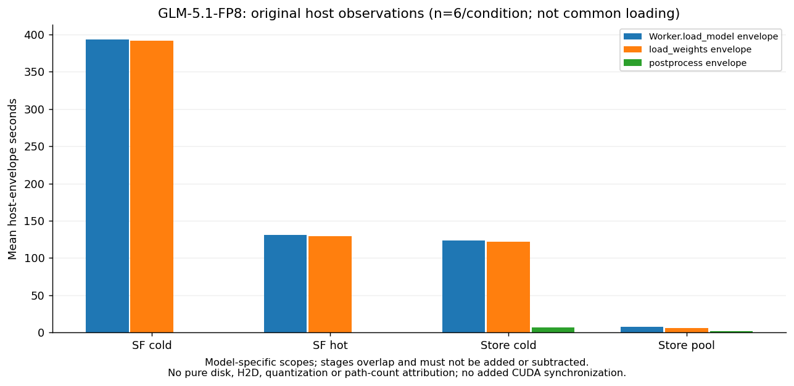
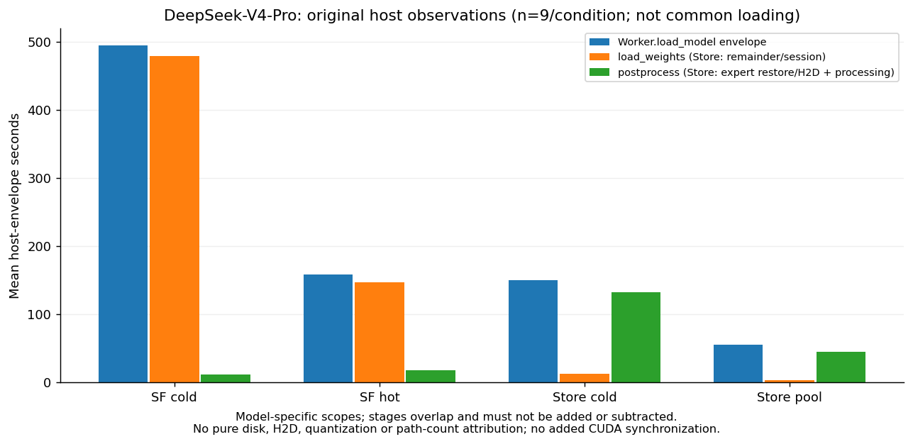

# SLLM × Kimi-K2.6 / GLM-5.1-FP8 / DeepSeek-V4-Pro 三模型对比

2026-11-09口径修订；保留2026-11-08历史结果。参照[指定的 Kimi/GLM 整合版 V2](https://github.com/BoyJiang2/serverlessllm/blob/1213421633a6e63fa6afdfc960207560c7d3acf1/kimi/evidence/final-report-20261107-v2/REPORT.md)的组织方式，补入已完成 B10 的 V4 正式结果。本次整理仅做 CPU 复核、统计与绘图，没有新启动模型、转换 Store 或重跑 Kimi/GLM。

**GLM历史CPU补充**：新增读取既有监控与日志，补回资源采样、26条helper记录区间和一次历史转换容器成本；没有新增GPU运行，原40项35成功/5失败不变。数据来自已核验GLM提交[447765a](https://github.com/BoyJiang2/serverlessllm/commit/447765a98d1ed7edcd4075243c1b70e5ffd70032)及[服务器同步核验](https://github.com/BoyJiang2/serverlessllm/blob/5c9a7dba18a9d6da70a6dc61065f30b3fd418acc/glm/evidence/cost-sources/historical-supplement-sync.json)，副本与边界见[GLM历史CPU补充](inputs/glm-cpu/historical-supplement.md)。

**三个模型在各自配置下均观察到Store的A较小；A不是纯加载。Prep和Controller边界不同，不作跨模型总成本排名。严格共同完整加载指标仍缺测，不能按同名phase填入。**

本轮以[97f0359历史基线](https://github.com/BoyJiang2/serverlessllm/blob/97f0359ef000e5111ac165ade4efb2a5e837a33f/comparison/evidence/three-model-final-20261108/REPORT.md)和后续2e1252d已撤混合图修订为起点，复用Kimi新补采、GLM最新历史边界/Controller审计及V4原阶段事件，仅CPU重算；未转换权重、未启动模型、未干预在途任务。详见[指标口径对照](METRIC-CROSSWALK.md)、[逐文件证据/SHA索引](EVIDENCE-INDEX.json)、[仍需补采的最小执行单](FOLLOWUP.md)。

## 交付与样本导航

| 项目 | Kimi-K2.6 | GLM-5.1-FP8 | DeepSeek-V4-Pro |
|---|---|---|---|
| 原始计划 / 合格 / 原失败 | 40 / 38 / 2 | 40 / 35 / 5，混合历史协议 | 40 / 38 / 2 |
| 比较图的完整块 | B1/2/3/5/6/7/8/10，n=8 | C23 B5–B10，n=6 | B2–B10，n=9，同一源 88cc71e |
| 全部有效描述样本，按四条件顺序 | 9 / 9 / 10 / 10 | C23：6 / 6 / 7 / 7 | 10 / 9 / 10 / 9 |
| 功能 / 生命周期证据 | 所有者接受既有 L1；原 NOT_L1、30 秒失败不改 | 沿用历史验收，非本轮重新运行 | 原生参考、完整 Store、八 rank 恢复、两轮 HTTP 服务及正常释放已通过 |
| 原失败 / 补跑 | b04 SF 冷准入、b09 SF 热身份错误保留；额外补跑 1 次和历史 5 次另列 | 原 5 失败不被后续协议覆盖 | Pool01 同引擎失败；SFhot01 缓存准入失败，均无替换 |

V4 的 n=9 是三模型展示用的**完整块描述性子集**，不是重订正式主分析。冻结的 V4 正式分析仍按各比较实际匹配块取 n=10 或 n=9，见后文。Kimi/GLM 主集和统计完全沿用原报告，三个模型的同名 B10 也不构成跨模型配对。原始 120 行见 [all-original120.csv](all-original120.csv)；Kimi 的额外 6 行在[原台账](inputs/legacy/all-runs-ledger.csv)单列，不进入这 120 行。

## 图 1：四条件启动至首个正确业务响应

柱为上述完整块的算术均值，点为原始观测。右图只在模型内部除以自己的 SF 冷读均值。图形形式参照原报告；指标包括服务启动和业务响应，不是论文 checkpoint-only loading。

| 条件 | Kimi n=8，秒 | GLM C23 n=6，秒 | V4 完整块 n=9，秒 |
|---|---:|---:|---:|
| SF 冷读 | 1271.466 | 448.496 | 556.222 |
| SF 热读 | 441.607 | 185.754 | 220.451 |
| Store 冷读 | 241.266 | 178.399 | 223.752 |
| Store 池命中 | 158.611 | 63.012 | 130.614 |

下面是同一展示集的**算术均值之比**；不是 V4 正式几何配对效应，也不进行新跨模型显著性检验。

| 模型 | SF 冷 / Store 冷 | SF 冷 / Store 池 | Store 冷 / Store 池 |
|---|---:|---:|---:|
| Kimi-K2.6 | 5.270× | 8.016× | 1.521× |
| GLM-5.1-FP8 | 2.514× | 7.118× | 2.831× |
| DeepSeek-V4-Pro | 2.486× | 4.259× | 1.713× |

V4 的 SF 冷读约 556 秒，Store 冷读约 224 秒，池命中约 131 秒；但其 SF 是冻结的 NFS 路径，Store 是本地 XFS。这是**加载器、缓存及介质路径的整体差异**，不能把约 2.49× 或 4.26× 全归因于 SLLM 代码。Store 池命中指 CPU 权重驻留，GPU 引擎仍为本次新建，不是暖 GPU 服务。

## 图 2：全部当前有效描述样本

Kimi 38、GLM C23 26、V4 38 个合格观测进入各自 ECDF；原失败仍留在原始 40 分母。未将失败延迟设为 0，也不以失败退出历时填入成功完成时间。

## 计时口径与准备成本

A统一为“激活/注册→首个正确业务完整响应”的用户可见定义；具体接点与编码实现仍分模型保留：Kimi为自己tokenizer/template冻结IDs、GLM为自己的冻结input_tokens，首题17+25；V4为自己revision/tokenizer及messages路径的2+2自然EOS（业务/固定32输入30/43token）。Kimi/GLM采样、模板和收到响应的代码实现不完全相同，不能称同请求实验。后端首输出不是客户端流式TTFT；所有主机计时都不等于CUDA设备完成时间，本轮未补加CUDA同步。

**原跨模型Prep+A堆叠图已撤下。** 下表按各自可观测范围列项；null不填零。“环境/建池”是Kimi原Prep之外的独立区间，不与原Prep拼成完整账单。GLM共享栈成本不按trial均摊；V4纯分量缺失时只报原口径合计。权重注册纯时长、目标cache与准入各自纯时长在这三模型主集都不能独立给出，均保留null。

| 模型 | 条件 | n | 环境独立区间/s | 池初始化/s | 目标构造＋准入原合计/s | 原Prep合计/s |
|---|---|---:|---:|---:|---:|---:|
| Kimi-K2.6 | SF冷 | 8 | 33.227 | 229.410 | 49.398 | 49.398 |
| Kimi-K2.6 | SF热 | 8 | 32.565 | 229.192 | 167.311 | 167.311 |
| Kimi-K2.6 | Store冷 | 8 | 32.849 | 229.289 | 26.410 | 26.410 |
| Kimi-K2.6 | Store池 | 8 | 34.107 | 229.731 | 91.486 | 91.486 |
| GLM-5.1-FP8 | SF冷 | 6 | null | null | 39.818 | 39.818 |
| GLM-5.1-FP8 | SF热 | 6 | null | null | 323.430 | 323.430 |
| GLM-5.1-FP8 | Store冷 | 6 | null | null | 11.864 | 11.864 |
| GLM-5.1-FP8 | Store池 | 6 | null | null | 132.754 | 132.754 |
| DeepSeek-V4-Pro | SF冷 | 9 | null | null | null | 446.443 |
| DeepSeek-V4-Pro | SF热 | 9 | null | null | null | 1084.352 |
| DeepSeek-V4-Pro | Store冷 | 9 | null | null | null | 776.518 |
| DeepSeek-V4-Pro | Store池 | 9 | null | null | null | 898.217 |

[逐ID分项与缺测范围](derived/preparation_components.csv)。这些分量有不同纳入范围，禁止跨模型堆叠、相减称为纯磁盘/池加热成本，或据此排名总成本。

V4另可从已有时间戳严格拆出以下**连续里程碑**；不是纯建池、注册、I/O或准入时长。三段逐attempt相加等于原Prep，未估算拆分。

| 条件 | n | origin→栈/池配置检查完成/s | →cache控制完成/s | →startup command/s |
|---|---:|---:|---:|---:|
| SF冷 | 9 | 31.007 | 410.645 | 4.791 |
| SF热 | 9 | 31.157 | 1048.953 | 4.242 |
| Store冷 | 9 | 391.122 | 381.333 | 4.063 |
| Store池 | 9 | 387.026 | 504.072 | 7.120 |

[V4逐次里程碑及范围](derived/v4_preparation_milestones.csv)。注册验证可能与cache操作同处中段，不能将该段改称纯注册/传输；最后一段含后续检查和调度。没有以均值差估算任何缺失纯分量。

SF 热读控制额外用 mlock 持有 864738865152 字节（约 805.35 GiB）OS 文件页；9 次 acquisition 为 215.01–784.34 秒，中位数 444.53 秒，已包含在 Prep。这是实验驻留控制，不是 Store 的 CUDA pinned pool。锁前已证 Store 1513 输入全冷，不代表 SF 的 64 权重在锁前也从统一全冷起点开始；初始 SF 驻留及前序影响未记录，不推断其准备时间变化的原因。

## 表 4：生命周期边界与分模型观测（撤下原混合柱图）

原图4将不同起止范围并列画柱，容易造成GLM全生命周期更短的误读，现撤下该比较图。数据原值保留，分模型列示如下。

**尚未形成统一边界的三模型生命周期总成本数据。以下仅分模型记录既有观测，不作横向总成本排名或比值。**

**Kimi-K2.6**：systemd outercontroller激活→成功结果字典中elapsed求值；包含环境/池、请求验证、正常关闭和释放≥60秒、checkfiles/network删除；不含随后结果写入/finally/journal及进程退出。

| 条件 | n | 该模型原区间均值/秒 |
|---|---:|---:|
| SF冷读 | 8 | 1851.676328 |
| SF热读 | 8 | 1138.029032 |
| Store冷读 | 8 | 796.615172 |
| Store池命中 | 8 | 781.075201 |

**GLM-5.1-FP8**：preparation_begin_ns→complete_ns；排除公共环境/建池，不保证覆盖之后退出和父控制器清理。

| 条件 | n | 该模型原区间均值/秒 |
|---|---:|---:|
| SF冷读 | 6 | 575.095693 |
| SF热读 | 6 | 594.722176 |
| Store冷读 | 6 | 276.402988 |
| Store池命中 | 6 | 281.715133 |

**DeepSeek-V4-Pro**：宿主准备origin→正常退出、release_roles和journal release后、candidate字典中elapsed求值；包含环境/池、验证、删除后及最终释放观察，不含随后candidate写入、进程退出和独立review。

| 条件 | n | 该模型原区间均值/秒 |
|---|---:|---:|
| SF冷读 | 9 | 1112.745841 |
| SF热读 | 9 | 1483.558194 |
| Store冷读 | 9 | 1177.261220 |
| Store池命中 | 9 | 1203.268119 |

[下载含边界说明的完整精度CSV](derived/table4_lifecycle_observations.csv)。原图文件仅留历史归档，不再在正文展示。

Kimi 和 V4 的完整控制器均值按各自原边界展示，不强行对齐。GLM原选定小文件没有同定义完整controller数值；本次补回的是不同边界的helper区间，表4仅独立记录该helper区间，不再与controller区间并列画柱，不能改称同定义controller；对应数值见下表。原报告 Kimi 转换 controller 678.128942504 秒包含退出和释放；V4 原转换尝试因 1080 秒上限失败，后续独立 CPU 完整校验 197.160720331 秒通过。两者都不是统一定义的纯转换 I/O，V4 原失败没有被追认为成功。GLM本次补回历史rawexport容器启动至退出505.467441929秒，派发至八rank最后预热结束403.180093388秒。两者重叠，包含加载、导出、后处理、预热和退出；不是纯save或统一转换I/O，不能相加。容器身份及八rank事件SHA均经核验；纯保存分量仍缺测，不设为0。环境构建、历史失败、迁移人工时间不混成在线延迟。

### GLM：已恢复的helper生命周期区间（不是controller总时长）

| 条件 | C23描述n | 准备开始→记录完成均值/秒 | 完整B5–B10 n=6同区间/秒 |
|---|---:|---:|---:|
| SF冷读 | 6 | 575.095693 | 575.095693 |
| SF热读 | 6 | 594.722176 | 594.722176 |
| Store冷读 | 7 | 279.157305 | 276.402988 |
| Store池命中 | 7 | 281.920955 | 281.715133 |

每条严格计算 `(complete_ns-preparation_begin_ns)/1e9`，包括条件准备、三道请求、删除与至少60秒观察；不包含此前公共环境/池初始化，不保证包含记录完成后的落盘、进程退出及父控制器清理。描述26项与主配对24项分列；不混用7次与6次均值。逐项端点与SHA见[补充JSON](inputs/glm-cpu/historical-supplement.json)和[窗口摘要](inputs/glm-cpu/historical-monitor.json)。
共享worker/head supervisor各覆盖整批26项，实测区间分别为11204.882661/11217.540113秒；两者重叠，不相加或按ID均摊。

## 表5：完整加载共同边界与模型内阶段观测

共同定义为**八rank在fresh构造/storage分配前进入完整model_loader.load_model调用→其必要恢复/后处理正常返回后**的最早begin至最晚end。另报每rank时长和最大值。历史Kimi f7、GLM/V4外层Worker.load_model都不能只改字段名就当作该共同指标，故当前不画跨模型完整加载主柱图。

| 历史主展示集 | 各条件原n | 严格共同完整加载有效n | 均值/中位数 |
|---|---:|---:|---|
| Kimi | 8 | 0 | null |
| GLM C23 | 6 | 0 | null |
| V4同源完整块 | 9 | 0 | null |

Kimi历史单条f7均值仍为1121.367/284.511/87.859/9.998秒（精确值以原输入为准），仅是无完整rank身份/绝对端点的局部日志观测，不再替代主图；其起止含loader工厂及可选runner工作。GLM192个历史rank端点可复算，但缺逐rank startticks/直接boot以及实际GPUModelRunner映射/可选分支闭合；最新边界审计仍为C。V4虽有完整rank进程身份，但原hook位于Worker.load_model，外层还包含runner收尾，不能代替缺失的内层完整loader调用端点。具体源码/行号、有效n和原件路径见[口径表](METRIC-CROSSWALK.md)。

### Kimi新补采：独立小批，未形成完整四条件块

| 新cohort/介质 | 条件 | 八rank观测 | 完整loader主机包络/s | 最大单rank/s | 资格 |
|---|---|---:|---:|---:|---|
| qjhs003_supplement_v1 | SF热 | 8 | 285.231648676 | 285.202741492 | 单条件合格n=1 |
| qjhs003_supplement_v1 | Store冷 | 8 | 95.465140200 | 95.342349852 | 失败观测n=1 |
| qjhs003_supplement_v1 | SF冷 | 0 | null | null | 未开始 |
| qjhs003_supplement_v1 | Store池 | 0 | null | null | 未开始 |
| qjhs000_formal64_supplement | SF冷 | 0 | null | null | 未开始 |
| qjhs000_formal64_supplement | SF热 | 8 | 302.153546032 | 302.043261813 | 单条件合格n=1 |
| qjhs000_formal64_supplement | Store冷 | 8 | 31.413848904 | 31.076709263 | 失败观测n=1 |
| qjhs000_formal64_supplement | Store池 | 0 | null | null | 未开始 |

两个新cohort的完整块n均为0；不得把各自SF热单点或失败Store冷拼成四条件完整块，也不回填历史n=8。qjhs003小批为本地NVMe；最新qjhs000 formal64为XFS RAID、SF池64MiB，与历史配置独立。其间另一个qjhs000候选在SF热cache准入阶段即失败，无加载端点，不补图。新补采没有摄入/后处理分项端点，分项仍null。

### GLM：原Worker阶段，各条件n=6，不能升级为统一完整加载

GLM的ingestion、postprocess及外层Worker阶段仅作本模型观测。其图不与V4同名阶段并排做因果比较。

### V4：原Worker与分组恢复阶段，各条件n=9

纠正旧字段解释：**Store的weight_ingestion只围V4GroupedStoreLoader.load_weights/session.begin，包括remainder恢复及hook安装，不能代表全部专家权重传输。quantization_postprocess围process_weights_after_loading，包含逐专家组恢复、H2D和权重处理，不是纯量化计算。** SF也保留其各自load_weights/后处理接点；不能从字段名推导与GLM功能等价。包络可重叠，禁止相加或均值相减称为纯磁盘、H2D、量化或路径开销；未添加CUDA同步。

下表只列两模型各自外层Worker观测，**不是共同完整加载主表，不作排名**。完整逐rank时长、每attempt最大值和摄入/后处理同类数据均在CSV。

| 模型 | 条件 | 观测n | Worker八rank包络均值/s | 每attempt最大单rank时长的均值/s |
|---|---|---:|---:|---:|
| GLM-5.1-FP8 | SF冷 | 6 | 393.624687 | 393.600161 |
| GLM-5.1-FP8 | SF热 | 6 | 131.216366 | 131.118515 |
| GLM-5.1-FP8 | Store冷 | 6 | 123.572061 | 123.522684 |
| GLM-5.1-FP8 | Store池 | 6 | 7.889165 | 7.796522 |
| DeepSeek-V4-Pro | SF冷 | 9 | 494.732700 | 494.643649 |
| DeepSeek-V4-Pro | SF热 | 9 | 158.196931 | 157.992841 |
| DeepSeek-V4-Pro | Store冷 | 9 | 150.256008 | 150.157247 |
| DeepSeek-V4-Pro | Store池 | 9 | 55.670591 | 55.551708 |

[逐rank端点/时长（含显式缺测槽位）](derived/rank_durations.csv) · [逐attempt包络及最大值](derived/phase_attempts.csv) · [各自阶段汇总](derived/phase_summary.csv) · [Kimi补采独立台账](derived/kimi_supplements.csv)。历史原始阶段字段及数值未改写；V4正式全集38项也逐次重算并与原metrics相等，展示表仍只取同源B2–B10。

## 表 6：启动时间的互斥分解（替代原图6）

后两段约0.2–2秒，相比几十至上千秒的命令至路由阶段，在原堆叠图中难以辨认，改用数值表。单位为秒，均为固定完整块的算术均值，保留六位小数；显示舍入可能使合计末位略有差异，校验使用未舍入值。

| 模型 | 条件 | n | 命令→路由发布 | 路由→后端首输出 | 首输出→正确HTTP响应 | 合计 A |
|---|---|---:|---:|---:|---:|---:|
| Kimi-K2.6 | SF冷读 | 8 | 1268.995380 | 1.878032 | 0.592470 | 1271.465883 |
| Kimi-K2.6 | SF热读 | 8 | 439.222533 | 1.794220 | 0.590645 | 441.607398 |
| Kimi-K2.6 | Store冷读 | 8 | 238.835447 | 1.849554 | 0.581399 | 241.266401 |
| Kimi-K2.6 | Store池命中 | 8 | 156.197765 | 1.836714 | 0.576331 | 158.610811 |
| GLM-5.1-FP8 | SF冷读 | 6 | 447.091141 | 1.182353 | 0.222865 | 448.496359 |
| GLM-5.1-FP8 | SF热读 | 6 | 184.542528 | 0.982716 | 0.229068 | 185.754312 |
| GLM-5.1-FP8 | Store冷读 | 6 | 177.169690 | 0.990030 | 0.239581 | 178.399301 |
| GLM-5.1-FP8 | Store池命中 | 6 | 61.868151 | 0.919945 | 0.224150 | 63.012245 |
| DeepSeek-V4-Pro | SF冷读 | 9 | 554.129352 | 1.661932 | 0.431205 | 556.222489 |
| DeepSeek-V4-Pro | SF热读 | 9 | 218.226117 | 1.752789 | 0.472379 | 220.451285 |
| DeepSeek-V4-Pro | Store冷读 | 9 | 221.461781 | 1.853954 | 0.436065 | 223.751799 |
| DeepSeek-V4-Pro | Store池命中 | 9 | 128.225884 | 1.967195 | 0.420744 | 130.613822 |

[下载完整精度CSV](derived/table6_exclusive.csv)；Kimi n=8、GLM C23 n=6、V4同源B2–B10 n=9，原样本集及正式统计不变。原图文件仅保留历史归档，不再用于主文展示。

命令至 route、route 至 backend 首输出、首输出至正确 HTTP 三段逐条非负、相加严格等于 A。大段不包含嵌套 phase 的重复累计。最后一段不是纯 decode，首输出事件不是 GPU 第一次 sampling。所有小段原数组保存在 [comparison.json](derived/comparison.json)，无需靠图估读。

Kimi fixed32 的整个 HTTP 均值约 3.61–3.69 秒；GLM 无独立持久化 begin/end，保留缺测。V4 本批未将固定长度请求的独立 HTTP 时长导出为跨模型比较指标；不从总历时倒推，不把 token 一致当吞吐性能。

## 图 7：原 120 个编号和失败

绿色只表示各自原协议下合格，不构成统一可靠性因果比较。GLM 图保留全 40 的混合 v6/v7/v8/C19/C21/C23 等来源，主推断只取 C23；Kimi runtime v8/v9 差别保留。V4 原始两失败如下：

| 编号 | 原终态和原因 | 处理 |
|---|---|---|
| v4n40_store_pool_hit_01 | 业务/fixed32 正确且退出正常，但 keep_alive=0 导致两请求间重建引擎，同引擎契约不通过 | 原编号仍失败；后续 3600 秒 keep_alive 修订及独立 pilot 不替换该行 |
| v4n40_safetensors_disk_hot_01 | 启动前 SF 全热缓存准入失败，199638095/211117887 页驻留；未加载模型 | 原失败和精确容器清理/82 秒观察保留；清理不是正常生命周期 PASS |

40 个 V4 编号均终结，38 次合格、2 次原失败，没有补跑或新增 B11。B10 的四条件均通过业务/fixed32、同引擎、正常退出及 head/worker 最终至少 60 秒释放。所有开发、转换、native-reference 和 pilot 失败单独保留，不把“正式 2 失败”说成整项研究只失败两次。

## V4 冻结正式统计：保留原规则

此表使用正式全集，**与图 1 的 V4 9 块均值不同**。

| 条件 | 合格/原分母 | A 均值/秒 | 中位数/秒 | 探索性 P90/秒 |
|---|---:|---:|---:|---:|
| SF 冷读 | 10/10 | 555.247 | 546.952 | 587.715 |
| SF 热读 | 9/10 | 220.451 | 219.334 | 228.008 |
| Store 冷读 | 10/10 | 224.593 | 224.950 | 228.173 |
| Store 池命中 | 9/10 | 130.614 | 127.476 | 140.737 |

| baseline / target | 匹配块 n | 配对几何延迟比 | 描述性 bootstrap 95% CI | 双侧 exact p | Holm4 p |
|---|---:|---:|---|---:|---:|
| safetensors_disk_cold / store_disk_cold | 10 | 2.471 | [2.412, 2.535] | 0.00195312 | 0.00781250 |
| safetensors_disk_hot / store_pool_hit | 9 | 1.689 | [1.648, 1.727] | 0.00390625 | 0.01171875 |
| safetensors_disk_cold / safetensors_disk_hot | 9 | 2.522 | [2.480, 2.565] | 0.00390625 | 0.01171875 |
| store_disk_cold / store_pool_hit | 9 | 1.714 | [1.674, 1.746] | 0.00390625 | 0.01171875 |

效应为 exp(mean(log(baseline/target)))，不是均值之比。每对都要求两项正式合格；冷/冷对包含 B1 的同旧源 df6059 两条合格记录，其余 36 条合格为冻结源 88cc71e。bootstrap 为成对块重采样 10000 次、seed=20261105、线性百分位 95% 描述区间，未作多重区间校正；exact 检验在 paired log ratios 上枚举 2^n 双侧符号翻转，四个冻结比较作 Holm alpha=.05。

Kimi 仍用原 8 完整块、原四项均差检验/均值比与 seed20261024；原 A 四项 Holm=.03125。GLM 原 C23 n=6 四项的 Holm 仍为 .125/.125/.125/.5625。其检验族、统计量、配对几何和最小可达 p 均不同；不能将 p 值或区间横向排列解释为模型间效果差异。原计算产物完整附在 inputs/legacy；本轮没有改写它们。

## 独立共享Store随机切换：不进入历史主集

该批在qjhs003使用同一1TiB Store、32MiB chunk和8卡，固定Kimi→GLM→V4→Kimi→Kimi闭环后，执行六个方向各2次的冻结平衡随机序列，共12次切换（首模型初始化不计）。其时间是**直接VllmBackend激活marker→宿主解析正确响应**，不是上述HTTP注册A；不得并入原120项、主块或加载主图。46条请求按各自冻结协议通过；44条严格文本/token相同，两条固定序列Kimi fixed32仅原length_only规则通过，随机轮全部严格一致。

### 缓存管理粒度

- Store路径：Kimi/GLM各8条rank路径；V4为8×(61专家层组+1其余权重组)=496条路径。496不是实验次数，也不是文件总数。
- 路径内tensor.data_*：存储payload数据文件，一个路径可以含多个文件。
- chunk：内存池分配/归还单位；本随机批32MiB，历史Kimi/GLM/V4分别64/512/32MiB，不混用块数比较字节容量。

分组粒度可能影响淘汰、重读和调用开销，但现有跨模型数据没有量化独立贡献，不能将耗时差异主要归因于路径数量。下表优先展示有效命中字节、重读字节及块复用，路径数仅作核查；GB为十进制。

| 次序 | 切换 | 命中payload/GB | Store重读/GB | 申请块 | 归还块 | 实际命中/缺失路径（辅助） |
|---|---|---:|---:|---:|---:|---:|
| 1 | kimi→v4 | 0.000 | 877.730 | 26552 | 28125 | 0/496 |
| 2 | v4→glm | 0.000 | 762.037 | 22712 | 21103 | 0/8 |
| 3 | glm→kimi | 0.000 | 617.001 | 18392 | 18564 | 0/8 |
| 4 | kimi→glm | 285.764 | 476.273 | 14195 | 14874 | 3/5 |
| 5 | glm→v4 | 0.000 | 877.730 | 26552 | 26230 | 0/496 |
| 6 | v4→glm | 0.000 | 762.037 | 22712 | 22183 | 0/8 |
| 7 | glm→kimi | 0.000 | 617.001 | 18392 | 18564 | 0/8 |
| 8 | kimi→v4 | 0.000 | 877.730 | 26552 | 27989 | 0/496 |
| 9 | v4→kimi | 77.125 | 539.876 | 16093 | 14520 | 1/7 |
| 10 | kimi→glm | 0.000 | 762.037 | 22712 | 23527 | 0/8 |
| 11 | glm→v4 | 0.000 | 877.730 | 26552 | 26230 | 0/496 |
| 12 | v4→kimi | 0.000 | 617.001 | 18392 | 17899 | 0/8 |

12次中2次部分命中、10次全未命中。首个Kimi→V4激活前虽驻留281条目标路径，仍在自身lookup前全部被驱逐，最终全未命中；不能以初驻留路径数当实际命中率。文件重读是Store逻辑文件读取，不等于块设备物理读。命中/重读/块数没有被换算成纯耗时。

[逐次数据/时间边界](derived/random_switches.csv) · [六方向×实际缓存状态，小样本中位数/范围及字节/块汇总](derived/random_direction_cache_summary.csv) · [原验收/协议/原件SHA索引](inputs/harmonized/random/qualification.json)。原始证据根qjhs003:/home/boyjiang/sllm-v4-pro/cache-competition-20261109/cache-sequence-directed-v1；其独立原生回放和最终74.904秒八卡释放已完成，本轮不重复GPU运行。

## 软件、模型和资源对齐

| 项 | Kimi | GLM C23 | V4 |
|---|---|---|---|
| 节点 / GPU | qjhs003 / 8×H20 | qjhs003 / 8×H20 | qjhs2 / 8×H20-3e，143771 MiB/卡 |
| vLLM | 0.19.1 | 0.19.1.dev1+g43a9b1afb | 0.20.1@132765e3560659ff63ebd236203672e991b70e08 |
| Torch | 2.10.0+cu129 | 2.10.0+cu130 | 2.11.0+cu130 |
| 权重 revision | 7eb5002f6aadc958aed6a9177b7ed26bb94011bb | f396cf805182f4ca10fa675e1a99815b3ca384db | b5968e9190ef611bbf34a7229255be88a0e937c1 |
| 量化与架构范围 | compressed-tensors packed INT4，部分模块排除；文本路径 | FP8，DSA/MoE；inactive MTP 不在部署 Store | 原生 MXFP4 专家、FP8 非专家、UE8M0、mHC FP32；MLA/DSA |
| SF / Store payload 字节 | 595177988208 / 617000763392 | 756177645648 / 762037043200 | 864721029744 / 877729513472 |
| SF / Store 介质 | 本地 XFS NVMe / 本地 XFS NVMe | 本地 XFS NVMe / 本地 XFS NVMe | 原冻结 NFS4.2-RDMA / 本地 XFS |
| TP / PP / DP / EP | TP8；其他未知不推默认 | TP8；其他未知不推默认 | 8 / 1 / 1 / off |
| context / seq / batch / eager / prefix | 2048 / 1 / 2048 / on / off | 同左 | 同左 |
| GPU memory utilization | .8 | .9 | .92，KV 显式 fp8，FP4 indexer cache off |
| engine / request seed | engine 未显式；request20261024 | 20261024 | 20261105，mp |
| head / worker CPU quota | 8 / 32 | 4 / 32 | 4 / 4；Ray 各自登记 4 |
| head / worker memory cap | 16 / 1536 GiB | 8g / 1700g，保留原单位字符串 | 16 / 1008 GiB，总 1 TiB |
| Store pool / chunk / IO threads | 640 GiB / 64 MiB / 4 | 716 GiB / 512 MiB / 4 | Store 890937278464B / 32 MiB / 8；SF 控制池仅 32 MiB |
| 池 / JIT 生命周期 | 每条件新池；每条件空 JIT | 正式批共享池；保留 C23 disk-JIT 标签 | 每条件新池；复用已冻结 native JIT namespace，不是冷编译测试 |

Kimi/GLM 参数来自指定提交的逐来源 SHA 表；不从 cu129 字符串补出 CUDA runtime，也不将省略的 GLM top_p/top_k/min_p/n 当作已核实同值。V4 路径仍是 `/mnt/raid/models/DeepSeek-V4-Pro`；用户提出的 brick3 本地化清单和协议独立、未消费，不能混入本批 NFS 数值。权重/Store 大资产留 /data，代码/脚本/证据位于 `/home/boyjiang/sllm-v4-pro`。

## 物理资源、释放和缺测

Kimi 已选导出逐卡 NVML 采样高水位范围约 118045–118171 MiB，host/cgroup 数值峰在选定输入中缺测。V4 正式合格样本逐卡采样高水位：SF 135623–135627 MiB，Store 冷 137181–137183 MiB，Store 池 137181 MiB；这些是**非同时的采样下界**，不将八张卡各自峰值相加为实测整机峰。GLM本次已低优先级单遍流式重读服务器上1070633372字节原监控；9647条均有八卡值，GPU查询缺失0、外来GPU进程标记0，最大相邻采样间隔3.689146886秒，与当时独立审计一致。整个受监控run（含公共准备/准入及正式尝试）逐卡高水位均99293 MiB；各正式尝试窗口摘要另见下表。它们是设备级采样下界，不能当连续精确峰或相加为整机同时峰。

### GLM逐尝试资源窗口（C23全部26项）

| 条件 | n | 每卡采样高水位范围/MiB | 自有slice memory.current采样峰/GiB |
|---|---:|---:|---:|
| SF冷读 | 6 | 99291–99293 | 1437.952 |
| SF热读 | 6 | 99291–99293 | 1447.134 |
| Store冷读 | 7 | 99223–99225 | 1447.013 |
| Store池命中 | 7 | 99225–99225 | 1447.049 |

窗口为每次preparation_begin_ns→complete_ns，不是仅A。memory.current包含文件缓存，不是RSS/锁页总量；整段监控的自有slice采样峰为1553848774656字节（1447.134 GiB）。内核精确峰及全资源时间积分仍未知。原1.07 GB监控留服务器，报告只附约百KB摘要；同一大文件没有下载或模型payload读取。

V4 cgroup memory.current 包括文件缓存，不是完整进程 RSS/全物理占用；worker 高水位随条件约 222.93–1008 GiB。共享/NFS 锁页的计费不必全部落在当前 cgroup，因此 SF-hot helper 的约 805.35 GiB VmLck 单列，不能据较小 cgroup 值宣称省内存。内核 5.15 无 memory.peak，不冒称精确峰值；pids.current 是线程加进程任务数，不是 CPU 预留。

40 次主运行监控共有 **5 个 GPU 查询 timeout 缺口**：Pool01、Storecold01、Pool02、Pool03、Storecold05 各 1 点；最长相邻有效 GPU 起点间隔约 12.12 秒。缺失点、错误原文、起止时间和每角色有效采样数在 [sampled-resources.json](inputs/v4/results/sampled-resources.json)明确保留，不补零。这些是主运行资源监控，不是最终释放 collector；38 次合格最终 head/worker 均各有 61 个有效释放样本、跨度 81.67–84.38 秒，满足冻结的释放最大间隔 5 秒规则。

38 次合格均以正常 Store/Ray/容器退出、原 PID 身份消失、无 compute apps 和 GPU 回原零基线独立验收。结束后现场八卡均 0 MiB、无计算进程。独立 native 两轮生命周期 run `native-service-20261107T093848Z` 的源为 69f67ad，轮间 62.028 秒只余已校准 Store daemon，第二轮重新注册/恢复/请求成功；不能将它写成 88cc71e 新重跑的两轮证明。

## 尚未闭合的补采项

[补采清单与未来最小执行单](FOLLOWUP.md)区分能只读尝试补证和必须新布点的缺口：Kimi缺完整四条件新块及分项；GLM共同加载函数/身份映射链未闭合，历史共享父栈不能恢复每条件完整Controller；V4缺直接内层loader调用端点；Prep纯分量缺失不估算。新GLM Controller不得拼接旧加载数据。只有以后确需新增模型任务时才按最小执行单、既有授权/停止规则及占GPU前告知执行，本轮无此运行。

## 复核、来源与复现

指定报告实际从私有 GitHub **精确提交**读取，14 个文件逐项匹配原 manifest；原报告 SHA `d342bc7b5bf88d280f53d719ba9f33ff88fed8cd3ac55598bab406fd915a5989`。[reference-receipt.json](inputs/legacy/reference-receipt.json)记录来源，未触碰另一任务的原结果。

V4 完成后只读 replay 全 40 journal，使用冻结 reviewer 对 38 成功逐项重审并与原报告比较；仅 reviewer 源 hash 可以不同，资格、计时和物理释放结果必须相同。collector v1 因原 telemetry 的 `gpu=null` 在资源汇总处失败，原脚本/日志/exit1 保留；v2 显式记录缺测后退出 0。这是 CPU 分析问题，不是新增模型失败，也没有重跑模型。[collection-manifest.json](inputs/v4/results/collection-manifest.json)绑定原输入与全部导出 SHA。

原 40 全部目录、原 journal、campaign complete 和 handles 已另打包于服务器：`/home/boyjiang/sllm-v4-pro/results/nfs40-raw-evidence-20261108.tar.gz`，56908305 字节，SHA `76ef89cb2b4de1d21605b4d65f90c33bc5057a3bfe637ff058b7a368573ef99b`；108086 个成员、44 个顶层根，gzip/tar 全读检查通过。包不含权重或 Store payload。本交付附 [receipt](inputs/v4/raw-archive-receipt.json)，完整原件仍保留服务器。

本目录当前展示A、ECDF、原120项和两张分模型阶段图；Prep/生命周期/启动分解/逐rank/随机切换改以表格记录。原混合图文件保留历史归档，正文不再展示。附逐行CSV、原输入副本与SHA和CPU复算脚本。[V4-MIGRATION.md](V4-MIGRATION.md)单列机制映射、上游能力、最小补丁与 Store 状态/失败契约；[REPRODUCTION.md](REPRODUCTION.md)给出 CPU 复算和服务器完整重审命令。新分模型图已视检；验收及重算方法见[REPRODUCTION.md](REPRODUCTION.md)。既有 Kimi/GLM 不重新审计大监控或重读权重，既有 V4 Store 数据不重复转换/哈希。

未验证图像/视频、长上下文覆盖、并发吞吐、在线 KV 迁移、EP-on/TP16/PP、MTP/graph、在途取消或 N>1 持续驻留收益。本报告只覆盖冻结的文本、TP8、2048/seq1/eager 和两类 V4 请求。缺测与原失败保留，不用额外运行填出理想图。
