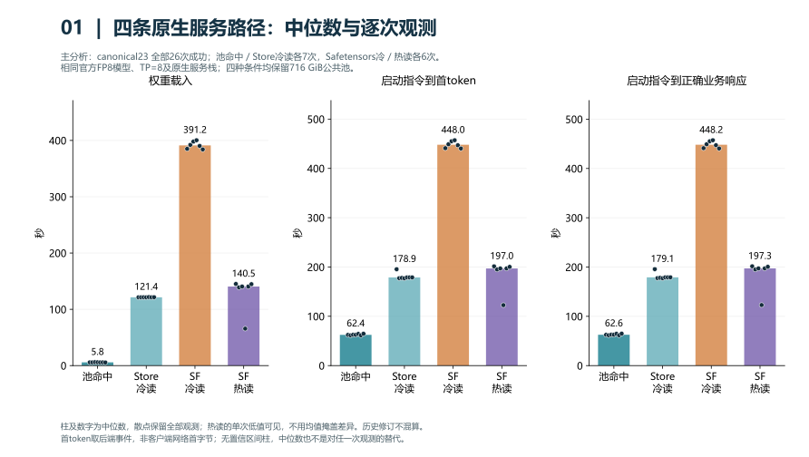
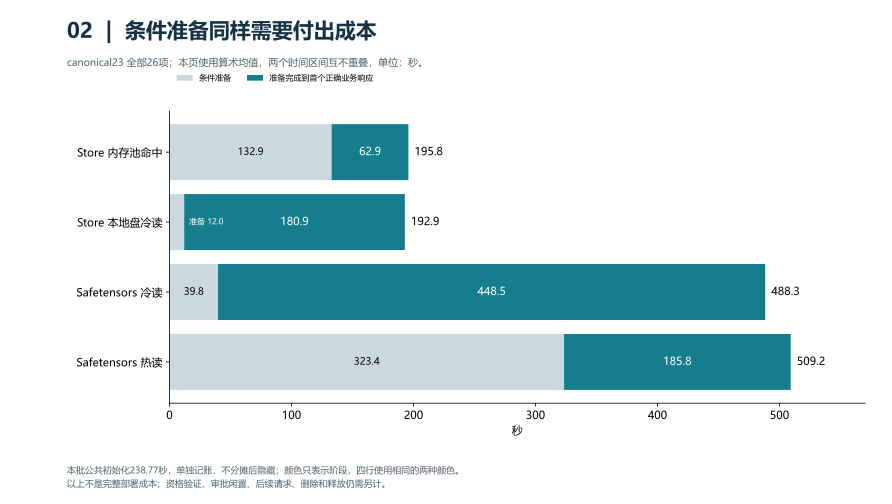
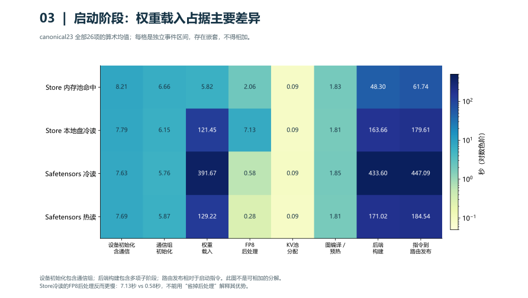
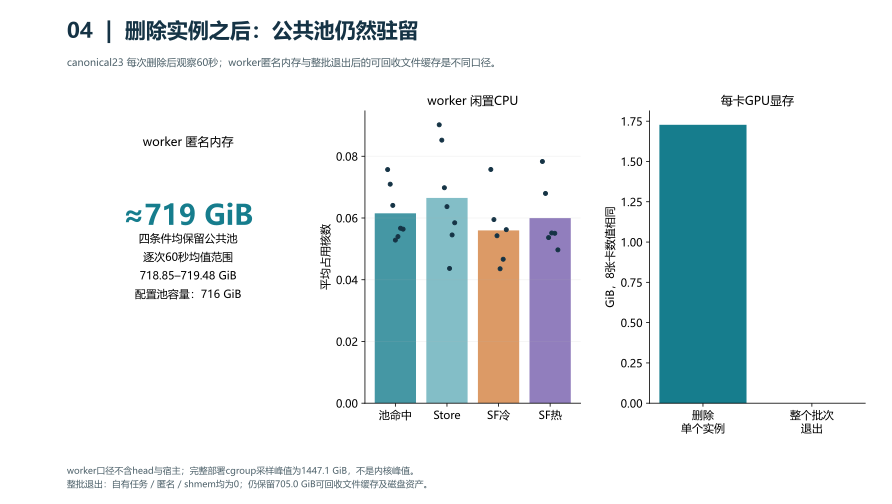
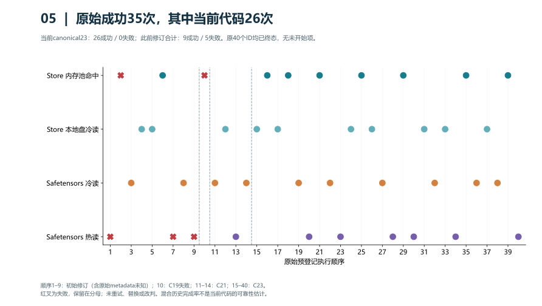
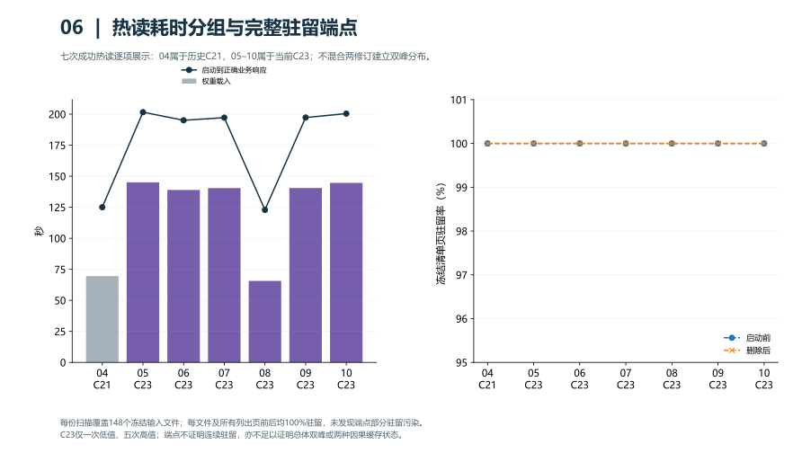
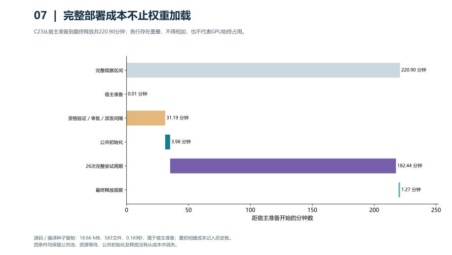
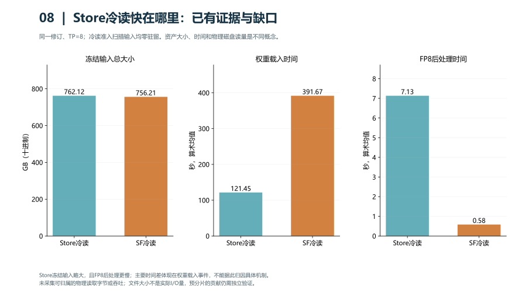

# GLM-5.1 FP8 分层图表与基线对比

主分析仅使用 `v13-canonical23-qualified-disk-jit-seed` 的全部26项：7/7/6/6。其余修订不混入性能主表。

基线是相同官方FP8 checkpoint、TP=8、上下文/推理配置与原生ServerlessLLM服务路径的 Safetensors 本地盘冷读；四种条件均保留716 GiB公共Store池。
A2独立vLLM参考只证明后端/正确性，包含审计开销，不能据此计算等价端到端加速。不同模型或论文硬件也不作为等价基线。

## 主表：全部26项

| 条件 | n | 权重均值/中位/P90(s) | 启动→首token均值(s) | 启动→正确业务均值/中位/P90(s) |
|---|---:|---:|---:|---:|
| Store 内存池命中 | 7 | 5.819 / 5.780 / 6.103 | 62.713 | 62.936 / 62.607 / 64.861 |
| Store 本地盘冷读 | 7 | 121.455 / 121.368 / 121.783 | 180.633 | 180.875 / 179.112 / 195.727 |
| Safetensors 冷读 | 6 | 391.671 / 391.208 / 400.429 | 448.273 | 448.496 / 448.192 / 457.390 |
| Safetensors 热读 | 6 | 129.215 / 140.474 / 145.085 | 185.525 | 185.754 / 197.255 / 201.611 |

P90采用nearest-rank；n=6/7时等于样本最大值。主表是全部已观察项的描述统计，不套用matched-six的置信区间。散点保留所有样本。
不确定性补充：[matched blocks5–10](matched-six-supplement.csv)，四条件各6次，沿用已审阅的整块配对重采样（seed20261024，10000次；边际95%百分位区间，非同时覆盖）。样本小且连续采集，不能消除相关性，也不能代表全部26项的区间。

冷Safetensors均值/各路径均值的比值见[c23-baseline-comparison.csv](c23-baseline-comparison.csv)，属于事后描述性比值、样本数不等，无加速比置信区间。

## 其他protocol_revision单列

| 原始修订 | 条件 | 总数/成功/失败 | 权重均值(s) | 正确业务均值(s) |
|---|---|---:|---:|---:|
| UNKNOWN_RAW_METADATA | safetensors_disk_hot | 1/0/1 | NA | NA |
| v6 | store_pool_hit | 1/0/1 | NA | NA |
| v7 | store_pool_hit | 1/1/0 | 15.004 | 75.738 |
| v7 | store_disk_cold | 2/2/0 | 124.371 | 184.706 |
| v7 | safetensors_disk_cold | 1/1/0 | 399.901 | 480.309 |
| v7 | safetensors_disk_hot | 1/0/1 | NA | NA |
| v8 | safetensors_disk_cold | 1/1/0 | 400.392 | 482.302 |
| v8 | safetensors_disk_hot | 1/0/1 | NA | NA |
| v13-canonical19-formal-continuation | store_pool_hit | 1/0/1 | NA | NA |
| v13-canonical21-complete-phase-and-history-chain | store_disk_cold | 1/1/0 | 121.204 | 178.168 |
| v13-canonical21-complete-phase-and-history-chain | safetensors_disk_cold | 2/2/0 | 401.683 | 468.256 |
| v13-canonical21-complete-phase-and-history-chain | safetensors_disk_hot | 1/1/0 | 69.589 | 125.067 |

原始metadata未知仍为未知，不补成v8。协议分层表仍是历史描述；代码/manifest/preparation/window/node/boot逐项保留在[all40-stratified.csv](all40-stratified.csv)，原完整细分统计见[final-statistics.json](../final-statistics.json)。失败不计入耗时均值，但始终保留在总分母：35成功/5失败/0未开始。

## Hot耗时分组与驻留核验

| ID | 修订 | 权重(s) | 正确业务(s) | 前/后驻留率 | 最小单文件驻留率前/后 |
|---|---|---:|---:|---:|---:|
| safetensors_disk_hot_04 | C21 | 69.589 | 125.067 | 100%/100% | 100%/100% |
| safetensors_disk_hot_05 | C23 | 145.085 | 201.611 | 100%/100% | 100%/100% |
| safetensors_disk_hot_06 | C23 | 138.942 | 195.073 | 100%/100% | 100%/100% |
| safetensors_disk_hot_07 | C23 | 140.454 | 197.205 | 100%/100% | 100%/100% |
| safetensors_disk_hot_08 | C23 | 65.661 | 122.874 | 100%/100% | 100%/100% |
| safetensors_disk_hot_09 | C23 | 140.494 | 197.305 | 100%/100% | 100%/100% |
| safetensors_disk_hot_10 | C23 | 144.657 | 200.457 | 100%/100% | 100%/100% |

14份完整summary各148文件、184621464页；逐文件resident_pages均等于pages。原完整mincore向量已由此前逐页原始审计验证，本图从保留的SHA绑定summary重算，不声称重新解压远端向量。repair_passes均0，准备前自有输入eviction扫描均0，reader均绑定node1。
C23内hot08为65.661秒，其余五次138.942–145.085秒；C21 hot04为69.589秒，但不能与C23混合建立双峰分布。六次仅一个低值，尚不能统计确认总体双峰。
差异主要落在权重ingestion；设备/通信和graph预热未出现对应约75秒差异。前后驻留均100%，没有准入时部分驻留污染的证据。准备区间及准备后至删除/观察后区间，global pgscan/pgsteal kswapd/direct增量均0。
全局major-fault、file-refault、NUMA-migration有增量，但不能归属本模型/worker；reader CPU亲和性不证明文件页物理NUMA位置。完整mincore是约6秒的逐文件扫描窗口，非全模型同一瞬间快照。端点不能证明加载全程连续驻留，也不能证明两种真实缓存状态。根因未确定，保留hot08，不剔除、不改判、不补跑。
逐次时刻、repair、计数器及阶段数据见[hot-seven-residency.csv](hot-seven-residency.csv)。进一步定因需要独立非计时控制中的按文件/worker实际磁盘读量、NUMA物理页和连续驻留归属证据；本次没有新增计算或改变正式记录。

## 分图解读

### 四条路径的中位数

柱表示中位数，散点是全部26项。热读存在一个明显低值，故不以均值柱掩盖样本差异。所有样本来自相同C23修订；每个柱的样本量分别为7、7、6、6。

### 准备和启动成本

两种固定颜色分别代表条件准备以及准备完成到首个正确业务响应，区间互不重叠；本图使用均值。公共初始化238.77秒另计，审批、后续请求、删除及释放也不包含在柱内。

### 启动阶段

权重载入、设备、通信、后处理和预热的事件区间存在嵌套，不得将热图各格相加。Store冷读的FP8后处理均值为7.13秒，Safetensors冷读为0.58秒，因此差异不能解释为省去后处理。

### 实例删除后的资源

四种条件的worker匿名内存逐次60秒均值约719 GiB（范围718.85–719.48 GiB）；716 GiB是公共池配置值，不是worker总匿名内存。删除实例后每卡保留1769 MiB辅助显存。整个部署退出后自有任务、匿名内存和共享内存为零，但约705 GiB可回收文件缓存仍保留。

### 全部预登记尝试

40项中35项原始成功、5项失败，当前C23贡献26项成功；其余历史修订有9成功和5失败。混合修订的35/40不能作为当前代码可靠性。失败没有重试或改判。

### 热读分组与驻留

七次前后端点均完整驻留，C23仅一次低值和五次高值，历史C21低值单列。逐文件扫描不是同一瞬间或连续跟踪，无法据此确认总体双峰及其物理原因。

### 整体部署时间

从宿主准备到最终释放为220.90分钟，其中包含资格验证与审批等待；阶段互相重叠，不能逐行相加，也不表示GPU连续占用。公共初始化和闲置成本单独保留。

### 冷读差异的证据边界

冻结输入清单为Store 762.117 GB、Safetensors 756.209 GB，Store并不更小。权重载入均值121.455秒对391.671秒；FP8后处理均值7.13秒对0.58秒。实际服务响应均值180.875秒对448.496秒，约2.48倍。时间差主要落在权重载入事件，但各事件可能嵌套，不能相减拼成因果分解。Store已有按TP rank保存的布局；它可能改变读取和张量处理路径，其独立贡献未测量。现有记录缺少可归属的物理读取字节、设备吞吐及CPU/H2D分解，文件大小除以耗时不能称为磁盘吞吐，因此无法证明具体加速机制。后续需独立控制并记录各进程/cgroup的磁盘读量、CPU、H2D及阶段时间。

## 复现与边界

运行：`python -X utf8 tools/plot_results.py --output ../outputs/glm51-fp8-figures-v2`。需Python、matplotlib、numpy和微软雅黑字体；PDF由同一图形矢量导出。
SVG/CSV/源码/输入及输出hash纳入Git；PDF/PNG在本机outputs目录，避免违反仓库二进制与单文件大小限制。manifest记录两类输出hash。
阶段区间有嵌套，不能相加；worker闲置统计不等于整个部署。删除实例保留公共池及每卡1769 MiB辅助显存；整个批次退出后自有任务/匿名/shmem为0，可回收文件缓存约705 GiB和磁盘资产保留。
本材料是ServerlessLLM在GLM-5.1官方FP8上的扩展实验，不声称复现论文原始模型或全部评测。历史exit137仍原因未知。
