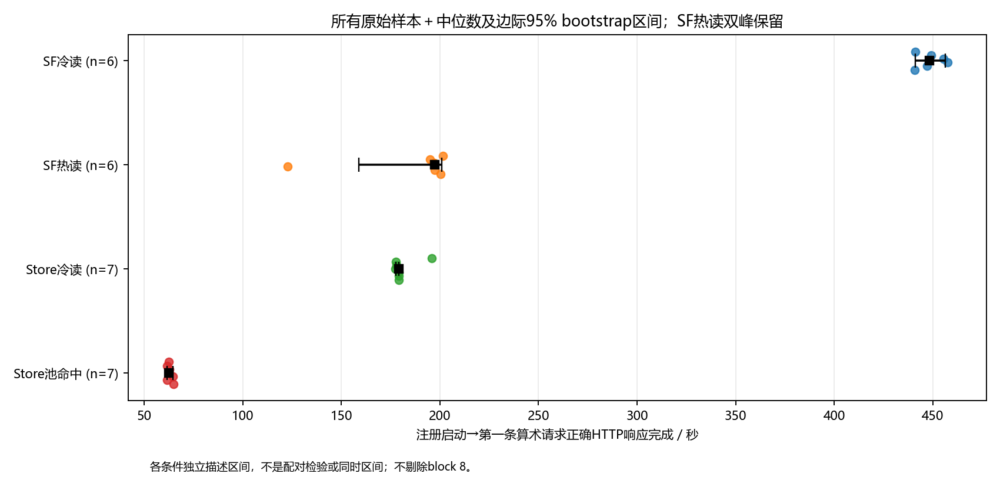
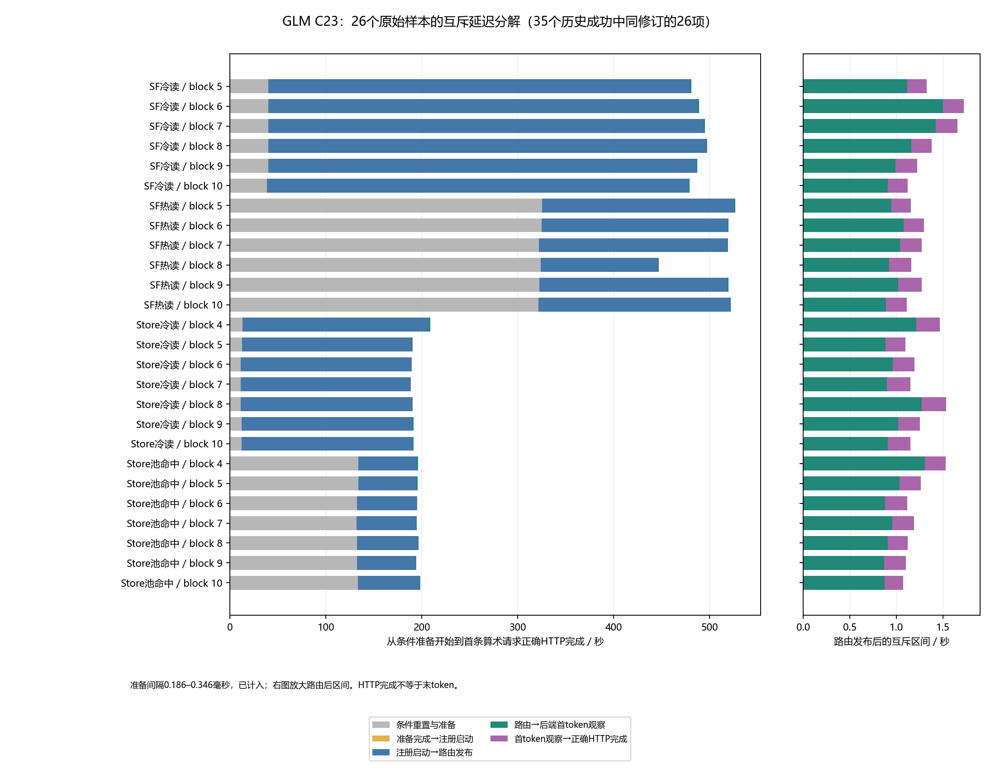

# GLM-5.1 FP8：V2纯数据复算报告

本轮只读取历史数据并复算，不启动模型、GPU、Store池、缓存预热或补跑。原40项保留35成功、5失败；C23描述集合26项，完整四条件配对为blocks 5–10（n=6）。不删除或替换block 8。Kimi由用户统一协调，本报告不评价其PASS或根因。

## 输入与sanity gate

权威输入节点qjhs003，根目录`/data/brick1/boyjiang/glm5.1-fp8`。原复算目录为`results/reanalysis-20261106/`；本报告的`original/`只保存对应原始产物副本，不执行其默认写入入口。ledger SHA `76184b66b4418fc486ec00aa530b705542bff20d6b6950c07b00c4aa8a75a06b`；40条结果均依照ledger的result_path读取、逐条匹配result_sha256。不是按固定目录推断结果。路径与SHA见`all40-matrix.csv`和`input-copy-manifest.json`。home分析副本已按用户要求删除；不再向home同步。

独立数值gate：PASS；16个已发布条件均值最大舍入差0.004755901秒（阈值0.05秒）。8个主配对估计及n=6/n=7敏感性区间重算无不匹配。事件顺序gate：PASS（26/26），执行源码归档与参考副本绑定见`executed-source-binding.json`。

## 修订与配对规则

完整40项状态/修订见`all40-matrix.csv`；C23 block×条件见`c23-block-matrix.csv`。blocks 1–3包括v5外部归属、v6、v7、v8、C19和C21，不能混为同一个v8条件。缺失的原始修订保持空值，外部历史归属不冒充原始字段。block 4的两条Store是C23、两条SF是C21，因此完整四条件主分析结构性排除block 4；不根据耗时选取。最大配对n=7仅为第三项的透明敏感性分析，主规则仍固定n=6。

## 全26项描述统计

指标为注册启动→第一条算术请求正确HTTP响应完成。请求顺序是 arithmetic → translation → fixed32；fixed32是第三条正确性检查。下表区间是各条件中位数的边际描述bootstrap区间，不是配对检验或同时区间。

| 条件 | n | 均值/秒 | 中位数/秒 | 中位数边际95%区间/秒 |
|---|---|---|---|---|
| safetensors_disk_cold | 6 | 448.496 | 448.192 | [440.927, 456.371] |
| safetensors_disk_hot | 6 | 185.754 | 197.255 | [158.973, 201.034] |
| store_disk_cold | 7 | 180.875 | 179.112 | [177.560, 179.167] |
| store_pool_hit | 7 | 62.936 | 62.607 | [61.697, 64.522] |



## 互斥计时与时钟域



每条分解为：条件重置与准备＋准备完成到注册启动间隔＋注册启动到路由发布＋路由到后端首token观察＋后端首token观察到正确HTTP完成。CSV中分别保留command_*与trigger_*。26条时间戳按源记录的同主机monotonic域核对，boot ID、后端/路由容器身份及原始事件集合摘要匹配；不与HTTP created墙钟相减。图右侧放大路由后区间。

准备完成到启动的间隔为0.186017–0.345500毫秒，已逐条计入。按同一fresh worker初始pool_loaded=False、成功执行顺序及源码状态更新，14/26条准备包含旧池卸载；具体ID及状态见event-intervals.csv和event-gate.json。该窗口不能称为纯填池成本，也不估算减去某个平均卸载时间。

后端首token观察不是客户端流式首字节；非流式HTTP完成不是最后token，最后一段不叫纯generation。phase_*是跨rank、可能嵌套的跨度，不相加构造总耗时或固定开销。ingestion跨度不等于纯I/O。此处时钟核验范围是历史同主机monotonic记录，不测网络时钟同步或CUDA内核时间。

### 跨rank阶段跨度（描述均值，秒；不可相加）

| 条件 | n | 业务启动→正确HTTP | 启动→路由 | 权重载入跨度 | 量化后处理跨度 |
|---|---|---|---|---|---|
| SF冷读 | 6 | 448.496 | 447.091 | 391.671 | 0.583 |
| SF热读 | 6 | 185.754 | 184.543 | 129.215 | 0.275 |
| Store冷读 | 7 | 180.875 | 179.611 | 121.455 | 7.130 |
| Store池命中 | 7 | 62.936 | 61.737 | 5.819 | 2.057 |

每条阶段均核对八rank覆盖、各rank终点不早于起点，以及max(end)−min(begin)与记录值一致；逐条跨度保存在event-intervals.csv。该表只定位记录中跨度的差异，不能将相互嵌套区间相减后解释为某内核或存储机制的独立因果贡献。

## 完整block配对推断

配对统计沿用原复算定义：不含准备为command_to_correct_business_response_s；含准备为preparation_s加该command区间，不含准备完成至注册启动的0.186–0.346毫秒间隔。互斥堆叠图包含这个间隔，因而图中整条壁钟与含准备统计有这一明确差别；本轮不悄悄改写原统计口径。

符号翻转的精确性以零假设下各block差值可独立翻转符号为条件；bootstrap把block视为可重采样单元。顺序运行、共享主机状态可能违反独立/可交换假设，n=6不足以验证这些假设。以下为对既定方法的复算，不提升为随机干预的因果结论。各条件中位数区间另按条件内样本重采样，B=10000、seed=20261024、同样使用249/9749排序索引；它不保留跨条件配对，不用于主检验。

两种成本口径分别定义四项检验族；双侧精确符号翻转，以|配对差均值|为统计量，枚举全部2^6=64符号，边界容差1e-12。bootstrap按block有放回抽样，B=10000、seed=20261024，每个估计重新开始随机序列。区间为排序bootstrap均值的floor(p*(B−1))位置，p=0.025/0.975。比值定义为配对集合内均值之比A/B，不是逐block比值的均值。Cohen dz=配对差均值/配对差样本标准差。

### 不含条件准备

| A−B | n | 配对均值差/秒 | 边际95%区间 | 原始p | Holm p | 均值之比A/B |
|---|---|---|---|---|---|---|
| Store冷 − SF冷 | 6 | -270.097059 | [-275.329460, -264.997766] | 0.03125 | 0.125 | 0.397772 |
| 池命中 − SF冷 | 6 | -385.484114 | [-390.536885, -380.431342] | 0.03125 | 0.125 | 0.140497 |
| 池命中 − Store冷 | 6 | -115.387055 | [-116.313926, -114.653456] | 0.03125 | 0.125 | 0.353209 |
| Store冷 − SF热 | 6 | -7.355012 | [-21.493427, 18.456785] | 0.5625 | 0.5625 | 0.960405 |

### 含条件重置与准备

| A−B | n | 配对均值差/秒 | 边际95%区间 | 原始p | Holm p | 均值之比A/B |
|---|---|---|---|---|---|---|
| Store冷 − SF冷 | 6 | -298.051557 | [-303.902499, -292.200615] | 0.03125 | 0.125 | 0.389632 |
| 池命中 − SF冷 | 6 | -292.548660 | [-298.302178, -286.625398] | 0.03125 | 0.125 | 0.400901 |
| 池命中 − Store冷 | 6 | 5.502897 | [4.226940, 6.402128] | 0.03125 | 0.125 | 1.028923 |
| Store冷 − SF热 | 6 | -318.920694 | [-333.265531, -293.569451] | 0.03125 | 0.125 | 0.373663 |

第四项为完整策略比较，不能单独归因于格式或缓存。不存在用phase跨度证明独立I/O机制贡献的结论。不含准备的第四项p_raw=p_Holm=0.5625，其余三项为0.03125/0.125；含准备四项均为0.03125/0.125。因此不能笼统说四项Holm都0.125。所有主对比在族级α=0.05均未通过；边际CI不等于Holm同时区间，本报告不声称已构造同时区间。第四项不含准备的区间跨零表示未检出差异，不证明等效。

### 配对敏感性与可达性

| 第三项：池命中−Store冷 | 口径 | 均值差/秒 | 边际95%区间 |
|---|---|---|---|
| n6_complete_block | business_only | -115.387055 | [-116.313926, -114.653456] |
| n6_complete_block | including_preparation | 5.502897 | [4.226940, 6.402128] |
| n7_maximal_pair | business_only | -117.938373 | [-123.180969, -114.844449] |
| n7_maximal_pair | including_preparation | 2.904584 | [-2.489913, 6.204437] |

含准备的n=6与n=7区间不同，均保留；不得据显著性切换规则。block 8与store_disk_cold_04均保留。SF热读快样本不是机制因果证明；本报告不据异常点单独解释零结果，不发布未经核验的MAD异常倍数。四项族、双侧全符号枚举这个特定设计下，n=6/7/8理论最小首步调整p为0.125/0.0625/0.03125；它是可达性下限，不是功效保证或追加样本授权。

## 准备、初始化、驻留与释放成本

| 项目 | 已有数值/状态 | 边界 |
|---|---|---|
| 一次完整Store转换成本 | 尚缺可独立计费的单一完整数值 | 历史控制/失败另列，不能当0 |
| 公共初始化 | 238.771220秒 | C23单次已有成本记录，包含共享Ray/Store/池等；不是纯建池 |
| 公共Store池 | 716 GiB | 配置量，四条件均保留；不同于实际时刻锁页测量 |
| 每条准备 | 逐条见event-intervals.csv | 包括状态依赖卸载、构造条件、缓存检查；不当纯填池 |
| 整部署采样内存峰值 | 1447.134 GiB | 采样值；kernel峰值未知；不是整机峰值 |
| 删除后辅助GPU驻留 | 每卡1769 MiB | 公共辅助资源成本；不等于实例模型仍常驻 |
| 最终释放观察 | 75.982432秒 | 成本账记录；不是本轮重新运行 |
| 最终自有slice | anon=0，shmem=0，pids.current=0 | 可回收文件缓存保留，不要求全机缓存清零 |
| 源checkpoint与TP8 Store | 756177645648 B / 762037043200 B | 既有报告中的资产尺寸，各保留一份，不按每ID重复算容量 |
| 货币、GiB·小时与N>1重复复用 | 缺少统一可追溯参数/真实重复轨迹 | 不报告实测回本次数 |

成本来源为既有c23-costs.json及其原审阅；精确副本保存在inputs/c23-costs.json，补丁输入亦在inputs，分析目录可独立复算。本轮未重读GB级监控或重测资源。上述重叠壁钟区间不能相加。RSS/PSS与CUDA锁页、文件缓存、slab分别处理，不把它们合并成匿名内存。公共池配置不因SF路径而撤去。

### 摊销结论

不生成确定回本曲线：一次转换、纯填池/淘汰以及N>1缓存复位轨迹尚不可分。可采用模型 [转换＋Σ准备＋Σ生命周期]/N，但每个参数须给出处和未知值，任何N>1曲线只能标模型推演。不能把混杂preparation代入后宣称N次回本，也不能永久用强制冷读成本模拟允许缓存保留的重复访问。

## 相对官方基线的补丁证据与缺口

### sllm，官方基线 `9f50241baa5386e06a9321c51f19a9ef5f964c2b`

历史补丁 `glm/patches/sllm-integration-candidate-v5.patch`，SHA `2d508961eda6f6d8ae4b9915d117043b08bc618ce90ffb116f9cee877e30844d` 已核对。以下文件来自实际patch正文解析，不预填文件/行数：

- `sllm/backends/vllm_backend.py`
- `sllm/controller.py`
- `sllm/routers/roundrobin_router.py`
- `sllm_store/csrc/checkpoint/aligned_buffer.cpp`
- `sllm_store/csrc/checkpoint/checkpoint.cpp`
- `sllm_store/csrc/checkpoint/tensor_writer.cpp`
- `sllm_store/csrc/sllm_store/checkpoint_store.cpp`
- `sllm_store/csrc/sllm_store/checkpoint_store.h`
- `sllm_store/csrc/sllm_store/checkpoint_store_py.cpp`
- `sllm_store/setup.py`
- `sllm_store/sllm_store/client.py`
- `sllm_store/sllm_store/event_trace.py`
- `sllm_store/sllm_store/server.py`
- `sllm_store/sllm_store/torch.py`
- `sllm_store/sllm_store/vllm_loader.py`

### vllm，官方基线 `43a9b1afbb7ed88e63ebeefeb55df8d445aa1992`

历史补丁 `glm/patches/vllm-integration-candidate-v5.patch`，SHA `60dfa6eb35eb73b0cdff139e16db737277e9e0f343abe4a09f99f3ee22d7bac0` 已核对。以下文件来自实际patch正文解析，不预填文件/行数：

- `vllm/model_executor/model_loader/base_loader.py`
- `vllm/v1/worker/gpu_worker.py`

已按固定历史源码清单逐项核对：上述补丁的17个目标文件，其补丁账本预期SHA、C23外部清单SHA与当前canonical文件字节SHA全部一致。C23控制输入清单引用历史清单，canonical映射由冻结INDEX解析；证据见deployment-binding.json和deployment-gate.json。该gate仅为PASS_FOR_DECLARED_PATCHSET，不等于整个仓库全部文件的穷尽diff。

C23另有一层Store服务覆盖：实际冻结store_server13.py挂载到sllm_store/server.py，相对v5仅将await server.wait_for_termination()改为await asyncio.shield(server.wait_for_termination())。精确差异见c23-store-server-overlay.patch；归档SHA、run-manifest要求与当时head CPU实际导入证据一致。不能把v5补丁单独称为最终部署版本，也不据此认定历史exit137已解决。

官方SDK基线9f50241baa5386e06a9321c51f19a9ef5f964c2b、vLLM基线43a9b1afbb7ed88e63ebeefeb55df8d445aa1992均与C23选定版本一致。冻结镜像为sha256:aa161e3800353473bf1c4bfc312cef77eb16fdf85e45d45d274246e6de582b6f，历史环境为PyTorch 2.10.0+cu130、vLLM 0.19.1.dev1+g43a9b1afb、CUDA 13。

证据边界：head的CPU导入记录覆盖Store Python模块及两个扩展库文件身份，不是每个GPU rank已映射机器码的证明；vLLM替换源码SHA也不能单独证明每个worker导入路径。formal_trials.py和phase_summary.py已与C23实际执行归档逐字节比对，绑定f176e056…/3eac8c63…。

## Kimi与论文路线

Kimi数值栏留空：本轮未接收可用于统一表的已核验交付，不推定其PASS或停服根因闭环。停止与其他会话通信，由用户统一管理。论文Figure 6单列可选路线：20副本、random访问及原始artifact设置另审，不把本四条件扩展实验称为论文原样复现。

## 复算与文件

```bash
python3 independent_audit.py
python3 event_audit.py
python3 deployment_audit.py
# 使用既有matplotlib环境；不创建新环境
python plot_analysis.py
```

原始权威路径和SHA见MANIFEST.md、all40-matrix.csv及input-copy-manifest.json；本目录inputs是小型只读结果副本。原始输入不修改。`original/recompute.py`默认会写原目录，因此此处不调用其默认入口。README与CSV/JSON均可编辑，SVG保留文字。home副本已删除，不向home再传输。

剩余边界：声明补丁集之外的全仓库差异及逐rank映射机器码；转换/纯填池成本分离；N>1实测；完整rank内部opaque内存不在本轮审计范围。当前报告是GLM历史证据复算交付，不证明当前服务可运行，也不将历史exit137判为已解决。
