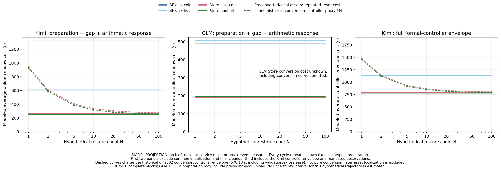

# 原 Kimi goal 最终交付补充审计

本轮继续原目标，未重建或缩小目标。原正式采样与对比已完成并发布；本补充不是整个 goal 完成声明。

## 当前状态

功能证据已齐备；正式 L1 验收状态待澄清并单独确认。原 run 的 NOT_L1、旧30秒FAIL及协调者既有功能接受决定同时保留，不能互相替代。本轮已将具体已有证据与审计提交所有者单独确认；未收到答复前不替其作决定。

| 目标最终交付 | 审计状态 | 证据与范围 |
|---|---|---|
| 11.1 无歧义L1状态、覆盖与单独验收决定 | PENDING_OWNER_SEPARATE_CONFIRMATION | 既有功能覆盖已核，原NOT_L1和30秒FAIL不变；所有者尚未单独确认。不为标签启动GPU。 |
| 11.2 版本、补丁、实际ELF、构建与运行身份 | VERIFIED_BOUNDED_IDENTITY | 实际RO挂载/历史真实CPU导入与模型运行分层。未在已审公开回执找到每正式PID nativeSO maps/hash、FlashInfer active importversion，不把源码意图当stdout。 |
| 11.3 存储路线、参数、缓存与计时对齐表 | VERIFIED_WITH_EXPLICIT_DIFFERENCES | 本地NVMe资产stat身份核验，metadata/payload分列；参数取实际config，名义参数另引官方说明。GLM/Kimi Prep、量化与容量差异保留。 |
| 11.4 冻结且可执行正式入口 | VERIFIED_CPU_AND_ACTUAL_RUNTIME_SEPARATELY | 现有57CPU通过和实际block消费者身份核验，不以CPU替代GPU；原B4/B9FAIL保留。 |
| 11.5 所有样本、失败、未执行项与原始台账 | VERIFIED_PUBLISHED_PRIOR_DELIVERY | 已发布816d80fd目录all-runs-ledger.csv/actualanalysis/459快照：原40全部启动38合格2FAIL，补跑1合格，历史5次1合格4FAIL；GLM原40为35/5。未复制权重或大日志。 |
| 11.6 分条件统计、成功率与不确定性 | VERIFIED_PUBLISHED_PRIOR_DELIVERY | a43734f分析源码、13CPU+实际结果独审，Kimi完整8block、GLM C23完整6block；两独立Holm4族、成对bootstrap和Wilson范围明确。 |
| 11.7 初始化、转换/准备、缓存、加载、推理、删除与停服成本 | PARTIALLY_OBSERVED_C_AND_PURE_COMPONENTS_MISSING | 1036既有小文件核验，38合格原样本E成本完整；C ingestion独立起止、纯fill/纯conversion、GiB·h/货币成本缺测。38旧workerCID均已移除，私有hostlog尚可能含加载耗时。N曲线为条件模型，不是N>1测量。 |
| 11.8 可比较范围、差异与未支持范围 | VERIFIED_BOUNDED_REPORTING | 不声称全617GB值逐字节相等、纯IO、纯decode、warm service、迁移/调度/吞吐、跨模型因果优劣、实测N回本。 |
| 11.9 代码/证据远端SHA与复现说明 | PRIOR_PUBLICATION_VERIFIED_THIS_SUPPLEMENT_PENDING | 已有source a43734f和main816d80fd已核远端。本补充将独立显式stage发布，发布后另存SHA回执，不预填成功。 |

## 新增成本记录

# Kimi existing cost evidence audit

Scope: 38 qualified original samples, not a total study-cost bill. SHA-linked public exports only; original private R0 permissions unchanged.

| Condition | n | Common env | Ray join | Pool init | Target Prep | Backend init | Delete ack | API stop | Store stop | Stop to release |
|---|---:|---:|---:|---:|---:|---:|---:|---:|---:|---:|
| safetensors_disk_cold | 9 | 33.164 | 7.924 | 229.450 | 49.819 | 1242.655 | 5.974 | 2.538 | 33.126 | 102.589 |
| safetensors_disk_hot | 9 | 32.585 | 7.805 | 229.203 | 163.223 | 417.050 | 5.732 | 2.417 | 32.768 | 102.112 |
| store_disk_cold | 10 | 32.725 | 7.888 | 229.501 | 26.382 | 215.964 | 5.810 | 2.449 | 32.710 | 102.004 |
| store_pool_hit | 10 | 33.772 | 7.718 | 229.624 | 91.470 | 133.016 | 5.603 | 2.555 | 32.721 | 102.016 |

Values are mean seconds. Operation boundaries are controller-observed and include communication/polling/verification overhead. Backend init overlaps A; API/Store stop overlap the stop-to-release envelope. Do not add nested intervals.

Counts: 38 fresh environments and Store pools; 9 warm-file preparations, 19 target evictions, 10 poolhit prefill admissions / 80 confirmed rank CPU loads, 10 Storecold demand attempts, 114 correct HTTP requests, 38 delete/baseline/normal Store shutdown and release sequences. This scope excludes two failed original attempts, one supplemental success and five historical launches from cost aggregation; their main denominators remain unchanged.

**C weight ingestion and pure pool-fill are missing.** Registered load metadata has no ingestion begin/end. capture_seconds measures metadata capture, not weights. Poolhit Prep includes registration/load/admission, not isolated fill. Initial/deleted baseline observation and independent release quiet each have their own >=60 records, and are not summed together.

以下表是38个合格原样本的描述性成本，不是全部失败/补跑/历史的总费用。API/Store停服与stop-to-release嵌套，backendinit位于A内，不能把所有列相加。旧770秒池初始化只是一条历史不同构建/部署下观测，不用来代表当前约229秒的每样本初始化。

## 复用次数模型图

每个假设恢复周期重新构造同一缓存/池条件，因此在线窗口均值不会随N自动变小。前两图比较Prep+Gap+A；第三图仅Kimi，使用主8block完整controller envelope（包括初始化、删除及观察窗口），不是把嵌套阶段加总。Store虚线只额外摊入历史qjhs002转换控制器整体678.128942504秒/N；它含验证、退出和释放，不是纯转换时间，且不含之后本地化复制成本。GLM未知转换曲线留空，未被当成0。
图是点估计条件推演，不表示测得N>1驻留复用、稳态吞吐、概率预测区间或真实回本次数。若允许缓存自然保留/持续驻留、不同淘汰策略或并发，模型不适用，需另定义协议。

## 资产与参数差异

# Kimi / GLM asset and configuration table

| Asset | Payload files / bytes | Metadata + provenance files / bytes | All regular files / bytes |
|---|---:|---:|---:|
| Kimi safetensors | 64 / 595177988208 | 20 / 26645943 | 84 / 595204634151 |
| Kimi store | 64 / 617000763392 | 40 / 28833109 | 104 / 617029596501 |
| GLM safetensors | 142 / 756177645648 | 9 / 31690471 | 151 / 756209336119 |
| GLM store | 80 / 762037043200 | 26 / 48703043 | 106 / 762085746243 |

GLM Store frozen metadata subset:22files /48,659,964bytes; full current root also contains README/LICENSE and provenance files. Kimi metadata20/40files versus GLM root/provenance categories must not be silently treated as identical inventories.

| Configuration from exact config.json | Kimi | GLM |
|---|---|---|
| Architecture | KimiK25ForConditionalGeneration (multimodal) | GlmMoeDsaForCausalLM |
| Text layers / hidden size |61 /7168 |78 /6144 |
| Routed experts / selected per token / shared |384 /8 /1 |256 /8 /1 |
| Quantization | compressed-tensors pack-quantized:4-bit symmetric group32 on targeted Linear weights; ignored modules retained separately | FP8 e4m3,128x128 block weights, dynamic activations; modules_to_not_convert exceptions |
| Base dtype | bfloat16 | bfloat16 |
| Exact total / activated parameter count | Unknown from checked config | Unknown from checked config |

All values are apparent stat bytes, not allocated disk blocks, parameter counts, device memory or pure tensor logical bytes. Safetensors shard bytes include file headers; Store physical bytes include alignment. No payload content read or new hash scan. Current findmnt:both assets are local XFS /dev/nvme1n1. Kimi source/control remains shared NFS; equal device does not make all IO or software identical.

GLM source checkpoint142 shards stat-matched against frozen manifest; Store80part sizes stat-matched against frozen raw-disk-verification receipt,22metadata sizes against store-metadata-inputs. Inactive MTP Store assets outside activeTP8 excluded. Kimi188files matched frozen dev/inode/bytes/mtime/uid exactly.

JSON: kimi-glm-final-asset-and-configuration-table-20261107-v1.json
SHA256: a0534de2d1ca92bbf70d6545c3a4ce0693be3a8fc2cfb1de8bc913e6e7e47851

名义参数规模另由发布者说明核对：Kimi [1T总/32B激活](https://huggingface.co/moonshotai/Kimi-K2.6/raw/main/README.md)；GLM-5.1-FP8 [744B-A40B](https://raw.githubusercontent.com/zai-org/GLM-5/main/README.md)。这些是发布者标称数，不是本次逐tensor枚举，也不把MTP/vision/scales等不同计数范围与实际字节数混同。先前actual-config表的精确计数null保持不变；名义数见publisher-parameter-counts.json。

## 实际部署补丁与身份

20个tracked生产路径相对官方9f502到实际835部署的unified patch已导出，SHA8ff4343cfee461831dd97f3ae429c1c55a574d05a60f17a80af185e26fdd30c4。该patch不独自复原外部已编译ELF、oldf7 overlay或环境；必须连同v1/v2身份清单使用。没有套用新866 overlay，没有重新构建/部署。

## 仍需闭环的证据与决定

1. 所有者单独确认已有证据的L1功能验收定义与决定；原始运行NOT_L1与30秒FAIL不改。无需仅为标签重跑模型。
2. 先只读恢复现存私有host启动日志的加载时长与实际导入标记，不先加GPU探针。38个旧worker容器已不存在，所以其thin-layer/Ray日志读取路径不可用；这不证明host日志不存在。当前公开load-metadata只有采集耗时，不可冒充C加载耗时。
3. 纯转换、纯fill、完整GLM生命周期与资源GiB·h等独立测量仍缺；当前图明确只在已测范围和显式模型假设内成立。未观察字段保持缺测，不用估算伪造实测。
4. 已审公开证据没有逐正式PID的native SO maps/hash或FlashInfer实际import版本；历史真实CPU导入、实际RO挂载、固定源SHA和模型运行有证据，分层报告，不宣称从未私下采过也不冒充本轮补采。

旧root会话工具自动审批拒绝继续写入，返回需审批且当前策略禁止申请；sudo非交互认证不可用。已改用既有逐字节公开副本完成可完成的审计，没有绕过权限或再打印凭据。私有启动日志尚未读，因此整个goal保持active，而不是把待核字段记完成。

## 已发布主对比

[原报告、4图和全部台账（main816d80fd）](https://github.com/BoyJiang2/serverlessllm/blob/816d80fd98b5ef6692782faea6b808a565f0339a/kimi/evidence/final-kimi-glm-comparison-20261107/REPORT.md)。本补充不改原结果/金标/失败或GLM文件，也没有启动新GPU、Store、全量转换或任何新40项实验。

复现本补图：使用现有Matplotlib执行本目录plot_kimi_glm_reset_cost_projection_20261107.py COST_JSON NEW_OUTPUT_DIR；脚本校验冻结输入SHA、模型公式和样本几何，并拒覆盖已有图。所有代码与大证据继续保留服务器。
