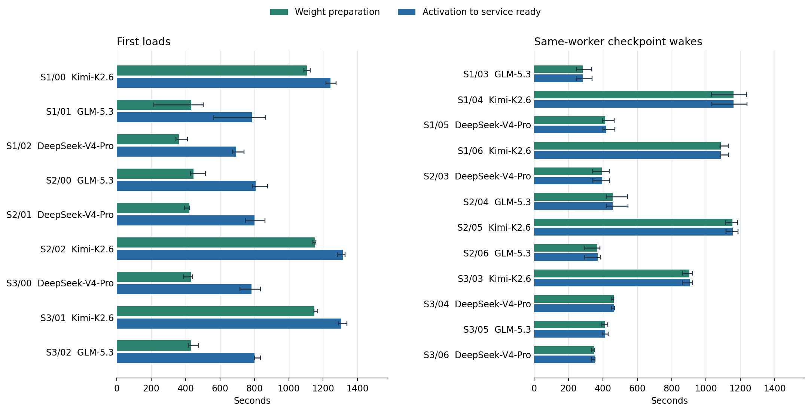

# V11 联合 B2 三模型 Sleep L2 · GLM-5.3

**9/9 轮验收通过，共 63 段。** 27 次首次加载和 36 次原 Worker 唤醒均通过金标。回访实测从 Host KV 恢复 512 token，删除对应键后复查为零命中。模型间使用同一前缀做命中与未命中的配对查询。

序列验收轮数为 S1 3/3，S2 3/3，S3 3/3。

qjhs003 使用 8×H20、TP8 与 813 GiB Host KV 池（不启用权重 Store）。GLM-5.3 使用 vLLM 0.30.0，Kimi-K2.6 和 DeepSeek-V4-Pro 使用 vLLM 0.20.1。每轮仅初始化 Host KV 池。Kimi 使用已验收的 560-token 参考探针，其中 512 token 用于 Host KV 回读。

## 轮次与释放

| 序列与 run ID | 模型顺序 | Host KV 池（s） | 金标 | 八卡归零观察（s） |
| --- | --- | --- | --- | --- |
| `B2-GLM53-S1-20261120T163053Z` | Kimi-K2.6 → GLM-5.3 → DeepSeek-V4-Pro → GLM-5.3 → Kimi-K2.6 → DeepSeek-V4-Pro → Kimi-K2.6 | 195.340 | 7/7 | 60.131 |
| `B2-GLM53-S1-20261121T123640Z` | Kimi-K2.6 → GLM-5.3 → DeepSeek-V4-Pro → GLM-5.3 → Kimi-K2.6 → DeepSeek-V4-Pro → Kimi-K2.6 | 192.132 | 7/7 | 61.062 |
| `B2-GLM53-S1-20261121T183659Z` | Kimi-K2.6 → GLM-5.3 → DeepSeek-V4-Pro → GLM-5.3 → Kimi-K2.6 → DeepSeek-V4-Pro → Kimi-K2.6 | 191.052 | 7/7 | 61.155 |
| `B2-GLM53-S2-20261120T190052Z` | GLM-5.3 → DeepSeek-V4-Pro → Kimi-K2.6 → DeepSeek-V4-Pro → GLM-5.3 → Kimi-K2.6 → GLM-5.3 | 196.002 | 7/7 | 61.191 |
| `B2-GLM53-S2-20261121T141943Z` | GLM-5.3 → DeepSeek-V4-Pro → Kimi-K2.6 → DeepSeek-V4-Pro → GLM-5.3 → Kimi-K2.6 → GLM-5.3 | 207.490 | 7/7 | 60.151 |
| `B2-GLM53-S2-20261121T202330Z` | GLM-5.3 → DeepSeek-V4-Pro → Kimi-K2.6 → DeepSeek-V4-Pro → GLM-5.3 → Kimi-K2.6 → GLM-5.3 | 204.472 | 7/7 | 61.109 |
| `B2-GLM53-S3-20261120T213052Z` | DeepSeek-V4-Pro → Kimi-K2.6 → GLM-5.3 → Kimi-K2.6 → DeepSeek-V4-Pro → GLM-5.3 → DeepSeek-V4-Pro | 194.248 | 7/7 | 60.008 |
| `B2-GLM53-S3-20261121T160117Z` | DeepSeek-V4-Pro → Kimi-K2.6 → GLM-5.3 → Kimi-K2.6 → DeepSeek-V4-Pro → GLM-5.3 → DeepSeek-V4-Pro | 202.570 | 7/7 | 61.193 |
| `B2-GLM53-S3-20261121T222136Z` | DeepSeek-V4-Pro → Kimi-K2.6 → GLM-5.3 → Kimi-K2.6 → DeepSeek-V4-Pro → GLM-5.3 → DeepSeek-V4-Pro | 192.978 | 7/7 | 60.185 |

## Host KV 占用与锁页观测

| run ID | 有效 KV 观测峰值（MiB） | 主机最低可用（GiB） | 该点 LMCache 匿名内存（GiB） | LMCache 匿名内存峰值（GiB） | 锁页日志 |
| --- | --- | --- | --- | --- | --- |
| `B2-GLM53-S1-20261120T163053Z` | 107.734 | 980.397 | 813.542 | 813.882 | 观察到注册失败 |
| `B2-GLM53-S1-20261121T123640Z` | 107.734 | 986.892 | 813.536 | 813.871 | 观察到注册失败 |
| `B2-GLM53-S1-20261121T183659Z` | 107.734 | 982.547 | 813.532 | 813.854 | 观察到注册失败 |
| `B2-GLM53-S2-20261120T190052Z` | 107.734 | 982.541 | 813.541 | 813.882 | 观察到注册失败 |
| `B2-GLM53-S2-20261121T141943Z` | 107.734 | 986.862 | 813.527 | 813.859 | 观察到注册失败 |
| `B2-GLM53-S2-20261121T202330Z` | 107.734 | 982.548 | 813.526 | 813.855 | 观察到注册失败 |
| `B2-GLM53-S3-20261120T213052Z` | 107.734 | 985.855 | 813.541 | 813.876 | 观察到注册失败 |
| `B2-GLM53-S3-20261121T160117Z` | 107.734 | 985.606 | 813.538 | 813.859 | 观察到注册失败 |
| `B2-GLM53-S3-20261121T222136Z` | 107.734 | 981.297 | 813.540 | 813.877 | 观察到注册失败 |

有效 KV 从各探针前后快照取最大值。主机和 cgroup 指标取池就绪后的实际采样。后端选择日志仅记录使用的注册接口，锁页状态以可核实的日志为准。

柱长为固定段的中位数，细线标出最小值–最大值。

## 首次加载

| run ID | 段 | 目标模型 | 路径 | 权重准备（s） | 新 GPU KV（s） | 旧 GPU KV 释放 → 新 KV 就绪（s） | 至可服务（s） | 首个正确完整响应（s） | 全套业务金标（s） | 金标 |
| --- | --- | --- | --- | --- | --- | --- | --- | --- | --- | --- |
| `B2-GLM53-S1-20261120T163053Z` | `00-K-kimi` | Kimi-K2.6 | SafeTensors 冷读 | 1104.951 | 2.250 | — | 1243.109 | 1244.954 | 1248.407 | 通过 |
| `B2-GLM53-S1-20261120T163053Z` | `01-G-glm53` | GLM-5.3 | SafeTensors 冷读 | 433.428 | — | — | 784.757 | 794.817 | 794.817 | 通过 |
| `B2-GLM53-S1-20261120T163053Z` | `02-D-v4` | DeepSeek-V4-Pro | SafeTensors 冷读 | 360.979 | 1.709 | — | 694.929 | 721.366 | 730.862 | 通过 |
| `B2-GLM53-S1-20261121T123640Z` | `00-K-kimi` | Kimi-K2.6 | SafeTensors 冷读 | 1087.079 | 1.915 | — | 1216.452 | 1218.295 | 1221.833 | 通过 |
| `B2-GLM53-S1-20261121T123640Z` | `01-G-glm53` | GLM-5.3 | SafeTensors 冷读 | 214.118 | — | — | 563.477 | 573.356 | 573.356 | 通过 |
| `B2-GLM53-S1-20261121T123640Z` | `02-D-v4` | DeepSeek-V4-Pro | SafeTensors 冷读 | 409.940 | 1.495 | — | 740.028 | 769.993 | 779.692 | 通过 |
| `B2-GLM53-S1-20261121T183659Z` | `00-K-kimi` | Kimi-K2.6 | SafeTensors 冷读 | 1124.641 | 2.198 | — | 1275.314 | 1277.178 | 1280.661 | 通过 |
| `B2-GLM53-S1-20261121T183659Z` | `01-G-glm53` | GLM-5.3 | SafeTensors 冷读 | 503.284 | — | — | 866.126 | 876.786 | 876.786 | 通过 |
| `B2-GLM53-S1-20261121T183659Z` | `02-D-v4` | DeepSeek-V4-Pro | SafeTensors 冷读 | 343.184 | 1.410 | — | 672.820 | 699.670 | 709.296 | 通过 |
| `B2-GLM53-S2-20261120T190052Z` | `00-G-glm53` | GLM-5.3 | SafeTensors 冷读 | 428.492 | — | — | 789.451 | 794.600 | 794.600 | 通过 |
| `B2-GLM53-S2-20261120T190052Z` | `01-D-v4` | DeepSeek-V4-Pro | SafeTensors 冷读 | 422.544 | 1.686 | — | 800.712 | 826.443 | 836.228 | 通过 |
| `B2-GLM53-S2-20261120T190052Z` | `02-K-kimi` | Kimi-K2.6 | SafeTensors 冷读 | 1158.401 | 0.492 | 1338.061 | 1314.937 | 1322.396 | 1325.809 | 通过 |
| `B2-GLM53-S2-20261121T141943Z` | `00-G-glm53` | GLM-5.3 | SafeTensors 冷读 | 445.188 | — | — | 807.500 | 813.052 | 813.052 | 通过 |
| `B2-GLM53-S2-20261121T141943Z` | `01-D-v4` | DeepSeek-V4-Pro | SafeTensors 冷读 | 422.808 | 1.814 | — | 861.554 | 887.256 | 896.654 | 通过 |
| `B2-GLM53-S2-20261121T141943Z` | `02-K-kimi` | Kimi-K2.6 | SafeTensors 冷读 | 1140.381 | 0.504 | 1307.324 | 1283.061 | 1290.189 | 1293.570 | 通过 |
| `B2-GLM53-S2-20261121T202330Z` | `00-G-glm53` | GLM-5.3 | SafeTensors 冷读 | 514.418 | — | — | 877.435 | 882.715 | 882.715 | 通过 |
| `B2-GLM53-S2-20261121T202330Z` | `01-D-v4` | DeepSeek-V4-Pro | SafeTensors 冷读 | 392.333 | 1.698 | — | 747.312 | 774.311 | 784.066 | 通过 |
| `B2-GLM53-S2-20261121T202330Z` | `02-K-kimi` | Kimi-K2.6 | SafeTensors 冷读 | 1151.100 | 0.524 | 1346.175 | 1328.042 | 1335.838 | 1339.243 | 通过 |
| `B2-GLM53-S3-20261120T213052Z` | `00-D-v4` | DeepSeek-V4-Pro | SafeTensors 冷读 | 439.336 | 2.894 | — | 783.026 | 804.007 | 813.565 | 通过 |
| `B2-GLM53-S3-20261120T213052Z` | `01-K-kimi` | Kimi-K2.6 | SafeTensors 冷读 | 1148.132 | 0.464 | 1301.658 | 1288.591 | 1297.299 | 1300.810 | 通过 |
| `B2-GLM53-S3-20261120T213052Z` | `02-G-glm53` | GLM-5.3 | SafeTensors 冷读 | 475.011 | — | — | 834.443 | 844.151 | 844.151 | 通过 |
| `B2-GLM53-S3-20261121T160117Z` | `00-D-v4` | DeepSeek-V4-Pro | SafeTensors 冷读 | 431.231 | 3.149 | — | 834.878 | 856.349 | 866.166 | 通过 |
| `B2-GLM53-S3-20261121T160117Z` | `01-K-kimi` | Kimi-K2.6 | SafeTensors 冷读 | 1168.868 | 0.526 | 1353.329 | 1339.102 | 1349.409 | 1352.833 | 通过 |
| `B2-GLM53-S3-20261121T160117Z` | `02-G-glm53` | GLM-5.3 | SafeTensors 冷读 | 414.370 | — | — | 800.255 | 812.072 | 812.072 | 通过 |
| `B2-GLM53-S3-20261121T222136Z` | `00-D-v4` | DeepSeek-V4-Pro | SafeTensors 冷读 | 386.409 | 2.945 | — | 715.269 | 736.584 | 745.924 | 通过 |
| `B2-GLM53-S3-20261121T222136Z` | `01-K-kimi` | Kimi-K2.6 | SafeTensors 冷读 | 1146.777 | 0.574 | 1314.548 | 1305.860 | 1316.520 | 1319.957 | 通过 |
| `B2-GLM53-S3-20261121T222136Z` | `02-G-glm53` | GLM-5.3 | SafeTensors 冷读 | 430.049 | — | — | 801.255 | 813.554 | 813.554 | 通过 |

## 回访唤醒

| run ID | 段 | 目标模型 | 权重准备（s） | 新 GPU KV（s） | 旧 GPU KV 释放 → 新 KV 就绪（s） | 至可服务（s） | 首个正确完整响应（s） | 全套业务金标（s） | 其中 checkpoint 重载（s） | Host KV 恢复（token / MiB） | 金标 |
| --- | --- | --- | --- | --- | --- | --- | --- | --- | --- | --- | --- |
| `B2-GLM53-S1-20261120T163053Z` | `03-G-glm53` | GLM-5.3 | 283.298 | 0.415 | 285.690 | 285.270 | 291.591 | 291.591 | 282.025 | 512 / 210.703 | 通过 |
| `B2-GLM53-S1-20261120T163053Z` | `04-K-kimi` | Kimi-K2.6 | 1159.156 | 0.230 | — | 1160.321 | 1165.878 | 1169.381 | 1157.639 | 512 / 274.500 | 通过 |
| `B2-GLM53-S1-20261120T163053Z` | `05-D-v4` | DeepSeek-V4-Pro | 397.518 | 0.403 | 400.205 | 400.414 | 406.720 | 414.396 | 395.549 | 512 / 376.607 | 通过 |
| `B2-GLM53-S1-20261120T163053Z` | `06-K-kimi` | Kimi-K2.6 | 1081.263 | 0.223 | 1083.841 | 1082.318 | 1091.630 | 1095.053 | 1079.786 | 512 / 274.500 | 通过 |
| `B2-GLM53-S1-20261121T123640Z` | `03-G-glm53` | GLM-5.3 | 245.789 | 0.379 | 248.533 | 247.811 | 253.824 | 253.824 | 244.617 | 512 / 210.703 | 通过 |
| `B2-GLM53-S1-20261121T123640Z` | `04-K-kimi` | Kimi-K2.6 | 1237.267 | 0.224 | — | 1238.563 | 1243.807 | 1247.227 | 1235.806 | 512 / 274.500 | 通过 |
| `B2-GLM53-S1-20261121T123640Z` | `05-D-v4` | DeepSeek-V4-Pro | 465.885 | 0.535 | 468.723 | 468.746 | 477.234 | 484.911 | 463.872 | 512 / 376.607 | 通过 |
| `B2-GLM53-S1-20261121T123640Z` | `06-K-kimi` | Kimi-K2.6 | 1085.723 | 0.247 | 1088.353 | 1086.956 | 1099.179 | 1102.681 | 1084.260 | 512 / 274.500 | 通过 |
| `B2-GLM53-S1-20261121T183659Z` | `03-G-glm53` | GLM-5.3 | 334.822 | 0.314 | 337.307 | 336.826 | 347.300 | 347.300 | 333.265 | 512 / 210.703 | 通过 |
| `B2-GLM53-S1-20261121T183659Z` | `04-K-kimi` | Kimi-K2.6 | 1031.953 | 0.229 | — | 1032.896 | 1039.316 | 1042.683 | 1030.498 | 512 / 274.500 | 通过 |
| `B2-GLM53-S1-20261121T183659Z` | `05-D-v4` | DeepSeek-V4-Pro | 414.120 | 0.407 | 416.601 | 416.434 | 428.120 | 436.019 | 412.052 | 512 / 376.607 | 通过 |
| `B2-GLM53-S1-20261121T183659Z` | `06-K-kimi` | Kimi-K2.6 | 1130.475 | 0.234 | 1133.380 | 1131.792 | 1141.109 | 1144.591 | 1129.011 | 512 / 274.500 | 通过 |
| `B2-GLM53-S2-20261120T190052Z` | `03-D-v4` | DeepSeek-V4-Pro | 339.524 | 0.409 | 342.154 | 342.313 | 348.352 | 356.460 | 337.599 | 512 / 376.607 | 通过 |
| `B2-GLM53-S2-20261120T190052Z` | `04-G-glm53` | GLM-5.3 | 455.959 | 0.581 | 458.718 | 458.139 | 465.499 | 465.499 | 454.694 | 512 / 210.703 | 通过 |
| `B2-GLM53-S2-20261120T190052Z` | `05-K-kimi` | Kimi-K2.6 | 1115.379 | 0.220 | — | 1116.504 | 1122.467 | 1125.825 | 1113.904 | 512 / 274.500 | 通过 |
| `B2-GLM53-S2-20261120T190052Z` | `06-G-glm53` | GLM-5.3 | 382.710 | 0.383 | 384.936 | 384.899 | 390.551 | 390.551 | 381.426 | 512 / 210.703 | 通过 |
| `B2-GLM53-S2-20261121T141943Z` | `03-D-v4` | DeepSeek-V4-Pro | 437.321 | 0.521 | 440.363 | 440.019 | 446.443 | 454.078 | 435.368 | 512 / 376.607 | 通过 |
| `B2-GLM53-S2-20261121T141943Z` | `04-G-glm53` | GLM-5.3 | 543.548 | 0.348 | 546.268 | 545.458 | 560.495 | 560.495 | 542.276 | 512 / 210.703 | 通过 |
| `B2-GLM53-S2-20261121T141943Z` | `05-K-kimi` | Kimi-K2.6 | 1183.936 | 0.379 | — | 1185.647 | 1197.007 | 1200.393 | 1182.354 | 512 / 274.500 | 通过 |
| `B2-GLM53-S2-20261121T141943Z` | `06-G-glm53` | GLM-5.3 | 291.079 | 0.544 | 293.668 | 293.678 | 302.037 | 302.037 | 289.797 | 512 / 210.703 | 通过 |
| `B2-GLM53-S2-20261121T202330Z` | `03-D-v4` | DeepSeek-V4-Pro | 394.100 | 0.402 | 396.763 | 396.717 | 403.746 | 411.309 | 391.841 | 512 / 376.607 | 通过 |
| `B2-GLM53-S2-20261121T202330Z` | `04-G-glm53` | GLM-5.3 | 418.792 | 0.258 | 421.629 | 420.530 | 427.723 | 427.723 | 417.525 | 512 / 210.703 | 通过 |
| `B2-GLM53-S2-20261121T202330Z` | `05-K-kimi` | Kimi-K2.6 | 1153.650 | 0.460 | — | 1155.104 | 1166.234 | 1169.566 | 1152.225 | 512 / 274.500 | 通过 |
| `B2-GLM53-S2-20261121T202330Z` | `06-G-glm53` | GLM-5.3 | 367.235 | 0.844 | 370.634 | 369.512 | 379.268 | 379.268 | 365.883 | 512 / 210.703 | 通过 |
| `B2-GLM53-S3-20261120T213052Z` | `03-K-kimi` | Kimi-K2.6 | 864.104 | 0.223 | — | 865.034 | 870.500 | 873.918 | 862.650 | 512 / 274.500 | 通过 |
| `B2-GLM53-S3-20261120T213052Z` | `04-D-v4` | DeepSeek-V4-Pro | 462.165 | 0.413 | 464.670 | 464.504 | 471.136 | 478.898 | 460.234 | 512 / 376.607 | 通过 |
| `B2-GLM53-S3-20261120T213052Z` | `05-G-glm53` | GLM-5.3 | 410.420 | 0.452 | 413.427 | 412.462 | 418.652 | 418.652 | 409.144 | 512 / 210.703 | 通过 |
| `B2-GLM53-S3-20261120T213052Z` | `06-D-v4` | DeepSeek-V4-Pro | 332.598 | 0.416 | — | 335.140 | 342.134 | 349.928 | 330.662 | 512 / 376.607 | 通过 |
| `B2-GLM53-S3-20261121T160117Z` | `03-K-kimi` | Kimi-K2.6 | 920.372 | 0.274 | — | 921.609 | 928.778 | 932.238 | 918.440 | 512 / 274.500 | 通过 |
| `B2-GLM53-S3-20261121T160117Z` | `04-D-v4` | DeepSeek-V4-Pro | 447.290 | 0.782 | 450.467 | 450.290 | 465.775 | 473.779 | 445.288 | 512 / 376.607 | 通过 |
| `B2-GLM53-S3-20261121T160117Z` | `05-G-glm53` | GLM-5.3 | 394.344 | 0.480 | 396.813 | 396.285 | 402.991 | 402.991 | 392.899 | 512 / 210.703 | 通过 |
| `B2-GLM53-S3-20261121T160117Z` | `06-D-v4` | DeepSeek-V4-Pro | 350.946 | 0.414 | — | 353.381 | 361.142 | 368.861 | 348.895 | 512 / 376.607 | 通过 |
| `B2-GLM53-S3-20261121T222136Z` | `03-K-kimi` | Kimi-K2.6 | 903.768 | 0.231 | — | 905.293 | 910.375 | 913.807 | 901.696 | 512 / 274.500 | 通过 |
| `B2-GLM53-S3-20261121T222136Z` | `04-D-v4` | DeepSeek-V4-Pro | 463.676 | 0.512 | 466.464 | 466.890 | 476.568 | 484.648 | 461.696 | 512 / 376.607 | 通过 |
| `B2-GLM53-S3-20261121T222136Z` | `05-G-glm53` | GLM-5.3 | 428.918 | 0.423 | 431.813 | 431.056 | 436.886 | 436.886 | 427.578 | 512 / 210.703 | 通过 |
| `B2-GLM53-S3-20261121T222136Z` | `06-D-v4` | DeepSeek-V4-Pro | 348.537 | 0.418 | — | 351.395 | 357.687 | 365.662 | 346.451 | 512 / 376.607 | 通过 |

## 按序列和段位汇总

各指标报告中位数、有效 n 和最小值–最大值。单个样本仅列实测值，缺测保持 n=0。

| 段位 | 目标模型 | 路径 | 通过轮数 | 权重准备（s） | 新 GPU KV（s） | 旧 GPU KV 释放 → 新 KV 就绪（s） | 至可服务（s） | 首个正确完整响应（s） | 全套业务金标（s） | 其中 checkpoint 重载（s） |
| --- | --- | --- | --- | --- | --- | --- | --- | --- | --- | --- |
| S1/00 | Kimi-K2.6 | SafeTensors 冷读 | 3 | 1104.951（n=3，1087.079–1124.641） | 2.198（n=3，1.915–2.250） | —（n=0） | 1243.109（n=3，1216.452–1275.314） | 1244.954（n=3，1218.295–1277.178） | 1248.407（n=3，1221.833–1280.661） | —（n=0） |
| S1/01 | GLM-5.3 | SafeTensors 冷读 | 3 | 433.428（n=3，214.118–503.284） | —（n=0） | —（n=0） | 784.757（n=3，563.477–866.126） | 794.817（n=3，573.356–876.786） | 794.817（n=3，573.356–876.786） | —（n=0） |
| S1/02 | DeepSeek-V4-Pro | SafeTensors 冷读 | 3 | 360.979（n=3，343.184–409.940） | 1.495（n=3，1.410–1.709） | —（n=0） | 694.929（n=3，672.820–740.028） | 721.366（n=3，699.670–769.993） | 730.862（n=3，709.296–779.692） | —（n=0） |
| S1/03 | GLM-5.3 | Checkpoint 唤醒 | 3 | 283.298（n=3，245.789–334.822） | 0.379（n=3，0.314–0.415） | 285.690（n=3，248.533–337.307） | 285.270（n=3，247.811–336.826） | 291.591（n=3，253.824–347.300） | 291.591（n=3，253.824–347.300） | 282.025（n=3，244.617–333.265） |
| S1/04 | Kimi-K2.6 | Checkpoint 唤醒 | 3 | 1159.156（n=3，1031.953–1237.267） | 0.229（n=3，0.224–0.230） | —（n=0） | 1160.321（n=3，1032.896–1238.563） | 1165.878（n=3，1039.316–1243.807） | 1169.381（n=3，1042.683–1247.227） | 1157.639（n=3，1030.498–1235.806） |
| S1/05 | DeepSeek-V4-Pro | Checkpoint 唤醒 | 3 | 414.120（n=3，397.518–465.885） | 0.407（n=3，0.403–0.535） | 416.601（n=3，400.205–468.723） | 416.434（n=3，400.414–468.746） | 428.120（n=3，406.720–477.234） | 436.019（n=3，414.396–484.911） | 412.052（n=3，395.549–463.872） |
| S1/06 | Kimi-K2.6 | Checkpoint 唤醒 | 3 | 1085.723（n=3，1081.263–1130.475） | 0.234（n=3，0.223–0.247） | 1088.353（n=3，1083.841–1133.380） | 1086.956（n=3，1082.318–1131.792） | 1099.179（n=3，1091.630–1141.109） | 1102.681（n=3，1095.053–1144.591） | 1084.260（n=3，1079.786–1129.011） |
| S2/00 | GLM-5.3 | SafeTensors 冷读 | 3 | 445.188（n=3，428.492–514.418） | —（n=0） | —（n=0） | 807.500（n=3，789.451–877.435） | 813.052（n=3，794.600–882.715） | 813.052（n=3，794.600–882.715） | —（n=0） |
| S2/01 | DeepSeek-V4-Pro | SafeTensors 冷读 | 3 | 422.544（n=3，392.333–422.808） | 1.698（n=3，1.686–1.814） | —（n=0） | 800.712（n=3，747.312–861.554） | 826.443（n=3，774.311–887.256） | 836.228（n=3，784.066–896.654） | —（n=0） |
| S2/02 | Kimi-K2.6 | SafeTensors 冷读 | 3 | 1151.100（n=3，1140.381–1158.401） | 0.504（n=3，0.492–0.524） | 1338.061（n=3，1307.324–1346.175） | 1314.937（n=3，1283.061–1328.042） | 1322.396（n=3，1290.189–1335.838） | 1325.809（n=3，1293.570–1339.243） | —（n=0） |
| S2/03 | DeepSeek-V4-Pro | Checkpoint 唤醒 | 3 | 394.100（n=3，339.524–437.321） | 0.409（n=3，0.402–0.521） | 396.763（n=3，342.154–440.363） | 396.717（n=3，342.313–440.019） | 403.746（n=3，348.352–446.443） | 411.309（n=3，356.460–454.078） | 391.841（n=3，337.599–435.368） |
| S2/04 | GLM-5.3 | Checkpoint 唤醒 | 3 | 455.959（n=3，418.792–543.548） | 0.348（n=3，0.258–0.581） | 458.718（n=3，421.629–546.268） | 458.139（n=3，420.530–545.458） | 465.499（n=3，427.723–560.495） | 465.499（n=3，427.723–560.495） | 454.694（n=3，417.525–542.276） |
| S2/05 | Kimi-K2.6 | Checkpoint 唤醒 | 3 | 1153.650（n=3，1115.379–1183.936） | 0.379（n=3，0.220–0.460） | —（n=0） | 1155.104（n=3，1116.504–1185.647） | 1166.234（n=3，1122.467–1197.007） | 1169.566（n=3，1125.825–1200.393） | 1152.225（n=3，1113.904–1182.354） |
| S2/06 | GLM-5.3 | Checkpoint 唤醒 | 3 | 367.235（n=3，291.079–382.710） | 0.544（n=3，0.383–0.844） | 370.634（n=3，293.668–384.936） | 369.512（n=3，293.678–384.899） | 379.268（n=3，302.037–390.551） | 379.268（n=3，302.037–390.551） | 365.883（n=3，289.797–381.426） |
| S3/00 | DeepSeek-V4-Pro | SafeTensors 冷读 | 3 | 431.231（n=3，386.409–439.336） | 2.945（n=3，2.894–3.149） | —（n=0） | 783.026（n=3，715.269–834.878） | 804.007（n=3，736.584–856.349） | 813.565（n=3，745.924–866.166） | —（n=0） |
| S3/01 | Kimi-K2.6 | SafeTensors 冷读 | 3 | 1148.132（n=3，1146.777–1168.868） | 0.526（n=3，0.464–0.574） | 1314.548（n=3，1301.658–1353.329） | 1305.860（n=3，1288.591–1339.102） | 1316.520（n=3，1297.299–1349.409） | 1319.957（n=3，1300.810–1352.833） | —（n=0） |
| S3/02 | GLM-5.3 | SafeTensors 冷读 | 3 | 430.049（n=3，414.370–475.011） | —（n=0） | —（n=0） | 801.255（n=3，800.255–834.443） | 813.554（n=3，812.072–844.151） | 813.554（n=3，812.072–844.151） | —（n=0） |
| S3/03 | Kimi-K2.6 | Checkpoint 唤醒 | 3 | 903.768（n=3，864.104–920.372） | 0.231（n=3，0.223–0.274） | —（n=0） | 905.293（n=3，865.034–921.609） | 910.375（n=3，870.500–928.778） | 913.807（n=3，873.918–932.238） | 901.696（n=3，862.650–918.440） |
| S3/04 | DeepSeek-V4-Pro | Checkpoint 唤醒 | 3 | 462.165（n=3，447.290–463.676） | 0.512（n=3，0.413–0.782） | 464.670（n=3，450.467–466.464） | 464.504（n=3，450.290–466.890） | 471.136（n=3，465.775–476.568） | 478.898（n=3，473.779–484.648） | 460.234（n=3，445.288–461.696） |
| S3/05 | GLM-5.3 | Checkpoint 唤醒 | 3 | 410.420（n=3，394.344–428.918） | 0.452（n=3，0.423–0.480） | 413.427（n=3，396.813–431.813） | 412.462（n=3，396.285–431.056） | 418.652（n=3，402.991–436.886） | 418.652（n=3，402.991–436.886） | 409.144（n=3，392.899–427.578） |
| S3/06 | DeepSeek-V4-Pro | Checkpoint 唤醒 | 3 | 348.537（n=3，332.598–350.946） | 0.416（n=3，0.414–0.418） | —（n=0） | 351.395（n=3，335.140–353.381） | 357.687（n=3，342.134–361.142） | 365.662（n=3，349.928–368.861） | 346.451（n=3，330.662–348.895） |

## 按模型和路径汇总

各列报告中位数、有效 n 和最小值–最大值。SafeTensors 冷读和 checkpoint 唤醒分别统计。

| 模型 | 路径 | 段数 | 权重准备（s） | 新 GPU KV（s） | 旧 GPU KV 释放 → 新 KV 就绪（s） | 至可服务（s） | 首个正确完整响应（s） | 全套业务金标（s） |
| --- | --- | --- | --- | --- | --- | --- | --- | --- |
| Kimi-K2.6 | SafeTensors 冷读 | 9 | 1146.777（n=9，1087.079–1168.868） | 0.526（n=9，0.464–2.250） | 1326.304（n=6，1301.658–1353.329） | 1288.591（n=9，1216.452–1339.102） | 1297.299（n=9，1218.295–1349.409） | 1300.810（n=9，1221.833–1352.833） |
| Kimi-K2.6 | Checkpoint 唤醒 | 12 | 1100.551（n=12，864.104–1237.267） | 0.230（n=12，0.220–0.460） | 1088.353（n=3，1083.841–1133.380） | 1101.730（n=12，865.034–1238.563） | 1110.823（n=12，870.500–1243.807） | 1114.253（n=12，873.918–1247.227） |
| GLM-5.3 | SafeTensors 冷读 | 9 | 433.428（n=9，214.118–514.418） | —（n=0） | —（n=0） | 801.255（n=9，563.477–877.435） | 813.052（n=9，573.356–882.715） | 813.052（n=9，573.356–882.715） |
| GLM-5.3 | Checkpoint 唤醒 | 12 | 388.527（n=12，245.789–543.548） | 0.419（n=12，0.258–0.844） | 390.875（n=12，248.533–546.268） | 390.592（n=12，247.811–545.458） | 396.771（n=12，253.824–560.495） | 396.771（n=12，253.824–560.495） |
| DeepSeek-V4-Pro | SafeTensors 冷读 | 9 | 409.940（n=9，343.184–439.336） | 1.709（n=9，1.410–3.149） | —（n=0） | 747.312（n=9，672.820–861.554） | 774.311（n=9，699.670–887.256） | 784.066（n=9，709.296–896.654） |
| DeepSeek-V4-Pro | Checkpoint 唤醒 | 12 | 405.819（n=12，332.598–465.885） | 0.415（n=12，0.402–0.782） | 440.363（n=9，342.154–468.723） | 408.424（n=12，335.140–468.746） | 417.420（n=12，342.134–477.234） | 425.208（n=12，349.928–484.911） |

## Kimi 同序列同唤醒位置对照

历史原生 Sleep 使用 GLM-5.1-FP8。联合 B2 使用 GLM-5.3、常驻 Host KV 池（无权重 Store）及 Host KV 回读。历史与本轮的同位置数据用于描述实际运行差异。单模型同配置补丁对照另见[准入与优化证据](B2-admission-20261119.md)。

| 位置 | 配置 | run ID | checkpoint 重载（s） | 重载开始至最后专家层（s） | 匿名内存采样峰值（GiB） | 文件页 refault（页） |
| --- | --- | --- | --- | --- | --- | --- |
| S1/04 | 历史原生未修 | `B2-S1-r1-20261115T193956Z` | 1991.431 | — | 1194.420（部分覆盖） | 154619658.000（部分覆盖） |
| S1/04 | 历史原生未修 | `B2-S1-r2-20261116T081141Z` | 2442.327 | — | 1231.635 | 253858732.000 |
| S1/04 | 历史原生未修 | `B2-S1-r3-20261116T142350Z` | 1954.619 | — | 1102.909 | 199934723.000 |
| S1/04 | 历史 WNA16 修复 | `B2-WNA16-S1-r2-20261117T032950Z` | 1281.350 | 1280.520 | 61.669 | 120995891.000 |
| S1/04 | 历史 WNA16 修复 | `B2-WNA16-S1-r2-20261117T095503Z` | 1223.706 | 1222.951 | 75.317 | 106265081.000 |
| S1/04 | 历史 WNA16 修复 | `B2-WNA16-S1-r3-20261117T135519Z` | 1048.329 | 1047.425 | 54.649 | 75214366.000 |
| S1/04 | 本轮联合 B2 · WNA16 + meta | `B2-GLM53-S1-20261120T163053Z` | 1157.639 | 1154.071 | 20.504 | 69478862.000 |
| S1/04 | 本轮联合 B2 · WNA16 + meta | `B2-GLM53-S1-20261121T123640Z` | 1235.806 | 1231.971 | 20.576 | 81103935.000 |
| S1/04 | 本轮联合 B2 · WNA16 + meta | `B2-GLM53-S1-20261121T183659Z` | 1030.498 | 1028.866 | 20.679 | 67917801.000 |
| S1/06 | 历史原生未修 | `B2-S1-r1-20261115T193956Z` | 2262.432 | — | 1257.756 | 188844833.000 |
| S1/06 | 历史原生未修 | `B2-S1-r2-20261116T081141Z` | 2883.410 | — | 1455.470 | 284018295.000 |
| S1/06 | 历史原生未修 | `B2-S1-r3-20261116T142350Z` | 2556.046 | — | 1339.593 | 237708866.000 |
| S1/06 | 历史 WNA16 修复 | `B2-WNA16-S1-r2-20261117T032950Z` | 860.015 | 859.416 | 61.798 | 39126386.000 |
| S1/06 | 历史 WNA16 修复 | `B2-WNA16-S1-r2-20261117T095503Z` | 853.910 | 853.063 | 75.542 | 45609651.000 |
| S1/06 | 历史 WNA16 修复 | `B2-WNA16-S1-r3-20261117T135519Z` | 877.513 | 876.639 | 61.540 | 40559411.000 |
| S1/06 | 本轮联合 B2 · WNA16 + meta | `B2-GLM53-S1-20261120T163053Z` | 1079.786 | 1076.698 | 20.786 | 79200527.000 |
| S1/06 | 本轮联合 B2 · WNA16 + meta | `B2-GLM53-S1-20261121T123640Z` | 1084.260 | 1081.290 | 20.678 | 91101778.000 |
| S1/06 | 本轮联合 B2 · WNA16 + meta | `B2-GLM53-S1-20261121T183659Z` | 1129.011 | 1124.415 | 20.622 | 83035068.000 |
| S2/05 | 历史原生未修 | `B2-S2-r1-20261115T220612Z` | 1708.807 | — | 809.614 | 99790619.000 |
| S2/05 | 历史原生未修 | `B2-S2-r2-20261116T021051Z` | 2150.118 | — | 1349.594 | 147221723.000 |
| S2/05 | 历史原生未修 | `B2-S2-r3-20261116T062640Z` | 1838.615 | — | 861.923 | 143754738.000 |
| S2/05 | 历史 WNA16 修复 | `B2-WNA16-S2-r1-20261117T051312Z` | 955.466 | 954.428 | 68.247 | 33833794.000 |
| S2/05 | 历史 WNA16 修复 | `B2-WNA16-S2-r2-20261117T113249Z` | 1004.901 | 1003.933 | 75.215 | 49779312.000 |
| S2/05 | 历史 WNA16 修复 | `B2-WNA16-S2-r3-20261117T155357Z` | 899.778 | 898.830 | 61.301 | 36677236.000 |
| S2/05 | 本轮联合 B2 · WNA16 + meta | `B2-GLM53-S2-20261120T190052Z` | 1113.904 | 1110.213 | 20.575 | 56816831.000 |
| S2/05 | 本轮联合 B2 · WNA16 + meta | `B2-GLM53-S2-20261121T141943Z` | 1182.354 | 1178.729 | 20.707 | 58668761.000 |
| S2/05 | 本轮联合 B2 · WNA16 + meta | `B2-GLM53-S2-20261121T202330Z` | 1152.225 | 1148.665 | 20.602 | 66864735.000 |
| S3/03 | 历史原生未修 | `B2-S3-r2-20261116T050140Z` | 825.680 | — | 405.605 | 24292792.000 |
| S3/03 | 历史原生未修 | `B2-S3-r3-20261116T104757Z` | 1754.840 | — | 1320.168 | 63325297.000 |
| S3/03 | 历史原生未修 | `B2-S3-r4-20261116T124148Z` | 1226.697 | — | 970.784 | 45933367.000 |
| S3/03 | 历史 WNA16 修复 | `B2-WNA16-S3-r1-20261117T062729Z` | 963.792 | 962.750 | 75.334 | 35737407.000 |
| S3/03 | 历史 WNA16 修复 | `B2-WNA16-S3-r2-20261117T124500Z` | 814.183 | 813.037 | 75.152 | 11159632.000 |
| S3/03 | 历史 WNA16 修复 | `B2-WNA16-S3-r3-20261117T170811Z` | 716.060 | 715.030 | 68.329 | 11949874.000 |
| S3/03 | 本轮联合 B2 · WNA16 + meta | `B2-GLM53-S3-20261120T213052Z` | 862.650 | 859.680 | 20.587 | 58275728.000 |
| S3/03 | 本轮联合 B2 · WNA16 + meta | `B2-GLM53-S3-20261121T160117Z` | 918.440 | 913.872 | 20.641 | 56698592.000 |
| S3/03 | 本轮联合 B2 · WNA16 + meta | `B2-GLM53-S3-20261121T222136Z` | 901.696 | 898.808 | 20.732 | 62996092.000 |

各位置、各配置报告中位数、有效 n 和最小值–最大值。专家层时间覆盖 60 层 × 8 rank。匿名内存为 checkpoint 窗口内 Worker cgroup 采样峰值。refault 为窗口内首末采样点的计数增量。内存中位数要求历史首末采样距端点各不超过 5 秒，本轮另要求首末偏差和最大间隔均不超过 3 秒。[历史逐次对照证据](../large-pool-20261114/sleep-wna16-sequences/audit.json)

| 位置 | 配置 | checkpoint 重载（s） | 重载开始至最后专家层（s） | 匿名内存采样峰值（GiB） | 文件页 refault（页） |
| --- | --- | --- | --- | --- | --- |
| S1/04 | 历史原生未修 | 1991.431（n=3，1954.619–2442.327） | —（n=0） | 1167.272（n=2，1102.909–1231.635） | 226896727.500（n=2，199934723.000–253858732.000） |
| S1/04 | 历史 WNA16 修复 | 1223.706（n=3，1048.329–1281.350） | 1222.951（n=3，1047.425–1280.520） | 61.669（n=3，54.649–75.317） | 106265081.000（n=3，75214366.000–120995891.000） |
| S1/04 | 本轮联合 B2 · WNA16 + meta | 1157.639（n=3，1030.498–1235.806） | 1154.071（n=3，1028.866–1231.971） | 20.576（n=3，20.504–20.679） | 69478862.000（n=3，67917801.000–81103935.000） |
| S1/06 | 历史原生未修 | 2556.046（n=3，2262.432–2883.410） | —（n=0） | 1339.593（n=3，1257.756–1455.470） | 237708866.000（n=3，188844833.000–284018295.000） |
| S1/06 | 历史 WNA16 修复 | 860.015（n=3，853.910–877.513） | 859.416（n=3，853.063–876.639） | 61.798（n=3，61.540–75.542） | 40559411.000（n=3，39126386.000–45609651.000） |
| S1/06 | 本轮联合 B2 · WNA16 + meta | 1084.260（n=3，1079.786–1129.011） | 1081.290（n=3，1076.698–1124.415） | 20.678（n=3，20.622–20.786） | 83035068.000（n=3，79200527.000–91101778.000） |
| S2/05 | 历史原生未修 | 1838.615（n=3，1708.807–2150.118） | —（n=0） | 861.923（n=3，809.614–1349.594） | 143754738.000（n=3，99790619.000–147221723.000） |
| S2/05 | 历史 WNA16 修复 | 955.466（n=3，899.778–1004.901） | 954.428（n=3，898.830–1003.933） | 68.247（n=3，61.301–75.215） | 36677236.000（n=3，33833794.000–49779312.000） |
| S2/05 | 本轮联合 B2 · WNA16 + meta | 1152.225（n=3，1113.904–1182.354） | 1148.665（n=3，1110.213–1178.729） | 20.602（n=3，20.575–20.707） | 58668761.000（n=3，56816831.000–66864735.000） |
| S3/03 | 历史原生未修 | 1226.697（n=3，825.680–1754.840） | —（n=0） | 970.784（n=3，405.605–1320.168） | 45933367.000（n=3，24292792.000–63325297.000） |
| S3/03 | 历史 WNA16 修复 | 814.183（n=3，716.060–963.792） | 813.037（n=3，715.030–962.750） | 75.152（n=3，68.329–75.334） | 11949874.000（n=3，11159632.000–35737407.000） |
| S3/03 | 本轮联合 B2 · WNA16 + meta | 901.696（n=3，862.650–918.440） | 898.808（n=3，859.680–913.872） | 20.641（n=3，20.587–20.732） | 58275728.000（n=3，56698592.000–62996092.000） |

## 计时与证据

- 首次加载的权重准备采用八 rank 最早开始至最晚成功返回。唤醒从权重映射开始计至 checkpoint 重载结束。回访的 Host KV 恢复在后续请求中实测，H2D 字节覆盖参与的八 rank。
- GLM-5.3 的 Host KV 回读分别核对每个 rank 的 MLA 78 层与 indexer 21 层。每段 `wake-transfers.json` 保留分组、block ID、传输方向及完成回执，文件名带段号。
- GLM-5.3 首次加载缺八 rank GPU KV 分配的独立单调时钟端点。休眠回执记录整体 Sleep 区间，缺各 rank 开始卸载 `kv_cache` 的时点。这两项保留缺测。GLM-5.3 回访使用实际 KV 唤醒开始至就绪端点。
- 至可服务计到 LMCache 注册完成。后续段的业务响应窗口包含注册后的跨模型对照查询。业务金标仅统计业务请求。新 GPU KV 采用原生分配或唤醒端点。缺独立端点显示为 `—`。

[B2-GLM53-S1-20261120T163053Z](derived/b2-s1.json) · [B2-GLM53-S2-20261120T190052Z](derived/b2-s2.json) · [B2-GLM53-S3-20261120T213052Z](derived/b2-s3.json) · [B2-GLM53-S1-20261121T123640Z](derived/b2-repeats-813/B2-GLM53-S1-20261121T123640Z.json) · [B2-GLM53-S2-20261121T141943Z](derived/b2-repeats-813/B2-GLM53-S2-20261121T141943Z.json) · [B2-GLM53-S3-20261121T160117Z](derived/b2-repeats-813/B2-GLM53-S3-20261121T160117Z.json) · [B2-GLM53-S1-20261121T183659Z](derived/b2-repeats-813/B2-GLM53-S1-20261121T183659Z.json) · [B2-GLM53-S2-20261121T202330Z](derived/b2-repeats-813/B2-GLM53-S2-20261121T202330Z.json) · [B2-GLM53-S3-20261121T222136Z](derived/b2-repeats-813/B2-GLM53-S3-20261121T222136Z.json) · [原始证据路径、大小和 SHA-256](derived/b2-evidence-index.json) · [逐段 CSV](derived/b2-segments.csv)
