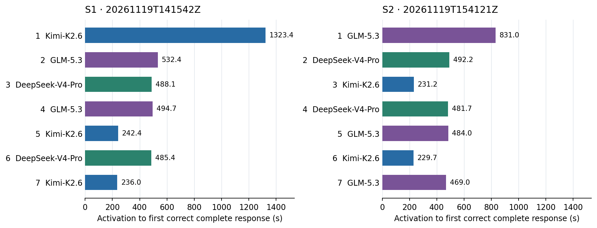

# V11 B1 三模型复现 · GLM-5.3

## 实验结论

**S1、S2 的 2 轮正式验收通过，共 14/14 段金标通过。** 每段 Host KV 提交 512 token，清理后占用归零，旧 KV 命中均为 0 token。每轮独立完成至少 60 秒八卡归零观察。

qjhs003 使用 8×H20、TP8、864 GiB 权重 Store 和 813 GiB 常驻 LMCache Host KV 池。GLM-5.3 使用 vLLM 0.30.0，Kimi-K2.6 和 DeepSeek-V4-Pro 使用 vLLM 0.20.1。三模型共用 LMCache 0.5.5。

## 冻结序列

| 序列 | 模型顺序 | 正式通过轮数 |
| --- | --- | --- |
| S1 | Kimi-K2.6 → GLM-5.3 → DeepSeek-V4-Pro → GLM-5.3 → Kimi-K2.6 → DeepSeek-V4-Pro → Kimi-K2.6 | 1 |
| S2 | GLM-5.3 → DeepSeek-V4-Pro → Kimi-K2.6 → DeepSeek-V4-Pro → GLM-5.3 → Kimi-K2.6 → GLM-5.3 | 1 |
| S3 | DeepSeek-V4-Pro → Kimi-K2.6 → GLM-5.3 → Kimi-K2.6 → DeepSeek-V4-Pro → GLM-5.3 → DeepSeek-V4-Pro | 0 |

每轮首段经 SafeTensors 冷页准入，后六段通过同一权重 Store 恢复。每段独立启动 Backend，完成业务及 KV 探针后退出并清理 Host KV。

## 数据 1 · 轮前初始化和整轮释放

| 序列与 run ID | Host KV 池初始化（s） | 权重 Store 初始化（s） | 两池就绪（s） | 八卡归零观察（s） | 归零采样数 | 金标 |
| --- | --- | --- | --- | --- | --- | --- |
| S1 · `B1-GLM53-S1-20261119T141542Z` | 195.271 | 376.012 | 571.284 | 60.972 | 50 | 7/7 |
| S2 · `B1-GLM53-S2-20261119T154121Z` | 191.303 | 404.958 | 596.262 | 61.085 | 50 | 7/7 |

先建 Host KV 池，再建权重 Store。两池就绪从首个池初始化发起计至第二个池就绪，含中间间隔。释放观察从末尾连续八卡归零的首个采样计至末个采样。

## 数据 2 · 逐段启动、权重和 Host KV

### S1 · `B1-GLM53-S1-20261119T141542Z`

| 原始段目录 | 切换目标 | 权重状态 | A（s） | 完整权重加载（s） | Store 重读 / 命中（GiB） | Host KV 清理前 → 后（MiB） | 金标 |
| --- | --- | --- | --- | --- | --- | --- | --- |
| `00-K-kimi` | Kimi | SF 冷读 | 1323.356 | 1166.951 | 0.000 / 0.000 | 34.312 → 0.000 | 通过 |
| `01-G-glm53` | Kimi → GLM | Store 全未命中 | 532.436 | 122.773 | 705.567 / 0.000 | 26.344 → 0.000 | 通过 |
| `02-D-v4` | GLM → V4 | Store 全未命中 | 488.148 | 151.735 | 817.449 / 0.000 | 47.078 → 0.000 | 通过 |
| `03-G-glm53` | V4 → GLM | Store 全未命中 | 494.666 | 120.076 | 705.567 / 0.000 | 26.344 → 0.000 | 通过 |
| `04-K-kimi` | GLM → Kimi | Store 全未命中 | 242.389 | 98.774 | 574.627 / 0.000 | 34.312 → 0.000 | 通过 |
| `05-D-v4` | Kimi → V4 | Store 全未命中 | 485.439 | 144.635 | 817.449 / 0.000 | 47.078 → 0.000 | 通过 |
| `06-K-kimi` | V4 → Kimi | Store 全未命中 | 235.954 | 96.220 | 574.627 / 0.000 | 34.312 → 0.000 | 通过 |

### S2 · `B1-GLM53-S2-20261119T154121Z`

| 原始段目录 | 切换目标 | 权重状态 | A（s） | 完整权重加载（s） | Store 重读 / 命中（GiB） | Host KV 清理前 → 后（MiB） | 金标 |
| --- | --- | --- | --- | --- | --- | --- | --- |
| `00-G-glm53` | GLM | SF 冷读 | 830.997 | 442.628 | 0.000 / 0.000 | 26.344 → 0.000 | 通过 |
| `01-D-v4` | GLM → V4 | Store 全未命中 | 492.245 | 148.106 | 817.449 / 0.000 | 47.078 → 0.000 | 通过 |
| `02-K-kimi` | V4 → Kimi | Store 全未命中 | 231.246 | 98.578 | 574.627 / 0.000 | 34.312 → 0.000 | 通过 |
| `03-D-v4` | Kimi → V4 | Store 全未命中 | 481.743 | 143.977 | 817.449 / 0.000 | 47.078 → 0.000 | 通过 |
| `04-G-glm53` | V4 → GLM | Store 全未命中 | 484.014 | 121.918 | 705.567 / 0.000 | 26.344 → 0.000 | 通过 |
| `05-K-kimi` | GLM → Kimi | Store 全未命中 | 229.699 | 96.650 | 574.627 / 0.000 | 34.312 → 0.000 | 通过 |
| `06-G-glm53` | Kimi → GLM | Store 局部命中 | 468.967 | 105.977 | 617.371 / 88.196 | 26.344 → 0.000 | 通过 |

[逐段 CSV](derived/b1-segments.csv) · [带原始端点和逐 rank 值的复算 JSON](derived/b1-recomputed.json)

## 计时与缓存口径

- **A** 取控制器放行激活至首个通过金标的完整业务响应。请求和 tokenizer 按各模型冻结，`kv_fill` 在业务响应之后单独记录。
- **完整权重加载** 取八 rank 中最早进入加载调用到最晚成功返回的主机端跨度。V4 分组恢复及 H2D 可发生在后处理内。缺测记 `—`。
- **SF 冷读** 按冻结 SafeTensors 权重的客户端页缓存零驻留判定。**Store 全未命中** 按目标 Store 路径在权重池内全部缺失判定，表中重读量来自 Store 路径回执，磁盘页缓存状态以另有准入证据为准。
- **Host KV** 取 LMCache 状态回执中清理前后的池内有效占用。整轮 GPU 释放由八卡采样独立核验。

## 原始证据

原始目录为 `qjhs003:/home/boyjiang/sllm-v4-pro/cache-competition-20261109/glm53-four-condition-20261118/formal-b1-runs/<run_id>/`。

- 轮次使用 `protocol.json`、`admission.json`、`live-admission.json`、`pool-init-timing.json`、`result.json` 和 `release.jsonl`。
- 逐段使用 `step-result.json`、业务响应与金标回执、`events/*.jsonl` 或 `weight-load-rank-*.jsonl`、`kv-write.json`、`kv-clear.json` 和 `lookup-{before,after}.prom`。首段另有 `sf-admission/summary.json` 和原始 mincore 向量。

[失败与未结束记录索引](derived/b1-recomputed.json) · [原始证据路径、大小和 SHA-256](derived/evidence-index.json)

[联合 B2 容量与 CUDA 注册观察](B2-admission-20261119.md)
