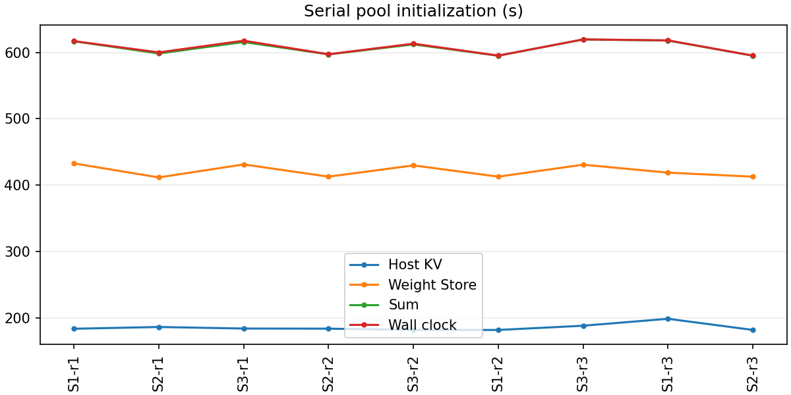
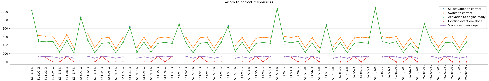
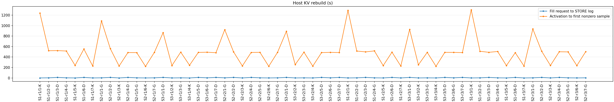
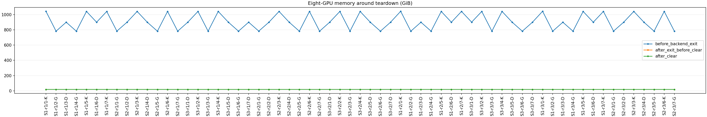
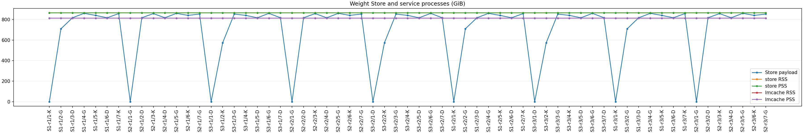
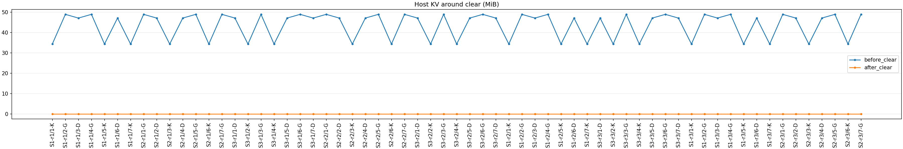
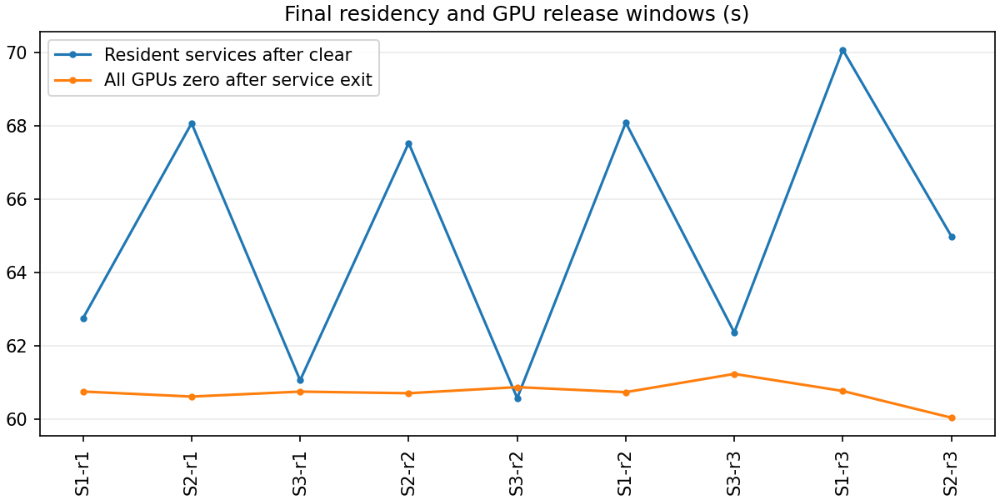

# V11 三模型大池实验

已纳入 9/9 轮、63/63 段。qjhs003，TP8，864 GiB 权重 Store，813 GiB Host KV，512-token 填充。

S1 以 Kimi 首尾，S2 以 GLM 首尾，S3 以 V4 首尾。每轮首段是通过冷页准入的 SafeTensors 启动，后六段使用该轮常驻 Store。

## 实验结论

| 实验问题 | 正式结果 | 对应表图 |
| --- | --- | --- |
| 双池初始化 | 从 Host KV 池启动到权重 Store 就绪，实测墙钟 595.138–619.587 秒 | 数据 1 / 图 1 |
| 模型切换 | 54 次 Store 切换通过金标。Store 驱逐与恢复合并区间为 90.837–139.139 秒 | 数据 2 / 图 2 |
| Host KV 重建 | 63 段各提交 512 token，查询零命中，清理后归零。填充至提交日志耗时 0.353–11.413 秒 | 数据 3 / 图 3 |
| 销毁后驻留与释放 | 清理后常驻服务的八卡 HBM 中位数为 19.260 GiB。九轮最终八卡归零窗口均超过 60 秒 | 数据 4–7 / 图 4–7 |

B2 原生 Sleep/Wake 的结果见[旧版 V11 报告](../report.md#b2--原生-sleep--wake)。本批使用后端退出后从 Store 恢复的切换流程。

## 实验条件与样本编号

| 条件 | 本轮怎么启动 | 用来回答什么 |
| --- | --- | --- |
| SF 冷读（每轮第 1 段） | 目标 SafeTensors 文件通过冷页准入后，由新 vLLM Backend 原生读取。双池服务已启动。 | 从激活到首个正确响应，给出各模型在当前双池服务环境下的原生冷启动参照。数据 2 的 SF 列只取这 9 段。 |
| 常驻 Store 切换（每轮第 2–7 段） | 旧 Backend 退出后，新 Backend 从同轮 864 GiB 权重 Store 恢复。目标权重随序列发生驱逐、驻留或重读，按事件账本判定。 | 测实际序列切换到首个正确响应的耗时，以及 Store 的驱逐、恢复和空间复用。数据 2 的切换列只取这 54 段。 |
| Host KV 冷重建（每轮全部 7 段） | 813 GiB Host KV 池跨段常驻，段间清空内容，实测查询零命中。每段提交 512 token 负载并检查写入。 | 测 Host KV 重建和清理，详见数据 3、5、6。池容量与本段写入量各自计量。 |

历史 SF 热读、独立 Store 冷读和预填 Store 池命中属于历史四条件基线。本轮后六段的 Store 状态由此前模型序列形成。B2 Sleep/Wake 的同一 Worker 唤醒路径见 [V11 基线说明](../report.md#各组基线怎么读)。

| 序列 | 第 1 → 7 段 |
| --- | --- |
| S1 | Kimi → GLM → V4 → GLM → Kimi → V4 → Kimi |
| S2 | GLM → V4 → Kimi → V4 → GLM → Kimi → GLM |
| S3 | V4 → Kimi → GLM → Kimi → V4 → GLM → V4 |

**读表例子。** `S2-r3/4-D` 是 S2 序列第 3 次正式重复的第 4 段，`D` 是本段的 DeepSeek-V4-Pro，上一段为 Kimi，所以这一行测的是 **Kimi → V4 的 Store 切换**。数据 2 中，该次切换至首个正确响应用了 **587.113 秒**。`r1`～`r3` 是重复编号，斜杠后从 1 数段。`K` 代表 Kimi-K2.6，`G` 代表 GLM-5.1-FP8。`S2-r3` 单独出现时指整轮。

## 数据 1 与图 1 · 双池串行初始化（s）

| 样本 | Host KV | Weight Store | Sum | Wall clock |
| --- | --- | --- | --- | --- |
| S1-r1 | 183.930 | 432.847 | 616.777 | 616.970 |
| S2-r1 | 186.578 | 411.772 | 598.350 | 600.000 |
| S3-r1 | 184.249 | 431.327 | 615.576 | 617.648 |
| S2-r2 | 184.076 | 412.922 | 596.998 | 597.213 |
| S3-r2 | 182.178 | 429.852 | 612.031 | 613.150 |
| S1-r2 | 182.082 | 412.903 | 594.986 | 595.138 |
| S3-r3 | 188.491 | 430.943 | 619.434 | 619.587 |
| S1-r3 | 198.912 | 418.928 | 617.840 | 618.092 |
| S2-r3 | 182.123 | 412.879 | 595.002 | 595.156 |

双池串行启动至就绪的墙钟范围为 **595.138–619.587 秒**。

## 数据 2 与图 2 · 切换与首个正确响应（s）

| 样本 | SF activation to correct | Switch to correct | Activation to engine ready | Eviction event envelope | Store event envelope |
| --- | --- | --- | --- | --- | --- |
| S1-r1/1-K | 1235.481 | — | 1233.702 | — | — |
| S1-r1/2-G | — | 633.235 | 497.346 | — | 120.211 |
| S1-r1/3-D | — | 615.534 | 481.711 | 99.468 | 134.735 |
| S1-r1/4-G | — | 620.308 | 490.517 | 1.321 | 120.434 |
| S1-r1/5-K | — | 359.471 | 234.604 | 0.834 | 91.215 |
| S1-r1/6-D | — | 653.211 | 513.456 | 127.123 | 135.165 |
| S1-r1/7-K | — | 342.219 | 221.665 | 1.404 | 91.846 |
| S2-r1/1-G | 1077.025 | — | 1065.713 | — | — |
| S2-r1/2-D | — | 673.721 | 517.948 | — | 136.815 |
| S2-r1/3-K | — | 338.470 | 221.909 | 0.833 | 91.135 |
| S2-r1/4-D | — | 568.049 | 444.164 | 130.501 | 138.399 |
| S2-r1/5-G | — | 588.798 | 461.868 | 0.046 | 120.273 |
| S2-r1/6-K | — | 323.985 | 215.521 | 0.477 | 91.537 |
| S2-r1/7-G | — | 579.729 | 465.062 | 0.556 | 120.195 |
| S3-r1/1-D | 846.352 | — | 825.691 | — | — |
| S3-r1/2-K | — | 339.682 | 231.170 | — | 90.898 |
| S3-r1/3-G | — | 590.913 | 470.398 | 0.601 | 120.213 |
| S3-r1/4-K | — | 347.528 | 236.530 | 0.514 | 90.981 |
| S3-r1/5-D | — | 575.025 | 446.464 | 128.246 | 136.775 |
| S3-r1/6-G | — | 595.392 | 468.615 | 0.057 | 120.072 |
| S3-r1/7-D | — | 571.852 | 442.654 | 126.992 | 136.292 |
| S2-r2/1-G | 908.864 | — | 897.782 | — | — |
| S2-r2/2-D | — | 586.522 | 458.703 | — | 136.458 |
| S2-r2/3-K | — | 339.377 | 223.916 | 0.924 | 91.406 |
| S2-r2/4-D | — | 578.343 | 447.103 | 130.183 | 137.375 |
| S2-r2/5-G | — | 598.476 | 466.469 | 1.250 | 120.204 |
| S2-r2/6-K | — | 334.497 | 217.136 | 0.813 | 91.225 |
| S2-r2/7-G | — | 584.203 | 467.258 | 1.105 | 120.125 |
| S3-r2/1-D | 869.555 | — | 848.809 | — | — |
| S3-r2/2-K | — | 386.805 | 249.287 | — | 90.837 |
| S3-r2/3-G | — | 585.684 | 468.823 | 0.076 | 120.246 |
| S3-r2/4-K | — | 330.438 | 220.648 | 0.371 | 90.950 |
| S3-r2/5-D | — | 569.853 | 445.508 | 127.776 | 137.194 |
| S3-r2/6-G | — | 591.635 | 465.718 | 1.202 | 120.034 |
| S3-r2/7-D | — | 574.574 | 446.524 | 126.727 | 137.647 |
| S1-r2/1-K | 1286.915 | — | 1285.201 | — | — |
| S1-r2/2-G | — | 612.914 | 490.845 | — | 120.056 |
| S1-r2/3-D | — | 584.314 | 457.131 | 104.562 | 139.139 |
| S1-r2/4-G | — | 617.336 | 492.390 | 0.512 | 120.169 |
| S1-r2/5-K | — | 340.114 | 229.859 | 0.729 | 91.175 |
| S1-r2/6-D | — | 579.029 | 452.669 | 129.563 | 136.620 |
| S1-r2/7-K | — | 339.460 | 221.453 | 0.310 | 91.458 |
| S3-r3/1-D | 905.397 | — | 884.836 | — | — |
| S3-r3/2-K | — | 365.770 | 244.001 | — | 91.250 |
| S3-r3/3-G | — | 588.162 | 465.669 | 1.149 | 120.324 |
| S3-r3/4-K | — | 327.299 | 217.108 | 0.767 | 91.218 |
| S3-r3/5-D | — | 574.512 | 448.329 | 128.240 | 136.508 |
| S3-r3/6-G | — | 593.803 | 465.083 | 0.415 | 120.232 |
| S3-r3/7-D | — | 577.445 | 443.983 | 127.432 | 136.679 |
| S1-r3/1-K | 1295.897 | — | 1294.083 | — | — |
| S1-r3/2-G | — | 604.268 | 486.113 | — | 119.967 |
| S1-r3/3-D | — | 576.458 | 448.833 | 103.622 | 136.691 |
| S1-r3/4-G | — | 608.523 | 482.960 | 0.048 | 120.099 |
| S1-r3/5-K | — | 339.130 | 229.895 | 0.859 | 91.189 |
| S1-r3/6-D | — | 571.422 | 442.323 | 129.588 | 137.753 |
| S1-r3/7-K | — | 338.490 | 220.473 | 1.014 | 91.310 |
| S2-r3/1-G | 923.513 | — | 912.422 | — | — |
| S2-r3/2-D | — | 598.406 | 470.051 | — | 138.628 |
| S2-r3/3-K | — | 357.508 | 233.741 | 0.669 | 91.075 |
| S2-r3/4-D | — | 587.113 | 459.357 | 131.132 | 138.467 |
| S2-r3/5-G | — | 600.807 | 474.389 | 0.500 | 120.413 |
| S2-r3/6-K | — | 338.229 | 229.486 | 0.301 | 91.780 |
| S2-r3/7-G | — | 598.965 | 476.692 | 0.394 | 120.147 |

已记录的 54 次 Store 恢复合并区间为 **90.837–139.139 秒**。该区间使用 Store 事件首尾，包含期间的等待，驱逐和恢复的重叠部分只计一次。

下表按目标模型汇总中位数。冷启动从本段激活计时，Store 切换从切换请求计时，分别保留样本数。

| 模型 | SF 激活至正确响应（s） | Store 切换至正确响应（s） | Store 驱逐与恢复区间（s） |
| --- | ---: | ---: | ---: |
| Kimi-K2.6 | 1286.915（n=3） | 339.419（n=18） | 91.217（n=18） |
| GLM-5.1-FP8 | 923.513（n=3） | 596.934（n=18） | 120.199（n=18） |
| DeepSeek-V4-Pro | 869.555（n=3） | 577.894（n=18） | 136.795（n=18） |

| 样本 | 文件读取 GiB | 权重命中 GiB | 驱逐路径 | 释放块 | 分配块 |
| --- | ---: | ---: | ---: | ---: | ---: |
| S1-r1/2-G | 710.159 | 0.000 | 0 | 0 | 22728 |
| S1-r1/3-D | 817.449 | 0.000 | 8 | 22728 | 26552 |
| S1-r1/4-G | 710.159 | 0.000 | 400 | 21656 | 22728 |
| S1-r1/5-K | 574.627 | 0.000 | 101 | 19101 | 18392 |
| S1-r1/6-D | 817.449 | 0.000 | 11 | 26915 | 26552 |
| S1-r1/7-K | 574.627 | 0.000 | 315 | 17321 | 18392 |
| S2-r1/2-D | 817.449 | 0.000 | 0 | 0 | 26552 |
| S2-r1/3-K | 574.627 | 0.000 | 315 | 17321 | 18392 |
| S2-r1/4-D | 817.449 | 0.000 | 189 | 27623 | 26552 |
| S2-r1/5-G | 710.159 | 0.000 | 400 | 21656 | 22728 |
| S2-r1/6-K | 574.627 | 0.000 | 101 | 19101 | 18392 |
| S2-r1/7-G | 710.159 | 0.000 | 9 | 22317 | 22728 |
| S3-r1/2-K | 574.627 | 0.000 | 0 | 0 | 18392 |
| S3-r1/3-G | 710.159 | 0.000 | 6 | 13794 | 22728 |
| S3-r1/4-K | 574.627 | 0.000 | 7 | 18803 | 18392 |
| S3-r1/5-D | 817.449 | 0.000 | 11 | 26915 | 26552 |
| S3-r1/6-G | 710.159 | 0.000 | 400 | 21656 | 22728 |
| S3-r1/7-D | 817.449 | 0.000 | 104 | 27624 | 26552 |
| S2-r2/2-D | 817.449 | 0.000 | 0 | 0 | 26552 |
| S2-r2/3-K | 574.627 | 0.000 | 315 | 17321 | 18392 |
| S2-r2/4-D | 817.449 | 0.000 | 189 | 27623 | 26552 |
| S2-r2/5-G | 710.159 | 0.000 | 400 | 21656 | 22728 |
| S2-r2/6-K | 574.627 | 0.000 | 101 | 19101 | 18392 |
| S2-r2/7-G | 710.159 | 0.000 | 9 | 22317 | 22728 |
| S3-r2/2-K | 574.627 | 0.000 | 0 | 0 | 18392 |
| S3-r2/3-G | 710.159 | 0.000 | 6 | 13794 | 22728 |
| S3-r2/4-K | 574.627 | 0.000 | 7 | 18803 | 18392 |
| S3-r2/5-D | 817.449 | 0.000 | 11 | 26915 | 26552 |
| S3-r2/6-G | 710.159 | 0.000 | 400 | 21656 | 22728 |
| S3-r2/7-D | 817.449 | 0.000 | 104 | 27624 | 26552 |
| S1-r2/2-G | 710.159 | 0.000 | 0 | 0 | 22728 |
| S1-r2/3-D | 817.449 | 0.000 | 8 | 22728 | 26552 |
| S1-r2/4-G | 710.159 | 0.000 | 400 | 21656 | 22728 |
| S1-r2/5-K | 574.627 | 0.000 | 101 | 19101 | 18392 |
| S1-r2/6-D | 817.449 | 0.000 | 11 | 26915 | 26552 |
| S1-r2/7-K | 574.627 | 0.000 | 315 | 17321 | 18392 |
| S3-r3/2-K | 574.627 | 0.000 | 0 | 0 | 18392 |
| S3-r3/3-G | 710.159 | 0.000 | 6 | 13794 | 22728 |
| S3-r3/4-K | 574.627 | 0.000 | 7 | 18803 | 18392 |
| S3-r3/5-D | 817.449 | 0.000 | 11 | 26915 | 26552 |
| S3-r3/6-G | 710.159 | 0.000 | 400 | 21656 | 22728 |
| S3-r3/7-D | 817.449 | 0.000 | 104 | 27624 | 26552 |
| S1-r3/2-G | 710.159 | 0.000 | 0 | 0 | 22728 |
| S1-r3/3-D | 817.449 | 0.000 | 8 | 22728 | 26552 |
| S1-r3/4-G | 710.159 | 0.000 | 400 | 21656 | 22728 |
| S1-r3/5-K | 574.627 | 0.000 | 101 | 19101 | 18392 |
| S1-r3/6-D | 817.449 | 0.000 | 11 | 26915 | 26552 |
| S1-r3/7-K | 574.627 | 0.000 | 315 | 17321 | 18392 |
| S2-r3/2-D | 817.449 | 0.000 | 0 | 0 | 26552 |
| S2-r3/3-K | 574.627 | 0.000 | 315 | 17321 | 18392 |
| S2-r3/4-D | 817.449 | 0.000 | 189 | 27623 | 26552 |
| S2-r3/5-G | 710.159 | 0.000 | 400 | 21656 | 22728 |
| S2-r3/6-K | 574.627 | 0.000 | 101 | 19101 | 18392 |
| S2-r3/7-G | 710.159 | 0.000 | 9 | 22317 | 22728 |

文件读取量来自 Store 计数，包含可能由 Linux 页缓存满足的读取。

## 数据 3 与图 3 · Host KV 重建（s）

| 样本 | Fill request to STORE log | Activation to first nonzero sample |
| --- | --- | --- |
| S1-r1/1-K | 0.359 | 1240.212 |
| S1-r1/2-G | 2.717 | 520.264 |
| S1-r1/3-D | 11.162 | 522.751 |
| S1-r1/4-G | 2.708 | 514.460 |
| S1-r1/5-K | 0.356 | 239.899 |
| S1-r1/6-D | 11.108 | 552.244 |
| S1-r1/7-K | 0.400 | 227.755 |
| S2-r1/1-G | 2.797 | 1089.223 |
| S2-r1/2-D | 11.040 | 558.920 |
| S2-r1/3-K | 0.356 | 227.849 |
| S2-r1/4-D | 11.098 | 484.798 |
| S2-r1/5-G | 2.681 | 483.990 |
| S2-r1/6-K | 0.376 | 221.179 |
| S2-r1/7-G | 2.702 | 487.322 |
| S3-r1/1-D | 11.356 | 865.784 |
| S3-r1/2-K | 0.385 | 237.160 |
| S3-r1/3-G | 2.724 | 493.416 |
| S3-r1/4-K | 0.353 | 242.837 |
| S3-r1/5-D | 11.120 | 487.751 |
| S3-r1/6-G | 2.737 | 491.993 |
| S3-r1/7-D | 10.947 | 481.820 |
| S2-r2/1-G | 2.743 | 921.753 |
| S2-r2/2-D | 11.251 | 498.614 |
| S2-r2/3-K | 0.388 | 229.298 |
| S2-r2/4-D | 11.096 | 487.231 |
| S2-r2/5-G | 2.785 | 489.316 |
| S2-r2/6-K | 0.401 | 222.875 |
| S2-r2/7-G | 2.747 | 490.011 |
| S3-r2/1-D | 11.350 | 889.980 |
| S3-r2/2-K | 0.389 | 254.856 |
| S3-r2/3-G | 2.722 | 492.253 |
| S3-r2/4-K | 0.390 | 226.116 |
| S3-r2/5-D | 11.087 | 484.137 |
| S3-r2/6-G | 2.747 | 488.878 |
| S3-r2/7-D | 10.902 | 485.390 |
| S1-r2/1-K | 0.393 | 1290.957 |
| S1-r2/2-G | 2.709 | 513.965 |
| S1-r2/3-D | 11.187 | 497.928 |
| S1-r2/4-G | 2.752 | 516.655 |
| S1-r2/5-K | 0.381 | 236.174 |
| S1-r2/6-D | 11.117 | 492.538 |
| S1-r2/7-K | 0.386 | 227.613 |
| S3-r3/1-D | 11.413 | 926.161 |
| S3-r3/2-K | 0.393 | 250.644 |
| S3-r3/3-G | 2.455 | 488.268 |
| S3-r3/4-K | 0.400 | 223.361 |
| S3-r3/5-D | 11.112 | 488.890 |
| S3-r3/6-G | 2.766 | 488.398 |
| S3-r3/7-D | 11.070 | 484.349 |
| S1-r3/1-K | 0.390 | 1301.058 |
| S1-r3/2-G | 2.703 | 509.825 |
| S1-r3/3-D | 11.108 | 489.850 |
| S1-r3/4-G | 2.720 | 505.416 |
| S1-r3/5-K | 0.355 | 236.047 |
| S1-r3/6-D | 10.942 | 482.462 |
| S1-r3/7-K | 0.360 | 227.487 |
| S2-r3/1-G | 2.797 | 935.247 |
| S2-r3/2-D | 11.112 | 511.249 |
| S2-r3/3-K | 0.400 | 238.919 |
| S2-r3/4-D | 11.083 | 500.295 |
| S2-r3/5-G | 2.692 | 497.635 |
| S2-r3/6-K | 0.444 | 236.331 |
| S2-r3/7-G | 2.715 | 500.563 |

填充请求到 STORE 完成日志的范围为 **0.353–11.413 秒**。63 段均提交 512 token，查询零命中，清理后归零。

| 模型 | 填充请求至最后一条 STORE 完成日志中位数（s） |
| --- | ---: |
| Kimi-K2.6 | 0.388（n=21） |
| GLM-5.1-FP8 | 2.722（n=21） |
| DeepSeek-V4-Pro | 11.108（n=21） |

| 样本 | STORE 提交 token | 查询 token | 命中 token | 清理后字节 |
| --- | ---: | ---: | ---: | ---: |
| S1-r1/1-K | 512 | 512 | 0 | 0 |
| S1-r1/2-G | 512 | 512 | 0 | 0 |
| S1-r1/3-D | 512 | 512 | 0 | 0 |
| S1-r1/4-G | 512 | 512 | 0 | 0 |
| S1-r1/5-K | 512 | 512 | 0 | 0 |
| S1-r1/6-D | 512 | 512 | 0 | 0 |
| S1-r1/7-K | 512 | 512 | 0 | 0 |
| S2-r1/1-G | 512 | 512 | 0 | 0 |
| S2-r1/2-D | 512 | 512 | 0 | 0 |
| S2-r1/3-K | 512 | 512 | 0 | 0 |
| S2-r1/4-D | 512 | 512 | 0 | 0 |
| S2-r1/5-G | 512 | 512 | 0 | 0 |
| S2-r1/6-K | 512 | 512 | 0 | 0 |
| S2-r1/7-G | 512 | 512 | 0 | 0 |
| S3-r1/1-D | 512 | 512 | 0 | 0 |
| S3-r1/2-K | 512 | 512 | 0 | 0 |
| S3-r1/3-G | 512 | 512 | 0 | 0 |
| S3-r1/4-K | 512 | 512 | 0 | 0 |
| S3-r1/5-D | 512 | 512 | 0 | 0 |
| S3-r1/6-G | 512 | 512 | 0 | 0 |
| S3-r1/7-D | 512 | 512 | 0 | 0 |
| S2-r2/1-G | 512 | 512 | 0 | 0 |
| S2-r2/2-D | 512 | 512 | 0 | 0 |
| S2-r2/3-K | 512 | 512 | 0 | 0 |
| S2-r2/4-D | 512 | 512 | 0 | 0 |
| S2-r2/5-G | 512 | 512 | 0 | 0 |
| S2-r2/6-K | 512 | 512 | 0 | 0 |
| S2-r2/7-G | 512 | 512 | 0 | 0 |
| S3-r2/1-D | 512 | 512 | 0 | 0 |
| S3-r2/2-K | 512 | 512 | 0 | 0 |
| S3-r2/3-G | 512 | 512 | 0 | 0 |
| S3-r2/4-K | 512 | 512 | 0 | 0 |
| S3-r2/5-D | 512 | 512 | 0 | 0 |
| S3-r2/6-G | 512 | 512 | 0 | 0 |
| S3-r2/7-D | 512 | 512 | 0 | 0 |
| S1-r2/1-K | 512 | 512 | 0 | 0 |
| S1-r2/2-G | 512 | 512 | 0 | 0 |
| S1-r2/3-D | 512 | 512 | 0 | 0 |
| S1-r2/4-G | 512 | 512 | 0 | 0 |
| S1-r2/5-K | 512 | 512 | 0 | 0 |
| S1-r2/6-D | 512 | 512 | 0 | 0 |
| S1-r2/7-K | 512 | 512 | 0 | 0 |
| S3-r3/1-D | 512 | 512 | 0 | 0 |
| S3-r3/2-K | 512 | 512 | 0 | 0 |
| S3-r3/3-G | 512 | 512 | 0 | 0 |
| S3-r3/4-K | 512 | 512 | 0 | 0 |
| S3-r3/5-D | 512 | 512 | 0 | 0 |
| S3-r3/6-G | 512 | 512 | 0 | 0 |
| S3-r3/7-D | 512 | 512 | 0 | 0 |
| S1-r3/1-K | 512 | 512 | 0 | 0 |
| S1-r3/2-G | 512 | 512 | 0 | 0 |
| S1-r3/3-D | 512 | 512 | 0 | 0 |
| S1-r3/4-G | 512 | 512 | 0 | 0 |
| S1-r3/5-K | 512 | 512 | 0 | 0 |
| S1-r3/6-D | 512 | 512 | 0 | 0 |
| S1-r3/7-K | 512 | 512 | 0 | 0 |
| S2-r3/1-G | 512 | 512 | 0 | 0 |
| S2-r3/2-D | 512 | 512 | 0 | 0 |
| S2-r3/3-K | 512 | 512 | 0 | 0 |
| S2-r3/4-D | 512 | 512 | 0 | 0 |
| S2-r3/5-G | 512 | 512 | 0 | 0 |
| S2-r3/6-K | 512 | 512 | 0 | 0 |
| S2-r3/7-G | 512 | 512 | 0 | 0 |

## 数据 4 与图 4 · 销毁前后八卡显存（GiB）

| 样本 | before_backend_exit | after_exit_before_clear | after_clear |
| --- | --- | --- | --- |
| S1-r1/1-K | 1042.770 | 19.258 | 19.258 |
| S1-r1/2-G | 782.006 | 19.260 | 19.260 |
| S1-r1/3-D | 899.307 | 19.260 | 19.260 |
| S1-r1/4-G | 782.006 | 19.260 | 19.260 |
| S1-r1/5-K | 1040.816 | 19.260 | 19.260 |
| S1-r1/6-D | 899.307 | 19.260 | 19.260 |
| S1-r1/7-K | 1040.816 | 19.260 | 19.260 |
| S2-r1/1-G | 782.957 | 19.260 | 19.260 |
| S2-r1/2-D | 899.307 | 19.260 | 19.260 |
| S2-r1/3-K | 1040.811 | 19.260 | 19.260 |
| S2-r1/4-D | 899.307 | 19.260 | 19.260 |
| S2-r1/5-G | 781.980 | 19.260 | 19.260 |
| S2-r1/6-K | 1040.820 | 19.260 | 19.260 |
| S2-r1/7-G | 782.002 | 19.260 | 19.260 |
| S3-r1/1-D | 900.209 | 19.260 | 19.260 |
| S3-r1/2-K | 1040.809 | 19.260 | 19.260 |
| S3-r1/3-G | 782.004 | 19.260 | 19.260 |
| S3-r1/4-K | 1040.809 | 19.260 | 19.260 |
| S3-r1/5-D | 899.307 | 19.260 | 19.260 |
| S3-r1/6-G | 782.006 | 19.260 | 19.260 |
| S3-r1/7-D | 899.307 | 19.260 | 19.260 |
| S2-r2/1-G | 782.971 | 19.260 | 19.260 |
| S2-r2/2-D | 899.307 | 19.260 | 19.260 |
| S2-r2/3-K | 1040.811 | 19.260 | 19.260 |
| S2-r2/4-D | 899.307 | 19.260 | 19.260 |
| S2-r2/5-G | 782.006 | 19.260 | 19.260 |
| S2-r2/6-K | 1040.820 | 19.260 | 19.260 |
| S2-r2/7-G | 781.998 | 19.260 | 19.260 |
| S3-r2/1-D | 900.191 | 19.260 | 19.260 |
| S3-r2/2-K | 1040.811 | 19.260 | 19.260 |
| S3-r2/3-G | 782.002 | 19.260 | 19.260 |
| S3-r2/4-K | 1040.820 | 19.260 | 19.260 |
| S3-r2/5-D | 899.307 | 19.260 | 19.260 |
| S3-r2/6-G | 782.006 | 19.260 | 19.260 |
| S3-r2/7-D | 899.307 | 19.260 | 19.260 |
| S1-r2/1-K | 1042.770 | 19.258 | 19.258 |
| S1-r2/2-G | 782.002 | 19.260 | 19.260 |
| S1-r2/3-D | 899.307 | 19.260 | 19.260 |
| S1-r2/4-G | 782.002 | 19.260 | 19.260 |
| S1-r2/5-K | 1040.812 | 19.260 | 19.260 |
| S1-r2/6-D | 899.307 | 19.260 | 19.260 |
| S1-r2/7-K | 1040.814 | 19.260 | 19.260 |
| S3-r3/1-D | 900.182 | 19.260 | 19.260 |
| S3-r3/2-K | 1040.812 | 19.260 | 19.260 |
| S3-r3/3-G | 782.004 | 19.260 | 19.260 |
| S3-r3/4-K | 1040.822 | 19.260 | 19.260 |
| S3-r3/5-D | 899.307 | 19.260 | 19.260 |
| S3-r3/6-G | 782.002 | 19.260 | 19.260 |
| S3-r3/7-D | 899.307 | 19.260 | 19.260 |
| S1-r3/1-K | 1042.770 | 19.258 | 19.258 |
| S1-r3/2-G | 781.996 | 19.260 | 19.260 |
| S1-r3/3-D | 899.307 | 19.260 | 19.260 |
| S1-r3/4-G | 782.006 | 19.260 | 19.260 |
| S1-r3/5-K | 1040.828 | 19.260 | 19.260 |
| S1-r3/6-D | 899.307 | 19.260 | 19.260 |
| S1-r3/7-K | 1040.816 | 19.260 | 19.260 |
| S2-r3/1-G | 782.973 | 19.260 | 19.260 |
| S2-r3/2-D | 899.307 | 19.260 | 19.260 |
| S2-r3/3-K | 1040.824 | 19.260 | 19.260 |
| S2-r3/4-D | 899.307 | 19.260 | 19.260 |
| S2-r3/5-G | 782.006 | 19.260 | 19.260 |
| S2-r3/6-K | 1040.820 | 19.260 | 19.260 |
| S2-r3/7-G | 782.006 | 19.260 | 19.260 |

## 数据 5 与图 5 · 模型退出并清理后 RAM 驻留（GiB）

| 样本 | Store payload | store RSS | store PSS | lmcache RSS | lmcache PSS |
| --- | --- | --- | --- | --- | --- |
| S1-r1/1-K | 0.000 | 865.852 | 865.830 | 814.174 | 814.153 |
| S1-r1/2-G | 710.159 | 865.875 | 865.850 | 814.181 | 814.156 |
| S1-r1/3-D | 817.449 | 865.898 | 865.873 | 814.183 | 814.158 |
| S1-r1/4-G | 860.768 | 865.904 | 865.880 | 814.215 | 814.190 |
| S1-r1/5-K | 840.936 | 865.907 | 865.882 | 814.230 | 814.205 |
| S1-r1/6-D | 817.449 | 865.913 | 865.888 | 814.233 | 814.208 |
| S1-r1/7-K | 858.588 | 865.916 | 865.891 | 814.234 | 814.208 |
| S2-r1/1-G | 0.000 | 865.857 | 865.822 | 814.214 | 814.178 |
| S2-r1/2-D | 817.449 | 865.894 | 865.859 | 814.216 | 814.180 |
| S2-r1/3-K | 858.588 | 865.899 | 865.865 | 814.217 | 814.180 |
| S2-r1/4-D | 817.449 | 865.909 | 865.874 | 814.218 | 814.182 |
| S2-r1/5-G | 860.768 | 865.914 | 865.879 | 814.220 | 814.184 |
| S2-r1/6-K | 840.936 | 865.915 | 865.881 | 814.220 | 814.183 |
| S2-r1/7-G | 853.816 | 865.919 | 865.884 | 814.221 | 814.184 |
| S3-r1/1-D | 0.000 | 865.819 | 865.805 | 814.166 | 814.151 |
| S3-r1/2-K | 574.627 | 865.840 | 865.824 | 814.166 | 814.148 |
| S3-r1/3-G | 853.816 | 865.848 | 865.831 | 814.167 | 814.149 |
| S3-r1/4-K | 840.936 | 865.850 | 865.833 | 814.167 | 814.150 |
| S3-r1/5-D | 817.449 | 865.869 | 865.853 | 814.169 | 814.151 |
| S3-r1/6-G | 860.768 | 865.876 | 865.859 | 814.171 | 814.152 |
| S3-r1/7-D | 817.449 | 865.881 | 865.865 | 814.172 | 814.154 |
| S2-r2/1-G | 0.000 | 865.870 | 865.831 | 814.226 | 814.187 |
| S2-r2/2-D | 817.449 | 865.906 | 865.867 | 814.228 | 814.188 |
| S2-r2/3-K | 858.588 | 865.911 | 865.872 | 814.229 | 814.189 |
| S2-r2/4-D | 817.449 | 865.920 | 865.881 | 814.231 | 814.190 |
| S2-r2/5-G | 860.768 | 865.925 | 865.886 | 814.286 | 814.245 |
| S2-r2/6-K | 840.936 | 865.927 | 865.888 | 814.287 | 814.246 |
| S2-r2/7-G | 853.816 | 865.931 | 865.891 | 814.288 | 814.247 |
| S3-r2/1-D | 0.000 | 865.804 | 865.792 | 814.166 | 814.152 |
| S3-r2/2-K | 574.627 | 865.829 | 865.813 | 814.168 | 814.149 |
| S3-r2/3-G | 853.816 | 865.836 | 865.821 | 814.169 | 814.151 |
| S3-r2/4-K | 840.936 | 865.839 | 865.824 | 814.170 | 814.152 |
| S3-r2/5-D | 817.449 | 865.858 | 865.842 | 814.171 | 814.153 |
| S3-r2/6-G | 860.768 | 865.864 | 865.848 | 814.173 | 814.154 |
| S3-r2/7-D | 817.449 | 865.871 | 865.855 | 814.174 | 814.155 |
| S1-r2/1-K | 0.000 | 865.794 | 865.787 | 814.143 | 814.135 |
| S1-r2/2-G | 710.159 | 865.817 | 865.810 | 814.149 | 814.139 |
| S1-r2/3-D | 817.449 | 865.840 | 865.833 | 814.150 | 814.140 |
| S1-r2/4-G | 860.768 | 865.847 | 865.840 | 814.151 | 814.142 |
| S1-r2/5-K | 840.936 | 865.850 | 865.843 | 814.152 | 814.142 |
| S1-r2/6-D | 817.449 | 865.856 | 865.849 | 814.153 | 814.144 |
| S1-r2/7-K | 858.588 | 865.858 | 865.851 | 814.154 | 814.144 |
| S3-r3/1-D | 0.000 | 865.802 | 865.788 | 814.156 | 814.143 |
| S3-r3/2-K | 574.627 | 865.822 | 865.807 | 814.157 | 814.142 |
| S3-r3/3-G | 853.816 | 865.829 | 865.814 | 814.158 | 814.143 |
| S3-r3/4-K | 840.936 | 865.832 | 865.817 | 814.158 | 814.143 |
| S3-r3/5-D | 817.449 | 865.852 | 865.837 | 814.203 | 814.189 |
| S3-r3/6-G | 860.768 | 865.857 | 865.842 | 814.206 | 814.190 |
| S3-r3/7-D | 817.449 | 865.863 | 865.848 | 814.208 | 814.192 |
| S1-r3/1-K | 0.000 | 865.781 | 865.783 | 814.118 | 814.120 |
| S1-r3/2-G | 710.159 | 865.807 | 865.807 | 814.127 | 814.125 |
| S1-r3/3-D | 817.449 | 865.832 | 865.831 | 814.130 | 814.127 |
| S1-r3/4-G | 860.768 | 865.838 | 865.837 | 814.131 | 814.129 |
| S1-r3/5-K | 840.936 | 865.842 | 865.840 | 814.133 | 814.131 |
| S1-r3/6-D | 817.449 | 865.847 | 865.846 | 814.135 | 814.133 |
| S1-r3/7-K | 858.588 | 865.849 | 865.848 | 814.136 | 814.134 |
| S2-r3/1-G | 0.000 | 865.923 | 865.870 | 814.253 | 814.199 |
| S2-r3/2-D | 817.449 | 865.958 | 865.905 | 814.256 | 814.200 |
| S2-r3/3-K | 858.588 | 865.963 | 865.909 | 814.256 | 814.201 |
| S2-r3/4-D | 817.449 | 865.972 | 865.919 | 814.258 | 814.202 |
| S2-r3/5-G | 860.768 | 865.977 | 865.923 | 814.260 | 814.204 |
| S2-r3/6-K | 840.936 | 865.979 | 865.926 | 814.261 | 814.205 |
| S2-r3/7-G | 853.816 | 865.982 | 865.929 | 814.262 | 814.207 |

## 数据 6 与图 6 · 清理前后 Host KV 数据占用（MiB）

| 样本 | before_clear | after_clear |
| --- | --- | --- |
| S1-r1/1-K | 34.312 | 0.000 |
| S1-r1/2-G | 48.906 | 0.000 |
| S1-r1/3-D | 47.078 | 0.000 |
| S1-r1/4-G | 48.906 | 0.000 |
| S1-r1/5-K | 34.312 | 0.000 |
| S1-r1/6-D | 47.078 | 0.000 |
| S1-r1/7-K | 34.312 | 0.000 |
| S2-r1/1-G | 48.906 | 0.000 |
| S2-r1/2-D | 47.078 | 0.000 |
| S2-r1/3-K | 34.312 | 0.000 |
| S2-r1/4-D | 47.078 | 0.000 |
| S2-r1/5-G | 48.906 | 0.000 |
| S2-r1/6-K | 34.312 | 0.000 |
| S2-r1/7-G | 48.906 | 0.000 |
| S3-r1/1-D | 47.078 | 0.000 |
| S3-r1/2-K | 34.312 | 0.000 |
| S3-r1/3-G | 48.906 | 0.000 |
| S3-r1/4-K | 34.312 | 0.000 |
| S3-r1/5-D | 47.078 | 0.000 |
| S3-r1/6-G | 48.906 | 0.000 |
| S3-r1/7-D | 47.078 | 0.000 |
| S2-r2/1-G | 48.906 | 0.000 |
| S2-r2/2-D | 47.078 | 0.000 |
| S2-r2/3-K | 34.312 | 0.000 |
| S2-r2/4-D | 47.078 | 0.000 |
| S2-r2/5-G | 48.906 | 0.000 |
| S2-r2/6-K | 34.312 | 0.000 |
| S2-r2/7-G | 48.906 | 0.000 |
| S3-r2/1-D | 47.078 | 0.000 |
| S3-r2/2-K | 34.312 | 0.000 |
| S3-r2/3-G | 48.906 | 0.000 |
| S3-r2/4-K | 34.312 | 0.000 |
| S3-r2/5-D | 47.078 | 0.000 |
| S3-r2/6-G | 48.906 | 0.000 |
| S3-r2/7-D | 47.078 | 0.000 |
| S1-r2/1-K | 34.312 | 0.000 |
| S1-r2/2-G | 48.906 | 0.000 |
| S1-r2/3-D | 47.078 | 0.000 |
| S1-r2/4-G | 48.906 | 0.000 |
| S1-r2/5-K | 34.312 | 0.000 |
| S1-r2/6-D | 47.078 | 0.000 |
| S1-r2/7-K | 34.312 | 0.000 |
| S3-r3/1-D | 47.078 | 0.000 |
| S3-r3/2-K | 34.312 | 0.000 |
| S3-r3/3-G | 48.906 | 0.000 |
| S3-r3/4-K | 34.312 | 0.000 |
| S3-r3/5-D | 47.078 | 0.000 |
| S3-r3/6-G | 48.906 | 0.000 |
| S3-r3/7-D | 47.078 | 0.000 |
| S1-r3/1-K | 34.312 | 0.000 |
| S1-r3/2-G | 48.906 | 0.000 |
| S1-r3/3-D | 47.078 | 0.000 |
| S1-r3/4-G | 48.906 | 0.000 |
| S1-r3/5-K | 34.312 | 0.000 |
| S1-r3/6-D | 47.078 | 0.000 |
| S1-r3/7-K | 34.312 | 0.000 |
| S2-r3/1-G | 48.906 | 0.000 |
| S2-r3/2-D | 47.078 | 0.000 |
| S2-r3/3-K | 34.312 | 0.000 |
| S2-r3/4-D | 47.078 | 0.000 |
| S2-r3/5-G | 48.906 | 0.000 |
| S2-r3/6-K | 34.312 | 0.000 |
| S2-r3/7-G | 48.906 | 0.000 |

## 数据 7 与图 7 · 末段常驻与八卡归零观察（s）

| 样本 | Resident services after clear | All GPUs zero after service exit |
| --- | --- | --- |
| S1-r1 | 62.748 | 60.744 |
| S2-r1 | 68.074 | 60.607 |
| S3-r1 | 61.052 | 60.742 |
| S2-r2 | 67.532 | 60.698 |
| S3-r2 | 60.565 | 60.865 |
| S1-r2 | 68.090 | 60.727 |
| S3-r3 | 62.359 | 61.226 |
| S1-r3 | 70.078 | 60.759 |
| S2-r3 | 64.985 | 60.030 |

末段常驻窗口从清理后快照算到服务退出前最后一次采样。八卡归零窗口取服务退出后的独立采样。

八卡显存为设备总量。权重及 KV 的显存分项缺少独立归因，导出中留空。原始导出逐段保留 RAM 权重、Host KV、进程 PID/RSS/PSS 和释放记录。

清理后的驻留中位数按本段销毁的模型分组。Store 有效载荷也受此前切换留下的权重影响。

| 模型 | 八卡 HBM（GiB） | RAM Store 有效载荷（GiB） | RAM Host KV 数据（MiB） |
| --- | ---: | ---: | ---: |
| Kimi-K2.6 | 19.260（n=21） | 840.936（n=21） | 0.000（n=21） |
| GLM-5.1-FP8 | 19.260（n=21） | 853.816（n=21） | 0.000（n=21） |
| DeepSeek-V4-Pro | 19.260（n=21） | 817.449（n=21） | 0.000（n=21） |

## 原始运行

可下载[正式数据快照](formal-snapshot.json)。在本目录运行 `python report_campaign.py formal-snapshot.json report` 可用快照复算表图。原始运行目录位于 qjhs003 的 `/home/boyjiang/sllm-v4-pro/cache-competition-20261109/v11-large-pool-20261113`。

- `runs/B1-S1-r1-20261113T154532Z/`
- `runs/B1-S2-r1-20261113T171618Z/`
- `runs/B1-S3-r1-20261113T184147Z/`
- `runs/B1-S2-r2-20261113T200253Z/`
- `runs/B1-S3-r2-20261113T212433Z/`
- `runs/B1-S1-r2-20261113T224615Z/`
- `runs/B1-S3-r3-20261114T001448Z/`
- `runs/B1-S1-r3-20261114T025144Z/`
- `runs/B1-S2-r3-20261114T042028Z/`

S1 第 3 轮首次尝试 `runs/B1-S1-r3-20261114T013711Z/` 中，第 5 段容器正常退出后被 Docker prune 清除，控制器读取退出状态失败。该尝试单独保留，八卡归零观察为 60.786 秒。正式 S1-r3 采用修复退出回执校验后的完整重跑。短测证据保留在原运行目录。

重算时在 qjhs003 实验目录运行 `python3 collect_campaign.py . > formal.json`，然后在有 Matplotlib 的环境运行 `python report_campaign.py formal.json report`。
