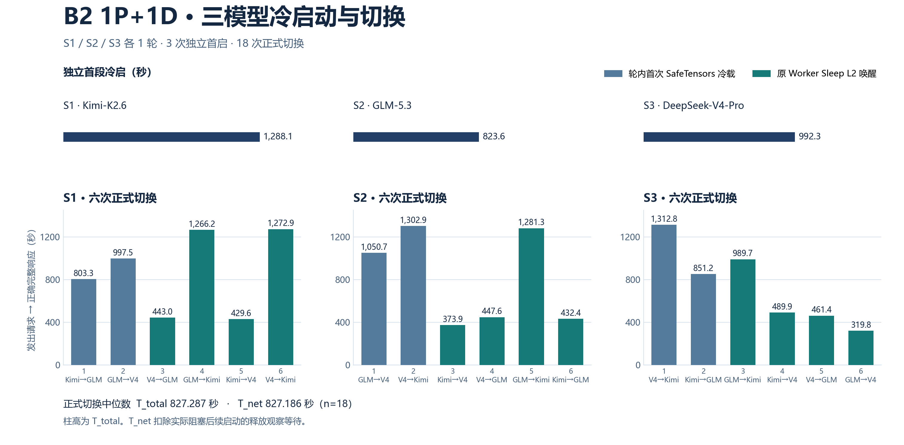
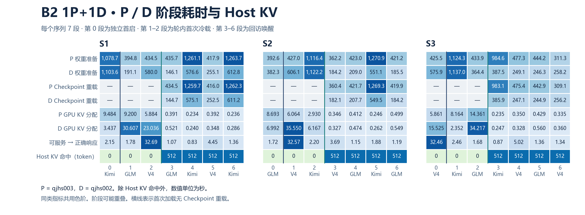

# B2 三模型 1P+1D 切换验收

P 为 qjhs003，D 为 qjhs002。两端 TP8，P 端 Host KV 池为 813 GiB。
B2 使用 SafeTensors 冷读和原 Worker Sleep L2 唤醒。

## 三模型闭环

| 基线 | 模型 | Run ID | 实际上下文／GPU KV（GiB/rank） | P／D RAM 峰值（GiB） | 共同归零（秒） | GSM8K |
|---|---|---|---|---:|---:|---:|
| B2 | Kimi-K2.6 | PD-V6-B2-K-20261123T070827Z | 2048／16 | 893.178／82.812 | 78.984 | — |
| B2 | DeepSeek-V4-Pro | PD-V6-B2-D-NUMA-4R-LONG-20261123T150838Z | 32800／18（另验 32,768-token 回读） | 895.952／92.095 | 78.977 | — |
| B2 | GLM-5.3 | PD-V6-B2-G-GSM4096-20261123T173010Z | 4608／16 | 890.980／87.075 | 78.978 | 49/50 |

## 常驻池准备

P 端初始化 813 GiB LMCache。D 端 Host KV 为 0 GiB。墙钟从 P 发出准备计至双端就绪。

| 基线 | 序列 | P LMCache（秒） | 准备墙钟（秒） |
|---|---|---:|---:|
| B2 | S1 | 216.817 | 217.066 |
| B2 | S2 | 215.458 | 215.709 |
| B2 | S3 | 217.359 | 217.608 |

## 首段独立冷启

| 基线 | 序列 | 首模型 | T_total（秒） | T_net（秒） |
|---|---|---|---:|---:|
| B2 | S1 | Kimi-K2.6 | 1288.079 | 1288.079 |
| B2 | S2 | GLM-5.3 | 823.564 | 823.564 |
| B2 | S3 | DeepSeek-V4-Pro | 992.253 | 992.253 |

## 正式切换

S1 从 Kimi 开始，S2 从 GLM 开始，S3 从 V4 开始。B2 共 3 个首段和 18 个正式切换段。
T_total 从切换发出到正确完整响应。T_net 只扣除实际阻塞后续启动的释放观察等待。
首次启动和原 Worker 回访分别记录八 rank 的权重和 GPU KV 张量分配包络及 rank 最大值。这些是主机端接点。P 与 D 的阶段各自计时。仅对适用的路径记录 checkpoint 重载。

| 基线 | 序列 | 段 | 源模型 → 目标模型 | T_total（秒） | T_net（秒） | Host KV（token） |
|---|---|---:|---|---:|---:|---:|
| B2 | S1 | 1 | Kimi-K2.6 → GLM-5.3 | 803.333 | 803.232 | 0 |
| B2 | S1 | 2 | GLM-5.3 → DeepSeek-V4-Pro | 997.533 | 997.429 | 0 |
| B2 | S1 | 3 | DeepSeek-V4-Pro → GLM-5.3 | 443.013 | 442.914 | 512 |
| B2 | S1 | 4 | GLM-5.3 → Kimi-K2.6 | 1266.205 | 1266.105 | 512 |
| B2 | S1 | 5 | Kimi-K2.6 → DeepSeek-V4-Pro | 429.613 | 429.507 | 512 |
| B2 | S1 | 6 | DeepSeek-V4-Pro → Kimi-K2.6 | 1272.854 | 1272.747 | 512 |
| B2 | S2 | 1 | GLM-5.3 → DeepSeek-V4-Pro | 1050.657 | 1050.559 | 0 |
| B2 | S2 | 2 | DeepSeek-V4-Pro → Kimi-K2.6 | 1302.890 | 1302.788 | 0 |
| B2 | S2 | 3 | Kimi-K2.6 → DeepSeek-V4-Pro | 373.912 | 373.778 | 512 |
| B2 | S2 | 4 | DeepSeek-V4-Pro → GLM-5.3 | 447.649 | 447.547 | 512 |
| B2 | S2 | 5 | GLM-5.3 → Kimi-K2.6 | 1281.280 | 1281.178 | 512 |
| B2 | S2 | 6 | Kimi-K2.6 → GLM-5.3 | 432.386 | 432.283 | 512 |
| B2 | S3 | 1 | DeepSeek-V4-Pro → Kimi-K2.6 | 1312.796 | 1312.695 | 0 |
| B2 | S3 | 2 | Kimi-K2.6 → GLM-5.3 | 851.240 | 851.139 | 0 |
| B2 | S3 | 3 | GLM-5.3 → Kimi-K2.6 | 989.717 | 989.613 | 512 |
| B2 | S3 | 4 | Kimi-K2.6 → DeepSeek-V4-Pro | 489.932 | 489.824 | 512 |
| B2 | S3 | 5 | DeepSeek-V4-Pro → GLM-5.3 | 461.417 | 461.227 | 512 |
| B2 | S3 | 6 | GLM-5.3 → DeepSeek-V4-Pro | 319.808 | 319.705 | 512 |

B2 正式切换中位数。T_total 为 827.287 秒，T_net 为 827.186 秒，有效 n=18。



## P／D 阶段耗时与 Host KV

各序列前三段走 SafeTensors 冷载，Host KV 命中均为 0。后四段使用原 Worker 从 checkpoint 唤醒，12 次均回读 512 token。图中 P／D 阶段为各自八 rank 主机端包络，可彼此重叠。Checkpoint 重载包含在对应唤醒段的权重准备中。



## 数据与重算

[segments.csv](segments.csv) 保存全部 21 段和未取整的逐段数据。[evidence-index.json](evidence-index.json) 绑定通过正式验收的 run ID、回执路径与 SHA-256。重画两张图时，脚本先逐段对照 CSV 与证据索引。依赖 Python、Matplotlib 及 Microsoft YaHei 或 Noto Sans CJK SC 等受支持的中文字体。

```bash
python v11/pd-1p1d-20261124/plot_b2.py
```
