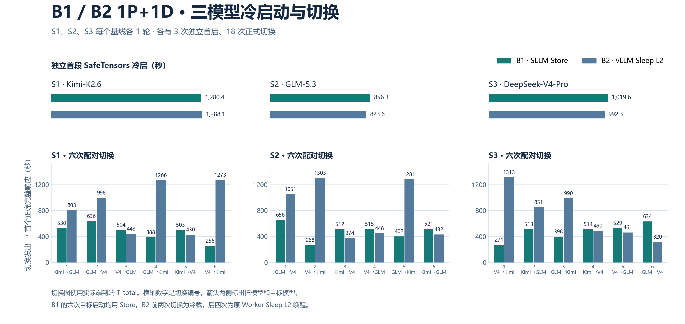

# 三模型 1P+1D 切换验收

P 为 qjhs003，D 为 qjhs002。两端 TP8，P 端 Host KV 池为 813 GiB。
B2 使用 SafeTensors 冷读和原 Worker Sleep L2 唤醒。B1 首段 SafeTensors 冷读，后六段从双机 Store 恢复。

## 验收结论

| 基线 | 首段／切换 | 金标通过 | T_total 中位数（秒） | T_net 中位数（秒） | 512-token Host KV 回读 |
|---|---:|---:|---:|---:|---:|
| B1 | 3／18 | 21/21 | 512.557 | 507.346 | 12/18 |
| B2 | 3／18 | 21/21 | 827.287 | 827.186 | 12/18 |

两个基线的 S1、S2、S3 各验收 1 轮。各序列均完成双机 16 卡至少 60 秒共同归零。本次比较覆盖指定模型切换位置，每个位置有一对实测值。当前预约剩余时间不足以让三个序列各补两轮。



## 三模型闭环

| 基线 | 模型 | Run ID | 实际上下文／GPU KV（GiB/rank） | P／D RAM 峰值（GiB） | 共同归零（秒） | GSM8K |
|---|---|---|---|---:|---:|---:|
| B2 | Kimi-K2.6 | PD-V6-B2-K-20261123T070827Z | 2048／16 | 893.178／82.812 | 78.984 | — |
| B2 | DeepSeek-V4-Pro | PD-V6-B2-D-NUMA-4R-LONG-20261123T150838Z | 32800／18（另验 32,768-token 回读） | 895.952／92.095 | 78.977 | — |
| B2 | GLM-5.3 | PD-V6-B2-G-GSM4096-20261123T173010Z | 4608／16 | 890.980／87.075 | 78.978 | 49/50 |
| B1 | Kimi-K2.6 | PD-V6-B1-K-20261124T075423Z | 2048／16 | 1832.215／1022.597 | 78.978 | — |
| B1 | GLM-5.3 | PD-V6-B1-G-GSM4096-20261124T081912Z | 4608／16 | 1831.744／1021.348 | 78.978 | 49/50 |
| B1 | DeepSeek-V4-Pro | PD-V6-B1-D-20261124T091427Z | 2048／16 | 1835.559／1024.289 | 78.979 | — |

## 常驻池准备

B1 的 P 端先初始化 LMCache，再初始化 Store。D 端 Store 与 P 端准备并行。墙钟取 P 发出准备到双端就绪的实测跨度。

| 基线 | 序列 | P LMCache（秒） | P Store（秒） | D Store（秒） | 准备墙钟（秒） |
|---|---|---:|---:|---:|---:|
| B2 | S1 | 216.817 | — | — | 217.066 |
| B2 | S2 | 215.458 | — | — | 215.709 |
| B2 | S3 | 217.359 | — | — | 217.608 |
| B1 | S1 | 216.460 | 357.869 | 341.913 | 575.000 |
| B1 | S2 | 216.451 | 316.790 | 291.958 | 533.913 |
| B1 | S3 | 217.448 | 317.750 | 287.781 | 535.848 |

## B1 内存准入与实测最低可用内存

B1 逐样本要求 P、D 的 MemAvailable 均不低于 50 GiB。B2 沿用各节点 MemTotal − MemAvailable ≤ 1,750 GiB 的门槛。

| Run ID | P 最低可用（GiB） | D 最低可用（GiB） |
|---|---:|---:|
| PD-V6-B1-K-20261124T075423Z | 91.068 | 900.686 |
| PD-V6-B1-G-GSM4096-20261124T081912Z | 91.539 | 901.936 |
| PD-V6-B1-D-20261124T091427Z | 87.725 | 898.995 |
| PD-V6-B1-S1-20261124T094436Z | 92.079 | 899.890 |
| PD-V6-B1-S2-20261124T110733Z | 99.455 | 910.789 |
| PD-V6-B1-S3-20261124T122400Z | 99.167 | 910.270 |

## B1 权重 Store 注册页

从固定原生二进制的分块注册和构造成功日志推得成功注册字节。按节点单列，不重复计入 cgroup。
Host KV 池仍采用独立的匿名页降级口径。

| Run ID | P／D 配置（GiB） | P／D 成功注册（GiB） |
|---|---:|---:|
| PD-V6-B1-K-20261124T075423Z | 864／864 | 864／864 |
| PD-V6-B1-G-GSM4096-20261124T081912Z | 864／864 | 864／864 |
| PD-V6-B1-D-20261124T091427Z | 864／864 | 864／864 |
| PD-V6-B1-S1-20261124T094436Z | 864／864 | 864／864 |
| PD-V6-B1-S2-20261124T110733Z | 864／864 | 864／864 |
| PD-V6-B1-S3-20261124T122400Z | 864／864 | 864／864 |

## 首段独立冷启

| 基线 | 序列 | 首模型 | T_total（秒） | T_net（秒） |
|---|---|---|---:|---:|
| B2 | S1 | Kimi-K2.6 | 1288.079 | 1288.079 |
| B2 | S2 | GLM-5.3 | 823.564 | 823.564 |
| B2 | S3 | DeepSeek-V4-Pro | 992.253 | 992.253 |
| B1 | S1 | Kimi-K2.6 | 1280.419 | 1280.419 |
| B1 | S2 | GLM-5.3 | 856.309 | 856.309 |
| B1 | S3 | DeepSeek-V4-Pro | 1019.628 | 1019.628 |

B1 每次切换前复核旧 Worker 正常退出。当次 GPU 计算进程只归属本轮常驻服务，LMCache GPU KV 注册和活动会话已清空。逐段释放证据见索引。

## 正式切换

S1 从 Kimi 开始，S2 从 GLM 开始，S3 从 V4 开始。每个基线各 18 个正式切换段。
T_total 从切换发出到正确完整响应。T_net 只扣除实际阻塞后续启动的释放观察等待。
首次启动、原 Worker 回访和 Store 恢复分别记录八 rank 的权重和 GPU KV 张量分配包络及 rank 最大值。这些是主机端接点。P 与 D 的阶段各自计时。仅对适用的路径记录 checkpoint 重载。

| 基线 | 序列 | 段 | 源模型 → 目标模型 | T_total（秒） | T_net（秒） | Host KV（token） |
|---|---|---:|---|---:|---:|---:|
| B2 | S1 | 1 | Kimi-K2.6 → GLM-5.3 | 803.333 | 803.232 | 0 |
| B2 | S1 | 2 | GLM-5.3 → DeepSeek-V4-Pro | 997.533 | 997.429 | 0 |
| B2 | S1 | 3 | DeepSeek-V4-Pro → GLM-5.3 | 443.013 | 442.914 | 512 |
| B2 | S1 | 4 | GLM-5.3 → Kimi-K2.6 | 1266.205 | 1266.105 | 512 |
| B2 | S1 | 5 | Kimi-K2.6 → DeepSeek-V4-Pro | 429.613 | 429.507 | 512 |
| B2 | S1 | 6 | DeepSeek-V4-Pro → Kimi-K2.6 | 1272.854 | 1272.747 | 512 |
| B2 | S2 | 1 | GLM-5.3 → DeepSeek-V4-Pro | 1050.657 | 1050.559 | 0 |
| B2 | S2 | 2 | DeepSeek-V4-Pro → Kimi-K2.6 | 1302.890 | 1302.788 | 0 |
| B2 | S2 | 3 | Kimi-K2.6 → DeepSeek-V4-Pro | 373.912 | 373.778 | 512 |
| B2 | S2 | 4 | DeepSeek-V4-Pro → GLM-5.3 | 447.649 | 447.547 | 512 |
| B2 | S2 | 5 | GLM-5.3 → Kimi-K2.6 | 1281.280 | 1281.178 | 512 |
| B2 | S2 | 6 | Kimi-K2.6 → GLM-5.3 | 432.386 | 432.283 | 512 |
| B2 | S3 | 1 | DeepSeek-V4-Pro → Kimi-K2.6 | 1312.796 | 1312.695 | 0 |
| B2 | S3 | 2 | Kimi-K2.6 → GLM-5.3 | 851.240 | 851.139 | 0 |
| B2 | S3 | 3 | GLM-5.3 → Kimi-K2.6 | 989.717 | 989.613 | 512 |
| B2 | S3 | 4 | Kimi-K2.6 → DeepSeek-V4-Pro | 489.932 | 489.824 | 512 |
| B2 | S3 | 5 | DeepSeek-V4-Pro → GLM-5.3 | 461.417 | 461.227 | 512 |
| B2 | S3 | 6 | GLM-5.3 → DeepSeek-V4-Pro | 319.808 | 319.705 | 512 |
| B1 | S1 | 1 | Kimi-K2.6 → GLM-5.3 | 530.459 | 529.692 | 0 |
| B1 | S1 | 2 | GLM-5.3 → DeepSeek-V4-Pro | 636.368 | 513.948 | 0 |
| B1 | S1 | 3 | DeepSeek-V4-Pro → GLM-5.3 | 504.198 | 503.560 | 512 |
| B1 | S1 | 4 | GLM-5.3 → Kimi-K2.6 | 387.583 | 252.594 | 512 |
| B1 | S1 | 5 | Kimi-K2.6 → DeepSeek-V4-Pro | 503.326 | 502.759 | 512 |
| B1 | S1 | 6 | DeepSeek-V4-Pro → Kimi-K2.6 | 256.060 | 255.406 | 512 |
| B1 | S2 | 1 | GLM-5.3 → DeepSeek-V4-Pro | 656.493 | 518.196 | 0 |
| B1 | S2 | 2 | DeepSeek-V4-Pro → Kimi-K2.6 | 268.106 | 267.532 | 0 |
| B1 | S2 | 3 | Kimi-K2.6 → DeepSeek-V4-Pro | 511.715 | 511.132 | 512 |
| B1 | S2 | 4 | DeepSeek-V4-Pro → GLM-5.3 | 514.645 | 514.052 | 512 |
| B1 | S2 | 5 | GLM-5.3 → Kimi-K2.6 | 401.987 | 272.927 | 512 |
| B1 | S2 | 6 | Kimi-K2.6 → GLM-5.3 | 520.889 | 520.303 | 512 |
| B1 | S3 | 1 | DeepSeek-V4-Pro → Kimi-K2.6 | 271.356 | 270.760 | 0 |
| B1 | S3 | 2 | Kimi-K2.6 → GLM-5.3 | 513.400 | 512.783 | 0 |
| B1 | S3 | 3 | GLM-5.3 → Kimi-K2.6 | 398.205 | 268.442 | 512 |
| B1 | S3 | 4 | Kimi-K2.6 → DeepSeek-V4-Pro | 513.867 | 513.235 | 512 |
| B1 | S3 | 5 | DeepSeek-V4-Pro → GLM-5.3 | 529.348 | 528.657 | 512 |
| B1 | S3 | 6 | GLM-5.3 → DeepSeek-V4-Pro | 633.503 | 502.030 | 512 |

B2 正式切换中位数。T_total 为 827.287 秒，T_net 为 827.186 秒，有效 n=18。

B1 正式切换中位数。T_total 为 512.557 秒，T_net 为 507.346 秒，有效 n=18。

逐段数据见 [segments.csv](segments.csv)，原始回执索引见 [evidence-index.json](evidence-index.json)。

## 正式轮整机峰值采样明细

每行取该节点 MemTotal − MemAvailable 的最高采样点，容器各列来自同一采样点。P、D 的峰值可发生在不同时间。表中容量以 GiB 表示，注册页在上文单列。

| 基线 | 序列 | 节点 | UTC 采样点 | 整机占用 | AnonPages | SUnreclaim | PageTables | Shmem | Cached |
| --- | --- | --- | --- | --- | --- | --- | --- | --- | --- |
| B2 | S1 | P | 2026-11-23T21:04:56.000+00:00 | 941.320 | 888.421 | 4.666 | 10.087 | 1.034 | 981.706 |
| B2 | S1 | D | 2026-11-23T21:00:21.000+00:00 | 131.048 | 73.099 | 6.671 | 4.545 | 1.682 | 1789.839 |
| B2 | S2 | P | 2026-11-24T02:26:43.000+00:00 | 954.492 | 898.816 | 4.818 | 10.206 | 1.035 | 968.260 |
| B2 | S2 | D | 2026-11-24T02:22:19.000+00:00 | 139.470 | 81.928 | 6.556 | 3.700 | 1.682 | 1741.089 |
| B2 | S3 | P | 2026-11-24T04:41:47.000+00:00 | 950.442 | 896.992 | 4.799 | 10.228 | 1.036 | 973.224 |
| B2 | S3 | D | 2026-11-24T04:24:41.000+00:00 | 139.743 | 82.763 | 6.525 | 8.184 | 1.682 | 1741.739 |
| B1 | S1 | P | 2026-11-24T10:15:50.000+00:00 | 1831.204 | 1720.135 | 70.921 | 3.692 | 0.543 | 92.865 |
| B1 | S1 | D | 2026-11-24T10:33:27.000+00:00 | 1023.393 | 902.028 | 72.194 | 1.991 | 1.316 | 885.186 |
| B1 | S2 | P | 2026-11-24T11:41:33.000+00:00 | 1823.828 | 1712.481 | 70.909 | 3.469 | 0.670 | 103.402 |
| B1 | S2 | D | 2026-11-24T11:40:06.000+00:00 | 1012.494 | 895.989 | 72.350 | 1.883 | 1.303 | 826.956 |
| B1 | S3 | P | 2026-11-24T12:49:43.000+00:00 | 1824.116 | 1712.573 | 70.879 | 3.468 | 0.670 | 102.515 |
| B1 | S3 | D | 2026-11-24T12:48:14.000+00:00 | 1013.013 | 896.545 | 72.335 | 1.877 | 1.317 | 893.811 |

| 基线 | 序列 | 节点 | 活跃容器 | current | anon + shmem | file − shmem |
| --- | --- | --- | --- | --- | --- | --- |
| B2 | S1 | P | worker-D | 813.784 | 20.778 | 782.924 |
| B2 | S1 | P | worker-G | 70.373 | 20.350 | 48.464 |
| B2 | S1 | P | worker-K | 171.734 | 22.285 | 147.990 |
| B2 | S1 | P | lmcache | 815.363 | 813.602 | 0.137 |
| B2 | S1 | D | worker-D | 670.919 | 19.521 | 645.290 |
| B2 | S1 | D | worker-G | 631.041 | 20.503 | 608.784 |
| B2 | S1 | D | worker-K | 541.267 | 22.601 | 517.190 |
| B2 | S2 | P | worker-K | 205.302 | 21.825 | 182.034 |
| B2 | S2 | P | worker-D | 788.892 | 20.816 | 758.107 |
| B2 | S2 | P | worker-G | 46.463 | 19.824 | 25.501 |
| B2 | S2 | P | lmcache | 815.363 | 813.605 | 0.136 |
| B2 | S2 | D | worker-K | 566.746 | 22.274 | 543.017 |
| B2 | S2 | D | worker-D | 736.520 | 19.499 | 711.977 |
| B2 | S2 | D | worker-G | 500.029 | 19.715 | 478.545 |
| B2 | S3 | P | worker-G | 174.829 | 20.178 | 152.872 |
| B2 | S3 | P | worker-K | 44.893 | 22.542 | 21.268 |
| B2 | S3 | P | worker-D | 828.262 | 21.652 | 796.583 |
| B2 | S3 | P | lmcache | 815.470 | 813.620 | 0.229 |
| B2 | S3 | D | worker-G | 465.734 | 19.920 | 444.059 |
| B2 | S3 | D | worker-K | 550.305 | 22.737 | 526.079 |
| B2 | S3 | D | worker-D | 794.699 | 19.563 | 765.585 |
| B1 | S1 | P | worker-K | 114.637 | 23.008 | 90.293 |
| B1 | S1 | P | lmcache | 816.043 | 813.921 | 0.496 |
| B1 | S1 | P | store | 866.968 | 865.246 | 0.006 |
| B1 | S1 | D | store | 866.994 | 865.277 | 0.000 |
| B1 | S1 | D | worker-D | 25.956 | 25.741 | 0.053 |
| B1 | S2 | P | lmcache | 815.623 | 813.596 | 0.407 |
| B1 | S2 | P | store | 866.985 | 865.269 | 0.001 |
| B1 | S2 | P | worker-D | 29.914 | 26.816 | 2.830 |
| B1 | S2 | D | worker-D | 25.317 | 24.769 | 0.349 |
| B1 | S2 | D | store | 866.979 | 865.263 | 0.000 |
| B1 | S3 | P | worker-D | 128.654 | 26.915 | 99.747 |
| B1 | S3 | P | store | 866.965 | 865.248 | 0.001 |
| B1 | S3 | P | lmcache | 815.289 | 813.608 | 0.061 |
| B1 | S3 | D | store | 866.961 | 865.244 | 0.000 |
| B1 | S3 | D | worker-D | 439.554 | 25.375 | 412.514 |

## Store 恢复证据与重算

[B1 Store 原生恢复索引](store-restore-evidence.json)覆盖三模型闭环和三条正式序列。正式序列的 18 个切换均包含 P、D 各八 rank 的原生恢复确认。V4 的字节量来自 planner 的张量覆盖范围，实际恢复用原生 GPU staging 的 UUID 核验。逐轮原始回执的路径和 SHA-256 见 [证据索引](evidence-index.json)。双机空卡、共享内存和服务退出的实时时点见 [Prism 交接回执](handoff-to-prism.json)。

在 qjhs003 对同一批原始证据重算时，使用本报告目录作为当前目录和新的输出目录。以下命令只读原始 GPU 实验回执。

```bash
export PYTHONPATH=/home/boyjiang/pd-v6-b1-closureplan50.P1Se3muW/runtime
export PATH="/data/brick2/boyjiang/pd-1p1d-baselines/tmp/v6-postboot-route.pMZpk2Ro/pair-ssh-bin:$PATH"
export PD_V6_SSH_SOCKET="/tmp/pd-v6-postboot-$(id -u)-51752"
mapfile -t run_ids < <(python3 -c 'import json; print("\n".join(r["run_id"] for r in json.load(open("evidence-index.json"))["runs"]))')
out="$(mktemp -d)/final"
python3 -B v6_campaign.py --through B1 --out "$out" "${run_ids[@]}"
python3 -B verify_store_restore.py --out "$out/store-restore-evidence.json" "${run_ids[@]:6}"
python3 -B render_memory_peaks.py "$out/evidence-index.json" >> "$out/FINAL-1P1D-S1S2S3-SUMMARY.md"
python3 -B plot_final.py "$out" --check-only
python3 -B finalize_report.py "$out"
```

将三个重算数据文件复制到安装 Matplotlib 和中文字体的工作站后执行 `python -B plot_final.py <复制后的目录>`，生成报告所引用的 PNG。
