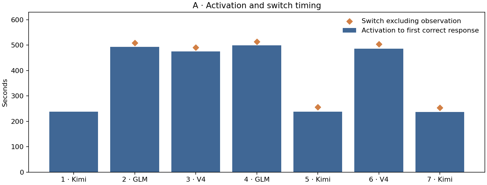
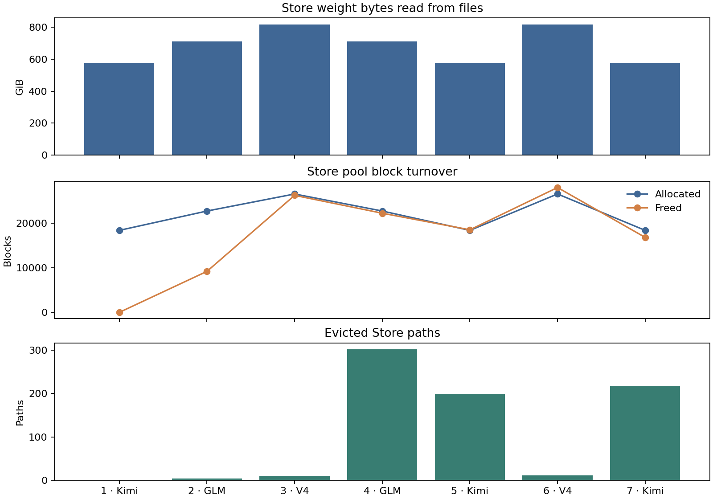
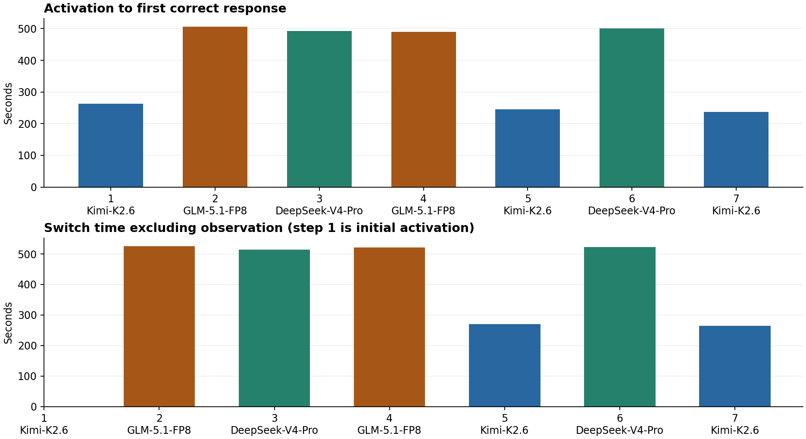
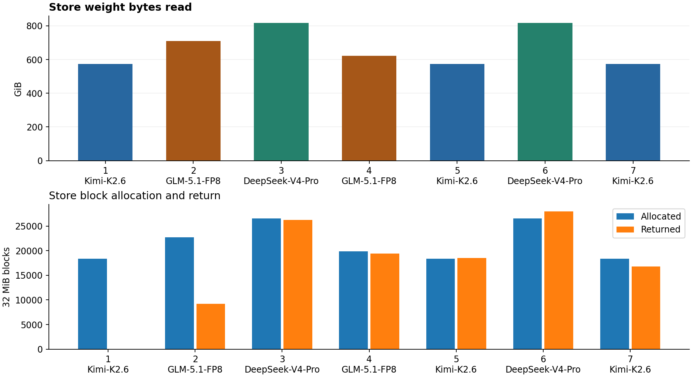
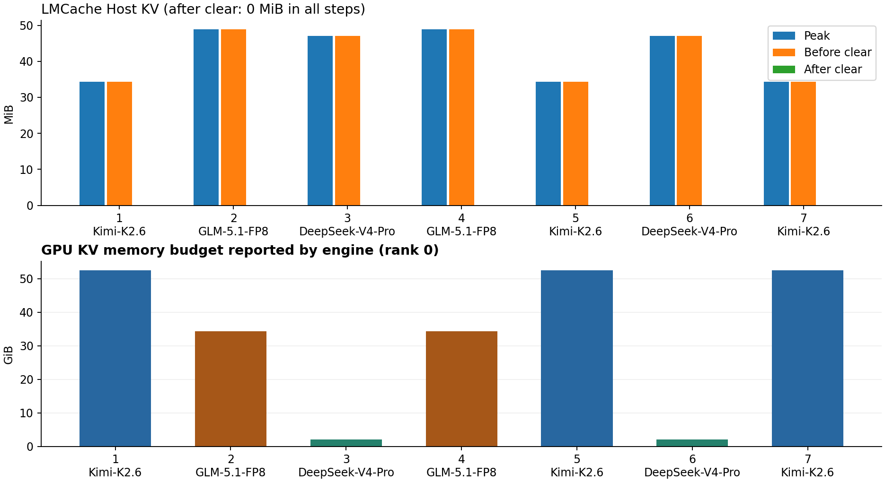
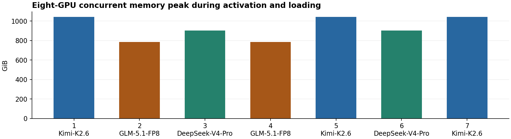
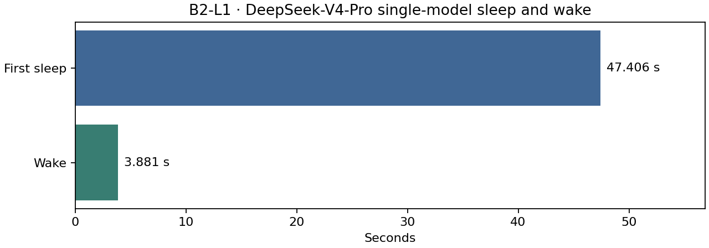
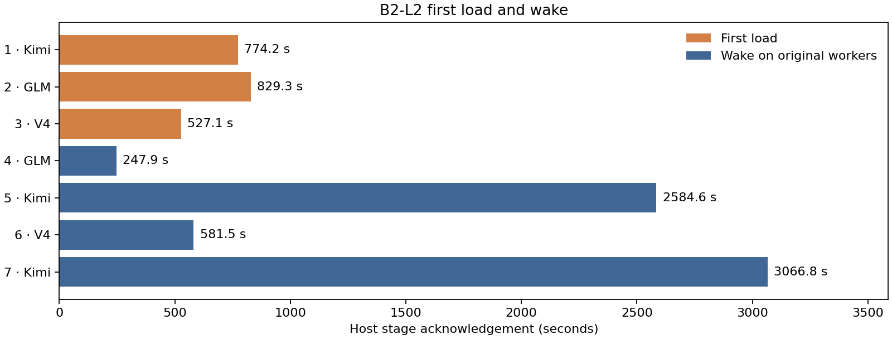

# V11 三模型切换复现实验报告

## 实验结论

| 路径 | 样本 | 实验结论 |
| --- | --- | --- |
| A · 常驻权重 Store | 固定序列 7 段 | 三模型均返回正确结果。六次切换均发生路径驱逐和权重重读，验证了常驻 Store 的空间复用。 |
| B1 · Store + Host KV | 原版正式轮 7 段 | 七段均观测到 Host KV 实际写入并在清理后归零，沿用原版正式轮结论。 |
| B2-L1 · Sleep + CPU 权重备份 | V4 单模型，1 次唤醒 | 原 Worker 唤醒后通过金标，单份 CPU 权重备份为 820.42 GiB。 |
| B2-L2 · Sleep + checkpoint 重载 | 同序列 7 段，其中 4 次唤醒 | 三模型金标通过、PID 连续，记录的 CPU 权重备份为 0。四次唤醒的重载 RPC 占唤醒时间的 99.2%–99.9%。 |

## 实验设置

qjhs003，8×H20，TP8。A 与 B2-L2 各取一轮完整七段，顺序均为 Kimi → GLM → V4 → GLM → Kimi → V4 → Kimi。A 使用 vLLM 0.20.1。A 与 B2-L2 最终八卡全零采样分别覆盖 60.845 和 61.237 秒。A/B2 表格从 1 开始编号，原始记录从 0 开始。B1 沿用原版正式轮及其统计口径。

## A · 常驻 Store

### 数据 1 与图 1 · 激活及切换耗时

激活耗时从本段激活到首个正确完整响应，包含权重恢复、引擎初始化和推理。切换耗时从上一段正确响应到本段正确响应，表中另扣协议观察时间。首段是首次启动，切换列留空。

| 段 | 模型 | 激活至正确（s） | 切换扣除观察（s） |
| --- | --- | --- | --- |
| 1 | Kimi-K2.6 | 237.748 | — |
| 2 | GLM-5.1-FP8 | 492.927 | 509.053 |
| 3 | DeepSeek-V4-Pro | 475.364 | 491.401 |
| 4 | GLM-5.1-FP8 | 499.48 | 513.588 |
| 5 | Kimi-K2.6 | 237.937 | 256.068 |
| 6 | DeepSeek-V4-Pro | 486.665 | 504.44 |
| 7 | Kimi-K2.6 | 236.709 | 254.107 |

七段激活均值 **381.0 s**，六次切换扣除观察后均值 **421.4 s**。本轮七段均为权重池未命中，适合作为同序列的重读基线。

### 数据 2 与图 2 · 权重读取和空间复用

| 段 | 模型 | 读取（GiB） | 命中（GiB） | 分配块 | 归还块 | 驱逐路径 |
| --- | --- | --- | --- | --- | --- | --- |
| 1 | Kimi-K2.6 | 574.63 | 0.00 | 18392 | 0 | 0 |
| 2 | GLM-5.1-FP8 | 710.16 | 0.00 | 22728 | 9196 | 4 |
| 3 | DeepSeek-V4-Pro | 817.45 | 0.00 | 26552 | 26242 | 10 |
| 4 | GLM-5.1-FP8 | 710.16 | 0.00 | 22728 | 22238 | 302 |
| 5 | Kimi-K2.6 | 574.63 | 0.00 | 18392 | 18519 | 199 |
| 6 | DeepSeek-V4-Pro | 817.45 | 0.00 | 26552 | 27999 | 11 |
| 7 | Kimi-K2.6 | 574.63 | 0.00 | 18392 | 16819 | 217 |

同一 Store PID 贯穿全序列。以第 4 段 V4 → GLM 为例，驱逐 302 条路径、归还 22,238 块并分配 22,728 块，GLM 重读后返回正确响应。路径数和池块数分别来自 Store 计数，文件读取量不区分 OS 页缓存和物理盘 I/O。

[A 逐段数据](runs/A-seq-7-agents-r1-20261113T035857Z/switch-events.csv) · [A 验收回执](runs/A-seq-7-agents-r1-20261113T035857Z/qualification.json)

## B1 组结果（Host KV 层）

**正式轮 `144041Z` 通过，7/7 段均观测到 Host KV 实际写入并在清理后归零。** 该轮使用固定 vLLM 0.20.1 和带 HMA 补丁的 LMCache 0.5.5。[正式验收回执](runs/B1-seq-7-agents-r1-20261112T144041Z/qualification.json)

顺序为 Kimi-K2.6 → GLM-5.1-FP8 → DeepSeek-V4-Pro → GLM-5.1-FP8 → Kimi-K2.6 → DeepSeek-V4-Pro → Kimi-K2.6。

SLLM Store 为每个新 Backend 恢复模型权重。vLLM 在本次启动时为 GPU KV 分配空间，LMCache 在请求期间接收 Host KV 写入。旧 Backend 退出后，控制器清理 Host KV，再启动下一个 Backend。本轮实测 Host KV 命中为 0 token。

**本轮测的加载条件**

B1 测的是 **同一个常驻 SLLM Store 上的三模型切换，加上 LMCache Host KV 写入和清理**。第 1 段从空 Store 权重池加载 Kimi-K2.6。第 2–7 段保留同一 Store 进程与权重池，按固定顺序驱逐、分配及读取。每段使用新建的 vLLM Backend 和 GPU KV。Host KV 在每段退出后清零，本轮实测 Host KV 命中 token 为 0。

本轮没有按历史四条件逐段重建缓存状态，也没有逐段验证操作系统页缓存冷暖。首段可标为「空 Store 池首次加载」，后六段标为「常驻 Store 序列切换」。所有段均走 Store 权重路径。以下四条件仅用于说明历史口径。

| 历史条件 | 历史实验的启动前状态 | 本轮 B1 的对应关系 |
| --- | --- | --- |
| SF 冷读 | 原生 SafeTensors，按历史协议完成冷页准入 | 未测 |
| SF 热读 | 原生 SafeTensors，按历史协议验证热页 | 未测 |
| Store 冷读 | 使用 Store 权重路径，按单次实验协议完成冷读准入 | 首段从空 Store 权重池加载 |
| Store 池命中 | 启动前已填入并确认目标权重驻留 | 后六段是自然切换，未设置独立的预填池条件 |

历史四条件的「启动至首个正确业务响应」见 [三模型历史报告](https://github.com/BoyJiang2/serverlessllm/blob/d3c10bda437b29d821b4845ca6a79c39b00fb975/comparison/evidence/three-model-final-20261108/REPORT.md)。下表仅列 `144041Z` 的逐段实测。

**加载与切换时间**

**Figure 1. B1 Activation and Model Switch Latency**

| 段 | 模型 | 激活至正确响应 (s) | 首 token (s) | 切换含观察 (s) | 切换不含观察 (s) | 观察 (s) |
| --- | --- | --- | --- | --- | --- | --- |
| 1 | Kimi-K2.6 | 262.544 | 258.581 | — | — | 60.000 |
| 2 | GLM-5.1-FP8 | 506.107 | 493.346 | 585.680 | 525.680 | 60.000 |
| 3 | DeepSeek-V4-Pro | 492.280 | 480.051 | 573.875 | 513.875 | 60.000 |
| 4 | GLM-5.1-FP8 | 490.297 | 477.949 | 580.686 | 520.686 | 60.000 |
| 5 | Kimi-K2.6 | 244.740 | 240.833 | 329.872 | 269.872 | 60.000 |
| 6 | DeepSeek-V4-Pro | 500.722 | 488.921 | 582.334 | 522.334 | 60.000 |
| 7 | Kimi-K2.6 | 237.713 | 233.797 | 323.909 | 263.909 | 60.000 |

激活至正确响应包含 Store 恢复、引擎初始化与推理。切换从上一模型正确响应到下一模型正确响应。首段没有上一模型，因此切换指标缺测。

**加载阶段与 Host KV 清理**

| 段 | 模型 | 上一正确响应至 Backend 退出 (s) | 退出至下一激活 (s) | 激活至引擎就绪 (s) | 就绪至首 token (s) | 首 token 至正确响应 (s) | 本段退出后 Host KV clear (s) |
| --- | --- | --- | --- | --- | --- | --- | --- |
| 1 | Kimi-K2.6 | — | — | 257.535 | 1.046 | 3.963 | 0.002 |
| 2 | GLM-5.1-FP8 | 11.980 | 67.594 | 485.877 | 7.469 | 12.761 | 0.002 |
| 3 | DeepSeek-V4-Pro | 12.938 | 68.657 | 464.242 | 15.809 | 12.228 | 0.001 |
| 4 | GLM-5.1-FP8 | 21.494 | 68.895 | 467.063 | 10.886 | 12.348 | 0.001 |
| 5 | Kimi-K2.6 | 14.788 | 70.343 | 239.932 | 0.901 | 3.907 | 0.002 |
| 6 | DeepSeek-V4-Pro | 11.731 | 69.882 | 473.682 | 15.239 | 11.801 | 0.002 |
| 7 | Kimi-K2.6 | 18.142 | 68.054 | 232.905 | 0.892 | 3.916 | 0.002 |原始切换表中，`t0` 是上一段正确响应，`t1` 是上一 Backend 退出，`t2` 是本段激活，`t3` 是引擎就绪，`t3_5` 是首 token，`t4` 是本段正确响应。退出至下一激活包含轮间观察等控制器动作。最后一列是本段退出后的独立 clear 调用耗时。

**Store 权重缓存与 LMCache Host KV**

**Figure 2. B1 Store Weight Reads and Block Allocation**

| 段 | 模型 | 读取 (GiB) | 分配块 | 归还块 | 驱逐路径 | Host KV 峰值 (MiB) | clear 前 (MiB) | clear 后 (MiB) | clear (s) |
| --- | --- | --- | --- | --- | --- | --- | --- | --- | --- |
| 1 | Kimi-K2.6 | 574.63 | 18392 | 0 | 0 | 34.31 | 34.31 | 0.00 | 0.002 |
| 2 | GLM-5.1-FP8 | 710.16 | 22728 | 9196 | 4 | 48.91 | 48.91 | 0.00 | 0.002 |
| 3 | DeepSeek-V4-Pro | 817.45 | 26552 | 26242 | 10 | 47.08 | 47.08 | 0.00 | 0.001 |
| 4 | GLM-5.1-FP8 | 621.39 | 19887 | 19397 | 301 | 48.91 | 48.91 | 0.00 | 0.001 |
| 5 | Kimi-K2.6 | 574.63 | 18392 | 18519 | 199 | 34.31 | 34.31 | 0.00 | 0.002 |
| 6 | DeepSeek-V4-Pro | 817.45 | 26552 | 27999 | 11 | 47.08 | 47.08 | 0.00 | 0.002 |
| 7 | Kimi-K2.6 | 574.63 | 18392 | 16819 | 217 | 34.31 | 34.31 | 0.00 | 0.002 |

Store 权重池配置为 1 TiB、每块 32 MiB。LMCache Host KV L1 配置为 16 GiB、每 chunk 256 token。Store 读取与块分配来自权重池账本，Host KV 峰值来自独立的 LMCache 采样。

**引擎加载与 KV 容量**

**Figure 3. B1 Host KV Writes and GPU KV Budget**

| 段 | 模型 | Rank 0 加载日志 (s) | Rank 0 可用于 GPU KV (GiB) | 引擎 GPU KV 容量 (token) | 2048-token 理论并发 | Host STORE 提交数 | Host STORE 完成数 | Host KV 命中 token |
| --- | --- | --- | --- | --- | --- | --- | --- | --- |
| 1 | Kimi-K2.6 | 92.712 | 52.49 | 802,080 | 391.64 | 1 | 1 | 0 |
| 2 | GLM-5.1-FP8 | 120.676 | 34.25 | 16,384 | 8.00 | 1 | 1 | 0 |
| 3 | DeepSeek-V4-Pro | 142.230 | 2.08 | 4,036 | 1.97 | 1 | 1 | 0 |
| 4 | GLM-5.1-FP8 | 107.512 | 34.25 | 16,384 | 8.00 | 1 | 1 | 0 |
| 5 | Kimi-K2.6 | 91.970 | 52.5 | 802,112 | 391.66 | 1 | 1 | 0 |
| 6 | DeepSeek-V4-Pro | 145.929 | 2.08 | 4,036 | 1.97 | 1 | 1 | 0 |
| 7 | Kimi-K2.6 | 93.075 | 52.5 | 802,112 | 391.66 | 1 | 1 | 0 |

加载时间取 vLLM Rank 0 的日志区间。GPU KV GiB 是引擎报告的可用预算，token 容量和理论并发来自 EngineCore。实际设备占用见逐卡采样。Host STORE 与 KV 命中按每段 LMCache 前后 Prometheus 计数器求差，首次出现的计数序列以 0 为起点，表中 — 表示后快照缺少该计数。

**Why DeepSeek-V4-Pro has a smaller GPU KV budget**

vLLM 先按每卡总显存与 `gpu_memory_utilization` 算出目标显存，再扣除权重、预跑测得的激活峰值和非 PyTorch 开销，以及适用时的 CUDA Graph 估算。该轮使用 eager 模式。DeepSeek-V4-Pro 的利用率设置为 **0.76**，另外两个模型为 **0.90**。按每卡约 139.8 GiB 算，0.76 对应约 **106.25 GiB**，比 0.90 少 **19.57 GiB**。两次 DeepSeek-V4-Pro 加载日志均显示 Rank 0 的加载区间显存增量为 **95.88 GiB**，预跑后引擎报告的可用 KV 预算为 **2.08 GiB**。加载日志增量与 profiler 的分项统计口径有别，现有证据未逐项给出各类扣减值。

同一模型每次激活都使用相同的权重、并行和显存配置，并重新跑初始化 profiling，结果接近。图 3 下半部分逐段取 Rank 0 日志。Kimi-K2.6 三次为 **52.49 / 52.50 / 52.50 GiB**，GLM-5.1-FP8 两次均为 **34.25 GiB**，DeepSeek-V4-Pro 两次均为 **2.08 GiB**。后两组在日志的两位小数精度下相同。上半部分是独立采样的 CPU Host KV 占用。[vLLM 预算计算](https://github.com/vllm-project/vllm/blob/132765e3560659ff63ebd236203672e991b70e08/vllm/v1/worker/gpu_worker.py#L391-L425)

[加载日志及 LMCache 计数器原文](runs/B1-seq-7-agents-r1-20261112T144041Z/kv-loading-log-excerpts.txt)

**激活与加载阶段资源采样**

**Figure 4. B1 Peak Concurrent Memory Usage Across Eight GPUs**

| 段 | 模型 | GPU0 峰值 (MiB) | GPU1 峰值 (MiB) | GPU2 峰值 (MiB) | GPU3 峰值 (MiB) | GPU4 峰值 (MiB) | GPU5 峰值 (MiB) | GPU6 峰值 (MiB) | GPU7 峰值 (MiB) | 八卡同刻峰值 (GiB) | 宿主可用内存最低 (GiB) | Store RSS 峰值 (GiB) |
| --- | --- | --- | --- | --- | --- | --- | --- | --- | --- | --- | --- | --- |
| 1 | Kimi-K2.6 | 133657 | 133569 | 133569 | 133569 | 133567 | 133567 | 133567 | 133567 | 1043.59 | 722.20 | 1026.20 |
| 2 | GLM-5.1-FP8 | 100453 | 100451 | 100451 | 100451 | 100451 | 100447 | 100451 | 100451 | 784.77 | 731.41 | 1026.21 |
| 3 | DeepSeek-V4-Pro | 115467 | 115465 | 115465 | 115465 | 115465 | 115465 | 115465 | 115465 | 902.07 | 729.55 | 1026.23 |
| 4 | GLM-5.1-FP8 | 100453 | 100451 | 100451 | 100451 | 100451 | 100447 | 100451 | 100451 | 784.77 | 730.85 | 1026.23 |
| 5 | Kimi-K2.6 | 133657 | 133569 | 133567 | 133569 | 133567 | 133569 | 133565 | 133569 | 1043.59 | 695.80 | 1026.24 |
| 6 | DeepSeek-V4-Pro | 115467 | 115465 | 115465 | 115465 | 115465 | 115465 | 115465 | 115465 | 902.07 | 729.14 | 1026.24 |
| 7 | Kimi-K2.6 | 133655 | 133567 | 133569 | 133567 | 133567 | 133567 | 133565 | 133569 | 1043.58 | 689.13 | 1026.24 |

GPU 数值取自 NVML 整卡显存采样，包含权重、GPU KV、工作区和运行时开销。八卡同刻峰值按每条采样先求和再取最大值。GPU KV 独占显存缺少可分离的实测值。

[原始资源采样](runs/B1-seq-7-agents-r1-20261112T144041Z/resource-samples.csv) · [Store 块账本](runs/B1-seq-7-agents-r1-20261112T144041Z/store-ledger.csv)

正式轮使用 vLLM 0.20.1 @132765e 与带 HMA 补丁的 LMCache 0.5.5 @05a013b。DeepSeek-V4-Pro 的 GPU memory utilization 为 0.76，Kimi-K2.6 和 GLM-5.1-FP8 为 0.90。最终八卡显存归零，释放观测记录为 59.504 秒。

[验收回执](runs/B1-seq-7-agents-r1-20261112T144041Z/qualification.json) · [原始切换事件与 Host KV 清理耗时](runs/B1-seq-7-agents-r1-20261112T144041Z/switch-events.csv) · [补丁及运行身份](runs/B1-seq-7-agents-r1-20261112T144041Z/lmcache-patch-identity.json) · [HMA 补丁](runs/B1-seq-7-agents-r1-20261112T144041Z/lmcache-hma.patch)

### 早期尝试与失败记录

早期尝试使用固定镜像，vLLM 0.20.1 的 `LMCacheMPConnector` 与 LMCache 0.5.6/0.5.7rc4
的 MP server 无法完成 `register_kv_caches` 握手：server 端 `LayoutDescRegistry.register`
收到 `world_size=0` 并拒绝（`ValueError: AttnWindowDesc: world_size must be >= 1, got 0`），
worker 等满 300 s 超时后 engine init 失败，因此没有任何一次激活可以记录。

逐次失败与修复记录：

| run | 现象 | 根因 | 处理 |
|---|---|---|---|
| `…T092923Z` | 作废 | 遗留探针占用 9100/5555，KV 被写进外来 server | 端口预检 + 校验 tier 大小 |
| `…T094324Z` | register 超时 | server 无 GPU 设备，无法接收 CUDA IPC handle | server 容器加 `--gpus` |
| `…T100307Z` | register 超时 | `ModuleNotFoundError: cupy`（`lmcache_driven_transfer.py:483`） | 装 `cupy-cuda13x==14.2.0` |
| `…T102728Z` | register 拒绝 | `AttnWindowDesc: world_size must be >= 1, got 0` | 当轮因协议错配终止 |

预验收第 1 部分（`b1-preacceptance-part1.json`）已通过：`GET /status` 200、`POST /cache/clear {"tier":"l1"}` 200、`tier=l2` 400、`num_l2_adapters=0`、`memory_used_bytes` 可直接读取。该阶段只完成管理接口检查，随后才修复注册并验证真实写入。

## B2 · 原生 Sleep / Wake

### 数据 1 与图 B2-1 · L1 单模型唤醒与主机容量

| 模型 | CPU 权重备份（GiB） | 首次 Sleep（s） | Wake（s） | 唤醒后金标 |
| --- | ---: | ---: | ---: | --- |
| DeepSeek-V4-Pro | 820.42 | 47.406 | 3.881 | 通过 |

V4 单模型同 PID 唤醒成功。该轮最终全零采样为 59.858 秒，低于 60 秒严格门槛。1.9 TiB 主机上，Kimi 备份仍驻留时写入 GLM 备份，最低 `MemAvailable` 为 0.316 GiB，因此 L1 的结论限于单模型唤醒。

[L1 原始回执](runs/B2-B2-smoke-r1-20261111T113723Z/L1/level-result.json) · [主机容量证据](B2-L1-RAM-BOUNDARY.md)

### 数据 2 与图 B2-2 · L2 首次加载及原 Worker 唤醒

| 段 | 模型 | 动作 | 动作至回执（s） | 重载 RPC（s） | 本段 Sleep（s） | Worker PID |
| --- | --- | --- | --- | --- | --- | --- |
| 1 | Kimi-K2.6 | 首次加载 | 774.181 | — | 1.413 | 2405340 |
| 2 | GLM-5.1-FP8 | 首次加载 | 829.322 | — | 1.489 | 2417938 |
| 3 | DeepSeek-V4-Pro | 首次加载 | 527.144 | — | 1.748 | 2442464 |
| 4 | GLM-5.1-FP8 | 唤醒 | 247.854 | 245.934 | 1.362 | 2417938 |
| 5 | Kimi-K2.6 | 唤醒 | 2584.591 | 2582.761 | 1.448 | 2405340 |
| 6 | DeepSeek-V4-Pro | 唤醒 | 581.513 | 578.630 | 1.976 | 2442464 |
| 7 | Kimi-K2.6 | 唤醒 | 3066.760 | 3064.757 | 1.388 | 2405340 |

L2 使用 checkpoint 重载，V4 使用独立 overlay。七段 Sleep 均值 **1.546 s**，四次 Wake 均值 **1620.2 s**。两次 Kimi 返回各耗时超过 2,500 s，且耗时主要落在重载 RPC。L2 证明了保留原 Worker 并恢复正确推理的可行性，当前实现的恢复耗时受 checkpoint 重载限制。表中动作耗时止于回执，金标在随后验证，与 A/B1 首个正确响应的时间端点不同。

[L2 逐段验收与回执](runs/B2-seq-7-agents-r1-20261113T012344Z/qualification.json) · [L2 重载配置](runs/B2-seq-7-agents-r1-20261113T012344Z/diagnostic-config.json)

## 重算

在仓库根目录运行 `python v11/make_experiment_report.py`。脚本从链接中的 CSV 和 JSON 重算 A/B2 的表格和图，并校验 A 激活时间戳与 B2 金标及 PID 连续性。B1 正文从固定提交读取。
