# V11 三模型切换复现实验报告

## 实验结论

A 和 B1 各完成同一固定序列的七段业务校验。A 验证常驻权重 Store 的空间复用，B1 加入 LMCache Host KV 写入与清理。B2-L1 验证 V4 单模型的 CPU 备份唤醒，B2-L2 验证原 Worker 从 checkpoint 恢复。Kimi 单模型补测在 1664 GiB 容器上限下通过。

qjhs003 使用 8×H20 和 TP8。七段为 Kimi → GLM → V4 → GLM → Kimi → V4 → Kimi。B1 正文、表和图统一使用 **052724Z**，带 HMA 补丁的 LMCache 0.5.6。144041Z 保留为历史证据。图的序号从 1 开始，原始目录从 00 开始。

**计时口径。** t2 是控制器放行 Backend 启动的 CLOCK_MONOTONIC 时间。t4_first 是有配对通过金标的首个完整业务响应的 received_ns，经段目录、模型和请求 ID 绑定。归档 Backend 的 boot ID 和 time namespace 与同一启动周期的 qjhs003 宿主读回一致，Worker 事件也逐条核对。t4_all 沿用原 t4，表示控制器观察到全套业务响应及检查文件，包含轮询。B1 的 kv_fill 在全套业务之后。B2 Wake 到唤醒回执结束，金标随后验证。

## A · 常驻权重 Store

### 数据 1 · 启动和切换

| 段 | 首个请求 | t4_first − t2（s） | t4_all − t2（s） | 全套切换扣观察（s） |
| --- | --- | --- | --- | --- |
| 00-K-kimi | arithmetic | 234.321 | 237.748 | — |
| 01-G-glm | business_arithmetic | 483.931 | 492.927 | 509.053 |
| 02-D-v4 | business | 467.579 | 475.364 | 491.401 |
| 03-G-glm | business_arithmetic | 490.431 | 499.480 | 513.588 |
| 04-K-kimi | arithmetic | 234.546 | 237.937 | 256.068 |
| 05-D-v4 | business | 478.496 | 486.665 | 504.440 |
| 06-K-kimi | arithmetic | 233.245 | 236.709 | 254.107 |

七段首个响应均值 **374.650 s**，全套均值 **380.976 s**。全套切换由上一段 t4_all 计至本段 t4_all，另扣原协议观察时间。

### 数据 2 · 权重 Store 状态

| 段 | cache_state | 命中（GiB） | 读取（GiB） | 分配块 | 归还块 | 驱逐路径 |
| --- | --- | --- | --- | --- | --- | --- |
| 00-K-kimi | full_miss | 0.00 | 574.63 | 18392 | 0 | 0 |
| 01-G-glm | full_miss | 0.00 | 710.16 | 22728 | 9196 | 4 |
| 02-D-v4 | full_miss | 0.00 | 817.45 | 26552 | 26242 | 10 |
| 03-G-glm | full_miss | 0.00 | 710.16 | 22728 | 22238 | 302 |
| 04-K-kimi | full_miss | 0.00 | 574.63 | 18392 | 18519 | 199 |
| 05-D-v4 | full_miss | 0.00 | 817.45 | 26552 | 27999 | 11 |
| 06-K-kimi | full_miss | 0.00 | 574.63 | 18392 | 16819 | 217 |

[原时间戳](runs/A-seq-7-agents-r1-20261113T035857Z/switch-events.csv) · [原验收](runs/A-seq-7-agents-r1-20261113T035857Z/qualification.json)

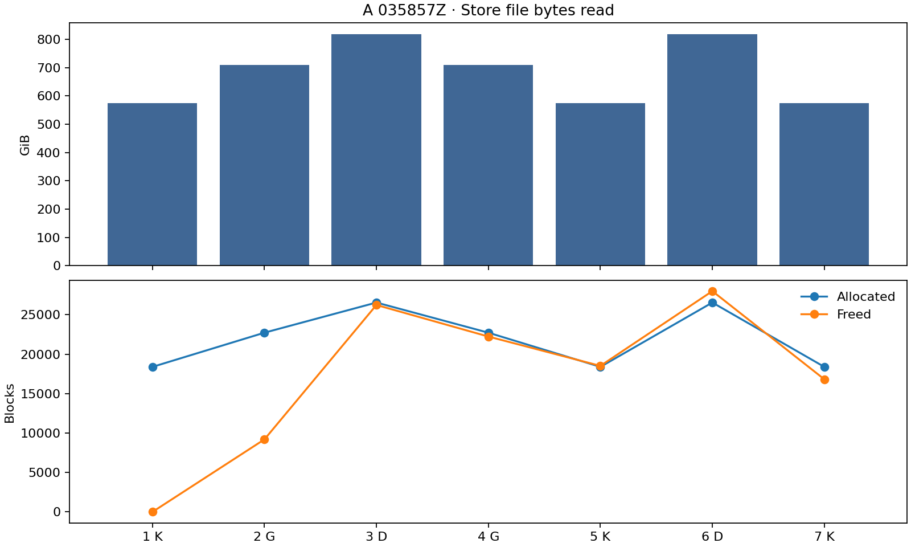

历史 A 的三轮各通过本轮业务验收，共 28/28 段。八卡均归零，三轮原始采样跨度均低于 60 秒。上方同序列 A 是独立的七段对照。

| 历史轮次与原始释放采样 | 有效段数 | 零显存观察（s） | 采样数 | 原件 SHA-256 |
| --- | --- | --- | --- | --- |
| [A-seq-7-1-r1-20261111T081622Z](runs/A-seq-7-1-r1-20261111T081622Z/release-samples.jsonl) | 8 | 59.690 | 48 | 094b81683c0fa35ce7d9c9b681558fba7622f9af28511b063d1fdb3cd5412a05 |
| [A-seq-8-1-r1-20261111T120359Z](runs/A-seq-8-1-r1-20261111T120359Z/release-samples.jsonl) | 9 | 59.529 | 48 | 0c0694c1ad9a573e98c0f5aa57f6acd10ac4781fcde460760fa79b888a51a0c6 |
| [A-seq-10-1-r1-20261111T142600Z](runs/A-seq-10-1-r1-20261111T142600Z/release-samples.jsonl) | 11 | 59.369 | 44 | cef1baa9b4c68c0bac9a161e33d4b40694925517d5325119f9fac6a48a67855a |

## B1 · 常驻权重 Store + Host KV

### 数据 1 · 启动和切换

| 段 | 首个请求 | t4_first − t2（s） | t4_all − t2（s） | 全套切换扣观察（s） |
| --- | --- | --- | --- | --- |
| 00-K-kimi | arithmetic | 247.894 | 251.360 | — |
| 01-G-glm | business_arithmetic | 503.087 | 511.857 | 533.034 |
| 02-D-v4 | business | 484.810 | 493.011 | 515.917 |
| 03-G-glm | business_arithmetic | 484.841 | 493.980 | 523.598 |
| 04-K-kimi | arithmetic | 238.609 | 241.962 | 262.912 |
| 05-D-v4 | business | 484.789 | 492.899 | 514.589 |
| 06-K-kimi | arithmetic | 241.579 | 244.918 | 272.810 |

七段首个响应均值 **383.659 s**，全套均值 **389.998 s**。全套切换由上一段 t4_all 计至本段 t4_all，另扣原协议观察时间。

### 数据 2 · 权重 Store 状态

| 段 | cache_state | 命中（GiB） | 读取（GiB） | 分配块 | 归还块 | 驱逐路径 |
| --- | --- | --- | --- | --- | --- | --- |
| 00-K-kimi | full_miss | 0.00 | 574.63 | 18392 | 0 | 0 |
| 01-G-glm | full_miss | 0.00 | 710.16 | 22728 | 9196 | 4 |
| 02-D-v4 | full_miss | 0.00 | 817.45 | 26552 | 26242 | 10 |
| 03-G-glm | partial_hit | 88.77 | 621.39 | 19887 | 19397 | 301 |
| 04-K-kimi | full_miss | 0.00 | 574.63 | 18392 | 18519 | 199 |
| 05-D-v4 | full_miss | 0.00 | 817.45 | 26552 | 27999 | 11 |
| 06-K-kimi | full_miss | 0.00 | 574.63 | 18392 | 16819 | 217 |

[原时间戳](runs/B1-seq-7-agents-r1-20261113T052724Z/switch-events.csv) · [原验收](runs/B1-seq-7-agents-r1-20261113T052724Z/qualification.json)

### B1 填充与旧 Backend 退出

16 GiB Host KV 池在准备阶段初始化。Backend 就绪后先跑业务金标，再以 kv_fill 推理请求生成 KV，验证 Host 写入和清理。七段 Host KV 命中均为 0 token。

| 下一段 | A t0→t1（s） | B1 t0→t1（s） | A t1→t2（s） | B1 t1→t2（s） | B1 上一段 kv_fill 总长（s） | B1 落在 t0→t1 的 kv_fill（s） |
| --- | --- | --- | --- | --- | --- | --- |
| 01-G-glm | 8.426 | 10.529 | 67.700 | 70.648 | 0.920 | 0.774 |
| 02-D-v4 | 8.879 | 14.935 | 67.158 | 67.971 | 4.283 | 4.237 |
| 03-G-glm | 6.623 | 21.446 | 67.485 | 68.173 | 12.864 | 12.775 |
| 04-K-kimi | 10.128 | 12.983 | 68.003 | 67.966 | 4.271 | 4.177 |
| 05-D-v4 | 9.828 | 13.736 | 67.947 | 67.954 | 0.871 | 0.837 |
| 06-K-kimi | 8.776 | 19.548 | 68.622 | 68.345 | 12.906 | 12.806 |

t0 等于上一段 t4_all，t1 是旧 Backend 退出。以 max(0, min(t1, fill_end) − max(t0, fill_start)) 计算实际相交时长。

| 段 | Host KV 峰值（MiB） | 提交 token | 命中 token | 清理后字节 |
| --- | --- | --- | --- | --- |
| 00-K-kimi | 34.31 | 512 | 0 | 0 |
| 01-G-glm | 48.91 | 512 | 0 | 0 |
| 02-D-v4 | 47.08 | 512 | 0 | 0 |
| 03-G-glm | 48.91 | 512 | 0 | 0 |
| 04-K-kimi | 34.31 | 512 | 0 | 0 |
| 05-D-v4 | 47.08 | 512 | 0 | 0 |
| 06-K-kimi | 34.31 | 512 | 0 | 0 |

### A 与 B1 的逐段差值

| 段 | 首个响应 B1−A（s） | 全套 B1−A（s） |
| --- | --- | --- |
| 00-K-kimi | 13.573 | 13.612 |
| 01-G-glm | 19.156 | 18.930 |
| 02-D-v4 | 17.230 | 17.647 |
| 03-G-glm | -5.589 | -5.500 |
| 04-K-kimi | 4.063 | 4.025 |
| 05-D-v4 | 6.294 | 6.234 |
| 06-K-kimi | 8.335 | 8.209 |

B1 的 03-G-glm 命中 rank 6 的 **88.77 GiB**，读取 **621.39 GiB**。A 对应段为全未命中，读取 **710.16 GiB**。V4 的 gpu_memory_utilization 为 A **0.9**、B1 **0.76**。读取状态、显存配置和填充等差异共同影响观测，无法单独量化 LMCache 成本。

## 八 rank 权重阶段（秒）

同一 run、时钟域和 Worker 身份内配对 begin/end。八 rank 齐全才计算最晚结束减最早开始。派生 JSON 提供逐 rank 起止、最大单 rank 时长和原始路径。破折号对应 null。

| 组 | 段 | full_weight_load | weight_ingestion | quantization_postprocess |
| --- | --- | --- | --- | --- |
| A | 00-K-kimi | 94.175 | 91.587 | — |
| A | 01-G-glm | 122.790 | 120.468 | 9.512 |
| A | 02-D-v4 | 140.452 | 10.881 | 127.876 |
| A | 03-G-glm | 123.747 | 120.694 | 13.945 |
| A | 04-K-kimi | 93.944 | 91.386 | — |
| A | 05-D-v4 | 144.642 | 12.867 | 131.900 |
| A | 06-K-kimi | 94.442 | 91.871 | — |
| B1 | 00-K-kimi | 94.320 | 91.793 | — |
| B1 | 01-G-glm | 122.318 | 120.569 | 8.289 |
| B1 | 02-D-v4 | 143.123 | 11.115 | 129.920 |
| B1 | 03-G-glm | 107.739 | 105.624 | 89.057 |
| B1 | 04-K-kimi | 94.472 | 91.868 | — |
| B1 | 05-D-v4 | 144.199 | 10.587 | 129.880 |
| B1 | 06-K-kimi | 99.747 | 92.407 | — |

| 组 | 模型 | full_weight_load 有效 n | weight_ingestion 有效 n | quantization_postprocess 有效 n |
| --- | --- | --- | --- | --- |
| A | Kimi-K2.6 | 3 | 3 | 0 |
| A | GLM-5.1-FP8 | 2 | 2 | 2 |
| A | DeepSeek-V4-Pro | 2 | 2 | 2 |
| B1 | Kimi-K2.6 | 3 | 3 | 0 |
| B1 | GLM-5.1-FP8 | 2 | 2 | 2 |
| B1 | DeepSeek-V4-Pro | 2 | 2 | 2 |

完整加载接点覆盖 Worker 调用的加载器 load_model()，包括构造与必要恢复步骤，设备初始化和 KV 分配在此窗口外。Kimi 摄入包住 load_dict_owned()，有单独的 restore_postprocess，缺少本表的 quantization_postprocess 接点。GLM 摄入包住 load_weights()，后处理包住 process_weights_after_loading()。V4 后处理包含分组权重恢复及 H2D，摄入未覆盖全部专家权重传输。重叠阶段各自展示。

[Kimi 加载器](../v7/vllm_kimi20_loader.py) · [GLM 加载器](../v7/vllm_glm20_loader.py) · [V4 加载接点](../v7/v7_trace.py)

## 历史参照

| 模型 | 条件 | 有效 n | A（s） | 提交 | 端点与准入 |
| --- | --- | --- | --- | --- | --- |
| Kimi-K2.6 | Store 冷读 | 8 | 241.266 | d3c10bd | 历史配对块注册至首个正确业务响应，独立 Store 冷读准入 |
| GLM-5.1-FP8 | SF 冷读（C23） | 6 | 448.496 | d3c10bd | C23 B5–B10 配对块，注册至首个正确算术 HTTP 响应，独立冷读 |
| GLM-5.1-FP8 | Store 冷读（v7，vLLM 0.20.1） | 1 | 599.712 | 15d9341 | 启动指令至首条算术正确 HTTP 响应，716 GiB 公共池及单次冷读准入 |
| DeepSeek-V4-Pro | SF 冷读 | 9 | 556.222 | d3c10bd | NFS40 B2–B10，startup_command 至正确业务响应，NFS 冷页准入 |
| DeepSeek-V4-Pro | Store 冷读 | 9 | 223.752 | d3c10bd | NFS40 B2–B10，startup_command 至正确业务响应，本地 XFS Store 冷读准入 |

| V11 模型 | 每组 n | A 首个响应均值（s） | B1 首个响应均值（s） | A 全套均值（s） | B1 全套均值（s） |
| --- | --- | --- | --- | --- | --- |
| Kimi-K2.6 | 3 | 234.037 | 242.694 | 237.464 | 246.080 |
| GLM-5.1-FP8 | 2 | 487.181 | 493.964 | 496.204 | 502.919 |
| DeepSeek-V4-Pro | 2 | 473.038 | 484.800 | 481.014 | 492.955 |

历史逐次控制缓存。V11 A/B1 在常驻 Store 内自然复用或重读权重，OS 页缓存冷暖未逐段验证。V11 首个响应在 Backend 内记录，历史以服务/控制器接收为终点。审阅提到的 V4 236.737 s 在指定提交中无对应指标，已核实该提交的 Store 冷读 A 为 223.752 s。236.737 s 保留为待核值。

[GLM 历史参照](https://github.com/BoyJiang2/serverlessllm/blob/15d93417f24bdc00291c791d7f95bdd50dd7725e/comparison/evidence/three-model-final-20261108/REPORT.md) · [Kimi/V4 历史参照](https://github.com/BoyJiang2/serverlessllm/blob/d3c10bda437b29d821b4845ca6a79c39b00fb975/comparison/evidence/three-model-final-20261108/REPORT.md) · [V4 九条历史冷读样本](report-inputs/v4-historical-store-cold.json)

## B2 · 原生 Sleep / Wake

### B2-L1 · CPU 权重备份

V4 单模型回到原 Worker，金标通过。CPU 权重备份 **820.42 GiB**，首次 Sleep **47.406 s**，Wake **3.881 s**。多模型 L1 受主机内存容量限制。

### B2-L2 · 正式七段

| 原段 | 模型 | 首次加载至就绪（s） |
| --- | --- | --- |
| 0 | Kimi-K2.6 | 774.181 |
| 1 | GLM-5.1-FP8 | 829.322 |
| 2 | DeepSeek-V4-Pro | 527.144 |

| 原段 | 模型 | 唤醒至回执（s） | 重载 RPC（s） |
| --- | --- | --- | --- |
| 3 | GLM-5.1-FP8 | 247.854 | 245.934 |
| 4 | Kimi-K2.6 | 2584.591 | 2582.761 |
| 5 | DeepSeek-V4-Pro | 581.513 | 578.630 |
| 6 | Kimi-K2.6 | 3066.760 | 3064.757 |

首次加载 n=3，均值 **710.216 s**。唤醒 n=4，均值 **1620.179 s**。原 Worker PID 连续，全七段金标通过，权重 CPU 备份为零。V4 实际容器创建回执中的三条只读 bind 均指向 b2-v4-sink-router-overlay，包含 deepseek_v4.py、meta.py 和 v4_source_pins.json。

[正式回执](runs/B2-seq-7-agents-r1-20261113T012344Z/qualification.json) · [V4 容器挂载回执](runs/B2-seq-7-agents-r1-20261113T012344Z/L2/02-D-created.json)

### 11 月 15 日 Kimi L2 单模型诊断

| 运行 | RAM 上限（GiB） | Wake（s） | 重载 RPC（s） | 验收 |
| --- | --- | --- | --- | --- |
| 031303Z | 1400 | — | — | rank 5 重载期间退出，Docker 记录 OOM |
| 041505Z | 1664 | 1062.981 | 1061.138 | 八 rank 身份连续、四项原金标通过，正常退出 |

031303Z 八 rank 重载初始化包络 0.061645 s，没有完整重载端点，最终全卡归零 61.074 s。041505Z 与失败轮及历史轮的 Kimi 引擎配置一致。相对历史 2584.591 s 和 3066.760 s，本轮 Wake 短 58.87% 和 65.34%。历史为三模型序列，本轮为 Kimi → Kimi，页缓存状态未对齐。

| 阶段 | 八 rank 包络（s） |
| --- | --- |
| reload | 1061.134 |
| initialize | 0.062 |
| load | 378.821 |
| finalize | 786.200 |

041505Z 唤醒窗口的同一采样点中，memory.current 为 **1630.47 GiB**，anon **1081.56 GiB**，file **543.34 GiB**。

| Rank | RssAnon 原值（kB，按 KiB） | 折算 GiB |
| --- | --- | --- |
| 0 | 2,707,192 | 2.58 |
| 1 | 249,585,244 | 238.02 |
| 2 | 131,788,208 | 125.68 |
| 3 | 2,538,372 | 2.42 |
| 4 | 248,913,276 | 237.38 |
| 5 | 245,251,840 | 233.89 |
| 6 | 249,064,984 | 237.53 |
| 7 | 2,544,116 | 2.43 |

审阅中的 131–249 GiB 混用了单位并只覆盖部分 rank。五个较高 rank 的区间为 125.68–238.02 GiB。共享页可同时记入多进程 RSS。

同点 workingset_refault_file 为 **184,923,939 页**，按宿主 4096 B 页大小折算 **705.43 GiB**。这是该容器 cgroup 从创建到采样点的累计文件页 refault 折算量，可重复计页。它与唯一扫描量、物理盘读字节以及唤醒窗口增量各有不同边界。收尾的进程读取计数仍增长。固定镜像的 layerwise.py 会延迟回放权重加载并处理、复制及恢复 kernel 张量，支持此处存在延迟处理的机制。各层内存占比仍缺分配级打点。1400 GiB 轮的 OOM 及 1664 GiB 轮越过旧上限的采样共同表明容量压力。

[失败轮 Docker OOM](runs/B2-Kimi-L2-diagnostic-r1-20261115T031303Z/docker-events.jsonl) · [失败回执](runs/B2-Kimi-L2-diagnostic-r1-20261115T031303Z/qualification.json) · [失败轮八 rank 接点](runs/B2-Kimi-L2-diagnostic-r1-20261115T031303Z/trace-summary.json) · [复跑验收](runs/B2-Kimi-L2-memory-r1-20261115T041505Z/audit.json) · [内存采样](runs/B2-Kimi-L2-memory-r1-20261115T041505Z/memory-summary.json) · [阶段端点](runs/B2-Kimi-L2-memory-r1-20261115T041505Z/trace-summary.json) · [收尾 I/O](runs/B2-Kimi-L2-memory-r1-20261115T041505Z/finalizer-io-snapshots.txt) · [固定镜像源码](report-inputs/layerwise.py)

## 释放观察

| run ID | 八卡归零且无计算进程 | 最终观察（s） | 严格 ≥60s | 原运行通过标记 | 原始采样数 |
| --- | --- | --- | --- | --- | --- |
| A-seq-7-agents-r1-20261113T035857Z | True | 60.845 | True | True | 49 |
| B1-seq-7-agents-r1-20261113T052724Z | True | 60.866 | True | True | 49 |
| B1-seq-7-agents-r1-20261112T144041Z | True | 59.504 | False | True | 48 |
| B2-seq-7-agents-r1-20261113T012344Z | True | 61.237 | True | True | 50 |
| B2-B2-smoke-r1-20261111T113723Z | True | 59.858 | False | True | 49 |
| B2-Kimi-L2-diagnostic-r1-20261115T031303Z | True | 61.074 | True | False | 50 |
| B2-Kimi-L2-memory-r1-20261115T041505Z | True | 60.892 | True | True | 49 |

144041Z 的 59.504 s 保留原值。实际资源回落和观察时长按各自原始记录核验，严格门槛为 60 秒。

## 重算与证据

仓库根目录运行 python v11/make_experiment_report.py。单独重绘可运行 python v11/plot_v11.py。生成数据、图和报告使用同一批输入。

[派生数据和逐 rank 起止](derived/report-data.json) · [运行清单](report-inputs/run-manifest.json) · [原始证据索引](report-inputs/evidence-index.csv.gz) · [三模型大池复验](large-pool-20261114/REPORT.md)

大池 B1 九轮共 54 次后续切换。逐路径配对 Store 日志后，可重算缺块加载到主机的跨度，以及副本创建到恢复成功确认的上下界。首次 Store 查找至八 rank 权重就绪的实测范围为 91.203–139.670 秒。Store 驻留、驱逐释放块与 Host KV clear 前后字节均可从原回执重算。独立 `pread` 和 CUDA 拷贝耗时仍为 null。54 次切换缺旧 GPU KV 释放起点，完整 KV 清理至就绪跨度同样保留 null。已归档的 S1 补测单列，正式样本仍为九轮。

[大池 B1 九轮可服务前指标](large-pool-20261114/READINESS.md) · [独立 S1 补测与释放回执](large-pool-20261114/supplement/B1-S1-r1-20261115T180856Z/README.md) · [Sleep L1/L2 前检](large-pool-20261114/SLEEP-PREFLIGHT-20261116.md)

新打点 S1 首次尝试 `B1-S1-r1-20261116T165642Z` 在 Kimi 冷页准入后、权重加载前被源码哈希校验拒绝。七段均未验收，最终八卡归零观察覆盖 60.536 s。[失败与释放证据索引](large-pool-20261114/supplement/B1-S1-r1-20261116T165642Z/evidence-index.csv)

## 大池 B1 逐 rank 补测

TP8，864 GiB 权重 Store，813 GiB LMCache Host KV。每轮首段通过 SafeTensors 冷页准入，后六段走同一常驻 Store。有效轮次单列，历史九轮继续使用原样本。

可服务和首个正确响应均从控制器调度计时，终点分别为直接引擎就绪和首个通过业务金标的完整响应。权重准备以八 rank 权重及必要后处理完成为终点。独立 GPU KV 物理释放接点缺测，旧 GPU KV 释放至新 KV 就绪留空。逐次计时、可观测区间并集及权重重叠见派生数据。

| 可服务前指标 | 有效 n | 中位数（s） | 最小（s） | 最大（s） |
| --- | --- | --- | --- | --- |
| 首段 SF 权重准备 | 3 | 516.148 | 488.933 | 1115.694 |
| 首段 GPU KV 初始化及注册 | 3 | 12.150 | 6.760 | 12.223 |
| Store 切换权重准备 | 18 | 120.900 | 91.398 | 138.743 |
| 缺块读取至 Host 数据发布 | 0 | — | — | — |
| 旧 GPU KV 释放至新 KV 就绪 | 0 | — | — | — |
| 旧 GPU KV 注销 | 18 | 0.091 | 0.060 | 0.424 |
| 旧 Host KV 清理 | 18 | 0.002 | 0.001 | 0.003 |
| 新 GPU KV 分配与初始化 | 18 | 0.158 | 0.058 | 0.837 |
| 新 GPU KV 注册 | 18 | 0.167 | 0.117 | 0.805 |

### B1-S1-r2-20261116T171537Z

整轮通过 True，同池复用通过 True，八卡归零观察 61.326 秒。[验收](large-pool-20261114/supplement/B1-S1-r2-20261116T171537Z/qualification.json) · [证据索引](large-pool-20261114/supplement/B1-S1-r2-20261116T171537Z/evidence-index.csv) · [Host KV 逐点数据](large-pool-20261114/supplement/B1-S1-r2-20261116T171537Z/host-kv-time-memory.csv) · [可复算端点](large-pool-20261114/supplement/B1-S1-r2-20261116T171537Z/derived-metrics.json)

Host KV 池初始化 188.286 秒，权重 Store 初始化 403.173 秒，串行合计 591.459 秒，两池初始化墙钟 593.910 秒。

| 段 | 权重准备（s） | 至可服务（s） | 至首个正确响应（s） | 旧 KV 注销（s） | 旧 Host KV 清理（s） | 写入 token | 本段清理后字节 |
| --- | --- | --- | --- | --- | --- | --- | --- |
| 00-K-kimi | 1115.694 | 1281.506 | 1289.061 | — | — | 512 | 0 |
| 01-G-glm | 120.527 | 527.133 | 538.367 | 0.201 | 0.003 | 512 | 0 |
| 02-D-v4 | 138.743 | 510.828 | 530.940 | 0.134 | 0.002 | 512 | 0 |
| 03-G-glm | 120.832 | 506.702 | 517.757 | 0.366 | 0.001 | 512 | 0 |
| 04-K-kimi | 91.870 | 232.368 | 234.077 | 0.086 | 0.002 | 512 | 0 |
| 05-D-v4 | 136.734 | 464.834 | 484.967 | 0.062 | 0.001 | 512 | 0 |
| 06-K-kimi | 91.398 | 229.265 | 231.003 | 0.066 | 0.002 | 512 | 0 |

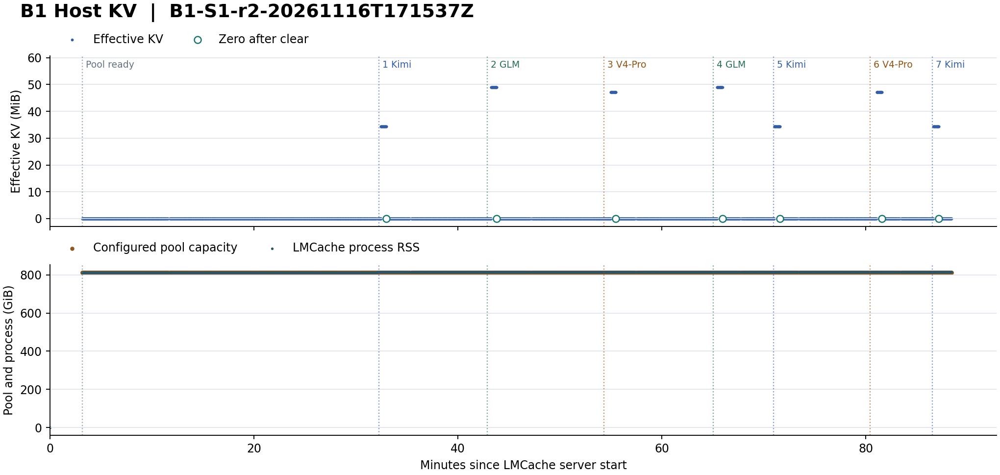

### B1-S2-r1-20261116T184708Z

整轮通过 True，同池复用通过 True，八卡归零观察 60.375 秒。[验收](large-pool-20261114/supplement/B1-S2-r1-20261116T184708Z/qualification.json) · [证据索引](large-pool-20261114/supplement/B1-S2-r1-20261116T184708Z/evidence-index.csv) · [Host KV 逐点数据](large-pool-20261114/supplement/B1-S2-r1-20261116T184708Z/host-kv-time-memory.csv) · [可复算端点](large-pool-20261114/supplement/B1-S2-r1-20261116T184708Z/derived-metrics.json)

Host KV 池初始化 183.047 秒，权重 Store 初始化 404.836 秒，串行合计 587.883 秒，两池初始化墙钟 588.776 秒。

| 段 | 权重准备（s） | 至可服务（s） | 至首个正确响应（s） | 旧 KV 注销（s） | 旧 Host KV 清理（s） | 写入 token | 本段清理后字节 |
| --- | --- | --- | --- | --- | --- | --- | --- |
| 00-G-glm | 516.148 | 916.297 | 927.291 | — | — | 512 | 0 |
| 01-D-v4 | 137.805 | 505.443 | 526.380 | 0.090 | 0.003 | 512 | 0 |
| 02-K-kimi | 91.803 | 243.830 | 245.738 | 0.091 | 0.001 | 512 | 0 |
| 03-D-v4 | 137.434 | 463.775 | 483.698 | 0.060 | 0.002 | 512 | 0 |
| 04-G-glm | 122.849 | 479.184 | 490.146 | 0.067 | 0.002 | 512 | 0 |
| 05-K-kimi | 91.446 | 226.171 | 227.983 | 0.091 | 0.002 | 512 | 0 |
| 06-G-glm | 120.782 | 474.617 | 485.626 | 0.309 | 0.002 | 512 | 0 |

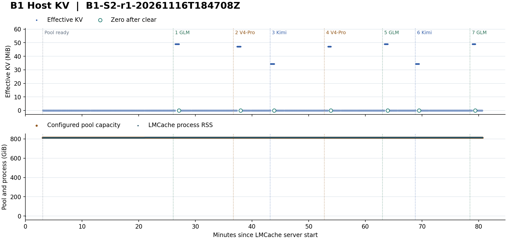

### B1-S3-r1-20261116T201045Z

整轮通过 True，同池复用通过 True，八卡归零观察 60.168 秒。[验收](large-pool-20261114/supplement/B1-S3-r1-20261116T201045Z/qualification.json) · [证据索引](large-pool-20261114/supplement/B1-S3-r1-20261116T201045Z/evidence-index.csv) · [Host KV 逐点数据](large-pool-20261114/supplement/B1-S3-r1-20261116T201045Z/host-kv-time-memory.csv) · [可复算端点](large-pool-20261114/supplement/B1-S3-r1-20261116T201045Z/derived-metrics.json)

Host KV 池初始化 183.446 秒，权重 Store 初始化 417.615 秒，串行合计 601.061 秒，两池初始化墙钟 602.914 秒。

| 段 | 权重准备（s） | 至可服务（s） | 至首个正确响应（s） | 旧 KV 注销（s） | 旧 Host KV 清理（s） | 写入 token | 本段清理后字节 |
| --- | --- | --- | --- | --- | --- | --- | --- |
| 00-D-v4 | 488.933 | 870.881 | 899.511 | — | — | 512 | 0 |
| 01-K-kimi | 91.836 | 290.454 | 292.331 | 0.424 | 0.003 | 512 | 0 |
| 02-G-glm | 120.967 | 488.258 | 499.257 | 0.278 | 0.002 | 512 | 0 |
| 03-K-kimi | 91.709 | 241.550 | 243.241 | 0.091 | 0.002 | 512 | 0 |
| 04-D-v4 | 134.350 | 456.496 | 476.460 | 0.062 | 0.001 | 512 | 0 |
| 05-G-glm | 121.065 | 476.641 | 487.729 | 0.387 | 0.002 | 512 | 0 |
| 06-D-v4 | 133.249 | 448.351 | 468.528 | 0.228 | 0.001 | 512 | 0 |

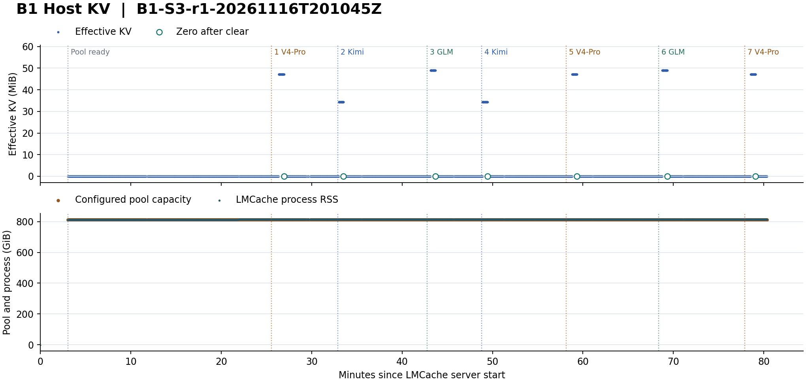

在原始证据所在节点运行 `python v11/large-pool-20261114/recompute_b1_metrics.py <run-directory>` 重算。

## 同序列 Sleep L2 复验

TP8，首模型经 SafeTensors 冷页准入，回访模型在原 Worker 重载 checkpoint。配置为每 rank 16 GiB 的 GPU KV 预算。此路径不使用 SLLM Store 或 LMCache。权重就绪、GPU KV 就绪和 Backend 可服务是独立接点，表中跨度存在重叠。

| 序列 | 七段顺序 | 已归档合格轮 | 目标轮 |
| --- | --- | --- | --- |
| S1 | Kimi-K2.6 → GLM-5.1-FP8 → DeepSeek-V4-Pro → GLM-5.1-FP8 → Kimi-K2.6 → DeepSeek-V4-Pro → Kimi-K2.6 | 3 | 3 |
| S2 | GLM-5.1-FP8 → DeepSeek-V4-Pro → Kimi-K2.6 → DeepSeek-V4-Pro → GLM-5.1-FP8 → Kimi-K2.6 → GLM-5.1-FP8 | 3 | 3 |
| S3 | DeepSeek-V4-Pro → Kimi-K2.6 → GLM-5.1-FP8 → Kimi-K2.6 → DeepSeek-V4-Pro → GLM-5.1-FP8 → DeepSeek-V4-Pro | 3 | 3 |

S3 末段 V4 显存准入取唤醒前八卡可用显存的最小值。余量为该值减去准入线。

| 轮次 | 最低可用（MiB） | 准入线（MiB） | 余量（MiB） | 整轮验收 |
| --- | --- | --- | --- | --- |
| [第 1 轮](large-pool-20261114/sleep-runs/B2-S3-r1-20261116T004923Z/L2/06-D-vram-gate.json) | 126,110 | 129,209 | -3,099 | 未通过 |
| [第 2 轮](large-pool-20261114/sleep-runs/B2-S3-r2-20261116T050140Z/L2/06-D-vram-gate.json) | 132,096 | 129,209 | +2,887 | 通过 |
| [第 3 轮](large-pool-20261114/sleep-runs/B2-S3-r3-20261116T104757Z/L2/06-D-vram-gate.json) | 132,096 | 129,209 | +2,887 | 通过 |
| [第 4 轮](large-pool-20261114/sleep-runs/B2-S3-r4-20261116T124148Z/L2/06-D-vram-gate.json) | 132,094 | 129,209 | +2,885 | 通过 |

首段 GPU KV 初始化取八 rank 最早开始到最晚结束。大池 B1 的历史事件包住 Worker.initialize_from_config，含分配、绑定与 LMCache 注册。服务器注册成功日志的首末跨度与该初始化区间重叠。B1 按显存利用率自动计算预算，Sleep L2 固定每 rank 16 GiB，使用原生初始化。池初始化和 Backend 预热各有独立接点。B1 的旧 GPU KV 释放起点缺失，严格的清理至新 KV 就绪跨度为 null。

| 序列 | 冷启动模型 | 大池 B1 n | B1 中位数（s） | Sleep L2 n | L2 中位数（s） |
| --- | --- | --- | --- | --- | --- |
| S1 | Kimi-K2.6 | 3 | 12.016 | 3 | 0.210 |
| S2 | GLM-5.1-FP8 | 3 | 7.846 | 3 | 0.217 |
| S3 | DeepSeek-V4-Pro | 3 | 12.422 | 3 | 0.314 |

### 各序列与切换位置汇总

单元格为有效 n · 中位数 [最小值, 最大值]，单位为秒。每项只计入通过轮次中具备该指标起止端点的观测。

| 序列 | 段 | 模型 | 权重准备 | GPU KV 分配 | 权重切换 | KV 切换 | 旧 KV 释放至可服务 |
| --- | --- | --- | --- | --- | --- | --- | --- |
| S1 | 1 | Kimi-K2.6 | 3 · 1120.479 [1099.132, 1123.200] | 3 · 0.210 [0.205, 0.235] | 0 · — | 0 · — | 0 · — |
| S1 | 2 | GLM-5.1-FP8 | 3 · 507.506 [125.776, 544.074] | 3 · 0.211 [0.209, 0.211] | 3 · 610.531 [244.714, 643.287] | 3 · 637.731 [272.208, 669.166] | 3 · 913.249 [548.000, 943.805] |
| S1 | 3 | DeepSeek-V4-Pro | 3 · 334.584 [209.600, 378.925] | 3 · 0.366 [0.320, 0.384] | 3 · 435.287 [315.447, 478.916] | 3 · 499.653 [375.238, 536.575] | 3 · 702.225 [580.681, 734.804] |
| S1 | 4 | GLM-5.1-FP8 | 3 · 301.242 [174.411, 350.557] | 3 · 0.193 [0.190, 0.194] | 3 · 364.746 [237.424, 413.499] | 3 · 364.188 [236.925, 412.923] | 3 · 364.238 [236.971, 412.969] |
| S1 | 5 | Kimi-K2.6 | 3 · 1993.030 [1956.212, 2443.923] | 3 · 0.277 [0.241, 0.403] | 3 · 2055.787 [2018.984, 2507.128] | 3 · 2055.421 [2018.715, 2506.746] | 3 · 2055.459 [2018.753, 2506.786] |
| S1 | 6 | DeepSeek-V4-Pro | 3 · 574.139 [561.011, 689.561] | 3 · 0.471 [0.405, 0.535] | 3 · 656.837 [643.888, 763.683] | 3 · 656.876 [643.881, 763.674] | 3 · 656.939 [643.951, 763.737] |
| S1 | 7 | Kimi-K2.6 | 3 · 2557.641 [2264.022, 2884.950] | 3 · 0.448 [0.233, 0.507] | 3 · 2639.917 [2338.592, 2968.135] | 3 · 2639.758 [2338.071, 2967.766] | 3 · 2639.798 [2338.110, 2967.805] |
| S2 | 1 | GLM-5.1-FP8 | 3 · 530.732 [497.020, 549.572] | 3 · 0.217 [0.211, 0.260] | 0 · — | 0 · — | 0 · — |
| S2 | 2 | DeepSeek-V4-Pro | 3 · 164.568 [130.292, 273.661] | 3 · 0.319 [0.316, 0.350] | 3 · 262.980 [239.913, 371.933] | 3 · 324.000 [308.547, 432.854] | 3 · 523.311 [509.482, 634.926] |
| S2 | 3 | Kimi-K2.6 | 3 · 931.983 [741.013, 981.806] | 3 · 0.208 [0.206, 0.213] | 3 · 1036.916 [854.402, 1085.407] | 3 · 1114.254 [935.242, 1163.691] | 3 · 1117.019 [937.095, 1166.996] |
| S2 | 4 | DeepSeek-V4-Pro | 3 · 220.553 [146.438, 250.242] | 3 · 0.397 [0.388, 0.447] | 3 · 283.441 [209.378, 313.589] | 3 · 283.495 [209.277, 313.354] | 3 · 283.557 [209.383, 313.420] |
| S2 | 5 | GLM-5.1-FP8 | 3 · 218.883 [212.985, 229.845] | 3 · 0.189 [0.184, 0.191] | 3 · 282.338 [276.566, 293.193] | 3 · 281.904 [276.128, 292.500] | 3 · 281.952 [276.174, 292.545] |
| S2 | 6 | Kimi-K2.6 | 3 · 1840.204 [1710.372, 2151.700] | 3 · 0.333 [0.225, 0.513] | 3 · 1903.114 [1773.401, 2214.682] | 3 · 1902.934 [1773.180, 2214.267] | 3 · 1902.974 [1773.220, 2214.305] |
| S2 | 7 | GLM-5.1-FP8 | 3 · 394.442 [307.417, 553.760] | 3 · 0.250 [0.185, 0.269] | 3 · 467.264 [381.108, 635.812] | 3 · 466.786 [380.854, 635.595] | 3 · 466.832 [380.900, 635.669] |
| S3 | 1 | DeepSeek-V4-Pro | 3 · 227.286 [205.661, 254.758] | 3 · 0.314 [0.302, 0.378] | 0 · — | 0 · — | 0 · — |
| S3 | 2 | Kimi-K2.6 | 3 · 998.194 [913.043, 1073.651] | 3 · 0.206 [0.205, 0.247] | 3 · 1099.873 [1015.667, 1174.607] | 3 · 1178.001 [1096.879, 1253.384] | 3 · 1179.770 [1098.758, 1255.248] |
| S3 | 3 | GLM-5.1-FP8 | 3 · 481.428 [364.466, 552.419] | 3 · 0.212 [0.211, 0.252] | 3 · 585.461 [467.773, 653.719] | 3 · 612.146 [495.002, 681.323] | 3 · 890.510 [775.642, 964.871] |
| S3 | 4 | Kimi-K2.6 | 3 · 1228.265 [827.399, 1756.363] | 3 · 0.284 [0.252, 0.606] | 3 · 1291.072 [890.371, 1818.954] | 3 · 1291.253 [890.014, 1818.647] | 3 · 1291.294 [890.078, 1818.687] |
| S3 | 5 | DeepSeek-V4-Pro | 3 · 432.097 [302.269, 600.757] | 3 · 0.373 [0.298, 0.434] | 3 · 505.475 [372.863, 680.501] | 3 · 505.311 [372.774, 680.541] | 3 · 505.374 [372.837, 680.607] |
| S3 | 6 | GLM-5.1-FP8 | 3 · 578.030 [528.510, 585.920] | 3 · 0.193 [0.192, 0.243] | 3 · 659.045 [599.028, 662.959] | 3 · 658.659 [598.771, 662.303] | 3 · 658.705 [598.816, 662.349] |
| S3 | 7 | DeepSeek-V4-Pro | 3 · 414.883 [324.203, 516.544] | 3 · 0.439 [0.297, 0.475] | 3 · 487.805 [394.754, 596.543] | 3 · 488.081 [394.692, 596.558] | 3 · 488.145 [394.758, 596.622] |

### S1 第 1 轮 · 通过

`B2-S1-r1-20261115T193956Z` · [验收原件](large-pool-20261114/sleep-runs/B2-S1-r1-20261115T193956Z/qualification.json) · [qjhs003 原始证据索引](large-pool-20261114/sleep-runs/B2-S1-r1-20261115T193956Z/evidence-index.csv)

最终八卡归零且无计算进程 True，50 个采样点覆盖 61.037 s。末次采样的整机可用 RAM 为 1878.408 GiB。[最终释放采样](large-pool-20261114/sleep-runs/B2-S1-r1-20261115T193956Z/resource-samples.csv)

| 段 | 模型 | 操作 | 权重准备（s） | GPU KV 分配（s） | 权重切换（s） | KV 切换（s） | 旧 KV 释放至可服务（s） |
| --- | --- | --- | --- | --- | --- | --- | --- |
| 1 | Kimi-K2.6 | load | 1123.200 | 0.210 | — | — | — |
| 2 | GLM-5.1-FP8 | load | 544.074 | 0.211 | 643.287 | 669.166 | 943.805 |
| 3 | DeepSeek-V4-Pro | load | 378.925 | 0.384 | 478.916 | 536.575 | 734.804 |
| 4 | GLM-5.1-FP8 | wake | 350.557 | 0.194 | 413.499 | 412.923 | 412.969 |
| 5 | Kimi-K2.6 | wake | 1993.030 | 0.277 | 2055.787 | 2055.421 | 2055.459 |
| 6 | DeepSeek-V4-Pro | wake | 689.561 | 0.471 | 763.683 | 763.674 | 763.737 |
| 7 | Kimi-K2.6 | wake | 2264.022 | 0.233 | 2338.592 | 2338.071 | 2338.110 |

逐段 sleep 后采样。HBM 为八卡合计，RAM 为整机统计，PID 计数覆盖该轮仍存活的 Backend 容器。CPU 权重备份字节来自 allocator 回执。

| 段 | 休眠模型 | HBM（GiB） | 可用 RAM（GiB） | 匿名页（GiB） | 存活 PID 数 | CPU 权重备份（B） |
| --- | --- | --- | --- | --- | --- | --- |
| 1 | Kimi-K2.6 | 19.426 | 1857.757 | 22.677 | 11 | 0 |
| 2 | GLM-5.1-FP8 | 47.566 | 1840.812 | 37.799 | 22 | 0 |
| 3 | DeepSeek-V4-Pro | 81.332 | 1819.201 | 57.769 | 33 | 0 |
| 4 | GLM-5.1-FP8 | 86.270 | 1819.820 | 58.107 | 33 | 0 |
| 5 | Kimi-K2.6 | 86.197 | 643.011 | 1232.622 | 33 | 0 |
| 6 | DeepSeek-V4-Pro | 132.963 | 641.953 | 1233.162 | 33 | 0 |
| 7 | Kimi-K2.6 | 132.963 | 579.123 | 1295.910 | 33 | 0 |

Kimi checkpoint 重载窗口的 cgroup 实测。匿名页和文件页取自同一峰值采样点。refault 为采样区间计数增量。采样覆盖范围见派生数据。

| 段 | 采样数 | 峰值（GiB） | 匿名页（GiB） | 文件页（GiB） | 文件页 refault 增量（页） | OOM kill 增量 |
| --- | --- | --- | --- | --- | --- | --- |
| 5 | 340 | 1664.000 | 1194.417 | 460.978 | 154,619,658 | 0 |
| 7 | 452 | 1664.000 | 1242.949 | 409.108 | 188,844,833 | 0 |

### S1 第 2 轮 · 通过

`B2-S1-r2-20261116T081141Z` · [验收原件](large-pool-20261114/sleep-runs/B2-S1-r2-20261116T081141Z/qualification.json) · [qjhs003 原始证据索引](large-pool-20261114/sleep-runs/B2-S1-r2-20261116T081141Z/evidence-index.csv)

最终八卡归零且无计算进程 True，50 个采样点覆盖 61.184 s。末次采样的整机可用 RAM 为 1878.193 GiB。[最终释放采样](large-pool-20261114/sleep-runs/B2-S1-r2-20261116T081141Z/resource-samples.csv)

| 段 | 模型 | 操作 | 权重准备（s） | GPU KV 分配（s） | 权重切换（s） | KV 切换（s） | 旧 KV 释放至可服务（s） |
| --- | --- | --- | --- | --- | --- | --- | --- |
| 1 | Kimi-K2.6 | load | 1120.479 | 0.205 | — | — | — |
| 2 | GLM-5.1-FP8 | load | 125.776 | 0.211 | 244.714 | 272.208 | 548.000 |
| 3 | DeepSeek-V4-Pro | load | 334.584 | 0.320 | 435.287 | 499.653 | 702.225 |
| 4 | GLM-5.1-FP8 | wake | 301.242 | 0.193 | 364.746 | 364.188 | 364.238 |
| 5 | Kimi-K2.6 | wake | 2443.923 | 0.241 | 2507.128 | 2506.746 | 2506.786 |
| 6 | DeepSeek-V4-Pro | wake | 574.139 | 0.405 | 656.837 | 656.876 | 656.939 |
| 7 | Kimi-K2.6 | wake | 2884.950 | 0.448 | 2968.135 | 2967.766 | 2967.805 |

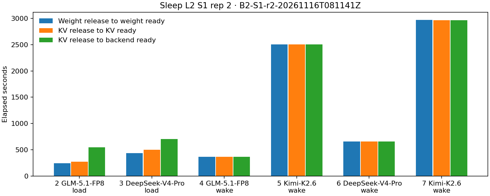

逐段 sleep 后采样。HBM 为八卡合计，RAM 为整机统计，PID 计数覆盖该轮仍存活的 Backend 容器。CPU 权重备份字节来自 allocator 回执。

| 段 | 休眠模型 | HBM（GiB） | 可用 RAM（GiB） | 匿名页（GiB） | 存活 PID 数 | CPU 权重备份（B） |
| --- | --- | --- | --- | --- | --- | --- |
| 1 | Kimi-K2.6 | 19.426 | 1857.445 | 22.809 | 11 | 0 |
| 2 | GLM-5.1-FP8 | 47.566 | 1841.779 | 37.704 | 22 | 0 |
| 3 | DeepSeek-V4-Pro | 81.332 | 1819.188 | 57.857 | 33 | 0 |
| 4 | GLM-5.1-FP8 | 86.270 | 1819.066 | 58.156 | 33 | 0 |
| 5 | Kimi-K2.6 | 86.197 | 605.125 | 1269.974 | 33 | 0 |
| 6 | DeepSeek-V4-Pro | 132.963 | 605.071 | 1270.485 | 33 | 0 |
| 7 | Kimi-K2.6 | 132.963 | 380.851 | 1494.202 | 33 | 0 |

Kimi checkpoint 重载窗口的 cgroup 实测。匿名页和文件页取自同一峰值采样点。refault 为采样区间计数增量。采样覆盖范围见派生数据。

| 段 | 采样数 | 峰值（GiB） | 匿名页（GiB） | 文件页（GiB） | 文件页 refault 增量（页） | OOM kill 增量 |
| --- | --- | --- | --- | --- | --- | --- |
| 5 | 488 | 1664.000 | 1231.552 | 424.361 | 253,858,732 | 0 |
| 7 | 576 | 1664.000 | 1343.733 | 311.148 | 284,018,295 | 0 |

### S1 第 3 轮 · 通过

`B2-S1-r3-20261116T142350Z` · [验收原件](large-pool-20261114/sleep-runs/B2-S1-r3-20261116T142350Z/qualification.json) · [qjhs003 原始证据索引](large-pool-20261114/sleep-runs/B2-S1-r3-20261116T142350Z/evidence-index.csv)

最终八卡归零且无计算进程 True，50 个采样点覆盖 61.150 s。末次采样的整机可用 RAM 为 1878.086 GiB。[最终释放采样](large-pool-20261114/sleep-runs/B2-S1-r3-20261116T142350Z/resource-samples.csv)

| 段 | 模型 | 操作 | 权重准备（s） | GPU KV 分配（s） | 权重切换（s） | KV 切换（s） | 旧 KV 释放至可服务（s） |
| --- | --- | --- | --- | --- | --- | --- | --- |
| 1 | Kimi-K2.6 | load | 1099.132 | 0.235 | — | — | — |
| 2 | GLM-5.1-FP8 | load | 507.506 | 0.209 | 610.531 | 637.731 | 913.249 |
| 3 | DeepSeek-V4-Pro | load | 209.600 | 0.366 | 315.447 | 375.238 | 580.681 |
| 4 | GLM-5.1-FP8 | wake | 174.411 | 0.190 | 237.424 | 236.925 | 236.971 |
| 5 | Kimi-K2.6 | wake | 1956.212 | 0.403 | 2018.984 | 2018.715 | 2018.753 |
| 6 | DeepSeek-V4-Pro | wake | 561.011 | 0.535 | 643.888 | 643.881 | 643.951 |
| 7 | Kimi-K2.6 | wake | 2557.641 | 0.507 | 2639.917 | 2639.758 | 2639.798 |

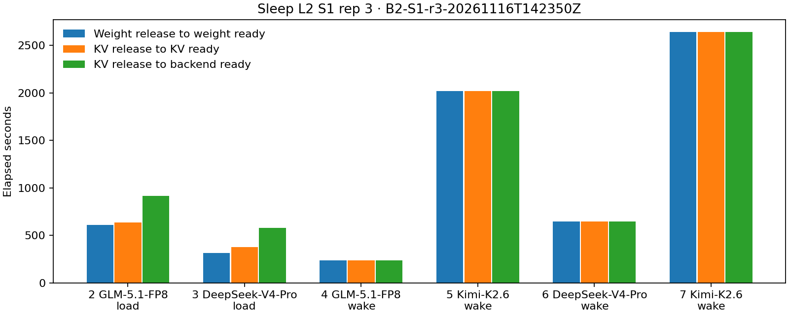

逐段 sleep 后采样。HBM 为八卡合计，RAM 为整机统计，PID 计数覆盖该轮仍存活的 Backend 容器。CPU 权重备份字节来自 allocator 回执。

| 段 | 休眠模型 | HBM（GiB） | 可用 RAM（GiB） | 匿名页（GiB） | 存活 PID 数 | CPU 权重备份（B） |
| --- | --- | --- | --- | --- | --- | --- |
| 1 | Kimi-K2.6 | 19.430 | 1856.169 | 22.710 | 11 | 0 |
| 2 | GLM-5.1-FP8 | 47.572 | 1839.980 | 37.850 | 22 | 0 |
| 3 | DeepSeek-V4-Pro | 81.338 | 1818.880 | 57.890 | 33 | 0 |
| 4 | GLM-5.1-FP8 | 86.273 | 1818.800 | 58.199 | 33 | 0 |
| 5 | Kimi-K2.6 | 86.203 | 734.036 | 1141.456 | 33 | 0 |
| 6 | DeepSeek-V4-Pro | 132.969 | 733.065 | 1141.819 | 33 | 0 |
| 7 | Kimi-K2.6 | 132.969 | 496.142 | 1378.475 | 33 | 0 |

Kimi checkpoint 重载窗口的 cgroup 实测。匿名页和文件页取自同一峰值采样点。refault 为采样区间计数增量。采样覆盖范围见派生数据。

| 段 | 采样数 | 峰值（GiB） | 匿名页（GiB） | 文件页（GiB） | 文件页 refault 增量（页） | OOM kill 增量 |
| --- | --- | --- | --- | --- | --- | --- |
| 5 | 390 | 1598.367 | 1102.909 | 491.318 | 199,934,723 | 0 |
| 7 | 511 | 1664.000 | 1256.411 | 398.054 | 237,708,866 | 0 |

### S2 第 1 轮 · 通过

`B2-S2-r1-20261115T220612Z` · [验收原件](large-pool-20261114/sleep-runs/B2-S2-r1-20261115T220612Z/qualification.json) · [qjhs003 原始证据索引](large-pool-20261114/sleep-runs/B2-S2-r1-20261115T220612Z/evidence-index.csv)

最终八卡归零且无计算进程 True，50 个采样点覆盖 61.127 s。末次采样的整机可用 RAM 为 1878.441 GiB。[最终释放采样](large-pool-20261114/sleep-runs/B2-S2-r1-20261115T220612Z/resource-samples.csv)

| 段 | 模型 | 操作 | 权重准备（s） | GPU KV 分配（s） | 权重切换（s） | KV 切换（s） | 旧 KV 释放至可服务（s） |
| --- | --- | --- | --- | --- | --- | --- | --- |
| 1 | GLM-5.1-FP8 | load | 549.572 | 0.217 | — | — | — |
| 2 | DeepSeek-V4-Pro | load | 273.661 | 0.316 | 371.933 | 432.854 | 634.926 |
| 3 | Kimi-K2.6 | load | 741.013 | 0.213 | 854.402 | 935.242 | 937.095 |
| 4 | DeepSeek-V4-Pro | wake | 220.553 | 0.397 | 283.441 | 283.495 | 283.557 |
| 5 | GLM-5.1-FP8 | wake | 218.883 | 0.191 | 282.338 | 281.904 | 281.952 |
| 6 | Kimi-K2.6 | wake | 1710.372 | 0.333 | 1773.401 | 1773.180 | 1773.220 |
| 7 | GLM-5.1-FP8 | wake | 394.442 | 0.185 | 467.264 | 466.786 | 466.832 |

逐段 sleep 后采样。HBM 为八卡合计，RAM 为整机统计，PID 计数覆盖该轮仍存活的 Backend 容器。CPU 权重备份字节来自 allocator 回执。

| 段 | 休眠模型 | HBM（GiB） | 可用 RAM（GiB） | 匿名页（GiB） | 存活 PID 数 | CPU 权重备份（B） |
| --- | --- | --- | --- | --- | --- | --- |
| 1 | GLM-5.1-FP8 | 28.164 | 1861.652 | 17.899 | 11 | 0 |
| 2 | DeepSeek-V4-Pro | 61.914 | 1839.935 | 38.054 | 22 | 0 |
| 3 | Kimi-K2.6 | 81.334 | 1819.757 | 57.862 | 33 | 0 |
| 4 | DeepSeek-V4-Pro | 128.100 | 1818.051 | 58.943 | 33 | 0 |
| 5 | GLM-5.1-FP8 | 133.037 | 1818.064 | 59.318 | 33 | 0 |
| 6 | Kimi-K2.6 | 132.967 | 1026.716 | 849.357 | 33 | 0 |
| 7 | GLM-5.1-FP8 | 132.967 | 1027.151 | 849.396 | 33 | 0 |

Kimi checkpoint 重载窗口的 cgroup 实测。匿名页和文件页取自同一峰值采样点。refault 为采样区间计数增量。采样覆盖范围见派生数据。

| 段 | 采样数 | 峰值（GiB） | 匿名页（GiB） | 文件页（GiB） | 文件页 refault 增量（页） | OOM kill 增量 |
| --- | --- | --- | --- | --- | --- | --- |
| 6 | 341 | 1179.818 | 809.614 | 365.275 | 99,790,619 | 0 |

### S2 第 2 轮 · 通过

`B2-S2-r2-20261116T021051Z` · [验收原件](large-pool-20261114/sleep-runs/B2-S2-r2-20261116T021051Z/qualification.json) · [qjhs003 原始证据索引](large-pool-20261114/sleep-runs/B2-S2-r2-20261116T021051Z/evidence-index.csv)

最终八卡归零且无计算进程 True，50 个采样点覆盖 61.145 s。末次采样的整机可用 RAM 为 1878.248 GiB。[最终释放采样](large-pool-20261114/sleep-runs/B2-S2-r2-20261116T021051Z/resource-samples.csv)

| 段 | 模型 | 操作 | 权重准备（s） | GPU KV 分配（s） | 权重切换（s） | KV 切换（s） | 旧 KV 释放至可服务（s） |
| --- | --- | --- | --- | --- | --- | --- | --- |
| 1 | GLM-5.1-FP8 | load | 497.020 | 0.211 | — | — | — |
| 2 | DeepSeek-V4-Pro | load | 164.568 | 0.350 | 262.980 | 324.000 | 523.311 |
| 3 | Kimi-K2.6 | load | 981.806 | 0.206 | 1085.407 | 1163.691 | 1166.996 |
| 4 | DeepSeek-V4-Pro | wake | 250.242 | 0.447 | 313.589 | 313.354 | 313.420 |
| 5 | GLM-5.1-FP8 | wake | 229.845 | 0.184 | 293.193 | 292.500 | 292.545 |
| 6 | Kimi-K2.6 | wake | 2151.700 | 0.225 | 2214.682 | 2214.267 | 2214.305 |
| 7 | GLM-5.1-FP8 | wake | 553.760 | 0.250 | 635.812 | 635.595 | 635.669 |

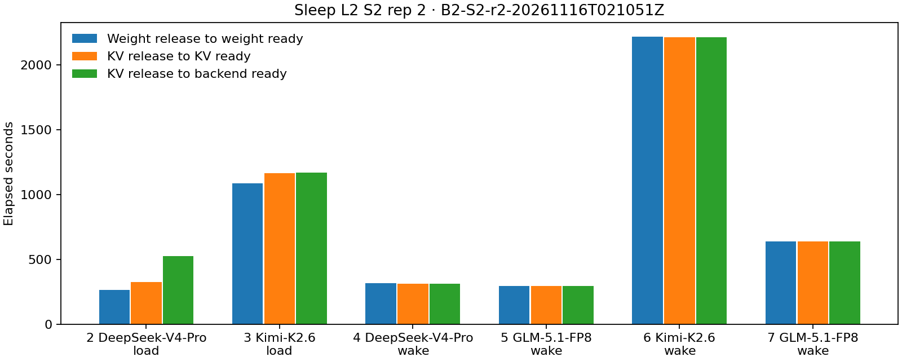

逐段 sleep 后采样。HBM 为八卡合计，RAM 为整机统计，PID 计数覆盖该轮仍存活的 Backend 容器。CPU 权重备份字节来自 allocator 回执。

| 段 | 休眠模型 | HBM（GiB） | 可用 RAM（GiB） | 匿名页（GiB） | 存活 PID 数 | CPU 权重备份（B） |
| --- | --- | --- | --- | --- | --- | --- |
| 1 | GLM-5.1-FP8 | 28.164 | 1861.644 | 17.916 | 11 | 0 |
| 2 | DeepSeek-V4-Pro | 61.914 | 1840.120 | 38.017 | 22 | 0 |
| 3 | Kimi-K2.6 | 81.328 | 1820.126 | 57.716 | 33 | 0 |
| 4 | DeepSeek-V4-Pro | 128.094 | 1818.563 | 58.711 | 33 | 0 |
| 5 | GLM-5.1-FP8 | 133.031 | 1818.224 | 59.090 | 33 | 0 |
| 6 | Kimi-K2.6 | 132.963 | 486.073 | 1389.078 | 33 | 0 |
| 7 | GLM-5.1-FP8 | 132.963 | 485.842 | 1389.153 | 33 | 0 |

Kimi checkpoint 重载窗口的 cgroup 实测。匿名页和文件页取自同一峰值采样点。refault 为采样区间计数增量。采样覆盖范围见派生数据。

| 段 | 采样数 | 峰值（GiB） | 匿名页（GiB） | 文件页（GiB） | 文件页 refault 增量（页） | OOM kill 增量 |
| --- | --- | --- | --- | --- | --- | --- |
| 6 | 430 | 1664.000 | 1349.594 | 307.025 | 147,221,723 | 0 |

### S2 第 3 轮 · 通过

`B2-S2-r3-20261116T062640Z` · [验收原件](large-pool-20261114/sleep-runs/B2-S2-r3-20261116T062640Z/qualification.json) · [qjhs003 原始证据索引](large-pool-20261114/sleep-runs/B2-S2-r3-20261116T062640Z/evidence-index.csv)

最终八卡归零且无计算进程 True，50 个采样点覆盖 61.127 s。末次采样的整机可用 RAM 为 1878.307 GiB。[最终释放采样](large-pool-20261114/sleep-runs/B2-S2-r3-20261116T062640Z/resource-samples.csv)

| 段 | 模型 | 操作 | 权重准备（s） | GPU KV 分配（s） | 权重切换（s） | KV 切换（s） | 旧 KV 释放至可服务（s） |
| --- | --- | --- | --- | --- | --- | --- | --- |
| 1 | GLM-5.1-FP8 | load | 530.732 | 0.260 | — | — | — |
| 2 | DeepSeek-V4-Pro | load | 130.292 | 0.319 | 239.913 | 308.547 | 509.482 |
| 3 | Kimi-K2.6 | load | 931.983 | 0.208 | 1036.916 | 1114.254 | 1117.019 |
| 4 | DeepSeek-V4-Pro | wake | 146.438 | 0.388 | 209.378 | 209.277 | 209.383 |
| 5 | GLM-5.1-FP8 | wake | 212.985 | 0.189 | 276.566 | 276.128 | 276.174 |
| 6 | Kimi-K2.6 | wake | 1840.204 | 0.513 | 1903.114 | 1902.934 | 1902.974 |
| 7 | GLM-5.1-FP8 | wake | 307.417 | 0.269 | 381.108 | 380.854 | 380.900 |

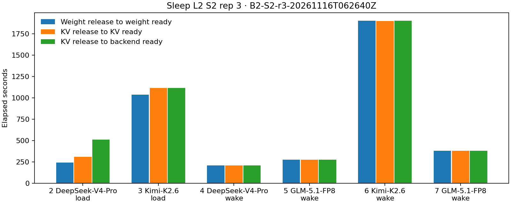

逐段 sleep 后采样。HBM 为八卡合计，RAM 为整机统计，PID 计数覆盖该轮仍存活的 Backend 容器。CPU 权重备份字节来自 allocator 回执。

| 段 | 休眠模型 | HBM（GiB） | 可用 RAM（GiB） | 匿名页（GiB） | 存活 PID 数 | CPU 权重备份（B） |
| --- | --- | --- | --- | --- | --- | --- |
| 1 | GLM-5.1-FP8 | 28.164 | 1861.467 | 18.061 | 11 | 0 |
| 2 | DeepSeek-V4-Pro | 61.914 | 1840.983 | 37.871 | 22 | 0 |
| 3 | Kimi-K2.6 | 81.332 | 1820.323 | 57.666 | 33 | 0 |
| 4 | DeepSeek-V4-Pro | 128.098 | 1818.614 | 58.659 | 33 | 0 |
| 5 | GLM-5.1-FP8 | 133.035 | 1818.574 | 58.946 | 33 | 0 |
| 6 | Kimi-K2.6 | 132.965 | 974.573 | 901.338 | 33 | 0 |
| 7 | GLM-5.1-FP8 | 132.965 | 975.083 | 901.418 | 33 | 0 |

Kimi checkpoint 重载窗口的 cgroup 实测。匿名页和文件页取自同一峰值采样点。refault 为采样区间计数增量。采样覆盖范围见派生数据。

| 段 | 采样数 | 峰值（GiB） | 匿名页（GiB） | 文件页（GiB） | 文件页 refault 增量（页） | OOM kill 增量 |
| --- | --- | --- | --- | --- | --- | --- |
| 6 | 367 | 1235.070 | 861.923 | 369.971 | 143,754,738 | 0 |

### S3 第 1 轮 · 未通过

`B2-S3-r1-20261116T004923Z` · [验收原件](large-pool-20261114/sleep-runs/B2-S3-r1-20261116T004923Z/qualification.json) · [qjhs003 原始证据索引](large-pool-20261114/sleep-runs/B2-S3-r1-20261116T004923Z/evidence-index.csv)

本轮完成 6/7 段。下一段准入时，八卡最低可用显存为 126,110 MiB，低于要求的 129,209 MiB。[显存准入回执](large-pool-20261114/sleep-runs/B2-S3-r1-20261116T004923Z/L2/06-D-vram-gate.json)

第 5 段 V4 唤醒的设备显存峰值增量为 131,430 MiB。第 7 段可用显存比按卡重放该峰值少至多 5,320 MiB。回访后再次休眠，PyTorch 保留显存的逐 rank 最大增量为 DeepSeek-V4-Pro 5,986 MiB、GLM-5.1-FP8 632 MiB。V4 的增量在 checkpoint 重载后、KV 恢复前已经出现。[逐 rank 原始接点与容量推算](large-pool-20261114/sleep-vram-audit.json)

源码显示，MARLIN MXFP4 后处理先用临时 scale 张量创建量化配置和 kernel，随后 layerwise reload 将参数复制回原存储并重新注册参数。量化配置可能仍持有临时 scale。按 V4 的 61 层、384 专家、7168 隐藏维度、TP8 后每 rank 的 384 个中间通道及每 32 元素 1 字节计算，三组 scale 合计 5,764.5 MiB/rank，实测活跃分配增量为 5,795.5 MiB/rank。待逐 rank 对照 scale 的存储地址和权重分配标签，确认具体归属。[MXFP4 后处理](https://github.com/vllm-project/vllm/blob/132765e3560659ff63ebd236203672e991b70e08/vllm/model_executor/layers/quantization/mxfp4.py#L651-L730) · [量化配置](https://github.com/vllm-project/vllm/blob/132765e3560659ff63ebd236203672e991b70e08/vllm/model_executor/layers/fused_moe/config.py#L676-L696) · [layerwise reload](https://github.com/vllm-project/vllm/blob/132765e3560659ff63ebd236203672e991b70e08/vllm/model_executor/model_loader/reload/layerwise.py#L290-L367)

最终八卡归零且无计算进程 True，50 个采样点覆盖 61.041 s。末次采样的整机可用 RAM 为 1878.536 GiB。[最终释放采样](large-pool-20261114/sleep-runs/B2-S3-r1-20261116T004923Z/resource-samples.csv)

| 段 | 模型 | 操作 | 权重准备（s） | GPU KV 分配（s） | 权重切换（s） | KV 切换（s） | 旧 KV 释放至可服务（s） |
| --- | --- | --- | --- | --- | --- | --- | --- |
| 1 | DeepSeek-V4-Pro | load | 246.282 | 0.305 | — | — | — |
| 2 | Kimi-K2.6 | load | 849.484 | 0.206 | 955.841 | 1034.494 | 1036.118 |
| 3 | GLM-5.1-FP8 | load | 275.675 | 0.208 | 376.095 | 403.278 | 686.651 |
| 4 | Kimi-K2.6 | wake | 1058.444 | 0.215 | 1121.459 | 1121.234 | 1121.273 |
| 5 | DeepSeek-V4-Pro | wake | 415.091 | 0.365 | 488.633 | 488.530 | 488.594 |
| 6 | GLM-5.1-FP8 | wake | 548.854 | 0.193 | 622.635 | 622.109 | 622.156 |

逐段 sleep 后采样。HBM 为八卡合计，RAM 为整机统计，PID 计数覆盖该轮仍存活的 Backend 容器。CPU 权重备份字节来自 allocator 回执。

| 段 | 休眠模型 | HBM（GiB） | 可用 RAM（GiB） | 匿名页（GiB） | 存活 PID 数 | CPU 权重备份（B） |
| --- | --- | --- | --- | --- | --- | --- |
| 1 | DeepSeek-V4-Pro | 33.773 | 1855.622 | 22.813 | 11 | 0 |
| 2 | Kimi-K2.6 | 53.176 | 1836.066 | 42.721 | 22 | 0 |
| 3 | GLM-5.1-FP8 | 81.332 | 1819.328 | 57.614 | 33 | 0 |
| 4 | Kimi-K2.6 | 81.262 | 1190.202 | 686.247 | 33 | 0 |
| 5 | DeepSeek-V4-Pro | 128.027 | 1189.482 | 687.404 | 33 | 0 |
| 6 | GLM-5.1-FP8 | 132.965 | 1189.361 | 687.696 | 33 | 0 |

Kimi checkpoint 重载窗口的 cgroup 实测。匿名页和文件页取自同一峰值采样点。refault 为采样区间计数增量。采样覆盖范围见派生数据。

| 段 | 采样数 | 峰值（GiB） | 匿名页（GiB） | 文件页（GiB） | 文件页 refault 增量（页） | OOM kill 增量 |
| --- | --- | --- | --- | --- | --- | --- |
| 4 | 211 | 1054.214 | 648.211 | 398.700 | 41,700,360 | 0 |

### S3 第 2 轮 · 通过

`B2-S3-r2-20261116T050140Z` · [验收原件](large-pool-20261114/sleep-runs/B2-S3-r2-20261116T050140Z/qualification.json) · [qjhs003 原始证据索引](large-pool-20261114/sleep-runs/B2-S3-r2-20261116T050140Z/evidence-index.csv)

本轮采用 V4 Marlin scale 引用修复。[运行配置](large-pool-20261114/sleep-runs/B2-S3-r2-20261116T050140Z/repro/campaign.json) · [容器挂载回执](large-pool-20261114/sleep-runs/B2-S3-r2-20261116T050140Z/v4-overlay-mounts.json)

末段 V4 唤醒前八卡最低可用显存为 132,096 MiB，通过原 129,209 MiB 准入。[显存准入回执](large-pool-20261114/sleep-runs/B2-S3-r2-20261116T050140Z/L2/06-D-vram-gate.json)

最终八卡归零且无计算进程 True，50 个采样点覆盖 61.187 s。末次采样的整机可用 RAM 为 1878.065 GiB。[最终释放采样](large-pool-20261114/sleep-runs/B2-S3-r2-20261116T050140Z/resource-samples.csv)

| 段 | 模型 | 操作 | 权重准备（s） | GPU KV 分配（s） | 权重切换（s） | KV 切换（s） | 旧 KV 释放至可服务（s） |
| --- | --- | --- | --- | --- | --- | --- | --- |
| 1 | DeepSeek-V4-Pro | load | 205.661 | 0.302 | — | — | — |
| 2 | Kimi-K2.6 | load | 998.194 | 0.247 | 1099.873 | 1178.001 | 1179.770 |
| 3 | GLM-5.1-FP8 | load | 364.466 | 0.212 | 467.773 | 495.002 | 775.642 |
| 4 | Kimi-K2.6 | wake | 827.399 | 0.284 | 890.371 | 890.014 | 890.078 |
| 5 | DeepSeek-V4-Pro | wake | 302.269 | 0.373 | 372.863 | 372.774 | 372.837 |
| 6 | GLM-5.1-FP8 | wake | 528.510 | 0.243 | 599.028 | 598.771 | 598.816 |
| 7 | DeepSeek-V4-Pro | wake | 324.203 | 0.297 | 394.754 | 394.692 | 394.758 |

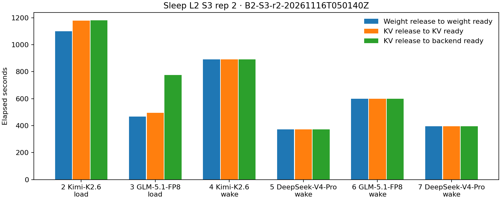

逐段 sleep 后采样。HBM 为八卡合计，RAM 为整机统计，PID 计数覆盖该轮仍存活的 Backend 容器。CPU 权重备份字节来自 allocator 回执。

| 段 | 休眠模型 | HBM（GiB） | 可用 RAM（GiB） | 匿名页（GiB） | 存活 PID 数 | CPU 权重备份（B） |
| --- | --- | --- | --- | --- | --- | --- |
| 1 | DeepSeek-V4-Pro | 33.773 | 1856.590 | 22.809 | 11 | 0 |
| 2 | Kimi-K2.6 | 53.176 | 1835.807 | 42.638 | 22 | 0 |
| 3 | GLM-5.1-FP8 | 81.332 | 1819.623 | 57.647 | 33 | 0 |
| 4 | Kimi-K2.6 | 81.264 | 1432.576 | 443.692 | 33 | 0 |
| 5 | DeepSeek-V4-Pro | 81.264 | 1432.158 | 444.616 | 33 | 0 |
| 6 | GLM-5.1-FP8 | 86.201 | 1432.323 | 445.111 | 33 | 0 |
| 7 | DeepSeek-V4-Pro | 86.201 | 1431.402 | 445.397 | 33 | 0 |

Kimi checkpoint 重载窗口的 cgroup 实测。匿名页和文件页取自同一峰值采样点。refault 为采样区间计数增量。采样覆盖范围见派生数据。

| 段 | 采样数 | 峰值（GiB） | 匿名页（GiB） | 文件页（GiB） | 文件页 refault 增量（页） | OOM kill 增量 |
| --- | --- | --- | --- | --- | --- | --- |
| 4 | 165 | 897.940 | 405.397 | 484.512 | 24,292,792 | 0 |

### S3 第 3 轮 · 通过

`B2-S3-r3-20261116T104757Z` · [验收原件](large-pool-20261114/sleep-runs/B2-S3-r3-20261116T104757Z/qualification.json) · [qjhs003 原始证据索引](large-pool-20261114/sleep-runs/B2-S3-r3-20261116T104757Z/evidence-index.csv)

本轮采用 V4 Marlin scale 引用修复。[运行配置](large-pool-20261114/sleep-runs/B2-S3-r3-20261116T104757Z/repro/campaign.json) · [容器挂载回执](large-pool-20261114/sleep-runs/B2-S3-r3-20261116T104757Z/v4-overlay-mounts.json)

末段 V4 唤醒前八卡最低可用显存为 132,096 MiB，通过原 129,209 MiB 准入。[显存准入回执](large-pool-20261114/sleep-runs/B2-S3-r3-20261116T104757Z/L2/06-D-vram-gate.json)

最终八卡归零且无计算进程 True，50 个采样点覆盖 61.152 s。末次采样的整机可用 RAM 为 1878.003 GiB。[最终释放采样](large-pool-20261114/sleep-runs/B2-S3-r3-20261116T104757Z/resource-samples.csv)

| 段 | 模型 | 操作 | 权重准备（s） | GPU KV 分配（s） | 权重切换（s） | KV 切换（s） | 旧 KV 释放至可服务（s） |
| --- | --- | --- | --- | --- | --- | --- | --- |
| 1 | DeepSeek-V4-Pro | load | 227.286 | 0.378 | — | — | — |
| 2 | Kimi-K2.6 | load | 913.043 | 0.205 | 1015.667 | 1096.879 | 1098.758 |
| 3 | GLM-5.1-FP8 | load | 552.419 | 0.252 | 653.719 | 681.323 | 964.871 |
| 4 | Kimi-K2.6 | wake | 1756.363 | 0.252 | 1818.954 | 1818.647 | 1818.687 |
| 5 | DeepSeek-V4-Pro | wake | 600.757 | 0.434 | 680.501 | 680.541 | 680.607 |
| 6 | GLM-5.1-FP8 | wake | 578.030 | 0.192 | 662.959 | 662.303 | 662.349 |
| 7 | DeepSeek-V4-Pro | wake | 516.544 | 0.439 | 596.543 | 596.558 | 596.622 |

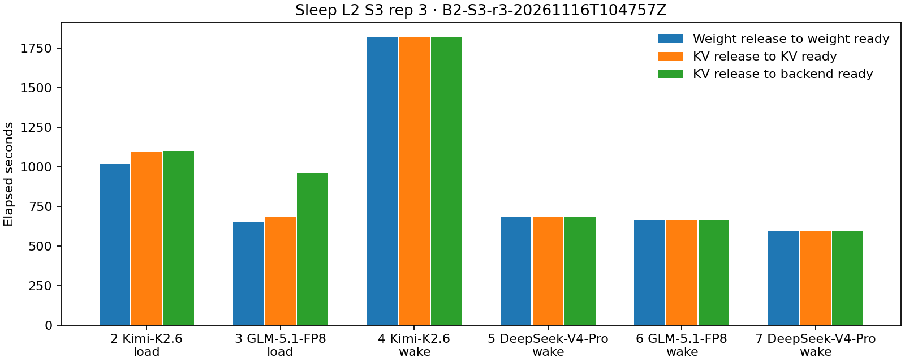

逐段 sleep 后采样。HBM 为八卡合计，RAM 为整机统计，PID 计数覆盖该轮仍存活的 Backend 容器。CPU 权重备份字节来自 allocator 回执。

| 段 | 休眠模型 | HBM（GiB） | 可用 RAM（GiB） | 匿名页（GiB） | 存活 PID 数 | CPU 权重备份（B） |
| --- | --- | --- | --- | --- | --- | --- |
| 1 | DeepSeek-V4-Pro | 33.773 | 1856.522 | 22.832 | 11 | 0 |
| 2 | Kimi-K2.6 | 53.174 | 1836.182 | 42.803 | 22 | 0 |
| 3 | GLM-5.1-FP8 | 81.330 | 1818.748 | 57.717 | 33 | 0 |
| 4 | Kimi-K2.6 | 81.260 | 514.668 | 1360.059 | 33 | 0 |
| 5 | DeepSeek-V4-Pro | 81.260 | 516.170 | 1358.340 | 33 | 0 |
| 6 | GLM-5.1-FP8 | 86.197 | 516.428 | 1358.577 | 33 | 0 |
| 7 | DeepSeek-V4-Pro | 86.197 | 515.842 | 1358.725 | 33 | 0 |

Kimi checkpoint 重载窗口的 cgroup 实测。匿名页和文件页取自同一峰值采样点。refault 为采样区间计数增量。采样覆盖范围见派生数据。

| 段 | 采样数 | 峰值（GiB） | 匿名页（GiB） | 文件页（GiB） | 文件页 refault 增量（页） | OOM kill 增量 |
| --- | --- | --- | --- | --- | --- | --- |
| 4 | 351 | 1572.047 | 1320.168 | 245.186 | 63,325,297 | 0 |

### S3 第 4 轮 · 通过

`B2-S3-r4-20261116T124148Z` · [验收原件](large-pool-20261114/sleep-runs/B2-S3-r4-20261116T124148Z/qualification.json) · [qjhs003 原始证据索引](large-pool-20261114/sleep-runs/B2-S3-r4-20261116T124148Z/evidence-index.csv)

本轮采用 V4 Marlin scale 引用修复。[运行配置](large-pool-20261114/sleep-runs/B2-S3-r4-20261116T124148Z/repro/campaign.json) · [容器挂载回执](large-pool-20261114/sleep-runs/B2-S3-r4-20261116T124148Z/v4-overlay-mounts.json)

末段 V4 唤醒前八卡最低可用显存为 132,094 MiB，通过原 129,209 MiB 准入。[显存准入回执](large-pool-20261114/sleep-runs/B2-S3-r4-20261116T124148Z/L2/06-D-vram-gate.json)

最终八卡归零且无计算进程 True，50 个采样点覆盖 61.115 s。末次采样的整机可用 RAM 为 1877.745 GiB。[最终释放采样](large-pool-20261114/sleep-runs/B2-S3-r4-20261116T124148Z/resource-samples.csv)

| 段 | 模型 | 操作 | 权重准备（s） | GPU KV 分配（s） | 权重切换（s） | KV 切换（s） | 旧 KV 释放至可服务（s） |
| --- | --- | --- | --- | --- | --- | --- | --- |
| 1 | DeepSeek-V4-Pro | load | 254.758 | 0.314 | — | — | — |
| 2 | Kimi-K2.6 | load | 1073.651 | 0.206 | 1174.607 | 1253.384 | 1255.248 |
| 3 | GLM-5.1-FP8 | load | 481.428 | 0.211 | 585.461 | 612.146 | 890.510 |
| 4 | Kimi-K2.6 | wake | 1228.265 | 0.606 | 1291.072 | 1291.253 | 1291.294 |
| 5 | DeepSeek-V4-Pro | wake | 432.097 | 0.298 | 505.475 | 505.311 | 505.374 |
| 6 | GLM-5.1-FP8 | wake | 585.920 | 0.193 | 659.045 | 658.659 | 658.705 |
| 7 | DeepSeek-V4-Pro | wake | 414.883 | 0.475 | 487.805 | 488.081 | 488.145 |

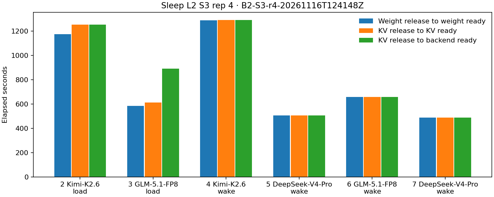

逐段 sleep 后采样。HBM 为八卡合计，RAM 为整机统计，PID 计数覆盖该轮仍存活的 Backend 容器。CPU 权重备份字节来自 allocator 回执。

| 段 | 休眠模型 | HBM（GiB） | 可用 RAM（GiB） | 匿名页（GiB） | 存活 PID 数 | CPU 权重备份（B） |
| --- | --- | --- | --- | --- | --- | --- |
| 1 | DeepSeek-V4-Pro | 33.773 | 1856.280 | 22.853 | 11 | 0 |
| 2 | Kimi-K2.6 | 53.172 | 1835.175 | 42.840 | 22 | 0 |
| 3 | GLM-5.1-FP8 | 81.328 | 1819.253 | 57.865 | 33 | 0 |
| 4 | Kimi-K2.6 | 81.260 | 867.296 | 1008.888 | 33 | 0 |
| 5 | DeepSeek-V4-Pro | 81.260 | 866.674 | 1009.071 | 33 | 0 |
| 6 | GLM-5.1-FP8 | 86.197 | 866.713 | 1009.398 | 33 | 0 |
| 7 | DeepSeek-V4-Pro | 86.197 | 865.589 | 1009.539 | 33 | 0 |

Kimi checkpoint 重载窗口的 cgroup 实测。匿名页和文件页取自同一峰值采样点。refault 为采样区间计数增量。采样覆盖范围见派生数据。

| 段 | 采样数 | 峰值（GiB） | 匿名页（GiB） | 文件页（GiB） | 文件页 refault 增量（页） | OOM kill 增量 |
| --- | --- | --- | --- | --- | --- | --- |
| 4 | 245 | 1510.576 | 970.780 | 536.391 | 45,933,367 | 0 |

从仓库根目录运行 `python v11/large-pool-20261114/recompute_sleep.py v11/large-pool-20261114/sleep-runs` 重算。[逐 rank 端点及各位置统计](large-pool-20261114/sleep-timing.json)

显存回执重算使用 `python v11/large-pool-20261114/recompute_sleep_vram.py v11/large-pool-20261114/sleep-runs`。

### V4 Sleep L2 单模型重复唤醒诊断

`B2-V4ScaleDiag-r1-20261116T035714Z` · V4 → V4 → V4，每 rank 16 GiB GPU KV，沿用原显存准入。金标和 Worker 连续性通过，13 个阶段各覆盖八 rank，退出后八卡归零观察 61.028 s。[验收](large-pool-20261114/sleep-diagnostics/B2-V4ScaleDiag-r1-20261116T035714Z/qualification.json) · [原始证据索引](large-pool-20261114/sleep-diagnostics/B2-V4ScaleDiag-r1-20261116T035714Z/evidence-index.csv)

| 第几次 sleep | 每卡 NVML 驻留（MiB） | 八 rank 权重分配区外 scale（GiB） |
| --- | --- | --- |
| 1 | 4323 | 0.000 |
| 2 | 10309 | 45.035 |
| 3 | 10119 | 45.035 |

首次 checkpoint 重载后，Marlin 的 scale 引用指向权重分配区外的存储，这些存储在下一次 Sleep 后仍被引用。首次重载前后每卡休眠驻留增加 5986 MiB，与 S3 的 V4 驻留增量一致。第二次重载后，区外 scale 容量保持稳定。NVML 总驻留同时包含其他显存分配，按原始读数列示。[逐 rank 派生回执](large-pool-20261114/v4-scale-diagnostic.json)

从仓库根目录运行 `python v11/large-pool-20261114/recompute_v4_scale_diagnostic.py v11/large-pool-20261114/sleep-diagnostics/B2-V4ScaleDiag-r1-20261116T035714Z`。

修复短测 `B2-V4RebindDiag-r1-20261116T044224Z` 沿用相同的 V4 请求和显存准入。两次 checkpoint 唤醒的金标与 Worker 连续性通过，八 rank 的 Marlin scale 在权重分配区外均为 0 字节。三次 Sleep 后每卡最大驻留为 4323 → 4323 → 4323 MiB。最终八卡归零观察 61.036 s。[验收](large-pool-20261114/sleep-diagnostics/B2-V4RebindDiag-r1-20261116T044224Z/qualification.json) · [原始证据索引](large-pool-20261114/sleep-diagnostics/B2-V4RebindDiag-r1-20261116T044224Z/evidence-index.csv) · [逐 rank 重算](large-pool-20261114/v4-rebind-diagnostic.json)

从仓库根目录运行 `python v11/large-pool-20261114/recompute_v4_scale_diagnostic.py v11/large-pool-20261114/sleep-diagnostics/B2-V4RebindDiag-r1-20261116T044224Z`。

## Kimi Sleep L2 逐层重载对照

固定 vLLM 0.20.1，TP8，每 rank 16 GiB GPU KV，容器内存上限 1664 GiB。两组首次加载和 checkpoint 唤醒前各做一次 SafeTensors 冷页准入。逐层记录覆盖八 rank 的 480 个专家层实例。匿名内存峰值与文件页 refault 均取重载窗口，refault 折算量按页计数计算。

[baseline 派生审计](large-pool-20261114/sleep-diagnostics/B2-Kimi-L2-wna16-baseline-r1-20261116T213414Z/audit.json) · [验收回执](large-pool-20261114/sleep-diagnostics/B2-Kimi-L2-wna16-baseline-r1-20261116T213414Z/qualification.json) · [重算脚本](large-pool-20261114/sleep-diagnostics/B2-Kimi-L2-wna16-baseline-r1-20261116T213414Z/capsule-provenance/audit_wna16.py)

[candidate 派生审计](large-pool-20261114/sleep-diagnostics/B2-Kimi-L2-wna16-candidate-r1-20261116T223422Z/audit.json) · [验收回执](large-pool-20261114/sleep-diagnostics/B2-Kimi-L2-wna16-candidate-r1-20261116T223422Z/qualification.json) · [重算脚本](large-pool-20261114/sleep-diagnostics/B2-Kimi-L2-wna16-candidate-r1-20261116T223422Z/capsule-provenance/audit_wna16.py)

| 组 | 运行证据 | finalize 完成数 | 重载（s） | GPU KV 唤醒（s） | 匿名内存峰值（GiB） | 文件页 refault 折算（GiB） | 八卡释放观察（s） |
| --- | --- | --- | --- | --- | --- | --- | --- |
| baseline | [B2-Kimi-L2-wna16-baseline-r1-20261116T213414Z](large-pool-20261114/sleep-diagnostics/B2-Kimi-L2-wna16-baseline-r1-20261116T213414Z/evidence-index.csv) | 480/480 | 2141.810 | 0.219 | 1313.796 | 953.656 | 60.683 |
| candidate | [B2-Kimi-L2-wna16-candidate-r1-20261116T223422Z](large-pool-20261114/sleep-diagnostics/B2-Kimi-L2-wna16-candidate-r1-20261116T223422Z/evidence-index.csv) | 0/480 | 1270.912 | 0.211 | 68.509 | 0.000 | 60.640 |

同配置各测一次，两组均以同一轮内的原八个 Worker 完成唤醒并通过前后金标。本对照重载缩短 870.898 s（40.7%）。基线的专家层实例全部在最终收尾阶段完成，修复组全部在重载过程中完成。

## Kimi WNA16 修复后的三模型 Sleep L2 复验

沿用 TP8、每 rank 16 GiB GPU KV 和原生 checkpoint。Kimi 用已验收的 WNA16 补丁，V4 用已验收的 Marlin scale 修复。每个模型的实际镜像、逐 rank 导入路径和 SHA 见本轮验收证据。

| 序列 | 验收回执 | 通过段数 | 回访唤醒 | 八卡归零观察（s） |
| --- | --- | --- | --- | --- |
| S1 | [B2-WNA16-S1-r2-20261117T032950Z](large-pool-20261114/sleep-wna16-sequences/B2-WNA16-S1-r2-20261117T032950Z/qualification.json) | 7 | 4 | 61.002 |
| S2 | [B2-WNA16-S2-r1-20261117T051312Z](large-pool-20261114/sleep-wna16-sequences/B2-WNA16-S2-r1-20261117T051312Z/qualification.json) | 7 | 4 | 61.189 |
| S3 | [B2-WNA16-S3-r1-20261117T062729Z](large-pool-20261114/sleep-wna16-sequences/B2-WNA16-S3-r1-20261117T062729Z/qualification.json) | 7 | 4 | 61.044 |

S1 第一次启动缺少补丁清单，在创建容器前退出。后续 S1 七段金标通过，三组 Worker 正常退出。控制器因 CSV 表头缺少内存字段而中止导出，61.002 s 为收尾后重新采集的连续归零观察。S2、S3 使用修正后的导出器。 [启动日志](large-pool-20261114/sleep-wna16-sequences/provenance/S1-controller.CbyPgp.log) · [S1 验收补录回执](large-pool-20261114/sleep-wna16-sequences/B2-WNA16-S1-r2-20261117T032950Z/qualification-recovery.json)

### 首次加载

| 序列/段 | 目标模型 | 权重准备（s） | GPU KV 分配（s） | 旧 KV 释放→新 KV 就绪（s） | 旧 KV 释放→可服务（s） | 权重准备开始→可服务（s） | 就绪→金标完成（s） | 金标 |
| --- | --- | --- | --- | --- | --- | --- | --- | --- |
| [S1/00](large-pool-20261114/sleep-wna16-sequences/B2-WNA16-S1-r2-20261117T032950Z/evidence-index.csv) | Kimi-K2.6 | 1080.535 | 0.195 | — | — | 1158.933 | 5.337 | True |
| [S1/01](large-pool-20261114/sleep-wna16-sequences/B2-WNA16-S1-r2-20261117T032950Z/evidence-index.csv) | GLM-5.1-FP8 | 532.845 | 0.207 | 657.490 | 929.831 | 831.374 | 19.145 | True |
| [S1/02](large-pool-20261114/sleep-wna16-sequences/B2-WNA16-S1-r2-20261117T032950Z/evidence-index.csv) | DeepSeek-V4-Pro | 242.078 | 0.411 | 400.481 | 598.929 | 499.759 | 29.483 | True |
| [S2/00](large-pool-20261114/sleep-wna16-sequences/B2-WNA16-S2-r1-20261117T051312Z/evidence-index.csv) | GLM-5.1-FP8 | 498.091 | 0.247 | — | — | 802.864 | 19.870 | True |
| [S2/01](large-pool-20261114/sleep-wna16-sequences/B2-WNA16-S2-r1-20261117T051312Z/evidence-index.csv) | DeepSeek-V4-Pro | 151.838 | 0.361 | 311.408 | 510.691 | 410.332 | 29.281 | True |
| [S2/02](large-pool-20261114/sleep-wna16-sequences/B2-WNA16-S2-r1-20261117T051312Z/evidence-index.csv) | Kimi-K2.6 | 644.671 | 0.201 | 826.615 | 829.132 | 724.961 | 5.431 | True |
| [S3/00](large-pool-20261114/sleep-wna16-sequences/B2-WNA16-S3-r1-20261117T062729Z/evidence-index.csv) | DeepSeek-V4-Pro | 314.442 | 0.303 | — | — | 574.493 | 30.197 | True |
| [S3/01](large-pool-20261114/sleep-wna16-sequences/B2-WNA16-S3-r1-20261117T062729Z/evidence-index.csv) | Kimi-K2.6 | 715.828 | 0.234 | 898.773 | 904.771 | 800.835 | 5.301 | True |
| [S3/02](large-pool-20261114/sleep-wna16-sequences/B2-WNA16-S3-r1-20261117T062729Z/evidence-index.csv) | GLM-5.1-FP8 | 175.358 | 0.209 | 306.783 | 592.591 | 489.333 | 20.595 | True |

各项汇总为有效 n · 中位数（s）。

| 模型 | 权重准备 | GPU KV 分配 | 旧 KV 释放→新 KV 就绪 | 旧 KV 释放→可服务 |
| --- | --- | --- | --- | --- |
| Kimi-K2.6 | 3 · 715.828 | 3 · 0.201 | 2 · 862.694 | 2 · 866.952 |
| GLM-5.1-FP8 | 3 · 498.091 | 3 · 0.209 | 2 · 482.136 | 2 · 761.211 |
| DeepSeek-V4-Pro | 3 · 242.078 | 3 · 0.361 | 2 · 355.945 | 2 · 554.810 |

### 原 Worker 回访唤醒

| 序列/段 | 目标模型 | 权重准备（s） | GPU KV 分配（s） | 旧 KV 释放→新 KV 就绪（s） | 旧 KV 释放→可服务（s） | 权重准备开始→可服务（s） | 就绪→金标完成（s） | 金标 |
| --- | --- | --- | --- | --- | --- | --- | --- | --- |
| [S1/03](large-pool-20261114/sleep-wna16-sequences/B2-WNA16-S1-r2-20261117T032950Z/evidence-index.csv) | GLM-5.1-FP8 | 348.101 | 0.501 | 410.876 | 410.924 | 348.705 | 8.771 | True |
| [S1/04](large-pool-20261114/sleep-wna16-sequences/B2-WNA16-S1-r2-20261117T032950Z/evidence-index.csv) | Kimi-K2.6 | 1282.936 | 0.217 | 1345.404 | 1345.442 | 1283.231 | 3.961 | True |
| [S1/05](large-pool-20261114/sleep-wna16-sequences/B2-WNA16-S1-r2-20261117T032950Z/evidence-index.csv) | DeepSeek-V4-Pro | 273.219 | 0.341 | 336.551 | 336.615 | 273.813 | 8.456 | True |
| [S1/06](large-pool-20261114/sleep-wna16-sequences/B2-WNA16-S1-r2-20261117T032950Z/evidence-index.csv) | Kimi-K2.6 | 861.530 | 0.217 | 925.132 | 925.169 | 862.230 | 4.085 | True |
| [S2/03](large-pool-20261114/sleep-wna16-sequences/B2-WNA16-S2-r1-20261117T051312Z/evidence-index.csv) | DeepSeek-V4-Pro | 108.907 | 0.290 | 171.843 | 171.908 | 109.442 | 8.380 | True |
| [S2/04](large-pool-20261114/sleep-wna16-sequences/B2-WNA16-S2-r1-20261117T051312Z/evidence-index.csv) | GLM-5.1-FP8 | 477.536 | 0.215 | 540.457 | 540.502 | 477.848 | 8.582 | True |
| [S2/05](large-pool-20261114/sleep-wna16-sequences/B2-WNA16-S2-r1-20261117T051312Z/evidence-index.csv) | Kimi-K2.6 | 956.959 | 0.215 | 1019.741 | 1019.777 | 957.254 | 3.950 | True |
| [S2/06](large-pool-20261114/sleep-wna16-sequences/B2-WNA16-S2-r1-20261117T051312Z/evidence-index.csv) | GLM-5.1-FP8 | 213.159 | 0.186 | 276.544 | 276.593 | 213.452 | 8.574 | True |
| [S3/03](large-pool-20261114/sleep-wna16-sequences/B2-WNA16-S3-r1-20261117T062729Z/evidence-index.csv) | Kimi-K2.6 | 965.287 | 0.246 | 1028.295 | 1028.333 | 965.613 | 3.968 | True |
| [S3/04](large-pool-20261114/sleep-wna16-sequences/B2-WNA16-S3-r1-20261117T062729Z/evidence-index.csv) | DeepSeek-V4-Pro | 238.544 | 0.291 | 302.339 | 302.401 | 239.079 | 8.279 | True |
| [S3/05](large-pool-20261114/sleep-wna16-sequences/B2-WNA16-S3-r1-20261117T062729Z/evidence-index.csv) | GLM-5.1-FP8 | 216.060 | 0.190 | 279.819 | 279.870 | 216.355 | 8.832 | True |
| [S3/06](large-pool-20261114/sleep-wna16-sequences/B2-WNA16-S3-r1-20261117T062729Z/evidence-index.csv) | DeepSeek-V4-Pro | 189.845 | 0.309 | 253.843 | 253.906 | 190.397 | 8.272 | True |

各项汇总为有效 n · 中位数（s）。

| 模型 | 权重准备 | GPU KV 分配 | 旧 KV 释放→新 KV 就绪 | 旧 KV 释放→可服务 |
| --- | --- | --- | --- | --- |
| Kimi-K2.6 | 4 · 961.123 | 4 · 0.217 | 4 · 1024.018 | 4 · 1024.055 |
| GLM-5.1-FP8 | 4 · 282.080 | 4 · 0.202 | 4 · 345.348 | 4 · 345.397 |
| DeepSeek-V4-Pro | 4 · 214.195 | 4 · 0.300 | 4 · 278.091 | 4 · 278.154 |

### Kimi 同序列同位置对照

| 位置 | 运行编号 | checkpoint 重载（s） | 重载中/收尾完成实例 | 匿名内存采样峰值（GiB） | 文件页 refault 折算（GiB） |
| --- | --- | --- | --- | --- | --- |
| S1/04 | B2-S1-r1-20261115T193956Z | 1991.431 | — | 1194.420 | 589.827 |
| S1/04 | B2-S1-r2-20261116T081141Z | 2442.327 | — | 1231.635 | 968.394 |
| S1/04 | B2-S1-r3-20261116T142350Z | 1954.619 | — | 1102.909 | 762.690 |
| S1/04 | B2-WNA16-S1-r2-20261117T032950Z | 1281.350 | 480/0 | 61.669 | 461.563 |
| S1/06 | B2-S1-r1-20261115T193956Z | 2262.432 | — | 1257.756 | 720.386 |
| S1/06 | B2-S1-r2-20261116T081141Z | 2883.410 | — | 1455.470 | 1083.444 |
| S1/06 | B2-S1-r3-20261116T142350Z | 2556.046 | — | 1339.593 | 906.787 |
| S1/06 | B2-WNA16-S1-r2-20261117T032950Z | 860.015 | 480/0 | 61.798 | 149.255 |
| S2/05 | B2-S2-r1-20261115T220612Z | 1708.807 | — | 809.614 | 380.671 |
| S2/05 | B2-S2-r2-20261116T021051Z | 2150.118 | — | 1349.594 | 561.606 |
| S2/05 | B2-S2-r3-20261116T062640Z | 1838.615 | — | 861.923 | 548.381 |
| S2/05 | B2-WNA16-S2-r1-20261117T051312Z | 955.466 | 480/0 | 68.247 | 129.066 |
| S3/03 | B2-S3-r2-20261116T050140Z | 825.680 | — | 405.605 | 92.670 |
| S3/03 | B2-S3-r3-20261116T104757Z | 1754.840 | — | 1320.168 | 241.567 |
| S3/03 | B2-S3-r4-20261116T124148Z | 1226.697 | — | 970.784 | 175.222 |
| S3/03 | B2-WNA16-S3-r1-20261117T062729Z | 963.792 | 480/0 | 75.334 | 136.327 |

同一位置各指标的有效 n · 中位数。

| 位置 | 配置 | 重载（s） | 匿名内存峰值（GiB） | 文件页 refault（GiB） |
| --- | --- | --- | --- | --- |
| S1/04 | 修复前 | 3 · 1991.431 | 3 · 1194.420 | 3 · 762.690 |
| S1/04 | 修复后 | 1 · 1281.350 | 1 · 61.669 | 1 · 461.563 |
| S1/06 | 修复前 | 3 · 2556.046 | 3 · 1339.593 | 3 · 906.787 |
| S1/06 | 修复后 | 1 · 860.015 | 1 · 61.798 | 1 · 149.255 |
| S2/05 | 修复前 | 3 · 1838.615 | 3 · 861.923 | 3 · 548.381 |
| S2/05 | 修复后 | 1 · 955.466 | 1 · 68.247 | 1 · 129.066 |
| S3/03 | 修复前 | 3 · 1226.697 | 3 · 970.784 | 3 · 175.222 |
| S3/03 | 修复后 | 1 · 963.792 | 1 · 75.334 | 1 · 136.327 |

历史整序列没有逐专家层完成打点。S1/S2 的历史运行早于本轮使用的 V4 Marlin scale 补丁，同位置对照包含这项配置差异。匿名内存峰值和 refault 使用各自重载窗口内的采样，refault 指该窗口首末采样点间的文件页计数增量。[逐次端点、逐层事件与采样来源](large-pool-20261114/sleep-wna16-sequences/audit.json)

## 原版冷读补测与现版本 B1 参照

| 条件 | 历史图 1 A（s） | 原版重测 A（s） | 现版本 B1 段 | B1 t4_first − t2（s） | B1 缓存证据 |
| --- | --- | --- | --- | --- | --- |
| V4 SF 冷读 | 556.222（n=9） | 682.869（n=1） [v4n40_pilot_003_sf_20261117T0135Z](large-pool-20261114/original-cold/v4n40_pilot_003_sf_20261117T0135Z/review.json) | [S3 / 00-D-v4](large-pool-20261114/supplement/B1-S3-r1-20261116T201045Z/00-D-v4/before-business-response.json) | 887.709 | 首段 SF，64 个分片零驻留页 |
| V4 Store 冷读 | 223.752（n=9） | 391.235（n=1） [v4n40_pilot_003_store_20261117T0200Z](large-pool-20261114/original-cold/v4n40_pilot_003_store_20261117T0200Z/review.json) | [S2 / 01-D-v4](large-pool-20261114/supplement/B1-S2-r1-20261116T184708Z/01-D-v4/before-business-response.json) | 496.615 | 空权重池，496 条路径未命中，读 877,729,513,472 B |
| GLM Store 冷读 | 599.712（n=1） | 625.635（n=1） | [S1 / 01-G-glm](large-pool-20261114/supplement/B1-S1-r2-20261116T171537Z/01-G-glm/before-business_arithmetic-response.json) | 499.985 | 空权重池，8 条路径未命中，读 762,527,481,856 B |

原版 GLM 延用 HTTP `/register` 前到外部完整业务响应的 A。本轮 Store 数据、Store 元数据和共享 checkpoint 元数据共 108 个文件，合并准入的驻留页均为零。B1 从控制器放行 Backend 到内部正确完整响应，两条 Store 段的全未命中属于 RAM 权重池状态，历史/原版冷读还验证 OS 页缓存。计时端点、Store 路径和缓存准入有差异，版本差值缺测。

[历史图 1](https://github.com/BoyJiang2/serverlessllm/blob/870d7daac4071790874884d2b3a9bdfc3af00f95/comparison/evidence/three-model-final-20261108/REPORT.md#图-1四条件启动至首个正确业务响应) · [GLM 原版终态](large-pool-20261114/original-cold/sllm-debug-20261116T225019Z-dfb118ad/controller-final.json) · [源证据索引](large-pool-20261114/original-cold/sllm-debug-20261116T225019Z-dfb118ad/evidence-index.csv)

V4 原版代码复测在 qjhs003 运行固定源码 `88cc71e` 和原镜像，A 沿用启动命令到外部完整金标响应。SafeTensors 沿用 NFS 路径，Store 使用 qjhs003 的本地 XFS 副本。启动器适配节点路径、清单和 GPU 准入，并在冷页检查前采样至少 60 s 的本机 Store 显存基线。两项均使用独立核验的 JIT 缓存，包含原清单的 174 个文件及 70 个 DeepGEMM 配套源文件。

[v4n40_pilot_003_sf_20261117T0135Z 证据索引](large-pool-20261114/original-cold/v4n40_pilot_003_sf_20261117T0135Z/evidence-index.csv)

[v4n40_pilot_003_store_20261117T0200Z 证据索引](large-pool-20261114/original-cold/v4n40_pilot_003_store_20261117T0200Z/evidence-index.csv)

qjhs003 的早期 SF 尝试分别止于启动许可握手和 DeepGEMM 缓存目录缺失配套源文件。两次均无有效 A。 [握手超时证据](large-pool-20261114/original-cold/v4n40_pilot_003_sf_20261117T0043Z/evidence-index.csv) · [JIT 缺失证据](large-pool-20261114/original-cold/v4n40_pilot_003_sf_20261117T0046Z/failure-excerpt.json)
