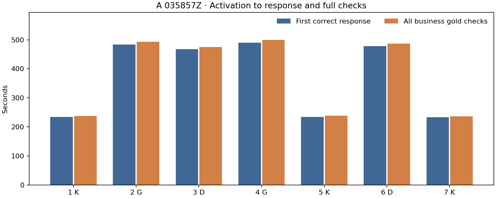
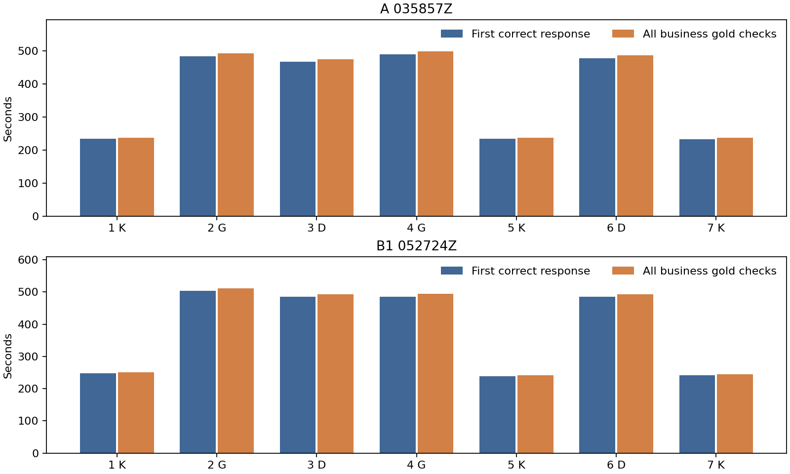
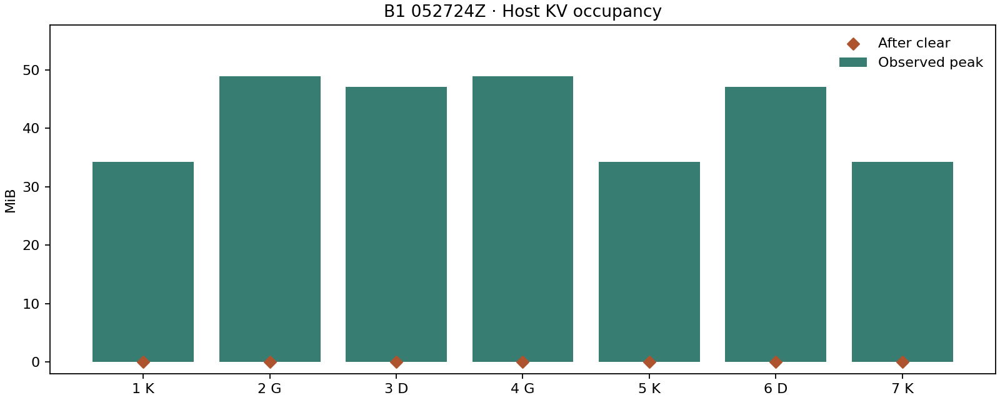
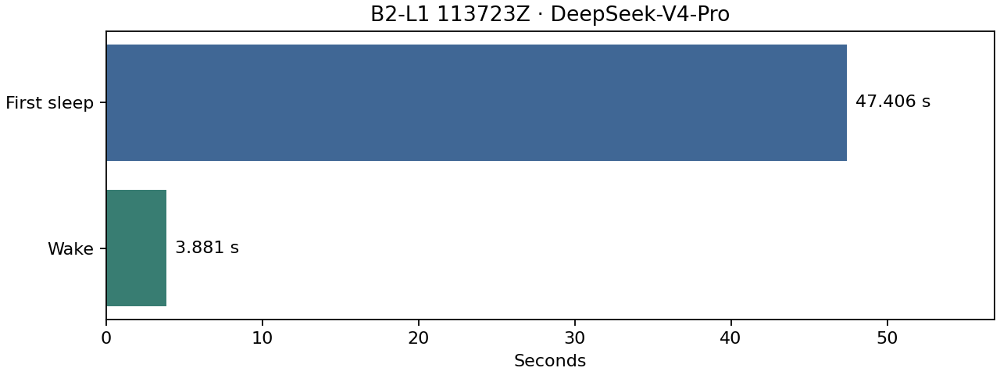
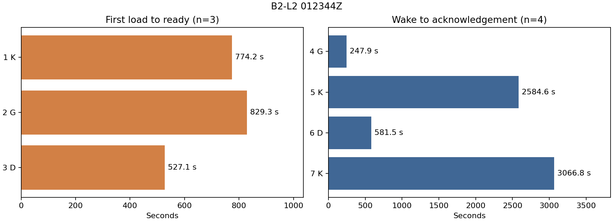
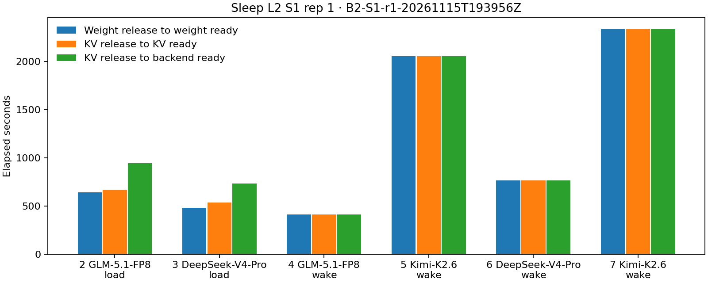
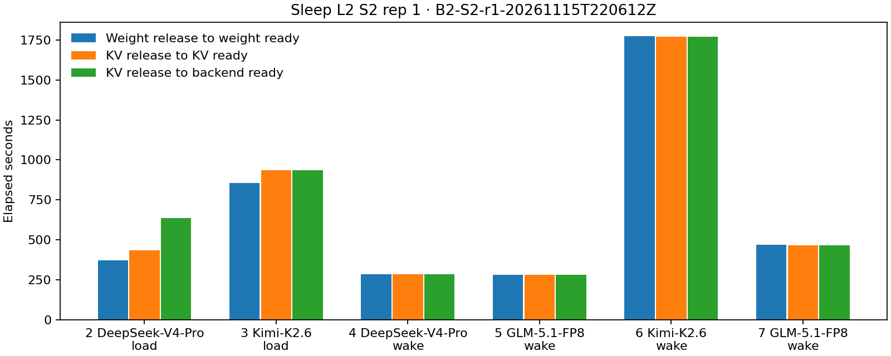

# V11 三模型切换复现实验报告

## 实验结论

A 和 B1 各完成同一固定序列的七段业务校验。A 验证常驻权重 Store 的空间复用，B1 加入 LMCache Host KV 写入与清理。B2-L1 验证 V4 单模型的 CPU 备份唤醒，B2-L2 验证原 Worker 从 checkpoint 恢复。Kimi 单模型补测在 1664 GiB 容器上限下通过。

qjhs003 使用 8×H20 和 TP8。七段为 Kimi → GLM → V4 → GLM → Kimi → V4 → Kimi。B1 正文、表和图统一使用 **052724Z**，带 HMA 补丁的 LMCache 0.5.6。144041Z 保留为历史证据。图的序号从 1 开始，原始目录从 00 开始。

**计时口径。** t2 是控制器放行 Backend 启动的 CLOCK_MONOTONIC 时间。t4_first 是有配对通过金标的首个完整业务响应的 received_ns，经段目录、模型和请求 ID 绑定。归档 Backend 的 boot ID 和 time namespace 与同一启动周期的 qjhs003 宿主读回一致，Worker 事件也逐条核对。t4_all 沿用原 t4，表示控制器观察到全套业务响应及检查文件，包含轮询。B1 的 kv_fill 在全套业务之后。B2 Wake 到唤醒回执结束，金标随后验证。

## A · 常驻权重 Store

### 数据 1 · 启动和切换

| 段 | 首个请求 | t4_first − t2（s） | t4_all − t2（s） | 全套切换扣观察（s） |
| --- | --- | --- | --- | --- |
| 00-K-kimi | arithmetic | 234.321 | 237.748 | — |
| 01-G-glm | business_arithmetic | 483.931 | 492.927 | 509.053 |
| 02-D-v4 | business | 467.579 | 475.364 | 491.401 |
| 03-G-glm | business_arithmetic | 490.431 | 499.480 | 513.588 |
| 04-K-kimi | arithmetic | 234.546 | 237.937 | 256.068 |
| 05-D-v4 | business | 478.496 | 486.665 | 504.440 |
| 06-K-kimi | arithmetic | 233.245 | 236.709 | 254.107 |

七段首个响应均值 **374.650 s**，全套均值 **380.976 s**。全套切换由上一段 t4_all 计至本段 t4_all，另扣原协议观察时间。

### 数据 2 · 权重 Store 状态

| 段 | cache_state | 命中（GiB） | 读取（GiB） | 分配块 | 归还块 | 驱逐路径 |
| --- | --- | --- | --- | --- | --- | --- |
| 00-K-kimi | full_miss | 0.00 | 574.63 | 18392 | 0 | 0 |
| 01-G-glm | full_miss | 0.00 | 710.16 | 22728 | 9196 | 4 |
| 02-D-v4 | full_miss | 0.00 | 817.45 | 26552 | 26242 | 10 |
| 03-G-glm | full_miss | 0.00 | 710.16 | 22728 | 22238 | 302 |
| 04-K-kimi | full_miss | 0.00 | 574.63 | 18392 | 18519 | 199 |
| 05-D-v4 | full_miss | 0.00 | 817.45 | 26552 | 27999 | 11 |
| 06-K-kimi | full_miss | 0.00 | 574.63 | 18392 | 16819 | 217 |

[原时间戳](runs/A-seq-7-agents-r1-20261113T035857Z/switch-events.csv) · [原验收](runs/A-seq-7-agents-r1-20261113T035857Z/qualification.json)

## B1 · 常驻权重 Store + Host KV

### 数据 1 · 启动和切换

| 段 | 首个请求 | t4_first − t2（s） | t4_all − t2（s） | 全套切换扣观察（s） |
| --- | --- | --- | --- | --- |
| 00-K-kimi | arithmetic | 247.894 | 251.360 | — |
| 01-G-glm | business_arithmetic | 503.087 | 511.857 | 533.034 |
| 02-D-v4 | business | 484.810 | 493.011 | 515.917 |
| 03-G-glm | business_arithmetic | 484.841 | 493.980 | 523.598 |
| 04-K-kimi | arithmetic | 238.609 | 241.962 | 262.912 |
| 05-D-v4 | business | 484.789 | 492.899 | 514.589 |
| 06-K-kimi | arithmetic | 241.579 | 244.918 | 272.810 |

七段首个响应均值 **383.659 s**，全套均值 **389.998 s**。全套切换由上一段 t4_all 计至本段 t4_all，另扣原协议观察时间。

### 数据 2 · 权重 Store 状态

| 段 | cache_state | 命中（GiB） | 读取（GiB） | 分配块 | 归还块 | 驱逐路径 |
| --- | --- | --- | --- | --- | --- | --- |
| 00-K-kimi | full_miss | 0.00 | 574.63 | 18392 | 0 | 0 |
| 01-G-glm | full_miss | 0.00 | 710.16 | 22728 | 9196 | 4 |
| 02-D-v4 | full_miss | 0.00 | 817.45 | 26552 | 26242 | 10 |
| 03-G-glm | partial_hit | 88.77 | 621.39 | 19887 | 19397 | 301 |
| 04-K-kimi | full_miss | 0.00 | 574.63 | 18392 | 18519 | 199 |
| 05-D-v4 | full_miss | 0.00 | 817.45 | 26552 | 27999 | 11 |
| 06-K-kimi | full_miss | 0.00 | 574.63 | 18392 | 16819 | 217 |

[原时间戳](runs/B1-seq-7-agents-r1-20261113T052724Z/switch-events.csv) · [原验收](runs/B1-seq-7-agents-r1-20261113T052724Z/qualification.json)

### B1 填充与旧 Backend 退出

16 GiB Host KV 池在准备阶段初始化。Backend 就绪后先跑业务金标，再以 kv_fill 推理请求生成 KV，验证 Host 写入和清理。七段 Host KV 命中均为 0 token。

| 下一段 | A t0→t1（s） | B1 t0→t1（s） | A t1→t2（s） | B1 t1→t2（s） | B1 上一段 kv_fill 总长（s） | B1 落在 t0→t1 的 kv_fill（s） |
| --- | --- | --- | --- | --- | --- | --- |
| 01-G-glm | 8.426 | 10.529 | 67.700 | 70.648 | 0.920 | 0.774 |
| 02-D-v4 | 8.879 | 14.935 | 67.158 | 67.971 | 4.283 | 4.237 |
| 03-G-glm | 6.623 | 21.446 | 67.485 | 68.173 | 12.864 | 12.775 |
| 04-K-kimi | 10.128 | 12.983 | 68.003 | 67.966 | 4.271 | 4.177 |
| 05-D-v4 | 9.828 | 13.736 | 67.947 | 67.954 | 0.871 | 0.837 |
| 06-K-kimi | 8.776 | 19.548 | 68.622 | 68.345 | 12.906 | 12.806 |

t0 等于上一段 t4_all，t1 是旧 Backend 退出。以 max(0, min(t1, fill_end) − max(t0, fill_start)) 计算实际相交时长。

| 段 | Host KV 峰值（MiB） | 提交 token | 命中 token | 清理后字节 |
| --- | --- | --- | --- | --- |
| 00-K-kimi | 34.31 | 512 | 0 | 0 |
| 01-G-glm | 48.91 | 512 | 0 | 0 |
| 02-D-v4 | 47.08 | 512 | 0 | 0 |
| 03-G-glm | 48.91 | 512 | 0 | 0 |
| 04-K-kimi | 34.31 | 512 | 0 | 0 |
| 05-D-v4 | 47.08 | 512 | 0 | 0 |
| 06-K-kimi | 34.31 | 512 | 0 | 0 |

### A 与 B1 的逐段差值

| 段 | 首个响应 B1−A（s） | 全套 B1−A（s） |
| --- | --- | --- |
| 00-K-kimi | 13.573 | 13.612 |
| 01-G-glm | 19.156 | 18.930 |
| 02-D-v4 | 17.230 | 17.647 |
| 03-G-glm | -5.589 | -5.500 |
| 04-K-kimi | 4.063 | 4.025 |
| 05-D-v4 | 6.294 | 6.234 |
| 06-K-kimi | 8.335 | 8.209 |

B1 的 03-G-glm 命中 rank 6 的 **88.77 GiB**，读取 **621.39 GiB**。A 对应段为全未命中，读取 **710.16 GiB**。V4 的 gpu_memory_utilization 为 A **0.9**、B1 **0.76**。读取状态、显存配置和填充等差异共同影响观测，无法单独量化 LMCache 成本。

## 八 rank 权重阶段（秒）

同一 run、时钟域和 Worker 身份内配对 begin/end。八 rank 齐全才计算最晚结束减最早开始。派生 JSON 提供逐 rank 起止、最大单 rank 时长和原始路径。破折号对应 null。

| 组 | 段 | full_weight_load | weight_ingestion | quantization_postprocess |
| --- | --- | --- | --- | --- |
| A | 00-K-kimi | 94.175 | 91.587 | — |
| A | 01-G-glm | 122.790 | 120.468 | 9.512 |
| A | 02-D-v4 | 140.452 | 10.881 | 127.876 |
| A | 03-G-glm | 123.747 | 120.694 | 13.945 |
| A | 04-K-kimi | 93.944 | 91.386 | — |
| A | 05-D-v4 | 144.642 | 12.867 | 131.900 |
| A | 06-K-kimi | 94.442 | 91.871 | — |
| B1 | 00-K-kimi | 94.320 | 91.793 | — |
| B1 | 01-G-glm | 122.318 | 120.569 | 8.289 |
| B1 | 02-D-v4 | 143.123 | 11.115 | 129.920 |
| B1 | 03-G-glm | 107.739 | 105.624 | 89.057 |
| B1 | 04-K-kimi | 94.472 | 91.868 | — |
| B1 | 05-D-v4 | 144.199 | 10.587 | 129.880 |
| B1 | 06-K-kimi | 99.747 | 92.407 | — |

| 组 | 模型 | full_weight_load 有效 n | weight_ingestion 有效 n | quantization_postprocess 有效 n |
| --- | --- | --- | --- | --- |
| A | Kimi-K2.6 | 3 | 3 | 0 |
| A | GLM-5.1-FP8 | 2 | 2 | 2 |
| A | DeepSeek-V4-Pro | 2 | 2 | 2 |
| B1 | Kimi-K2.6 | 3 | 3 | 0 |
| B1 | GLM-5.1-FP8 | 2 | 2 | 2 |
| B1 | DeepSeek-V4-Pro | 2 | 2 | 2 |

完整加载接点覆盖 Worker 调用的加载器 load_model()，包括构造与必要恢复步骤，设备初始化和 KV 分配在此窗口外。Kimi 摄入包住 load_dict_owned()，有单独的 restore_postprocess，缺少本表的 quantization_postprocess 接点。GLM 摄入包住 load_weights()，后处理包住 process_weights_after_loading()。V4 后处理包含分组权重恢复及 H2D，摄入未覆盖全部专家权重传输。重叠阶段各自展示。

[Kimi 加载器](../v7/vllm_kimi20_loader.py) · [GLM 加载器](../v7/vllm_glm20_loader.py) · [V4 加载接点](../v7/v7_trace.py)

## 历史参照

| 模型 | 条件 | 有效 n | A（s） | 提交 | 端点与准入 |
| --- | --- | --- | --- | --- | --- |
| Kimi-K2.6 | Store 冷读 | 8 | 241.266 | d3c10bd | 历史配对块注册至首个正确业务响应，独立 Store 冷读准入 |
| GLM-5.1-FP8 | SF 冷读（C23） | 6 | 448.496 | d3c10bd | C23 B5–B10 配对块，注册至首个正确算术 HTTP 响应，独立冷读 |
| GLM-5.1-FP8 | Store 冷读（v7，vLLM 0.20.1） | 1 | 599.712 | 15d9341 | 启动指令至首条算术正确 HTTP 响应，716 GiB 公共池及单次冷读准入 |
| DeepSeek-V4-Pro | SF 冷读 | 9 | 556.222 | d3c10bd | NFS40 B2–B10，startup_command 至正确业务响应，NFS 冷页准入 |
| DeepSeek-V4-Pro | Store 冷读 | 9 | 223.752 | d3c10bd | NFS40 B2–B10，startup_command 至正确业务响应，本地 XFS Store 冷读准入 |

| V11 模型 | 每组 n | A 首个响应均值（s） | B1 首个响应均值（s） | A 全套均值（s） | B1 全套均值（s） |
| --- | --- | --- | --- | --- | --- |
| Kimi-K2.6 | 3 | 234.037 | 242.694 | 237.464 | 246.080 |
| GLM-5.1-FP8 | 2 | 487.181 | 493.964 | 496.204 | 502.919 |
| DeepSeek-V4-Pro | 2 | 473.038 | 484.800 | 481.014 | 492.955 |

历史逐次控制缓存。V11 A/B1 在常驻 Store 内自然复用或重读权重，OS 页缓存冷暖未逐段验证。V11 首个响应在 Backend 内记录，历史以服务/控制器接收为终点。审阅提到的 V4 236.737 s 在指定提交中无对应指标，已核实该提交的 Store 冷读 A 为 223.752 s。236.737 s 保留为待核值。

[GLM 历史参照](https://github.com/BoyJiang2/serverlessllm/blob/15d93417f24bdc00291c791d7f95bdd50dd7725e/comparison/evidence/three-model-final-20261108/REPORT.md) · [Kimi/V4 历史参照](https://github.com/BoyJiang2/serverlessllm/blob/d3c10bda437b29d821b4845ca6a79c39b00fb975/comparison/evidence/three-model-final-20261108/REPORT.md) · [V4 九条历史冷读样本](report-inputs/v4-historical-store-cold.json)

## B2 · 原生 Sleep / Wake

### B2-L1 · CPU 权重备份

V4 单模型回到原 Worker，金标通过。CPU 权重备份 **820.42 GiB**，首次 Sleep **47.406 s**，Wake **3.881 s**。多模型 L1 受主机内存容量限制。

### B2-L2 · 正式七段

| 原段 | 模型 | 首次加载至就绪（s） |
| --- | --- | --- |
| 0 | Kimi-K2.6 | 774.181 |
| 1 | GLM-5.1-FP8 | 829.322 |
| 2 | DeepSeek-V4-Pro | 527.144 |

| 原段 | 模型 | 唤醒至回执（s） | 重载 RPC（s） |
| --- | --- | --- | --- |
| 3 | GLM-5.1-FP8 | 247.854 | 245.934 |
| 4 | Kimi-K2.6 | 2584.591 | 2582.761 |
| 5 | DeepSeek-V4-Pro | 581.513 | 578.630 |
| 6 | Kimi-K2.6 | 3066.760 | 3064.757 |

首次加载 n=3，均值 **710.216 s**。唤醒 n=4，均值 **1620.179 s**。原 Worker PID 连续，全七段金标通过，权重 CPU 备份为零。V4 实际容器创建回执中的三条只读 bind 均指向 b2-v4-sink-router-overlay，包含 deepseek_v4.py、meta.py 和 v4_source_pins.json。

[正式回执](runs/B2-seq-7-agents-r1-20261113T012344Z/qualification.json) · [V4 容器挂载回执](runs/B2-seq-7-agents-r1-20261113T012344Z/L2/02-D-created.json)

### 11 月 15 日 Kimi L2 单模型诊断

| 运行 | RAM 上限（GiB） | Wake（s） | 重载 RPC（s） | 验收 |
| --- | --- | --- | --- | --- |
| 031303Z | 1400 | — | — | rank 5 重载期间退出，Docker 记录 OOM |
| 041505Z | 1664 | 1062.981 | 1061.138 | 八 rank 身份连续、四项原金标通过，正常退出 |

031303Z 八 rank 重载初始化包络 0.061645 s，没有完整重载端点，最终全卡归零 61.074 s。041505Z 与失败轮及历史轮的 Kimi 引擎配置一致。相对历史 2584.591 s 和 3066.760 s，本轮 Wake 短 58.87% 和 65.34%。历史为三模型序列，本轮为 Kimi → Kimi，页缓存状态未对齐。

| 阶段 | 八 rank 包络（s） |
| --- | --- |
| reload | 1061.134 |
| initialize | 0.062 |
| load | 378.821 |
| finalize | 786.200 |

041505Z 唤醒窗口的同一采样点中，memory.current 为 **1630.47 GiB**，anon **1081.56 GiB**，file **543.34 GiB**。

| Rank | RssAnon 原值（kB，按 KiB） | 折算 GiB |
| --- | --- | --- |
| 0 | 2,707,192 | 2.58 |
| 1 | 249,585,244 | 238.02 |
| 2 | 131,788,208 | 125.68 |
| 3 | 2,538,372 | 2.42 |
| 4 | 248,913,276 | 237.38 |
| 5 | 245,251,840 | 233.89 |
| 6 | 249,064,984 | 237.53 |
| 7 | 2,544,116 | 2.43 |

审阅中的 131–249 GiB 混用了单位并只覆盖部分 rank。五个较高 rank 的区间为 125.68–238.02 GiB。共享页可同时记入多进程 RSS。

同点 workingset_refault_file 为 **184,923,939 页**，按宿主 4096 B 页大小折算 **705.43 GiB**。这是该容器 cgroup 从创建到采样点的累计文件页 refault 折算量，可重复计页。它与唯一扫描量、物理盘读字节以及唤醒窗口增量各有不同边界。收尾的进程读取计数仍增长。固定镜像的 layerwise.py 会延迟回放权重加载并处理、复制及恢复 kernel 张量，支持此处存在延迟处理的机制。各层内存占比仍缺分配级打点。1400 GiB 轮的 OOM 及 1664 GiB 轮越过旧上限的采样共同表明容量压力。

[失败轮 Docker OOM](runs/B2-Kimi-L2-diagnostic-r1-20261115T031303Z/docker-events.jsonl) · [失败回执](runs/B2-Kimi-L2-diagnostic-r1-20261115T031303Z/qualification.json) · [失败轮八 rank 接点](runs/B2-Kimi-L2-diagnostic-r1-20261115T031303Z/trace-summary.json) · [复跑验收](runs/B2-Kimi-L2-memory-r1-20261115T041505Z/audit.json) · [内存采样](runs/B2-Kimi-L2-memory-r1-20261115T041505Z/memory-summary.json) · [阶段端点](runs/B2-Kimi-L2-memory-r1-20261115T041505Z/trace-summary.json) · [收尾 I/O](runs/B2-Kimi-L2-memory-r1-20261115T041505Z/finalizer-io-snapshots.txt) · [固定镜像源码](report-inputs/layerwise.py)

## 释放观察

| run ID | 八卡归零且无计算进程 | 最终观察（s） | 严格 ≥60s | 原运行通过标记 | 原始采样数 |
| --- | --- | --- | --- | --- | --- |
| A-seq-7-agents-r1-20261113T035857Z | True | 60.845 | True | True | 49 |
| B1-seq-7-agents-r1-20261113T052724Z | True | 60.866 | True | True | 49 |
| B1-seq-7-agents-r1-20261112T144041Z | True | 59.504 | False | True | 48 |
| B2-seq-7-agents-r1-20261113T012344Z | True | 61.237 | True | True | 50 |
| B2-B2-smoke-r1-20261111T113723Z | True | 59.858 | False | True | 49 |
| B2-Kimi-L2-diagnostic-r1-20261115T031303Z | True | 61.074 | True | False | 50 |
| B2-Kimi-L2-memory-r1-20261115T041505Z | True | 60.892 | True | True | 49 |

144041Z 的 59.504 s 保留原值。实际资源回落和观察时长按各自原始记录核验，严格门槛为 60 秒。

## 重算与证据

仓库根目录运行 python v11/make_experiment_report.py。单独重绘可运行 python v11/plot_v11.py。生成数据、图和报告使用同一批输入。

[派生数据和逐 rank 起止](derived/report-data.json) · [运行清单](report-inputs/run-manifest.json) · [原始证据索引](report-inputs/evidence-index.csv.gz) · [三模型大池复验](large-pool-20261114/REPORT.md)

[大池 B1 九轮可服务前指标](large-pool-20261114/READINESS.md) · [独立 S1 补测与释放回执](large-pool-20261114/supplement/B1-S1-r1-20261115T180856Z/README.md) · [Sleep L1/L2 前检](large-pool-20261114/SLEEP-PREFLIGHT-20261116.md)

## 同序列 Sleep L2 复验

TP8，首模型经 SafeTensors 冷页准入，回访模型在原 Worker 重载 checkpoint。配置为每 rank 16 GiB 的 GPU KV 预算。此路径不使用 SLLM Store 或 LMCache。权重就绪、GPU KV 就绪和 Backend 可服务是独立接点，表中跨度存在重叠。

| 序列 | 七段顺序 | 已归档合格轮 | 目标轮 |
| --- | --- | --- | --- |
| S1 | Kimi-K2.6 → GLM-5.1-FP8 → DeepSeek-V4-Pro → GLM-5.1-FP8 → Kimi-K2.6 → DeepSeek-V4-Pro → Kimi-K2.6 | 1 | 3 |
| S2 | GLM-5.1-FP8 → DeepSeek-V4-Pro → Kimi-K2.6 → DeepSeek-V4-Pro → GLM-5.1-FP8 → Kimi-K2.6 → GLM-5.1-FP8 | 1 | 3 |
| S3 | DeepSeek-V4-Pro → Kimi-K2.6 → GLM-5.1-FP8 → Kimi-K2.6 → DeepSeek-V4-Pro → GLM-5.1-FP8 → DeepSeek-V4-Pro | 0 | 3 |

首段 GPU KV 分配取最早 rank 开始到最晚 rank 结束。B1 按显存利用率自动计算预算，Sleep L2 固定每 rank 16 GiB。池初始化、LMCache 注册和 Backend 预热各有独立接点。B1 的旧 GPU KV 释放起点缺失，严格的清理至新 KV 就绪跨度为 null。

| 序列 | 冷启动模型 | 大池 B1 n | B1 中位数（s） | Sleep L2 n | L2 中位数（s） |
| --- | --- | --- | --- | --- | --- |
| S1 | Kimi-K2.6 | 3 | 12.016 | 1 | 0.210 |
| S2 | GLM-5.1-FP8 | 3 | 7.846 | 1 | 0.217 |
| S3 | DeepSeek-V4-Pro | 3 | 12.422 | 0 | — |

### 各序列与切换位置汇总

单元格为有效 n · 中位数 [最小值, 最大值]，单位为秒。每项只计入通过轮次中具备该指标起止端点的观测。

| 序列 | 段 | 模型 | 权重准备 | GPU KV 分配 | 权重切换 | KV 切换 | 旧 KV 释放至可服务 |
| --- | --- | --- | --- | --- | --- | --- | --- |
| S1 | 1 | Kimi-K2.6 | 1 · 1123.200 [1123.200, 1123.200] | 1 · 0.210 [0.210, 0.210] | 0 · — | 0 · — | 0 · — |
| S1 | 2 | GLM-5.1-FP8 | 1 · 544.074 [544.074, 544.074] | 1 · 0.211 [0.211, 0.211] | 1 · 643.287 [643.287, 643.287] | 1 · 669.166 [669.166, 669.166] | 1 · 943.805 [943.805, 943.805] |
| S1 | 3 | DeepSeek-V4-Pro | 1 · 378.925 [378.925, 378.925] | 1 · 0.384 [0.384, 0.384] | 1 · 478.916 [478.916, 478.916] | 1 · 536.575 [536.575, 536.575] | 1 · 734.804 [734.804, 734.804] |
| S1 | 4 | GLM-5.1-FP8 | 1 · 350.557 [350.557, 350.557] | 1 · 0.194 [0.194, 0.194] | 1 · 413.499 [413.499, 413.499] | 1 · 412.923 [412.923, 412.923] | 1 · 412.969 [412.969, 412.969] |
| S1 | 5 | Kimi-K2.6 | 1 · 1993.030 [1993.030, 1993.030] | 1 · 0.277 [0.277, 0.277] | 1 · 2055.787 [2055.787, 2055.787] | 1 · 2055.421 [2055.421, 2055.421] | 1 · 2055.459 [2055.459, 2055.459] |
| S1 | 6 | DeepSeek-V4-Pro | 1 · 689.561 [689.561, 689.561] | 1 · 0.471 [0.471, 0.471] | 1 · 763.683 [763.683, 763.683] | 1 · 763.674 [763.674, 763.674] | 1 · 763.737 [763.737, 763.737] |
| S1 | 7 | Kimi-K2.6 | 1 · 2264.022 [2264.022, 2264.022] | 1 · 0.233 [0.233, 0.233] | 1 · 2338.592 [2338.592, 2338.592] | 1 · 2338.071 [2338.071, 2338.071] | 1 · 2338.110 [2338.110, 2338.110] |
| S2 | 1 | GLM-5.1-FP8 | 1 · 549.572 [549.572, 549.572] | 1 · 0.217 [0.217, 0.217] | 0 · — | 0 · — | 0 · — |
| S2 | 2 | DeepSeek-V4-Pro | 1 · 273.661 [273.661, 273.661] | 1 · 0.316 [0.316, 0.316] | 1 · 371.933 [371.933, 371.933] | 1 · 432.854 [432.854, 432.854] | 1 · 634.926 [634.926, 634.926] |
| S2 | 3 | Kimi-K2.6 | 1 · 741.013 [741.013, 741.013] | 1 · 0.213 [0.213, 0.213] | 1 · 854.402 [854.402, 854.402] | 1 · 935.242 [935.242, 935.242] | 1 · 937.095 [937.095, 937.095] |
| S2 | 4 | DeepSeek-V4-Pro | 1 · 220.553 [220.553, 220.553] | 1 · 0.397 [0.397, 0.397] | 1 · 283.441 [283.441, 283.441] | 1 · 283.495 [283.495, 283.495] | 1 · 283.557 [283.557, 283.557] |
| S2 | 5 | GLM-5.1-FP8 | 1 · 218.883 [218.883, 218.883] | 1 · 0.191 [0.191, 0.191] | 1 · 282.338 [282.338, 282.338] | 1 · 281.904 [281.904, 281.904] | 1 · 281.952 [281.952, 281.952] |
| S2 | 6 | Kimi-K2.6 | 1 · 1710.372 [1710.372, 1710.372] | 1 · 0.333 [0.333, 0.333] | 1 · 1773.401 [1773.401, 1773.401] | 1 · 1773.180 [1773.180, 1773.180] | 1 · 1773.220 [1773.220, 1773.220] |
| S2 | 7 | GLM-5.1-FP8 | 1 · 394.442 [394.442, 394.442] | 1 · 0.185 [0.185, 0.185] | 1 · 467.264 [467.264, 467.264] | 1 · 466.786 [466.786, 466.786] | 1 · 466.832 [466.832, 466.832] |
| S3 | 1 | DeepSeek-V4-Pro | 0 · — | 0 · — | 0 · — | 0 · — | 0 · — |
| S3 | 2 | Kimi-K2.6 | 0 · — | 0 · — | 0 · — | 0 · — | 0 · — |
| S3 | 3 | GLM-5.1-FP8 | 0 · — | 0 · — | 0 · — | 0 · — | 0 · — |
| S3 | 4 | Kimi-K2.6 | 0 · — | 0 · — | 0 · — | 0 · — | 0 · — |
| S3 | 5 | DeepSeek-V4-Pro | 0 · — | 0 · — | 0 · — | 0 · — | 0 · — |
| S3 | 6 | GLM-5.1-FP8 | 0 · — | 0 · — | 0 · — | 0 · — | 0 · — |
| S3 | 7 | DeepSeek-V4-Pro | 0 · — | 0 · — | 0 · — | 0 · — | 0 · — |

### S1 第 1 轮 · 通过

`B2-S1-r1-20261115T193956Z` · [验收原件](large-pool-20261114/sleep-runs/B2-S1-r1-20261115T193956Z/qualification.json) · [qjhs003 原始证据索引](large-pool-20261114/sleep-runs/B2-S1-r1-20261115T193956Z/evidence-index.csv)

最终八卡归零且无计算进程 True，50 个采样点覆盖 61.037 s。末次采样的整机可用 RAM 为 1878.408 GiB。[最终释放采样](large-pool-20261114/sleep-runs/B2-S1-r1-20261115T193956Z/resource-samples.csv)

| 段 | 模型 | 操作 | 权重准备（s） | GPU KV 分配（s） | 权重切换（s） | KV 切换（s） | 旧 KV 释放至可服务（s） |
| --- | --- | --- | --- | --- | --- | --- | --- |
| 1 | Kimi-K2.6 | load | 1123.200 | 0.210 | — | — | — |
| 2 | GLM-5.1-FP8 | load | 544.074 | 0.211 | 643.287 | 669.166 | 943.805 |
| 3 | DeepSeek-V4-Pro | load | 378.925 | 0.384 | 478.916 | 536.575 | 734.804 |
| 4 | GLM-5.1-FP8 | wake | 350.557 | 0.194 | 413.499 | 412.923 | 412.969 |
| 5 | Kimi-K2.6 | wake | 1993.030 | 0.277 | 2055.787 | 2055.421 | 2055.459 |
| 6 | DeepSeek-V4-Pro | wake | 689.561 | 0.471 | 763.683 | 763.674 | 763.737 |
| 7 | Kimi-K2.6 | wake | 2264.022 | 0.233 | 2338.592 | 2338.071 | 2338.110 |

逐段 sleep 后采样。HBM 为八卡合计，RAM 为整机统计，PID 计数覆盖该轮仍存活的 Backend 容器。CPU 权重备份字节来自 allocator 回执。

| 段 | 休眠模型 | HBM（GiB） | 可用 RAM（GiB） | 匿名页（GiB） | 存活 PID 数 | CPU 权重备份（B） |
| --- | --- | --- | --- | --- | --- | --- |
| 1 | Kimi-K2.6 | 19.426 | 1857.757 | 22.677 | 11 | 0 |
| 2 | GLM-5.1-FP8 | 47.566 | 1840.812 | 37.799 | 22 | 0 |
| 3 | DeepSeek-V4-Pro | 81.332 | 1819.201 | 57.769 | 33 | 0 |
| 4 | GLM-5.1-FP8 | 86.270 | 1819.820 | 58.107 | 33 | 0 |
| 5 | Kimi-K2.6 | 86.197 | 643.011 | 1232.622 | 33 | 0 |
| 6 | DeepSeek-V4-Pro | 132.963 | 641.953 | 1233.162 | 33 | 0 |
| 7 | Kimi-K2.6 | 132.963 | 579.123 | 1295.910 | 33 | 0 |

Kimi checkpoint 重载窗口的 cgroup 实测。匿名页和文件页取自同一峰值采样点。refault 为采样区间计数增量。采样覆盖范围见派生数据。

| 段 | 采样数 | 峰值（GiB） | 匿名页（GiB） | 文件页（GiB） | 文件页 refault 增量（页） | OOM kill 增量 |
| --- | --- | --- | --- | --- | --- | --- |
| 5 | 340 | 1664.000 | 1194.417 | 460.978 | 154,619,658 | 0 |
| 7 | 452 | 1664.000 | 1242.949 | 409.108 | 188,844,833 | 0 |

### S2 第 1 轮 · 通过

`B2-S2-r1-20261115T220612Z` · [验收原件](large-pool-20261114/sleep-runs/B2-S2-r1-20261115T220612Z/qualification.json) · [qjhs003 原始证据索引](large-pool-20261114/sleep-runs/B2-S2-r1-20261115T220612Z/evidence-index.csv)

最终八卡归零且无计算进程 True，50 个采样点覆盖 61.127 s。末次采样的整机可用 RAM 为 1878.441 GiB。[最终释放采样](large-pool-20261114/sleep-runs/B2-S2-r1-20261115T220612Z/resource-samples.csv)

| 段 | 模型 | 操作 | 权重准备（s） | GPU KV 分配（s） | 权重切换（s） | KV 切换（s） | 旧 KV 释放至可服务（s） |
| --- | --- | --- | --- | --- | --- | --- | --- |
| 1 | GLM-5.1-FP8 | load | 549.572 | 0.217 | — | — | — |
| 2 | DeepSeek-V4-Pro | load | 273.661 | 0.316 | 371.933 | 432.854 | 634.926 |
| 3 | Kimi-K2.6 | load | 741.013 | 0.213 | 854.402 | 935.242 | 937.095 |
| 4 | DeepSeek-V4-Pro | wake | 220.553 | 0.397 | 283.441 | 283.495 | 283.557 |
| 5 | GLM-5.1-FP8 | wake | 218.883 | 0.191 | 282.338 | 281.904 | 281.952 |
| 6 | Kimi-K2.6 | wake | 1710.372 | 0.333 | 1773.401 | 1773.180 | 1773.220 |
| 7 | GLM-5.1-FP8 | wake | 394.442 | 0.185 | 467.264 | 466.786 | 466.832 |

逐段 sleep 后采样。HBM 为八卡合计，RAM 为整机统计，PID 计数覆盖该轮仍存活的 Backend 容器。CPU 权重备份字节来自 allocator 回执。

| 段 | 休眠模型 | HBM（GiB） | 可用 RAM（GiB） | 匿名页（GiB） | 存活 PID 数 | CPU 权重备份（B） |
| --- | --- | --- | --- | --- | --- | --- |
| 1 | GLM-5.1-FP8 | 28.164 | 1861.652 | 17.899 | 11 | 0 |
| 2 | DeepSeek-V4-Pro | 61.914 | 1839.935 | 38.054 | 22 | 0 |
| 3 | Kimi-K2.6 | 81.334 | 1819.757 | 57.862 | 33 | 0 |
| 4 | DeepSeek-V4-Pro | 128.100 | 1818.051 | 58.943 | 33 | 0 |
| 5 | GLM-5.1-FP8 | 133.037 | 1818.064 | 59.318 | 33 | 0 |
| 6 | Kimi-K2.6 | 132.967 | 1026.716 | 849.357 | 33 | 0 |
| 7 | GLM-5.1-FP8 | 132.967 | 1027.151 | 849.396 | 33 | 0 |

Kimi checkpoint 重载窗口的 cgroup 实测。匿名页和文件页取自同一峰值采样点。refault 为采样区间计数增量。采样覆盖范围见派生数据。

| 段 | 采样数 | 峰值（GiB） | 匿名页（GiB） | 文件页（GiB） | 文件页 refault 增量（页） | OOM kill 增量 |
| --- | --- | --- | --- | --- | --- | --- |
| 6 | 341 | 1179.818 | 809.614 | 365.275 | 99,790,619 | 0 |

从仓库根目录运行 `python v11/large-pool-20261114/recompute_sleep.py v11/large-pool-20261114/sleep-runs` 重算。[逐 rank 端点及各位置统计](large-pool-20261114/sleep-timing.json)
