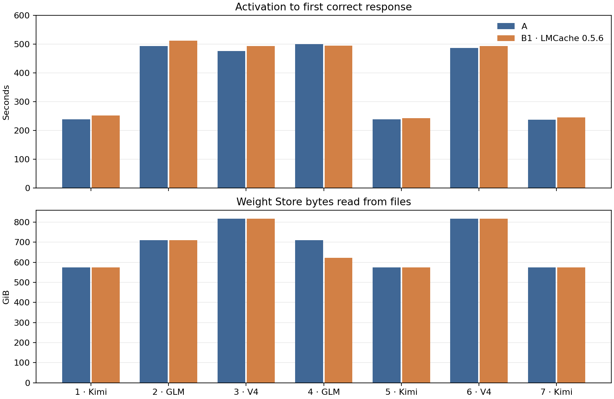
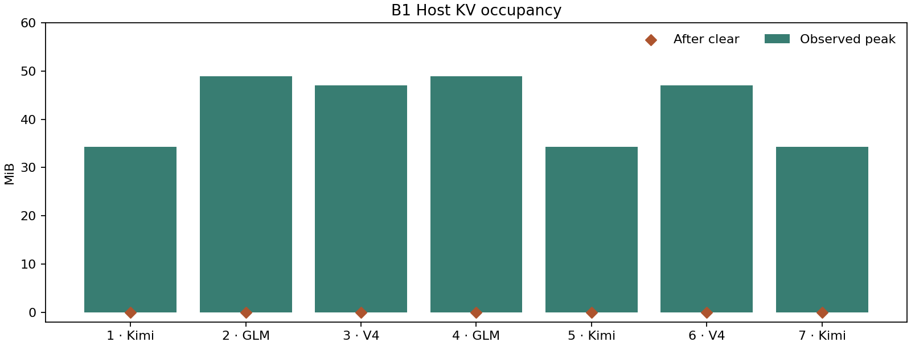

# V11 三模型三路径切换实验报告

本报告由 `make_report.py` 从各 run 目录的 `qualification.json` 与 `switch-events.csv` 生成，数字全部来自原生证据，未通过项照实列出。

| 组 | 状态 | 结论来源 |
|---|---|---|
| A | 通过（4/4 个 run 通过） | `runs/*/qualification.json` |
| B1 | 部分通过（8/24 个 run 通过） | `runs/*/qualification.json` |
| B2 | 部分通过（5/11 个 run 通过） | `runs/*/qualification.json` |

## 同序列七段实测图表

### 图 1　A 与 B1 的激活耗时及权重读取



上图从激活计到首个正确响应。下图是 Store 记录的文件读取字节。V4 显存利用率分别为 0.90 和 0.76。

### 图 2　B1 Host KV 写入与清理



LMCache 0.5.6 每段提交 512 个 KV token，查询零命中，清理后占用均为零。

### 图 3　B2-L2 原 Worker 唤醒


四次返回包含权重映射、checkpoint 重载和 KV 唤醒，计时止于唤醒回执。金标随后验证。

图表使用 A `035857Z`、B1 `052724Z` 和 B2-L2 `012344Z`。在仓库根目录运行 `python v11/plot_v11.py` 重画。

## A 组结果（SLLM Store）

### 序列汇总

| run | 序列 | 段数 | full_hit | partial_hit | full_miss | 平均切换(不含观察) | 最终释放 |
|---|---|---|---|---|---|---|---|
| `A-seq-10-1-r1-20261111T142600Z` | seq-10-1 | 11 | 2 | 0 | 9 | 389.1 s | 59.4 s |
| `A-seq-7-1-r1-20261111T081622Z` | seq-7-1 | 8 | 1 | 1 | 6 | 408.6 s | 59.7 s |
| `A-seq-7-agents-r1-20261113T035857Z` | seq-7-agents | 7 | 0 | 0 | 7 | 421.4 s | 60.8 s |
| `A-seq-8-1-r1-20261111T120359Z` | seq-8-1 | 9 | 2 | 0 | 7 | 347.8 s | 59.5 s |

说明：A 的"激活→正确"包含新进程从 Store 恢复权重（1 TiB 池、32 MiB 块）+ 8 卡引擎初始化 + 答题，所以即使 full_hit 也是百秒量级；命中只省掉磁盘读取，不省进程与引擎拉起。

campaign 覆盖（4 个通过的 A run 合计）：`D→G` 4、`D→K` 4、`G→D` 5、`G→K` 4、`K→D` 4、`K→G` 5；自切换 9 次单独统计 —— 最小非自方向计数 4。

### `A-seq-10-1-r1-20261111T142600Z` — 通过

序列 `seq-10-1`，11/11 段完成，protocol_hash `d6b76f45627bcdd5032ad4a579fa5abf032de44fb60d5b04eaeb202d6f59b5f7`（暂定），最终释放 59.4 s、8 卡全 0 = True。

| step | 迁移 | 缓存 | 读取 | 命中 | 块分配/释放 | 驱逐 | 激活→正确 (s) | 首 token (s) | 切换不含观察 (s) |
|---|---|---|---|---|---|---|---|---|---|
| 0 | ∅→K | full_miss | 574.6 GiB | 0 | 18392/0 | 0 | 273.8 | 269.6 | — |
| 1 | K→K | full_hit | 0 | 574.6 GiB | 0/0 | 0 | 146.0 | 142.0 | 165.7 |
| 2 | K→G | full_miss | 710.2 GiB | 0 | 22728/9196 | 4 | 505.5 | 493.2 | 529.4 |
| 3 | G→D | full_miss | 817.4 GiB | 0 | 26552/26242 | 10 | 481.3 | 469.3 | 498.1 |
| 4 | D→K | full_miss | 574.6 GiB | 0 | 18392/17903 | 217 | 239.7 | 235.7 | 254.7 |
| 5 | K→K | full_hit | 0 | 574.6 GiB | 0/0 | 0 | 142.4 | 138.5 | 156.9 |
| 6 | K→D | full_miss | 817.4 GiB | 0 | 26552/28125 | 287 | 478.0 | 465.9 | 496.5 |
| 7 | D→G | full_miss | 710.2 GiB | 0 | 22728/21154 | 302 | 501.9 | 489.8 | 515.4 |
| 8 | G→K | full_miss | 574.6 GiB | 0 | 18392/18519 | 199 | 236.1 | 232.0 | 253.0 |
| 9 | K→G | full_miss | 710.2 GiB | 0 | 22728/23401 | 9 | 498.7 | 486.3 | 522.8 |
| 10 | G→D | full_miss | 817.4 GiB | 0 | 26552/26242 | 10 | 481.4 | 469.3 | 498.8 |

Store 进程: 1885780（同一进程贯穿全部激活）。

### `A-seq-7-1-r1-20261111T081622Z` — 通过

序列 `seq-7-1`，8/8 段完成，protocol_hash `d6b76f45627bcdd5032ad4a579fa5abf032de44fb60d5b04eaeb202d6f59b5f7`（暂定），最终释放 59.7 s、8 卡全 0 = True。

| step | 迁移 | 缓存 | 读取 | 命中 | 块分配/释放 | 驱逐 | 激活→正确 (s) | 首 token (s) | 切换不含观察 (s) |
|---|---|---|---|---|---|---|---|---|---|
| 0 | ∅→K | full_miss | 574.6 GiB | 0 | 18392/0 | 0 | 229.7 | 225.6 | — |
| 1 | K→G | full_miss | 710.2 GiB | 0 | 22728/9196 | 4 | 495.5 | 483.3 | 510.6 |
| 2 | G→D | full_miss | 817.4 GiB | 0 | 26552/26242 | 10 | 474.4 | 462.3 | 489.0 |
| 3 | D→G | full_miss | 710.2 GiB | 0 | 22728/22238 | 302 | 489.7 | 477.4 | 502.0 |
| 4 | G→G | full_hit | 0 | 710.2 GiB | 0/0 | 0 | 382.5 | 370.5 | 396.9 |
| 5 | G→K | full_miss | 574.6 GiB | 0 | 18392/18519 | 199 | 227.1 | 223.2 | 241.7 |
| 6 | K→D | full_miss | 817.4 GiB | 0 | 26552/27999 | 11 | 475.9 | 463.9 | 490.4 |
| 7 | D→K | partial_hit | 502.8 GiB | 71.8 GiB | 16093/14520 | 216 | 217.7 | 213.9 | 229.9 |

Store 进程: 3543615（同一进程贯穿全部激活）。

### `A-seq-7-agents-r1-20261113T035857Z` — 通过

序列 `seq-7-agents`，7/7 段完成，protocol_hash `d6b76f45627bcdd5032ad4a579fa5abf032de44fb60d5b04eaeb202d6f59b5f7`（暂定），最终释放 60.8 s、8 卡全 0 = True。

| step | 迁移 | 缓存 | 读取 | 命中 | 块分配/释放 | 驱逐 | 激活→正确 (s) | 首 token (s) | 切换不含观察 (s) |
|---|---|---|---|---|---|---|---|---|---|
| 0 | ∅→K | full_miss | 574.6 GiB | 0 | 18392/0 | 0 | 237.7 | 233.7 | — |
| 1 | K→G | full_miss | 710.2 GiB | 0 | 22728/9196 | 4 | 492.9 | 480.4 | 509.1 |
| 2 | G→D | full_miss | 817.4 GiB | 0 | 26552/26242 | 10 | 475.4 | 463.4 | 491.4 |
| 3 | D→G | full_miss | 710.2 GiB | 0 | 22728/22238 | 302 | 499.5 | 486.9 | 513.6 |
| 4 | G→K | full_miss | 574.6 GiB | 0 | 18392/18519 | 199 | 237.9 | 233.9 | 256.1 |
| 5 | K→D | full_miss | 817.4 GiB | 0 | 26552/27999 | 11 | 486.7 | 474.5 | 504.4 |
| 6 | D→K | full_miss | 574.6 GiB | 0 | 18392/16819 | 217 | 236.7 | 232.6 | 254.1 |

Store 进程: 2992915（同一进程贯穿全部激活）。

### `A-seq-8-1-r1-20261111T120359Z` — 通过

序列 `seq-8-1`，9/9 段完成，protocol_hash `d6b76f45627bcdd5032ad4a579fa5abf032de44fb60d5b04eaeb202d6f59b5f7`（暂定），最终释放 59.5 s、8 卡全 0 = True。

| step | 迁移 | 缓存 | 读取 | 命中 | 块分配/释放 | 驱逐 | 激活→正确 (s) | 首 token (s) | 切换不含观察 (s) |
|---|---|---|---|---|---|---|---|---|---|
| 0 | ∅→D | full_miss | 817.4 GiB | 0 | 26552/0 | 0 | 472.2 | 460.2 | — |
| 1 | D→G | full_miss | 710.2 GiB | 0 | 22728/16556 | 300 | 488.7 | 476.5 | 501.4 |
| 2 | G→D | full_miss | 817.4 GiB | 0 | 26552/27042 | 202 | 471.7 | 459.6 | 486.0 |
| 3 | D→K | full_miss | 574.6 GiB | 0 | 18392/17903 | 217 | 226.5 | 222.5 | 239.5 |
| 4 | K→G | full_miss | 710.2 GiB | 0 | 22728/23527 | 285 | 491.1 | 478.9 | 507.1 |
| 5 | G→K | full_miss | 574.6 GiB | 0 | 18392/17719 | 7 | 228.3 | 224.4 | 243.6 |
| 6 | K→K | full_hit | 0 | 574.6 GiB | 0/0 | 0 | 141.4 | 137.4 | 157.1 |
| 7 | K→K | full_hit | 0 | 574.6 GiB | 0/0 | 0 | 146.0 | 142.1 | 161.7 |
| 8 | K→D | full_miss | 817.4 GiB | 0 | 26552/27999 | 11 | 471.1 | 459.2 | 486.3 |

Store 进程: 889517（同一进程贯穿全部激活）。

## B1 组结果（Host KV 层）

验收逐段核对真实 STORE 提交、零命中、清理归零。历史缺测及失败见 `B1-FAILED.md`。

### `B1-B1-smoke-r1-20261113T051124Z` — Host KV 闭环通过

LMCache 0.5.6，源码 `3e11e108`，补丁 SHA-256 `06ebf7c03c32251bb5324427484fbb6a8ed5eb42c18d8ab61817688a0fc97a09`。
最终八卡归零采样跨度 60.765 秒。

| step | 模型 | 读取 | Host 写入前 | Host 清理后 | clear 状态 | clear (s) |
|---|---|---|---|---|---|---|
| 0 | K | 574.6 GiB | 34.3 MiB | 0 | 200 | 0.0 |

### `B1-seq-7-agents-r1-20261112T144041Z` — Host KV 闭环通过

LMCache 0.5.5，源码 `05a013b`，补丁 SHA-256 `06ebf7c03c32251bb5324427484fbb6a8ed5eb42c18d8ab61817688a0fc97a09`。
最终八卡归零采样跨度 59.504 秒。

| step | 模型 | 读取 | Host 写入前 | Host 清理后 | clear 状态 | clear (s) |
|---|---|---|---|---|---|---|
| 0 | K | 574.6 GiB | 34.3 MiB | 0 | 200 | 0.0 |
| 1 | G | 710.2 GiB | 48.9 MiB | 0 | 200 | 0.0 |
| 2 | D | 817.4 GiB | 47.1 MiB | 0 | 200 | 0.0 |
| 3 | G | 621.4 GiB | 48.9 MiB | 0 | 200 | 0.0 |
| 4 | K | 574.6 GiB | 34.3 MiB | 0 | 200 | 0.0 |
| 5 | D | 817.4 GiB | 47.1 MiB | 0 | 200 | 0.0 |
| 6 | K | 574.6 GiB | 34.3 MiB | 0 | 200 | 0.0 |

### `B1-seq-7-agents-r1-20261113T052724Z` — Host KV 闭环通过

LMCache 0.5.6，源码 `3e11e108`，补丁 SHA-256 `06ebf7c03c32251bb5324427484fbb6a8ed5eb42c18d8ab61817688a0fc97a09`。
最终八卡归零采样跨度 60.866 秒。

| step | 模型 | 读取 | Host 写入前 | Host 清理后 | clear 状态 | clear (s) |
|---|---|---|---|---|---|---|
| 0 | K | 574.6 GiB | 34.3 MiB | 0 | 200 | 0.0 |
| 1 | G | 710.2 GiB | 48.9 MiB | 0 | 200 | 0.0 |
| 2 | D | 817.4 GiB | 47.1 MiB | 0 | 200 | 0.0 |
| 3 | G | 621.4 GiB | 48.9 MiB | 0 | 200 | 0.0 |
| 4 | K | 574.6 GiB | 34.3 MiB | 0 | 200 | 0.0 |
| 5 | D | 817.4 GiB | 47.1 MiB | 0 | 200 | 0.0 |
| 6 | K | 574.6 GiB | 34.3 MiB | 0 | 200 | 0.0 |

## B2 组结果（原生 Sleep，L1/L2 同组）

### `B2-B2-smoke-r1-20261111T110231Z` — 未通过

序列 `B2-smoke`，level [1]，最终释放 59.9 s、8 卡全 0 = True。

失败记录：

```
AssertionError('worker exited before ack')
```

### `B2-B2-smoke-r1-20261111T112107Z` — 运行器通过，严格释放门槛未达

序列 `B2-smoke`，level [1]，最终释放 42.3 s、8 卡全 0 = False。

| level | step | 模型 | 阶段 | 加载或唤醒 (s) | 重载 RPC (s) | sleep (s) | 权重 CPU 备份 | 权重 | KV | Worker PID |
|---|---|---|---|---|---|---|---|---|---|---|
| 1 | 0 | D | load | 522.0 | — | 72.8 | 820.4 GiB | 820.4 GiB | 218.2 GiB | 813729 |
| 1 | 1 | D | wake | 3.6 | 0.0 | 3.6 | 820.4 GiB | 820.4 GiB | 218.2 GiB | 813729 |

level 1: PID 连续性 = True，金标 = True，PID {'D': [813729]}

### `B2-B2-smoke-r1-20261111T113723Z` — 运行器通过，严格释放门槛未达

序列 `B2-smoke`，level [1]，最终释放 59.9 s、8 卡全 0 = True。

| level | step | 模型 | 阶段 | 加载或唤醒 (s) | 重载 RPC (s) | sleep (s) | 权重 CPU 备份 | 权重 | KV | Worker PID |
|---|---|---|---|---|---|---|---|---|---|---|
| 1 | 0 | D | load | 447.2 | — | 47.4 | 820.4 GiB | 820.4 GiB | 218.2 GiB | 840589 |
| 1 | 1 | D | wake | 3.9 | 0.0 | 4.1 | 820.4 GiB | 820.4 GiB | 218.2 GiB | 840589 |

level 1: PID 连续性 = True，金标 = True，PID {'D': [840589]}

### `B2-B2-smoke-r1-20261111T115102Z` — 未通过

序列 `B2-smoke`，level [2]，最终释放 59.7 s、8 卡全 0 = True。

失败记录：

```
AssertionError('worker exited before ack')
```

### `B2-B2-smoke-r1-20261112T005532Z` — 未通过

序列 `B2-smoke`，level [2]，最终释放 59.8 s、8 卡全 0 = True。

失败记录：

```
AssertionError('worker exited before ack')
```

### `B2-B2-smoke-r1-20261112T160706Z` — 未通过

序列 `B2-smoke`，level [2]，最终释放 59.1 s、8 卡全 0 = True。

失败记录：

```
AssertionError('worker exited before ack')
```

### `B2-B2-smoke-r1-20261113T001803Z` — 未通过

序列 `B2-smoke`，level [2]，最终释放 59.9 s、8 卡全 0 = True。

失败记录：

```
AssertionError('no ready')
```

### `B2-B2-smoke-r1-20261113T001929Z` — 未通过

序列 `B2-smoke`，level [2]，最终释放 59.9 s、8 卡全 0 = True。

失败记录：

```
RuntimeError('(\'docker\', \'create\', \'--network\', \'host\', \'--ipc\', \'host\', \'--pid\', \'host\', \'--gpus\', \'"device=GPU-901a39d6-debb-a126-3079-f1e2f9d4fc81,GPU-a3baf382-35c8-8748-626a-f69745aab5f8,GPU-1e269bc5-8466-4c75-a1b5-2fe52da4b771,GPU-fa6a72c0-dc98-2006-973f-a38e93672cbb,GPU-7e6158f3-be3a-4b12-5698-ab008c6f5f8e,GPU-151684e8-c7ba-a20a-6955-e1f765940536,GPU-af5f5c7a-0dce-f291-99b
```

### `B2-B2-smoke-r1-20261113T002126Z` — 运行器通过，严格释放门槛未达

序列 `B2-smoke`，level [2]，最终释放 58.9 s、8 卡全 0 = True。

| level | step | 模型 | 阶段 | 加载或唤醒 (s) | 重载 RPC (s) | sleep (s) | 权重 CPU 备份 | 权重 | KV | Worker PID |
|---|---|---|---|---|---|---|---|---|---|---|
| 2 | 0 | D | load | 383.5 | — | 1.7 | 0 | 820.4 GiB | 127.7 GiB | 2309748 |
| 2 | 1 | D | wake | 94.4 | 91.9 | 1.8 | 0 | 820.4 GiB | 127.7 GiB | 2309748 |

level 2: PID 连续性 = True，金标 = True，PID {'D': [2309748]}

### `B2-B2-smoke-r1-20261113T003454Z` — 通过

序列 `B2-smoke`，level [2]，最终释放 61.0 s、8 卡全 0 = True。

| level | step | 模型 | 阶段 | 加载或唤醒 (s) | 重载 RPC (s) | sleep (s) | 权重 CPU 备份 | 权重 | KV | Worker PID |
|---|---|---|---|---|---|---|---|---|---|---|
| 2 | 0 | D | load | 382.5 | — | 1.7 | 0 | 820.4 GiB | 127.7 GiB | 2338566 |
| 2 | 1 | K | load | 1,242.6 | — | 1.3 | 0 | 579.5 GiB | 128.8 GiB | 2356137 |
| 2 | 2 | D | wake | 225.4 | 222.9 | 2.0 | 0 | 820.4 GiB | 127.7 GiB | 2338566 |

level 2: PID 连续性 = True，金标 = True，PID {'D': [2338566], 'K': [2356137]}

### `B2-seq-7-agents-r1-20261113T012344Z` — 通过

序列 `seq-7-agents`，level [2]，最终释放 61.2 s、8 卡全 0 = True。

| level | step | 模型 | 阶段 | 加载或唤醒 (s) | 重载 RPC (s) | sleep (s) | 权重 CPU 备份 | 权重 | KV | Worker PID |
|---|---|---|---|---|---|---|---|---|---|---|
| 2 | 0 | K | load | 774.2 | — | 1.4 | 0 | 579.5 GiB | 128.8 GiB | 2405340 |
| 2 | 1 | G | load | 829.3 | — | 1.5 | 0 | 715.2 GiB | 12.4 GiB | 2417938 |
| 2 | 2 | D | load | 527.1 | — | 1.7 | 0 | 820.4 GiB | 127.7 GiB | 2442464 |
| 2 | 3 | G | wake | 247.9 | 245.9 | 1.4 | 0 | 715.2 GiB | 12.4 GiB | 2417938 |
| 2 | 4 | K | wake | 2,584.6 | 2,582.8 | 1.4 | 0 | 579.5 GiB | 128.8 GiB | 2405340 |
| 2 | 5 | D | wake | 581.5 | 578.6 | 2.0 | 0 | 820.4 GiB | 127.7 GiB | 2442464 |
| 2 | 6 | K | wake | 3,066.8 | 3,064.8 | 1.4 | 0 | 579.5 GiB | 128.8 GiB | 2405340 |

level 2: PID 连续性 = True，金标 = True，PID {'D': [2442464], 'G': [2417938], 'K': [2405340]}

## 两个对比

### 对比一：A（Store 常驻） vs B1（Store + Host KV 层）

同序列 A `A-seq-7-agents-r1-20261113T035857Z` 与 B1 `B1-seq-7-agents-r1-20261113T052724Z`（LMCache 0.5.6）各完成 7 段。两组 V4 显存利用率分别为 0.90 和 0.76。B1 额外执行 Host KV 写入和清理。

| 段 | 模型 | A 激活至正确 (s) | B1 激活至正确 (s) | A Store 命中 | B1 Store 命中 |
|---|---|---:|---:|---:|---:|
| 0 | K | 237.748 | 251.360 | 0 | 0 |
| 1 | G | 492.927 | 511.857 | 0 | 0 |
| 2 | D | 475.364 | 493.011 | 0 | 0 |
| 3 | G | 499.480 | 493.980 | 0 | 88.8 GiB |
| 4 | K | 237.937 | 241.962 | 0 | 0 |
| 5 | D | 486.665 | 492.899 | 0 | 0 |
| 6 | K | 236.709 | 244.918 | 0 | 0 |

两列均为激活至首个正确响应的耗时。差值同时受权重命中状态、显存配置和实现影响。

### 对比二：A（Store 常驻） vs B2（原生 Sleep，L1 / L2 同组）

| 路径 | 同一模型再次可服务所需时间 | 证据 |
|---|---|---|
| A：Store 命中 | 191.7 s（5 次 full_hit 均值） | `runs/A-*/switch-events.csv` |
| A：Store 未命中（冷读/重读） | 394.1 s（30 次 full_miss/partial_hit 均值） | 同上 |
| B2-L1：Sleep → Wake | Sleep 32.0 s 均值，Wake 3.7 s 均值，唤醒后同一 PID 继续答题 | `runs/B2-*/L1/level-result.json` |
| B2-L2 七段 | Sleep 1.5 s（7 段），Wake 1,620.2 s（4 次返回） | `runs/B2-seq-7-agents-*/L2/level-result.json` |

**口径差异（必须一起读）**：A 的计时是"新进程要从 Store 恢复权重 + 引擎初始化 + 答题"，B2 的 sleep/wake 是"同一常驻进程的内存/显存搬移"，两者不是同一件事；报告把两边都列出来，但不把它们的差值包装成单一"加速比"。

### 容量与可行性边界（实测）

- Store 池 1 TiB：同时只放得下一份模型权重；换模型时必然发生真实驱逐（见 A 组驱逐列）。
- B2-L1：1.9 TiB 主机上只能容纳"一份权重备份 + 当前活动模型"；两份备份会把 `MemAvailable` 压到 0.3 GiB（实测），三模型 L1 campaign 在本机不可行，见 `B2-L1-RAM-BOUNDARY.md`。
- B1 七段 `144041Z` 使用带补丁 LMCache 0.5.5 `05a013b`，0.5.6 为依赖回落。实际路径和补丁哈希见 `runs/B1-seq-7-agents-r1-20261112T144041Z/lmcache-patch-identity.json`。
- B2-L2 历史失败见 `B2-L2-FAILED.md`。V4 单模型 `002126Z` 唤醒后金标通过，最终八卡归零采样跨度 58.873 秒。
- B2-L2 同卡短测 `003454Z`：V4 → Kimi → V4 三段金标通过，V4 原八 rank 唤醒 225.437 秒，其中重载 222.863 秒。每 rank KV 池 16 GiB，V4 使用独立补丁和 CUDA 同步诊断。最终 50 个八卡全零采样横跨 61.002 秒。

